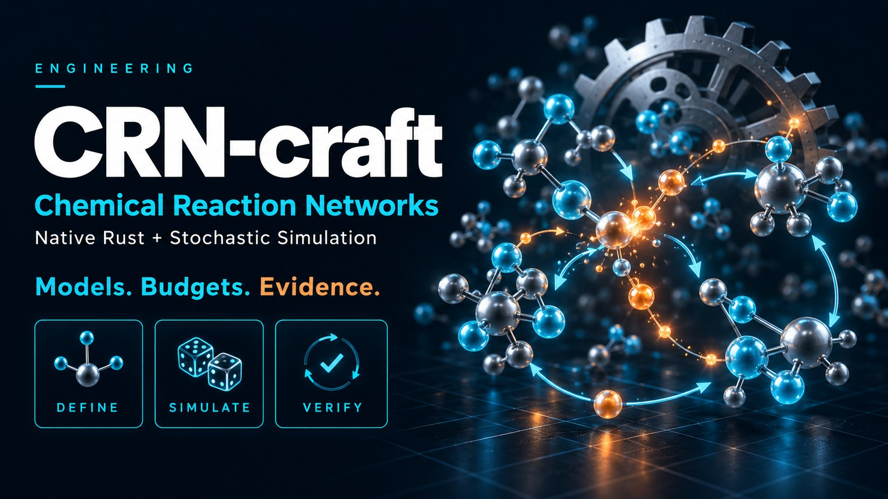

# CRN-craft



Native Rust foundations for well-mixed chemical reaction networks, designed for reproducible simulation and optimization workflows.

**Version 0.2.0.** Install the Python package with `pip install crn-craft` and the native CLI with `cargo install crn-craft-cli --locked`; the libraries are the crates `crn-craft` and `crn-craft-rules`. Optional integrations build from this repository. Native Direct, dependency-cached SSA, DirectCR, SortingDirect and RSSACR, sparse FSP and explicitly approximate Poisson leaps execute. Optional Python bindings, trajectory diagnostics, pinned fcmaes job applications, diffsol BDF/forward sensitivities, global-to-SQP fitting and explicit SBML/BioNetGen import subsets are included. The default Rust engine remains independent of Python, jobs and ODE dependencies. A successful numerical run is not biological validation.

Start with the [tutorial](docs/tutorial.md), the [architecture overview](docs/architecture.md), the [technical report](docs/technical-report.md) (design, validation and measured performance), the [comparison with GillesPy2](docs/comparison-gillespy2.md) and `crn-craft describe`. Every document is listed under [Documentation](#documentation). Legacy input/result/archive contracts remain available; new approximate/FSP results use distinct schemas.

## Optimization tutorials

The [four CRN optimization lessons](tutorials/optimization/README.md) cover reusable stochastic calibration, audited BDF sensitivities, oscillator Pareto/behavior searches, and bounded aggregation inference. Each has executable smoke/study presets, independent checks and held-out validation; the [shared catalog](https://github.com/dietmarwo/optimization-jobs/blob/main/tutorials/simulators/README.md) connects them to CFD and campaign lessons.

## Documentation

**Start here**

- [Tutorial](docs/tutorial.md): from a first model to exact ensembles, FSP, tau leaping and the Python interface, with screenshots and figures
- [Architecture overview](docs/architecture.md): layers, contracts, engines, determinism, archives and integrations
- [Technical report](docs/technical-report.md): numerical methods, validation evidence and measured performance
- [Comparison with GillesPy2](docs/comparison-gillespy2.md): same models, timed against GillesPy2's C++ and NumPy solvers
- [Alternative exact SSA methods](docs/alternative-ssa.md): versioned requests, prepared Python calls, bounded sampling and gated RSSACR bounds
- [Reusable parameter interface and optional generated kernels](docs/reusable-parameters.md): fixed-topology optimization, independent bindings and replay snapshots
- [Complete parameter-optimization comparison](docs/comparison-parameter-optimization.md): fast CRN versus rebop dynamic/macro routes, including compilation and final fit quality
- [Comparison with Catalyst and JumpProcesses](docs/comparison-catalyst-jumpprocesses.md): seven workloads, five Julia SSA algorithms and the new Rust methods, with pinned environments and distribution checks; the [earlier comparison](docs/comparison-catalyst-jumpprocesses-before-acceleration.md) is preserved
- [Ten further Julia-gap iterations](docs/comparison-julia-gap10.md): same-host GitHub-main/final/Julia rerun, all methods, exposed regressions and [inspected Julia mechanisms](docs/campaign/julia-gap10-source-investigation.md)
- [Fast mode versus Julia at one and eight threads](docs/comparison-julia-8-threads.md): direct same-host measurement of `fast` against five JumpProcesses methods, 2,240 timed observations, scaling and replay checks
- [Agent context](docs/ai-context.md): what an AI agent needs to use and extend CRN-craft
- [Dynamic, attributed species (experimental)](docs/rules-language.md): rule-based models whose species appear and disappear (mtDNA clones, aggregation), with [K1 law gates](validation/rules/RESULTS.md)
- [Three-class mtDNA ensembles](docs/mtdna-rules.md): parallel Python ensembles, event trackers and callbacks, Static Direct, a specialized fixed-population sampler, next reaction, approximate tau and binomial steps, and ATP-coupled thinning ([review log](docs/campaign/mtdna-a0-a6-review-log-2026-11-03.md))

**Using CRN-craft**

- [Direct SSA](docs/direct-ssa.md): exact simulation, termination states and budgets
- [Result 0.2 and archive 0.1](docs/archive-contract.md): sealed result directories and the verifier
- [Input and analysis contracts](docs/contracts.md): models, runs and analysis reports
- [Results and claims](docs/result-contract.md): what a result does and does not establish
- [Diagnostics](docs/diagnostics.md): every error and warning code
- [Compiled networks and analysis](docs/network-api.md): the Rust network API
- [Conservation cones and reaction graphs](docs/m1b-analysis.md): exact analysis and its limits
- [GillesPy2 reference export](docs/reference-export.md): exporting models for cross-checks
- [Extending the project](docs/extending.md): how to add rate laws, methods and evidence

**Model and algorithm cards**

- [Card template](docs/model-cards/README.md)
- [Direct SSA card](docs/model-cards/direct.md)
- [Rate-law contracts](docs/model-cards/rate-laws.md)

**Campaign M3–M10 and performance iterations**

- [Campaign guide](docs/campaign/README.md) and [acceptance plan](docs/campaign/acceptance.md)
- [M3: finite state projection](docs/campaign/M3.md)
- [M4a: same-host Direct baseline](docs/campaign/M4a.md) and [M4b: dependency-cached Direct](docs/campaign/M4b.md)
- [M5: Python and circuit workflows](docs/campaign/M5.md)
- [M6: job SDK and optimization studies](docs/campaign/M6.md)
- [M7 targets](docs/campaign/M7-targets.md) and [M7: BDF, sensitivities, fitting and screening](docs/campaign/M7.md)
- [M8: import subsets](docs/campaign/M8.md)
- [M9 targets](docs/campaign/M9-targets.md) and [M9: approximate Poisson leaping](docs/campaign/M9.md)
- [M10: installation and release preparation](docs/campaign/M10.md)
- [Performance experiments P01–P10](docs/campaign/performance.md) and [P11–P20](docs/campaign/performance-p11-p20.md)
- [Campaign implementation log](docs/campaign/implementation-log-2026-11-01.md) and [review of 1 November 2026](docs/campaign/review-2026-11-01.md)
- [Exact-SSA acceleration log](docs/campaign/ssa-acceleration-implementation-log-2026-11-02.md) and [Julia-gap campaign log](docs/campaign/julia-gap-implementation-log-2026-11-02.md)
- [Ten further iterations implementation log](docs/campaign/julia-gap10-implementation-log-2026-11-02.md), [fixed protocol](docs/decisions/julia-gap10-2026-11-02.md) and [raw evidence](validation/julia-gap10/README.md)
- [The `fast` switch: implementation log](docs/campaign/fast-implementation-log-2026-11-02.md), with evidence in `validation/fast/`
- [Rules engine K0/K1: implementation log](docs/campaign/rules-k1-implementation-log-2026-11-02.md), [protocol](docs/decisions/rules-k0-k1-2026-11-02.md) and [results](validation/rules/RESULTS.md)

**Plans and decisions**

- [Implementation plan, revision 2](docs/implementation-plan-2026-11-01.md)
- [M0 design decisions](docs/decisions/plan.md) and [statistical verification policy](docs/decisions/statistics.md)
- Acceptance declared before implementation: [iteration 2](docs/decisions/iteration-02-validation.md), [iteration 3](docs/decisions/iteration-03-validation.md), [iteration 4](docs/decisions/iteration-04-validation.md), [iteration 4 CME review check](docs/decisions/iteration-04-review-cme.md)
- Julia comparison and SSA acceleration protocols: [first Julia comparison](docs/decisions/julia-comparison-2026-11-02.md), [exact-SSA acceleration](docs/decisions/ssa-acceleration-2026-11-02.md), [closing the Julia gap](docs/decisions/julia-gap-2026-11-02.md)

**Implementation logs and validation results**

- Implementation logs: [iteration 1](docs/iteration-01-implementation-log.md), [iteration 2](docs/iteration-02-implementation-log.md), [iteration 3](docs/iteration-03-implementation-log.md), [iteration 4](docs/iteration-04-implementation-log.md)
- Validation results: [summary](validation/RESULTS.md), [iteration 2](validation/iteration-02/RESULTS.md), [iteration 3](validation/iteration-03/RESULTS.md), [iteration 4](validation/iteration-04/RESULTS.md)

**Project**

- [Changelog](CHANGELOG.md), [releasing](RELEASING.md) and [agent working rules](AGENTS.md)

## Quick start

Requires Rust 1.85 or newer. From this directory:

```bash
cargo build --release --workspace --locked
./target/release/crn-craft describe
./target/release/crn-craft describe model
./target/release/crn-craft check models/examples/immigration-death.model.json models/examples/immigration-death.run.json
./target/release/crn-craft analyze models/examples/enzyme-mechanism.model.json
./target/release/crn-craft analyze models/examples/immigration-death.model.json models/examples/immigration-death.state.json
./target/release/crn-craft analyze models/analysis/cone-gap.model.json
./target/release/crn-craft export models/examples/enzyme-mechanism.model.json gillespy2
./target/release/crn-craft simulate models/examples/immigration-death.model.json models/examples/immigration-death.run.json /tmp/crn-ssa-example
./target/release/crn-craft verify /tmp/crn-ssa-example
cargo test --release --workspace --locked
```

`check` emits JSON with `valid`, `execution_available: false`, hashes and diagnostics. `analyze MODEL [STATE]` emits `crn-craft.analysis/0.2` with indexed stoichiometry, evaluated rates, conservation cones, linkage classes and structural deficiency. `analyze-v1` retains the 0.1 report. `export MODEL gillespy2` returns generated Python in a JSON report; it does not execute that source. Without STATE it uses initial counts; otherwise STATE must name every species. These commands exit **0** on success and **1** for invalid inputs, usage, I/O or numerical errors. Warnings do not change exit 0. Conservation size/overflow limits are explicit partial-analysis warnings. `simulate MODEL RUN NEW_DIRECTORY [--cancel-file PATH]` writes result 0.2 and archive 0.1. It exits 0 only for a completed ensemble; incomplete work exits 1 with evidence when finalization succeeds. `verify DIRECTORY` exits 0 for a valid archive even if the simulation is incomplete. The output directory must be new. Read the [Direct SSA guide](docs/direct-ssa.md) and [archive contract](docs/archive-contract.md). Historical preflight/analysis flags remain unchanged; use `describe` for executable capabilities.

```json
{
  "severity": "error",
  "code": "CRN-E014",
  "path": "/reactions/0/rate/coefficient",
  "message": "unknown parameter \"missing\"",
  "hint": "Declare the parameter or provide a numeric literal."
}
```

## What is included

| Component | Implemented now |
|---|---|
| Rust library and CLI | Strict JSON parsing, typed contracts, semantic preflight checks, generated schemas |
| Network core | Immutable indices, sparse stoichiometry, availability gates, dependencies, transactional checked updates |
| Rate evaluation | Stochastic mass action, Hill activation/repression and Michaelis–Menten; finite-range diagnostics |
| Analyzer | Exact linear basis and nonnegative cone within explicit limits; complete conservation bounds when the cone succeeds; linkage/SCC/terminal classes and deficiency |
| Reference exporter | GillesPy2 1.8.3 elementary mass action, explicit homodimer conversion, fixed count convention and safe aliases |
| Models | Immigration–death; explicit enzyme mechanism; reduced Michaelis–Menten; complete three-gene repressilator |
| Simulator | Direct SSA; pinned ChaCha8 streams; deterministic ordered ensembles; mean/sample variance/mean SE; event, population, wall-time and output limits; cooperative cancellation |
| Results | Exact input snapshots, complete replicate accounting, checksummed archives and a marker written last; independent verifier |
| FSP | Reachable sparse projection, escaping sink, stable split uniformization, separate leakage/series/roundoff accounting |
| Experimental approximation | Checked Poisson leaps, critical Direct fallback, own approximate result schema |
| Optional applications | Python diagnostics/importers; native fcmaes worker; diffsol BDF and sensitivities; global-to-SQP fitting |
| Evidence | Rust regression tests, 13 invalid fixtures, independent exact/Decimal oracle for 200 seeded networks, 300-network exact cone/graph oracle with five targeted models, 45 source mutations against a passing baseline, three 100,000-path analytic campaigns, four 100,000-path exact master-equation checks of second-order, Hill and Michaelis–Menten channels, thread identity and real GillesPy2 exporter checks, schema and dependency gates |
| Documentation | Revised plan, diagnostics, rate conventions, statistical policy, extension/model-card templates and agent guide |

Unknown fields and duplicate JSON keys are errors. Names are unique ASCII identifiers. Counts are checked i64 values. Rate parameters have finite domains. Custom rates are complete propensities, with separate reactant-availability gates. No extra mass-action factor is applied to a custom law.

`CompiledNetwork` exposes pure rate evaluation and an atomic `fire_reaction` operation without a clock or random generator. Conservation arithmetic uses checked i128; unavailable results never imply absence of laws. Derived bounds describe the **initial conservation class**, even when rates are evaluated at another state. Read [the network API](docs/network-api.md), [M1b analysis limits](docs/m1b-analysis.md) and [reference export guide](docs/reference-export.md).

`run.model.sha256` identifies the model's exact bytes. Model paths are relative to the **run file directory**, must stay below it, and must resolve to the same model supplied to `check`. Reformatting a model changes its hash. Recompute after reviewing an intentional edit:

```bash
sha256sum models/examples/immigration-death.model.json
```

Copy the returned digest into the corresponding run file. Do not assume that semantically equivalent JSON has the same byte identity. The repository's `.gitattributes` keeps LF line endings in every checkout, so the example hashes also hold with Git for Windows' `core.autocrlf=true`.

## Exact SSA methods and the `fast` switch

Besides the legacy `simulate`/`simulate-cached` archives, `crn-craft ssa MODEL REQUEST`
runs five exact methods (`direct`, `cached_direct`, `direct_cr`, `sorting_direct`,
`rssa_cr`) with inverse or Ziggurat waits; see [alternative exact SSA methods](docs/alternative-ssa.md).
The switch `method.fast` selects between two numerical policies. It is **on by
default** in `crn-craft.ssa-run/0.3` requests, which `crn.ssa_spec` writes:

```json
"method": {"kind": "ssa", "aggregator": "direct_cr", "waiting_time": "ziggurat", "fast": true}
```

```python
request = crn.ssa_spec(model, aggregator="cached_direct", waiting_time="ziggurat")             # fast
checked = crn.ssa_spec(model, aggregator="cached_direct", waiting_time="ziggurat", fast=False)  # checked
result = crn.simulate_ssa(model, request)
```

`fast` emulates what JumpProcesses.jl (and GillesPy2) do; `fast: false` is the
checked policy:

| | `fast: false` (checked) | `fast: true` (default in 0.3) |
|---|---|---|
| Random words | ChaCha8, keyed per replicate | Xoshiro256++ per replicate (Julia's generator), seeded from its own keyed stream |
| Totals | Exact pairwise tree or ordered sums, rebuilt without drift | Running totals updated by `+= new - old` (Direct: additions only), recomputed from the leaves every 65,536 updates |
| Per-event checks | Rejects lost positive increments and channels below the 53-bit selection resolution | None |
| Stop polling | Before every random word | Every 256 event-loop iterations and on rejection retries |
| Kept in both | Exact selection for the totals in use, checked state updates, population/event/sampling budgets, cancellation, replay independent of the thread count | |

`fast` made the new methods 1.09–4.3 times faster on the seven benchmark
networks (W1–W7, `validation/fast/fast-vs-default.json`) and passes its own
210-comparison exact-law gate (100,000 paths per fixture). Its sampler identity
is `xoshiro256pp-u53/<method>/<wait>/fast-1`, so its paths differ from the
checked policy and replay only with the same setting. Results answer with
`crn-craft.ssa-result/0.3` and always state `fast`.

**Why `fast` is the default, and when to turn it off.** Most models have
well-scaled rates, where both policies sample the same law and `fast` is
1.09–4.3 times quicker; it is also the policy of the tools CRN-craft is
compared with. Set `fast: false` when a model's rates span more than about 16
orders of magnitude, when runs are very long, or when a result must carry the
checked guarantees: no positive channel silently loses its probability to
rounding, totals carry no accumulated drift, and a cancellation request is
seen before the next random word is drawn. Without those checks a tiny channel
can silently never fire and a running total can drift, and neither is visible
in a result.

**Earlier requests keep their meaning.** `crn-craft.ssa-run/0.1` has no `fast`
and stays checked; `crn-craft.ssa-run/0.2` keeps `fast` off unless it is set.
Both return the same bytes as before (`ssa-result/0.1` and `0.2`). The legacy
`simulate`/`simulate-cached` archives always use checked Direct.

**Benchmarks use `fast`.** Julia and GillesPy2 make none of the checked
policy's checks, so comparisons time CRN-craft with `fast: true` and report the
checked policy alongside. With `fast`, CRN-craft is 2.9–9.2 times faster than GillesPy2's C++
solver on W1–W4 ([comparison](docs/comparison-gillespy2.md)). Measured directly
against JumpProcesses.jl on one host ([comparison](docs/comparison-julia-8-threads.md)),
the best fast method takes 0.69 times the time of Julia's best method at eight
workers on the original W1–W7 batches (geometric mean; lower on 6 of 7) and
1.04 times on 256-path batches. At one worker the same run gives 1.15 and 1.12
times, so the earlier projection of 1.02 from serial timings was optimistic.

## Dynamic, attributed species (experimental)

Some models cannot list their species in advance: every mitochondrial mutant
is its own clone, clusters have a size, polymers a length. The rules engine
(`crn-craft-rules`) simulates them exactly. Species *types* carry numeric
*attributes*; instances appear when a rule produces a new attribute vector and
vanish when their count reaches zero. A rule is a schema over zero, one or two
reactant patterns with a global rate over observables and local factors over
attributes:

```json
{"name": "mutation",
 "reactants": [{"label": "x", "type": "mtDNA", "where": "x.wt == 1", "factor": "x.s * mu"}],
 "rate": "max(0, K - N) / D",
 "products": [{"type": "mtDNA", "copy": "x"},
              {"type": "mtDNA", "attributes": {"clone": "new_id()", "s": "choice(fracAdv, sm, sw)", "wt": 0}}]}
```

```bash
crn-craft rules-check models/rules/mtdna-fixed.rules.json
crn-craft rules MODEL REQUEST [--cancel-file PATH]
```

K1 passes 30 exact-law comparisons over 100,000 replicates each (Kowald's
fixed-population mtDNA model, constant and multiplicative aggregation kernels,
immigration–death and immigration–dimerization, the last also against the
network engine) and rejects every wrong law it was given. The three-class mtDNA
work adds the Python ensemble API, event observation, alternative methods and
the ATP-coupled variable-population model with its own gates; see
[docs/mtdna-rules.md](docs/mtdna-rules.md) and the
[language reference](docs/rules-language.md).

## Developer checks

```bash
cargo fmt --all -- --check
cargo clippy --workspace --all-targets --locked -- -D warnings
cargo test --release --workspace --locked
python3 -m pip install -r validation/requirements.txt
python3 -m ruff format --check validation
python3 -m ruff check validation
python3 validation/check_dependencies.py
python3 validation/check_contracts.py
python3 -O validation/check_contracts.py
python3 validation/check_network.py --output network.json
python3 -O validation/check_network.py --output network-optimized.json
diff network.json network-optimized.json
python3 validation/check_structure.py --output structure.json
python3 -O validation/check_structure.py --output structure-optimized.json
diff structure.json structure-optimized.json
python3 validation/reference_rng.py
python3 validation/check_ssa.py --output ssa.json
python3 -O validation/check_ssa.py --output ssa-optimized.json
diff ssa.json ssa-optimized.json
python3 validation/check_cme.py --output cme.json
python3 -O validation/check_cme.py --output cme-optimized.json
diff cme.json cme-optimized.json
python3 validation/mutation_check.py
python3 validation/check_rules.py --output rules.json
python3 -O validation/check_rules.py --output rules-optimized.json
diff rules.json rules-optimized.json
```

The optional real-reference checks use a separate Python environment:

```bash
python3 -m venv .venv-reference
.venv-reference/bin/pip install -r validation/reference-requirements.txt
.venv-reference/bin/python validation/check_export.py
.venv-reference/bin/python -O validation/check_export.py
```

The eleven original schema snapshots are preserved, and three new native schemas are compared with the CLI. Model/run/check/state, analysis 0.2, legacy analysis 0.1 and export 0.1 remain unchanged. Reserved result 0.1 is retained as `result-v1`; real simulation results use 0.2. Archive and archive-check are 0.1; discovery is 0.5. Strict parsers and semantic checks remain mandatory. The optional exporter checker runs a short GillesPy2 smoke test; the independent SSA campaign validates CRN-craft against declared analytic distributions, and `check_cme.py` against exact master-equation laws for nonlinear and custom rates.

GitHub Actions is configured for fmt, clippy and release tests on Rust 1.85.0, 1.88.0 and stable; dependency, schema/CLI and independent network/structure/SSA/CME checks normally and under Python `-O` with identical reports; source mutation checks; and contract/network/structure/SSA/archive tests with `core.autocrlf=true`. See [iteration 4 evidence](validation/iteration-04/RESULTS.md) for executed local checks. The default build has no C/C++ simulator, Julia or Python runtime dependency. It pins pure-Rust libm for rate evaluation. Python is only needed for independent acceptance checks.

## Campaign and remaining validation

The functional M3–M10 work and ten performance iterations are documented in
[docs/campaign](docs/campaign/README.md), with predeclared gates and retained failures
under validation/campaign. Optional integrations have independent lockfiles/MSRVs.
Release wheels pass the installed-package acceptance on Linux, Windows and macOS
([RELEASING.md](RELEASING.md)); a Julia reference run and broad biological
behavioral validation remain owner/platform-specific work. The circuit demonstrations
are labelled synthetic; detector diagnostics do not establish universal sensitivity.

The ecosystem boundary remains: CRN-craft supplies numerical models; fcmaes searches
parameters; optimization-jobs executes jobs; experiment-craft coordinates campaigns.

Read [the agent context](docs/ai-context.md), [contract details](docs/contracts.md), [diagnostics](docs/diagnostics.md), [archive contract](docs/archive-contract.md) and [release instructions](RELEASING.md) before extending the project. License: MIT; dependencies retain their respective licenses.
