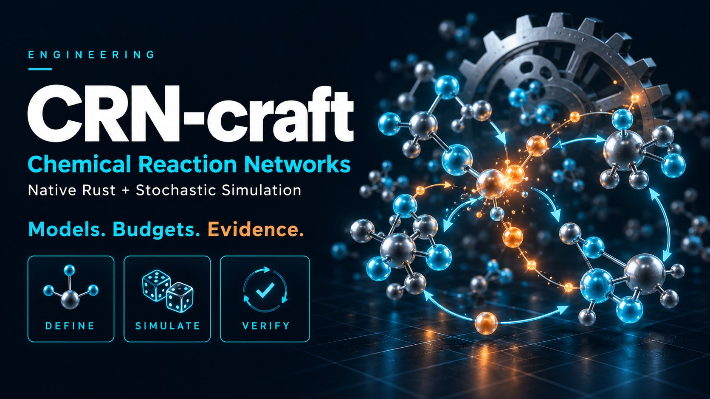

# CRN-craft

<!-- check: standalone -->



> **One of 18 related repositories.** The [repository overview](https://github.com/dietmarwo/fcmaes-rust/blob/main/docs/repositories.md) shows what each one does and how they connect.

CRN-craft simulates chemical reaction networks stochastically, from Python,
with a native engine.

```sh
pip install crn-craft
```

## Example

```python
import crn_craft as crn

model = crn.Model("immigration_death")
model.add_species("A", 0)
model.add_reaction(4.0, [], ["A"], name="birth")  # molecules arrive at rate 4
model.add_reaction(0.2, ["A"], [], name="death")  # each one decays at rate 0.2
run = crn.ensemble(model, end=10.0, report_times=[0.0, 5.0, 10.0],
                   replicates=1000, seed=1, threads=2, method="static_direct")
result = run.simulate()
print(result.statistics["mean"])  # exact: 20 * (1 - exp(-0.2 t)) = 0, 12.64, 17.29
```

```text
           A
time        
0.0    0.000
5.0   12.623
10.0  17.305
```

The 1,000 trajectories ran on two threads in one call, and the same seed
gives the same numbers on any number of threads.

## Why CRN-craft

- **Many trajectories in one call.** An ensemble runs on native threads, and
  the same seed gives the same result on any number of threads.
- **Compiled models from Python.** `crn.compile_loop(model)` compiles a
  model's event loop, and the results stay byte-identical. On 12 November
  2026 the compiled mtDNA model ran 2.1 times as fast as the interpreted one.
- **Exact methods and exact distributions.** Static Direct with five
  selectors, next reaction and finite state projection; approximate methods
  are labeled as approximate.
- **More than reaction networks.** Species with attributes, such as clones,
  sizes and lineages, and continuous variables that rates read.
- **Runs that can be checked.** Strict input checks, explicit budgets, and
  sealed archives with a verifier.

Coming from GillesPy2 or rebop? See [how CRN-craft compares](docs/comparison.md).

## What it is for

A person can use CRN-craft directly, from Python, R or the command line.
It is also built so that an AI agent can use it without a person checking
every step: input is checked strictly and refused with stable diagnostic
codes, every run has explicit budgets, the same seed gives the same result
on any number of threads and on another machine, results can be sealed in
archives that a verifier checks, and exact probability laws are available
to test a sampled result against. Three kinds of work follow from that.

**Reviewing publications.** An agent reads a paper, rebuilds its model,
runs it and reports which published numbers reproduce, which are
inconclusive and which do not. That serves a reviewer who wants a claim
checked, an author who wants an independent rerun before submitting, and a
reader who wants to build on a result. The
[simulation tutorials](docs/tutorials.md#simulation-tutorials) are such
reviews of published stochastic models. One reproduces a published 1.26
mutant lineages per cell after two unstated model details were settled
with an author; one finds that a published figure's values match if their
unit is bits, which the paper does not state; one leaves a wave speed as
an unresolved discrepancy and says so.

**Running and evaluating research experiments.** An agent states a
question, writes down the target and the decision rule before the run,
executes the experiment within its budgets and evaluates the outcome by
that rule, keeping the rows that failed. Scheduled experiments (timed
changes, cell divisions, fixed delays), exact laws and bit-for-bit replay
are the tools for it
([reproducible experiments](docs/reference/experiments.md)). An example is
the [extension of chapter 19](docs/guide/19b-mtdna-spread-de-novo.md): a
question the paper did not ask, suggested by an author of related papers.
Its long runs were made on a second machine, and two of their fibers were
replayed here bit for bit. The 40-year calibration failed by the rule
declared in advance and is reported as failed.

**Designing and executing optimizations.** An agent chooses the
objective, the bounds, an optimizer from
[fcmaes](https://github.com/dietmarwo/fast-cma-es) and a budget, runs the
search over the parameters of a simulation, records every proposal and
every failed evaluation, and checks the finalists with an independent
calculation or with fresh random paths. The
[optimization tutorials](docs/tutorials.md#optimization-tutorials) fit
rates to count data, select among models, design sampling experiments,
search a two-objective reactor design and calibrate deterministic
pathway models against published studies. One reproduces a published
ranking of two experiment designs in 97 of 100 parameter samples; one
shows that a 50-evaluation protocol cannot separate an evolutionary
optimizer from random search; one reaches a cost of 62 where the paper
reports 0.0013 after 2.8 million evaluations, verifies that the objective
is right and names the budget as the gap.

The tutorials were made this way. Apart from one contributed chapter, they
were written and then independently reviewed by AI agents directed by the
maintainer. A numerical agreement with a paper is not a biological
validation, and a tutorial that misses a published value reports the miss.

## Tutorials

All tutorials are listed, with their sources and outcomes, on the
[tutorials page](docs/tutorials.md). They come in two groups.

**Simulation tutorials** build a model and compare its simulation with a
paper, an exact law or archived data:

- [mtDNA mutants](docs/guide/12-mtdna.md), a worked case study
- [Random drift of mtDNA mutants](docs/guide/16-published-study.md) (Kowald & Kirkwood 2013)
- [Three mtDNA mechanisms](docs/guide/17-mtdna-mechanisms.md) (Kowald & Kirkwood 2014; Kowald, Dawson & Kirkwood 2014)
- [Spatial spread of mtDNA deletions](docs/guide/19-mtdna-spread.md) (Insalata et al. 2022)
- [Mitochondrial networks and genetic drift](docs/guide/20-mtdna-network.md) (Aryaman et al. 2019)
- [The mtDNA bottleneck during development](docs/guide/21-mtdna-bottleneck.md) (Johnston et al. 2015)
- [Protein distributions from four reactions](docs/guide/22-two-stage-expression.md) (Shahrezaei & Swain 2008)

**Optimization tutorials** put an fcmaes optimizer around a simulation:

- [Fitting parameters to data](docs/guide/13-fitting.md)
- [Inferring mtDNA takeover times](docs/guide/18-mtdna-inference.md) (Kowald & Kirkwood 2026)
- [Fitting single-cell RNA distributions](docs/guide/23-yeast-rna-fit.md) (Munsky et al. 2018)
- [Ten runnable lessons](tutorials/optimization/README.md): four on method
  (calibration, sensitivities, several objectives, rule-based models) and
  six that reconstruct published studies (Poovathingal & Gunawan 2010;
  Gómez-Schiavon et al. 2017; Felton et al. 2021; Fox & Munsky 2019;
  Boehm et al. 2014; Moles, Mendes & Banga 2003)

## Documentation

- [Documentation site](https://dietmarwo.github.io/CRN-craft/): everything below, with search
- [User guide](docs/guide/01-install.md): read chapters 1 to 4 first
- [How do I ...?](docs/howto.md): fifty tasks, each with a link to the answer
- [Reproducible experiments](docs/reference/experiments.md) with scheduled changes, projected laws, spatial transport and published experiment files
- [Reference](docs/reference/model-language.md): model language, methods, Python API, contracts, diagnostics
- [Context for AI agents](docs/developer/ai-context.md): entry points, contracts and checks for an agent that works with the project
- [Changelog](CHANGELOG.md)

## Other ways to use it

The wheel also installs the `crn-craft` command line, which runs model and
request files and seals results in archives. The engine is the Rust crate
`crn-craft` (`cargo add crn-craft`), and R uses the Python package through
reticulate.

## Status and license

Version 0.10.0. Release 0.7.0 merged two earlier engines into one; the
changelog says what changed and how to migrate. A successful numerical run
is not biological validation. MIT licensed; see `LICENSE` and
`THIRD_PARTY_NOTICES.md`.
