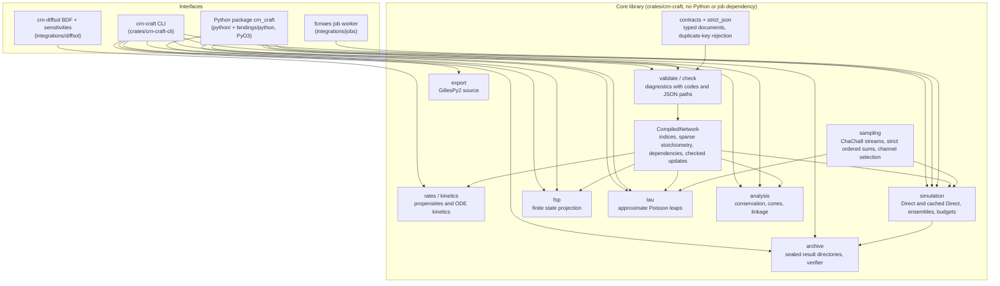
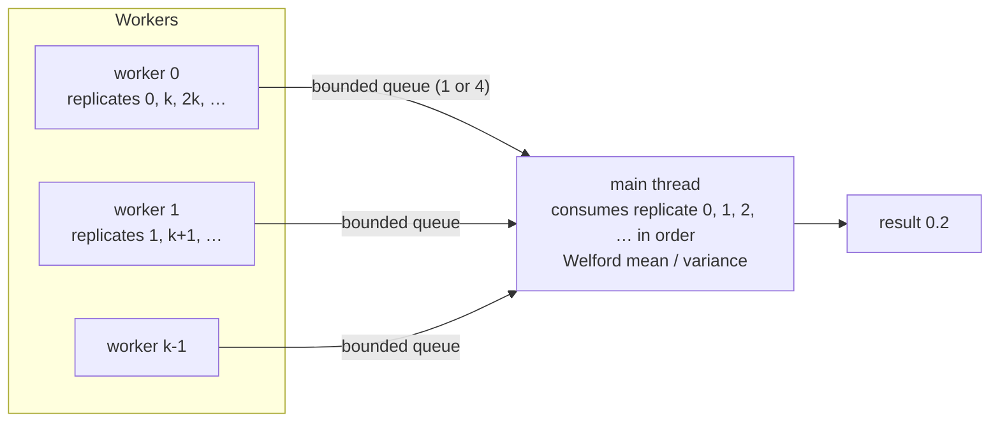

# CRN-craft architecture

CRN-craft simulates and analyzes well-mixed chemical reaction networks. It is
built around one idea: every numerical answer must be traceable to exact input
bytes and reproducible bit for bit, and anything that is not exact must say so
in its own schema. This page describes how the pieces fit together; the
[technical report](technical-report.md) adds the numerical methods, the
validation evidence and the performance measurements.

## Layers

The core library is a single crate with no dependency on Python, job
infrastructure or ODE solvers. Its dependencies are pinned to exact versions:
serde and serde_json (with correctly rounded float parsing), schemars for
generated schemas, sha2, libm (portable math functions), and rand_chacha /
rand_core for the random streams. Unsafe code is forbidden in every crate.

Optional pieces live in separate workspaces with their own lockfiles, so they
cannot change the core's dependency set: the PyO3 binding (`bindings/python`),
the fcmaes worker (`integrations/jobs`, Rust 1.88) and the diffsol integration
(`integrations/diffsol`, Rust 1.89).

## Documents and contracts

All inputs and outputs are versioned JSON documents whose Rust types are the
source of truth; `crn-craft describe KIND` prints the JSON Schema generated
from those types.

| Document | Schema | Produced by |
|---|---|---|
| Model | `crn-craft.model/0.1` | user |
| Run | `crn-craft.run/0.1` | user (binds a model by path and SHA-256) |
| Check report | `crn-craft.check/0.1` | `check` |
| Analysis | `crn-craft.analysis/0.2` (and legacy 0.1) | `analyze` |
| SSA result | `crn-craft.result/0.2` (the 0.1 schema stays available) | `simulate`, `simulate-cached` |
| Archive check | `crn-craft.archive-check/0.1` | `simulate`, `verify` |
| FSP result | `crn-craft.fsp-result/0.1` | `fsp` |
| Tau request / result | `crn-craft.tau-request/0.1`, `crn-craft.tau-result/0.1` | `tau` |
| Alternative exact SSA | `crn-craft.ssa-run/0.1` → `crn-craft.ssa-result/0.1` | `ssa`; [methods and bounds](alternative-ssa.md) |
| Discovery | `crn-craft.describe/0.7` | `describe` |

Parsing is strict: `strict_json` rejects duplicate keys before serde sees
them, every struct denies unknown fields, numbers must be finite, and a
contract change requires a new schema version. A run's model reference is a
path relative to the run file plus the SHA-256 of the model's exact bytes;
`check` rejects a mismatch (`CRN-E021`), so a result can never be attributed
to a model that was edited afterwards.

## From bytes to a compiled network

1. **Validate** (`validate`, `check_bytes`): structure, names, domains of
   rate parameters, finite numbers, save grids, budgets and limits. Problems
   become `Diagnostic { severity, code, path, message, hint }`; the codes are
   stable and listed in [diagnostics](diagnostics.md).
2. **Compile** (`CompiledNetwork::compile`): species and reactions become
   indices; parameters are resolved into literal coefficients (`rates`); the
   stoichiometry is stored sparsely as reactant terms and net changes; a
   reaction-dependency graph records which propensities each reaction can
   change (sorted, used by `simulate-cached`); availability gates record the
   reactant counts each channel needs.
3. **Prepare** (`simulation::prepare`): computes the worker count and an
   explicit memory reservation from the published formula (save grid ×
   species × buffers per worker, kept trajectories, per-worker scratch), and
   admits the run only if it fits the workspace and output limits.

The compiled network is immutable. Firing a reaction is a checked,
transactional update: overflow, a negative count (`CRN-E043`, a scheduler
defect) or a population limit (`CRN-E044`, a normal stop) leaves the state
unchanged.

## Exact simulation (Direct SSA)

`simulation` implements Gillespie's Direct method twice:

- **`simulate`** recomputes every propensity after each event.
- **`simulate-cached`** recomputes only the dependents of the fired reaction
  and resumes the strict running sums from the lowest changed channel.

Both make the same floating-point operations in the same order wherever they
affect a decision, so they consume the same random words and choose the same
channels; their results are byte-identical, and CI diffs them on the full
validation campaigns.

Per event, `sampling` provides:

- **Strict ordered sums.** The total propensity is summed in channel order
  while recording prefix sums. Each addition is checked: a positive rate that
  does not change the running sum (lost increment) or a positive rate below
  2^-53 of the total (the selection could never pick it) is a resolution
  failure (`CRN-E061`), not a silent bias.
- **Waiting time.** An open-interval uniform from the stream, mapped by
  `-ln(u) / total`, with checks that the clock advances.
- **Channel selection.** A second uniform scaled by the total, located by
  binary search over the recorded prefix sums (P11), which returns exactly
  the channel a linear scan would.

Saved states are written into one flat buffer per path (P15), and per-worker
buffers for state, rates, prefix sums and minima are reused across replicates
(P16).

### Ensembles, threads and determinism

Replicate *i* uses ChaCha8 stream *i* under a key that is the SHA-256 of a
domain string and the root seed (`crn-craft.chacha8/0.1`; tau leaping has its
own domain). Replicates are assigned round-robin to workers, each worker sends
its paths through a bounded queue, and the main thread reduces them strictly in
replicate order. The numerical result is therefore independent of the number
of threads and of scheduling; only provenance (timings, worker count) differs.

### Stopping, budgets and cancellation

A per-worker `Poller` amortizes the expensive checks: it reads the
cancellation flag at every poll and the wall clock, cancel file and an optional
external callback only every 64th poll (the file at most once per
millisecond). A stop observed by any worker is shared through the `Control`
flag. Each replicate records how it ended (`completed`, `event_limit`,
`population_limit`, `wall_time_limit`, `cancelled`, `failed`), and the
ensemble is `exact_ensemble` only if every replicate completed; otherwise the
statistics are withheld and the assessment says `incomplete` or
`failed_checks`. If the serialized result would exceed `max_output_bytes`,
trajectories and statistics are dropped (`CRN-E064`) while the replicate
accounting is kept.

The Python binding runs native calls on a helper thread and checks for Python
signals every 50 ms, so Ctrl-C cancels a run through the same `Control`.

## Archives

`archive` writes a **new** directory with six files: the exact `model.json`
and `run.json` bytes, `result.json`, `provenance.json` (versions, toolchain,
lockfile hash, executable hash, worker count, timing and memory
reservation), `manifest.json` (path, length and SHA-256 of each payload) and
`COMPLETE` (the manifest hash), written last and synced. The result is
serialized once; the bytes that passed the output budget are the bytes
written (P20).

`verify` never trusts the manifest: it reads files with size limits,
recomputes hashes, re-validates the inputs, and checks the result's internal
accounting (replicate ids, termination rules, event totals, assessment,
trajectory counts) against the inputs. It establishes integrity and internal
consistency, not authenticity or statistical correctness.

## Finite state projection

`fsp` enumerates the states reachable from the initial state within
per-species bounds (breadth first, up to `max_states`), records the
generator with every out-of-bounds transition sent to an absorbing sink, and
propagates the probability vector by uniformization. Each save interval is
split so that `lambda * dt <= 16`; the Poisson series is truncated when a tail
bound falls below the per-step share of the tolerance. The generator is stored
by column (P18), so each series term is a single gather-and-accumulate pass
over contiguous memory. Leakage into the sink, the series tail bound, the
omitted series weight and the floating-point residual are reported
separately; probabilities are never renormalized.

## Approximate tau leaping

`tau` implements explicit Poisson leaping with the Cao–Gillespie–Petzold
step-size rule (relative propensity change bounded by `epsilon`, with the
`g_i` factors for higher-order reactions), rejection and halving of proposals
that would make a count negative, and an exact Direct fallback for channels
close to exhausting their reactants. Poisson variates with mean at most 16 use
the multiplication method and larger means Hörmann's PTRS (P19). Results use
the tau-result schema, `assessment: approximate_ensemble`, and can never be
verified as exact archives.

## Analysis

`analysis` combines `conservation` (an exact rational left-nullspace basis
with checked i128 arithmetic), `cone` (extreme rays of the nonnegative
conservation cone by bounded double description, which yield upper bounds for
the initial conservation class) and `linkage` (complexes, linkage and strong
linkage classes, terminal classes, deficiency and weak reversibility). Every
algorithm has explicit size and work limits and reports `unavailable` rather
than a partial answer presented as complete.

## Python package

`bindings/python` is a thin PyO3 bridge exchanging JSON bytes with the core;
all numerical semantics stay in Rust. `python/crn_craft` adds dictionaries in
and out (`simulate`, `fsp`, `tau`, `check`, `analyze`, `run_spec`,
`load_example`), `CrnError` with parsed diagnostics, trajectory observables
(`oscillation`, `sampled_first_passage`), strict SBML and BioNetGen importers
(`crn-craft-import`) and a Python command line with the same commands as the
native one.

## Integrations

- **`integrations/jobs`** registers CRN objectives (`app.crn.fit-moments`,
  `app.crn.circuit-score`) with the existing fcmaes job worker and its retry,
  surrogate and evaluate profiles. Every candidate uses the declared seed set,
  so optimizers compare candidates on common random numbers.
- **`integrations/diffsol`** (`crn-diffsol`) integrates the deterministic
  count kinetics with diffsol's BDF method and returns forward sensitivities
  with respect to raw parameters, using analytic Jacobians from the core's
  `kinetics` module.

## Error model

Errors are values, not panics: every fallible step returns diagnostics with a
stable code (`CRN-Exxx` errors, `CRN-Wxxx` warnings), a JSON pointer, a
message and a hint. Commands print JSON and exit 0 or 1; `simulate` exits 0
only for a completed ensemble, `verify` exits 0 for any valid archive. The
Python layer raises `CrnError(ValueError)` with the same diagnostics.

## Extending

New rate laws, methods or result fields go through the contract types first
(with a new schema version), then validation and compilation, then the
engines. `docs/extending.md` lists the steps and the evidence a change needs:
tests that fail without it, the validation campaigns byte-identical where the
change claims exactness, and a declared, paired measurement for performance
claims.
