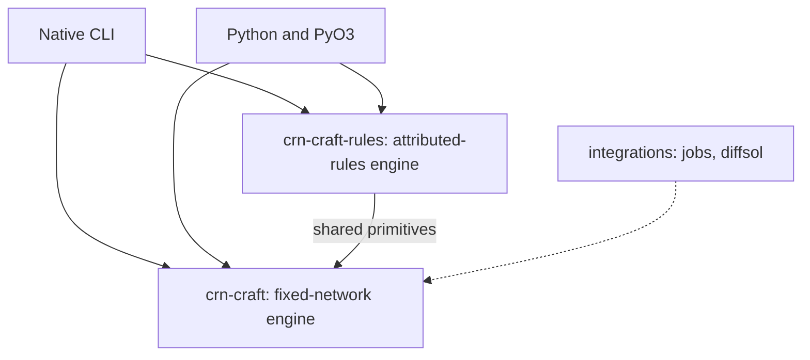
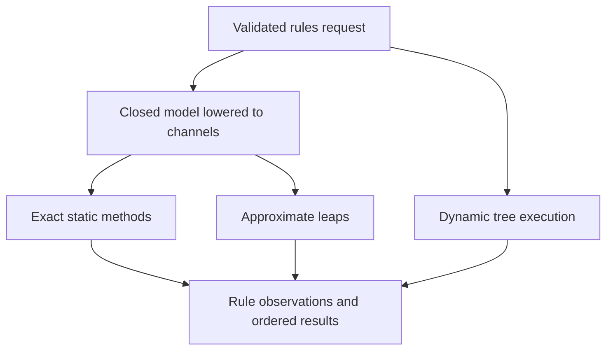

# CRN-craft architecture

CRN-craft has two Rust engines for well-mixed stochastic chemistry. The
fixed-network engine works with species and reactions declared in advance.
The rules engine also supports attributed instances whose identities and
population can change during a run. Both bind a request to its exact model
bytes and return structured diagnostics, termination and reproducibility
metadata. The [technical report](technical-report.md) covers the numerical
methods and validation evidence.

## Package boundaries

| Component | Responsibility |
| --- | --- |
| `crates/crn-craft` | Fixed-network contracts and solvers, compiled stoichiometry and rates, sampling, analysis, export and sealed archives. It also provides the primitives the rules engine reuses: diagnostics, strict JSON parsing, shared contract types, the Ziggurat exponential and indexed reaction clocks. |
| `crates/crn-craft-rules` | Attributed rules: dynamic (tree) and lowered (static) execution, rule observations, the specialized `mtdna_direct` sampler and generated rules kernels. |
| `crates/crn-craft-cli` | Dispatches both engines, emits Rust-generated JSON schemas and verifies archives. |
| `bindings/python` and `python/crn_craft` | Expose prepared execution, Python-friendly results, importers and trajectory analysis. The numerical loops run in Rust. |
| `integrations/jobs` and `integrations/diffsol` | Optional fcmaes job objectives and deterministic BDF integration with forward sensitivities. They have separate workspaces and lockfiles. |

The numerical crates have no dependency on Python, job infrastructure or
diffsol.

## Contracts and preparation

Rust types define the JSON schemas. Strict parsing rejects duplicate keys and
unknown fields. A present optional field must hold a value; `null` is
rejected. Validation checks names, finite inputs, limits and method
compatibility. File-based requests bind the model by a relative path and
SHA-256. Preparation builds immutable execution data and checks memory and
output budgets. `crn-craft describe` lists the supported methods, and
`crn-craft describe KIND` prints one schema.

| Entry point | Request and result |
| --- | --- |
| `check`, `analyze`, `export` | Fixed-network model `model/0.1`. Check emits `check/0.1`; analysis emits `analysis/0.2`, with `analyze-v1` for the legacy `0.1`; export emits the supported GillesPy2 subset. |
| `simulate`, `simulate-cached` | Fixed-network `run/0.1` → `result/0.2` in a sealed archive. |
| `ssa` | Alternative exact `ssa-run/0.1` through `0.4` → the matching `ssa-result` version. `0.4` is `0.3` plus the `next_reaction` aggregator. |
| `fsp`, `tau` | FSP emits `fsp-result/0.1`. Fixed-network tau uses `tau-request/0.1` → `tau-result/0.1`. |
| `rules-check`, `rules` | Attributed `rules-model/0.1`, or `0.2` with the ATP block. Check emits `rules-check/0.1`. Rules-run `0.1` emits rules-result `0.1`. Rules-run `0.2` (method, trackers, event log), `0.3` (`mtdna_direct`) and `0.4` (Static Direct options) emit rules-result `0.2`. |
| `describe` | The core and Python emit `describe/0.10`. The native CLI emits `describe/0.11`, which adds `dynamic_species` and the rules commands. Python's `crn_craft.rules.describe()` returns the rules discovery entry. |

Schema names in the table use the `crn-craft.` prefix. See
[fixed-network contracts](contracts.md), [alternative SSA](alternative-ssa.md),
the [rules language](rules-language.md) and the
[diagnostic codes](diagnostics.md).

## Fixed-network execution

`CompiledNetwork` resolves names and parameters, stores sparse reactants and
net changes, and builds dependencies and availability checks. A reaction
update is checked and transactional: overflow, a negative count or a
population limit leaves the state unchanged.

- **Archived Direct SSA.** `simulate` recomputes every propensity.
  `simulate-cached` recomputes dependents and resumes ordered prefix sums at
  the earliest changed channel. Both draw the same random words and produce
  the same numbers. Strict summation detects lost increments and propensities
  below the selector's resolution. [Direct SSA](direct-ssa.md)
- **Alternative exact SSA.** `ssa` offers Direct, cached Direct, DirectCR,
  SortingDirect, RSSACR and next reaction. The request version and method
  control the waiting-time sampler and the numerical policy. `fast` defaults
  to false in `0.2` and to true in `0.3` and `0.4`. Next reaction (`0.4`
  only) runs the checked policy with inverse waits, so its `fast` defaults to
  false and `fast: true` is rejected. [Alternative SSA](alternative-ssa.md)
- **FSP and leaps.** FSP enumerates a bounded reachable state space,
  propagates its distribution by uniformization, and reports leakage to an
  absorbing sink and numerical error terms. Fixed-network tau uses adaptive
  Poisson leaps with rejection, step reduction and an exact fallback where
  needed. Its result is explicitly approximate.
  [Technical report](technical-report.md)
- **Analysis.** Conservation laws, nonnegative conservation cones and linkage
  use the compiled network and have their own work limits. Deterministic
  kinetics and analytic Jacobians serve the diffsol integration.
  [Network API](network-api.md)

## Attributed rules execution

A rules model declares instance types, attributes, matching rules,
observables and an optional stop expression. Preparation compiles
expressions, initial instances, observation settings and the chosen method.

| Method | Execution and constraints |
| --- | --- |
| `tree` | The default dynamic Direct path. It keeps attributed instance state and supports changing instance identities and random product attributes. |
| `static_direct` | Exact Direct on a closed set of instance tuples and indexed channels. Inverse waits and per-event tracker updates are the defaults. Every positive channel must be at least 2⁻⁵³ of the total (`CRN-R031`); the tree resolves rules and instances separately and can run such models. |
| `next_reaction` | Exact Gibson–Bruck clocks on a lowered model. Dependency lists identify the clocks to update. |
| `thinning` | Exact thinning for the ATP-coupled rules model, with the analytic ATP flow and a checked intensity envelope. |
| `tau`, `binomial` | Approximate closed-model methods with their own sampler identities. Tau bounds both species and rate changes (Cao–Gillespie–Petzold) and takes exact steps where a leap would be inaccurate. Binomial uses competing-risk probabilities on a fixed step lattice and admits only single-parent unit births and deaths. |
| `mtdna_direct` | Opt-in exact specialization for the fixed three-class mtDNA topology. If the model or its parameters cannot be certified, Static Direct runs, the result carries the Static Direct sampler identity and a `CRN-R051` warning gives the reason. |

Static lowering fixes the channel order and builds rate, observable and stop
dependencies. Static Direct caches rule rates and shared vacancy bases and
recomputes only the rates a firing affects. The total and the resolution
check still cover every rate, in a fixed order. Count updates keep the
number of live instances incrementally. Observable refresh follows
dependencies, and report-only observables that cannot overflow are computed
at report times. These changes leave results byte-identical and also serve
next reaction, thinning and the leap methods.

Stop and first-passage predicates run as deterministic bytecode. Optional
trackers and logs record events. Reports are right-continuous: an event at a
report time contributes the post-event state. A model stop holds the stopped
state for later reports.

Rules-run `0.4` lets Static Direct opt into Ziggurat waits and sparse
tracking independently. Ziggurat waits change how the seeded stream is
consumed. Sparse tracking integrates eligible single-class counts over their
constant spans, which can change the last bits of an integral. If no tracker
is eligible, the run reports the default identity and a `CRN-R051` warning.
The result's sampler identity names the policy that ran.
[Rules execution and options](mtdna-rules.md)

## Prepared runs, parameter sweeps and kernels

| Route | Reuse and binding |
| --- | --- |
| Fixed-network `ParameterTemplate` | Shares the compiled topology across candidate bindings. Each candidate validates its parameter values and produces a prepared SSA execution. |
| Rules `Prepared.bind_parameters` | Creates a separate prepared candidate with the same run settings. It revalidates and lowers the model, because parameters can change attributes, projections and topology. The candidate's hashes cover the re-serialized model and request. |
| Generated fixed-network kernel | A Rust propensity kernel that plugs into the fixed-network SSA scheduler, for the supported mass-action subset. Benchmark it before adopting it. |
| Generated rules kernel | Ahead-of-time Rust for a lowered Static Direct model with constant or vacancy rates and weighted sums. It emits rate and projection code and static dependencies. Its fingerprint is the hash of the emitted source keyed by the model bytes, so another parameter set or a newer generator needs a regenerated kernel. The scheduler keeps selection, waits, budgets and reports, and results are byte-identical to the interpreter. Rust only. |

The generated rules route is opt-in. In the contributor's eight-worker mtDNA
measurement it was about 10% faster than the interpreter, and `mtdna_direct`
remained about three times faster than the generic path. Structural changes
to the interpreter, including grouped evaluation, did not narrow that gap
by more than the 5% threshold
([decision record](decisions/generic-rules-structural-2026-11-03.md)). Use the
[specialized kernel checklist](specialized-kernels.md) before introducing
another kernel. See [reusable parameters](reusable-parameters.md) for the
fixed-network Rust and Python interfaces.

## Parallelism, observations and evidence

- **Fixed-network archive runs** assign replicate IDs round-robin and collect
  results through bounded worker queues. The parent reduces in ascending ID
  order.
- **Rules ensembles** claim replicate IDs from a shared counter. A bounded
  window limits how far workers can run ahead, and results still reduce in
  ascending ID order. Rule observers run on the native workers. Events within
  one replicate are ordered; callbacks from different replicates can
  interleave. An observer that returns Continue leaves results unchanged.
- **Replay** depends on the engine, sampler identity, seed and input bytes.
  Completed numerical results do not depend on the worker count. A changed
  request changes its hash. Timing, cancellation and wall-time limits can
  change which work completes.
- **Archives** belong to fixed-network `simulate` and `simulate-cached`. They
  keep the exact model and request bytes with the result, provenance, a
  manifest and a completion marker. The verifier checks integrity and
  accounting. A complete archive can contain an incomplete simulation. The
  `ssa` and `rules` entry points return standalone JSON results.
  [Archive contract](archive-contract.md)

## Budgets, cancellation and errors

Every request states its budgets: events and sampling steps per replicate,
instances for rules, threads, output bytes and an optional wall time.
Workers poll cooperatively. The fixed-network `Poller` reads the
cancellation flag at every poll and the wall clock, cancel file and optional
callback at every 64th. The rules engine polls every 1,024 events.

Each replicate records how it ended, for example `completed`, `stopped`,
`event_limit`, `cancelled` or `failed`. Ensemble statistics are withheld
unless every replicate completed or stopped. A result that would exceed its
output budget drops trajectories, statistics and, for rules, observations and
retained instances, but keeps the replicate accounting. If even that does
not fit, the call fails with a coded error.

Errors are `Diagnostic { severity, code, path, message, hint }` values with
stable codes, listed in [diagnostics](diagnostics.md). They stay structured
through Rust, the CLI and Python, where they surface as `CrnError`.

Python runs native calls off the GIL and checks for signals every 50 ms, so
Ctrl-C cancels through the same control. A rules callback that blocks also
blocks Ctrl-C. Python exposes prepared fixed-network runs through
`crn_craft` and prepared rules ensembles through `crn_craft.rules`, with
parameter rebinding, native result columns, trackers, event logs and
callbacks. [Python and rules examples](mtdna-rules.md)

## Changing the architecture

Start from the relevant contract and keep numerical execution independent of
optional integrations. Preserve seeded replay when a change claims the same
sampler identity. Version changes to the request shape or the sampler
semantics. Use independent law checks for new numerical policies and matched
workloads for performance claims. [Extension guide](extending.md)
