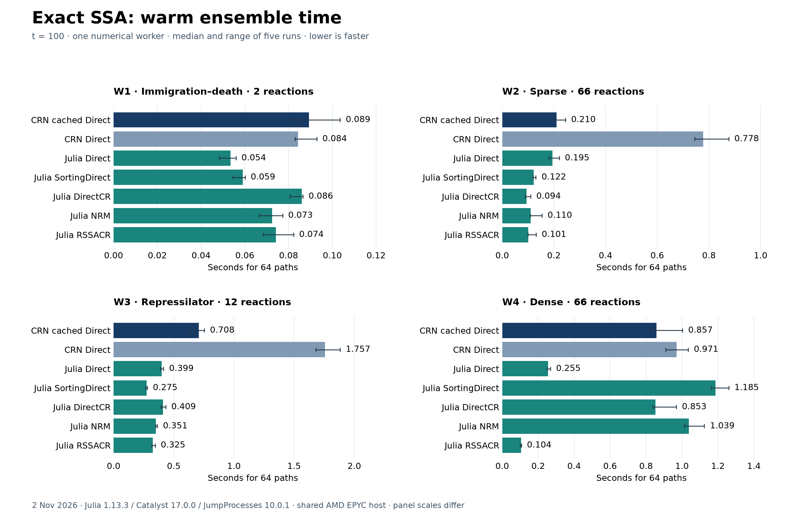

# CRN-craft compared with Catalyst.jl and JumpProcesses.jl

> **Measured with the 0.6.0 network engine (note of 12 November 2026).**
> The CRN-craft numbers on this page come from the network engine of
> releases 0.2.0 to 0.6.0 (its `simulate`, `simulate-cached` and `ssa`
> routes). Release 0.7.0 replaced that engine with one
> engine, whose selectors are ports of the methods measured here. Julia is
> not available on the host of the 0.7.0 measurements, so these comparisons
> were not repeated, and the tables below are left as measured. For the
> 0.7.0 engine against the 0.6.0 network engine on the same host, see the
> [speed gate](technical-report.md#71-speed-gate) and
> `validation/merge/RESULTS.md` ("M4d (speed gate): results").

> **Historical snapshot.** This is the comparison before the exact-SSA
> acceleration campaign, kept as measured on a development build. For later
> results see the [updated comparison](comparison-catalyst-jumpprocesses.md)
> and [fast mode versus Julia](comparison-julia-8-threads.md); none of them
> has been repeated on release 0.2.0.

Measured on **2 November 2026** with CRN-craft **0.2.0-dev.1**, commit
[`baed0e4`](https://github.com/dietmarwo/CRN-craft/tree/baed0e4590f93e4c1dcc77cd7f039a2604a1594c),
**Julia 1.13.3**, **Catalyst 17.0.0** and **JumpProcesses 10.0.1**.
This repeats the four frozen workloads of the
[GillesPy2 comparison](https://github.com/dietmarwo/CRN-craft/blob/baed0e4590f93e4c1dcc77cd7f039a2604a1594c/docs/comparison-gillespy2.md),
with fresh measurements of both engines on the same host.

Harness: [`validation/compare_julia.py`](../validation/compare_julia.py).
Raw measurements and final samples:
[`validation/campaign/julia-comparison.json`](../validation/campaign/julia-comparison.json).
Pinned Julia environment and reproduction notes:
[`validation/julia/`](../validation/julia/README.md).

## Summary

**The fastest measured Julia algorithm beats CRN-craft's cached Direct solver
on all four networks in warm, single-worker execution.** The advantage ranges
from **1.67× to 8.23×**, but the winning Julia algorithm changes with the model.

| Network | Fastest observed Julia median | CRN cached / Julia time |
|---|---|---:|
| W1: immigration–death | `Direct` | **1.67×** |
| W2: sparse 66 reactions | `DirectCR` | **2.25×** |
| W3: repressilator | `SortingDirect` | **2.57×** |
| W4: dense 66 reactions | `RSSACR` | **8.23×** |

These are ratios of medians, calculated from unrounded measurements. They do
not mean every Julia algorithm wins: on W4, `SortingDirect` and `NRM` are
slower than CRN-craft cached Direct, while `DirectCR` is effectively tied.
The five tested Julia algorithms all passed the declared model and
distribution checks.

Catalyst supplies the symbolic reaction model and generates jump problems;
JumpProcesses supplies the SSA algorithms and `SSAStepper`. This comparison
uses that actual stack, including its mass-action specialization and generated
dependency information. It does not substitute a hand-written Julia SSA.



## What was measured

| ID | Network | Species | Reactions | Propensities |
|---|---|---:|---:|---|
| W1 | Immigration–death, initially zero | 1 | 2 | Birth 100; death X |
| W2 | Independent immigration–death species, initially zero | 33 | 66 | Each birth 3; death 0.2 Xᵢ |
| W3 | Three-gene repressilator | 6 | 12 | Hill repression and mass action |
| W4 | Species born and removed together, initially 20 each | 8 | 66 | 33 births of rate 3; 33 deaths of rate 3 X₀/(20 + X₀) |

Each timed batch runs **64 paths**, from **t = 0 to 100**, saving at **0 and
100**, with **one numerical worker**. All five Julia algorithms are exact
jump-process methods for these models; no approximate leap method is timed.
All 66 W4 channels remain separate in both implementations.

The host was shared Linux x86-64 on an AMD EPYC 9V74, with nine logical CPUs
in its affinity mask and an eight-CPU cgroup quota. Only one numerical worker
was used, and Julia's BLAS thread count was also one. CRN-craft was built in
release mode with Rust 1.88.0; its Python API used Python 3.12.14 and NumPy
2.5.4. Validation used SciPy 1.17.0. No other builds or heavy project checks
ran during the timed rounds.

Five rounds rotated the order of all seven implementations within each
workload. Warm-up and distribution checks preceded timing. The workload seed
was 4242; validation used 777. CRN-craft uses its pinned ChaCha8 streams;
Julia used one advancing `Xoshiro` stream per batch. Matching seed numbers
do not imply matching paths between different generators or SSA algorithms.

### Timing boundaries

| CRN-craft Python API | Julia batch |
|---|---|
| Times `crn.simulate(model_bytes, run, cached=...)` | Times serial `solve(problem, SSAStepper(); rng, saveat=[0,100])` calls and final mean/sample-variance reduction |
| Includes run JSON encoding, native input parsing/validation and model compilation, simulation, result encoding and Python decoding | Includes per-path solver initialization, simulation, solution objects, saved-time/final-state checks and reduction |
| Model bytes and the run dictionary are prepared before timing; trajectory retention is disabled | Catalyst model/problem construction, copying a pristine batch problem and JSON IPC are outside the warm timer |

Julia uses `save_positions=(false,false)` so it does not save every jump;
this follows the documented performance guidance [1]. A typed function
specializes the solve loop on each problem type. Both sides compute ensemble
statistics; CRN-craft also returns its standard result metadata and statistics
at the initial save time. These are comparable application workloads, not
identical allocation or serialization pipelines. **Archive writing is not
included** in the timed CRN-craft API call.

SortingDirect retains learned reaction ordering across solves. Each Julia
batch therefore starts from a copy of an unsolved problem, made outside its
timer; the problem is reused within that batch. This permits both efficient
serial reuse and repeatable batches [2]. No hand tuning of bracket widths,
channel order or low-level state representation was performed.

## Warm results

**Seconds for 64 paths: median [minimum–maximum] of five runs.**

| Implementation | W1 | W2 | W3 | W4 |
|---|---:|---:|---:|---:|
| CRN-craft cached Direct | 0.089 [0.083–0.104] | 0.210 [0.200–0.245] | 0.708 [0.639–0.754] | 0.857 [0.820–1.003] |
| CRN-craft Direct | 0.084 [0.083–0.093] | 0.778 [0.745–0.877] | 1.757 [1.680–1.882] | 0.971 [0.909–1.034] |
| Julia `Direct` | **0.054** [0.048–0.056] | 0.195 [0.182–0.221] | 0.399 [0.389–0.414] | 0.255 [0.252–0.268] |
| Julia `SortingDirect` | 0.059 [0.055–0.060] | 0.122 [0.119–0.130] | **0.275** [0.267–0.280] | 1.185 [1.163–1.260] |
| Julia `DirectCR` | 0.086 [0.081–0.087] | **0.094** [0.089–0.110] | 0.409 [0.393–0.432] | 0.853 [0.838–0.968] |
| Julia `NRM` | 0.073 [0.067–0.077] | 0.110 [0.108–0.154] | 0.351 [0.349–0.363] | 1.039 [1.014–1.124] |
| Julia `RSSACR` | 0.074 [0.068–0.082] | 0.101 [0.100–0.131] | 0.325 [0.318–0.345] | **0.104** [0.099–0.106] |

Bold denotes the lowest observed median per column. Five observations on a
shared host are not enough to establish a precise ranking between close
options. One W2 NRM observation was approximately **40% above its median**;
the ranges retain this observation. No outlier was removed.

For continuity with the GillesPy2 report, the following normalizes time by
CRN-craft's event count. **The Julia values are proxies, not measured Julia
nanoseconds per event:** its actual event counts were not instrumented, and
its sampled paths differ. Ensemble seconds above are the primary result.

| Quantity | W1 | W2 | W3 | W4 |
|---|---:|---:|---:|---:|
| CRN-craft events | 1,268,165 | 1,234,576 | 3,663,350 | 1,225,923 |
| CRN cached, ns/event | 70 | 170 | 193 | 699 |
| Fastest Julia, ns/CRN-event proxy | 42 | 76 | 75 | 85 |

### Startup and first execution

The full benchmark used a fresh Julia process after package precompilation:

| Measured phase | Seconds | Scope |
|---|---:|---|
| Package imports | 9.17 | Catalyst, JumpProcesses and harness dependencies |
| Model/problem setup | 49.21 | All four workloads plus the homodimer control, five aggregators each |
| Process launch to ready response | 67.65 | Includes the preceding two phases and other startup/JIT/harness work; do not add these three rows |
| First two-path batch per model/algorithm | 0.24–0.69 | Observed range of 20 calls after setup; includes remaining first-use compilation |

This is a **whole-comparison setup measurement**, not a 67.65-second cost for
every Julia model or every subsequent batch. Construction shares compiled
methods, so individual setup entries depend on construction order. Package
installation/precompilation, CRN-craft's Rust build and Python wheel build
are excluded from these timings. CRN-craft accepts these JSON models without
a separate per-model code-generation/JIT phase. Long-lived Julia sessions
amortize their setup over repeated solves.

## Reading the algorithm differences

Inspection of the pinned JumpProcesses 10.0.1 source and CRN-craft's base commit
shows different event-selection strategies; the measured effects below are
consistent with them, but are not a component-level profiling attribution.

| Solver | Relevant strategy |
|---|---|
| CRN Direct | Re-evaluates every propensity; builds cumulative sums and selects by binary search |
| CRN cached Direct | Updates affected propensities; resumes cumulative summation at the earliest invalidated channel; binary-search selection |
| Julia `Direct` | Re-evaluates propensities into cumulative sums and binary-searches them, with specialized mass-action handling |
| Julia `SortingDirect` | Dependency-based updates; linear selection through an adaptively reordered channel list |
| Julia `DirectCR` | Dependency-based updates with composition–rejection selection |
| Julia `NRM` | Next Reaction Method with dependency-based propensity/time updates and an indexed priority queue |
| Julia `RSSACR` | Rejection SSA with propensity bounds and composition–rejection; can avoid recomputing actual rates after every event |

On **W1**, the small direct method wins among the measured Julia medians;
more elaborate selection machinery does not pay off here. On **W2**, sparse
dependencies favor DirectCR: Julia Direct alone is only 1.08× faster than
CRN cached, while DirectCR is 2.25× faster. On **W3**, SortingDirect is the
fastest observed option, and caching also helps CRN-craft substantially.

On **W4**, every event changes all eight species and affects all 33 custom
death rates. Dependency updates alone offer limited relief. RSSACR can use
bounds between updates and is much faster, whereas SortingDirect and NRM
are slower than CRN cached. W4 is deliberately synthetic: repeated channels
and an equal-count invariant reduce its effective state dimension to one.
Its large RSSACR advantage should not be generalized to arbitrary dense CRNs.

RSSACR requires valid propensity bounds. The tested custom laws depend
monotonically on a single species: Hill repression decreases and
Michaelis–Menten increases. Their endpoint bounds are valid. This benchmark
does not authorize using inferred endpoint bounds for arbitrary nonmonotone
or mixed-dependency rate functions [3].

## Model equivalence and validation

The [acceptance protocol](decisions/julia-comparison-2026-11-02.md) was committed
before measurements. Validation precedes performance interpretation.

**Model translation.** Native CRN-craft and Catalyst agree on all stoichiometric
updates and **2,325 propensity values** at selected zero, low and higher-count
states. The largest relative difference is **8.3 × 10⁻¹⁶**, below the declared
2 × 10⁻¹² tolerance.

- Mass-action reactions use Catalyst's normal `-->` arrow and default
  combinatorial convention, matching `c × ∏ binomial(Xᵢ, νᵢ)`. A separate
  `2X → 0`, c = 0.25 control verifies the factorial divisor [4].
- Hill repression and Michaelis–Menten use the full-propensity `=>` arrow,
  avoiding an extra reactant-count multiplier [5].
- W4's Julia law omits the availability gates, as in the GillesPy2 comparison.
  This is justified only on its reachable class: all eight counts start equal,
  every reaction changes them equally, and the death rate is zero when all are
  zero. Thus omitting the gates leaves this process unchanged. Unequal-state
  equivalence is neither asserted nor tested.

**Distribution checks.** Each of CRN cached and the five Julia algorithms ran
512 paths per workload, for **12,288 validation paths**. W1 has the exact
terminal law Poisson(100 × (1 − exp(−100))); each W2 species has
Poisson(15 × (1 − exp(−20))). All 34 linear-model species were checked for all
six engines. The six W3 species and W4's one independent coordinate were
compared between CRN-craft and each Julia algorithm.

The 239 comparisons use conservative Dvoretzky–Kiefer–Wolfowitz empirical-CDF
envelopes [9] with a union-bound family error probability of 0.01. For n = 512,
K = 239 and α = 0.01, the one-sample bound is
`sqrt(log(2K/α)/(2n)) = 0.10258`; the two-sample bound is
`2 sqrt(log(4K/α)/(2n)) = 0.21165`. No independence between species is required
for this multiplicity correction.
The two-sample threshold here follows by applying the one-sample bound to
each empirical CDF and using the triangle inequality; it is not the sharper
two-sample result studied in [9].

| Workload | Comparisons | Largest observed CDF distance | Declared bound | Result |
|---|---:|---:|---:|---|
| W1: all engines versus exact law | 6 | 0.04808 | 0.10258 | Pass |
| W2: all engines/species versus exact laws | 198 | 0.06452 | 0.10258 | Pass |
| W3: Julia versus CRN, all six species | 30 | 0.07422 | 0.21165 | Pass |
| W4: Julia versus CRN, one coordinate | 5 | 0.06250 | 0.21165 | Pass |

All simulations completed. Julia checked saved times and nonnegative integer
terminal counts; CRN-craft reported completed ensembles. All eight W4
terminal coordinates were equal in every retained validation path. Repeated
timed batches reproduced their own final-statistics/result digests, and CRN
Direct and cached Direct produced identical result digests. Cross-engine
path identity was not expected.

These checks support the translation and sampled terminal distributions.
Their deliberately conservative bounds do not prove equivalence of arbitrary
models, rare tails, transient distributions or extreme numerical inputs.
The full final samples and all individual distances are retained for review.

## Capabilities beyond these timings

| Area | CRN-craft at the tested commit | Catalyst / JumpProcesses ecosystem |
|---|---|---|
| Model interface | Native Rust library/CLI and optional Python; strict versioned JSON contracts | Symbolic Julia DSL and programmatic reaction systems [6] |
| Exact stochastic simulation | Direct and dependency-cached Direct | Several exact aggregators; five tested here [3] |
| Rate laws | Validated mass action, Hill activation/repression and Michaelis–Menten; explicit availability gates | General symbolic/function-based rates; users must supply correct semantics and any required bounds [3,5] |
| Other dynamics | Sparse FSP; explicitly approximate Poisson leaping; optional diffsol BDF/sensitivities integration | ODE, SDE, hybrid and spatial workflows through SciML; separate packages provide FSP and other stochastic extensions [6] |
| Analysis and fitting | Conservation/graph analysis and optional optimization/job integrations | Symbolic analysis and wider sensitivity, parameter-estimation and bifurcation tooling [6] |
| Ensembles | Replicate parallelism with pinned streams and ordered reduction; documented thread-count identity contract | Serial, threaded and distributed ensemble workflows; mutable jump state must be copied appropriately [2] |
| Evidence and execution contracts | Explicit budgets/diagnostics; CLI archives with hashes, input snapshots and verifier | Julia problems/solutions, return codes and callbacks; the user assembles persistence and workflow policy |

The present measurements do not compare FSP, ODE accuracy, parameter fitting,
parallel scaling or archive/diagnostic behavior. CRN-craft's contracts are a
separate reason to choose it; this benchmark does not quantify their runtime
cost or show that Julia cannot implement comparable policies.

## Limitations

- One shared host, four networks with at most 66 reactions, one numerical
  worker and five timing repetitions. No dedicated-core, large-network,
  multi-thread, GPU or memory-scaling claim follows.
- The fastest Julia option is selected from these observed medians. A new
  model needs its own algorithm comparison; closely spaced medians can swap.
- Equivalent processes use different random paths. Julia event-normalized
  numbers are explicitly CRN-count proxies.
- Warm timing boundaries and result representations differ. Julia problem
  reuse is intentional, while CRN's API parses/compiles the model per call.
- W4's redundant gates are omitted only in the Julia translation. Its speed
  ratio combines algorithm, rate-evaluation, checks and interface differences.
- Package versions are pinned. Different Julia/compiler/package versions,
  bracket tuning or model representations can change results.
- The earlier GillesPy2 report used a different host/runtime environment.
  Its absolute times must not be combined with this table into a three-way
  benchmark. GillesPy2 was not remeasured in this run.

## Reproducing and retained evidence

The complete instructions are in [`validation/julia/README.md`](../validation/julia/README.md).
Build the tested CRN-craft source and Python wheel, install the pinned Python
requirements, and instantiate the retained Julia `Project.toml`/`Manifest.toml`.
Then, from the repository root:

```sh
export JULIA_NUM_THREADS=1 OPENBLAS_NUM_THREADS=1
julia --startup-file=no --project=validation/julia -e 'using Pkg; Pkg.instantiate(); Pkg.precompile()'
python validation/compare_julia.py \
  --julia "$(command -v julia)" \
  --binary target/release/crn-craft \
  --output validation/campaign/julia-comparison-rerun.json
```

The raw report contains 140 timing observations, all 239 statistical checks,
terminal samples, per-engine replay hashes, model hashes and six hashes of
the exact benchmark sources/environment. They matched the delivered files.
Julia's full-run stderr was empty. `runtime-provenance.json` records the
official Julia archive and its verified SHA-256. The plot can be regenerated
with `validation/plot_julia_comparison.py` and matplotlib 3.11.2.

The unmodified native engine passed **166 release tests**, clippy with warnings
denied, formatting, **67 contract checks** in both normal and optimized Python,
and the default dependency gate. The Python benchmark/plot scripts passed
ruff. Two preliminary harness failures, an unsupported solver keyword and an
overly narrow result-dictionary type, are retained with their corrections
described in the environment README. The subsequent smoke and full runs
passed; no acceptance threshold changed.

## Sources

Retrieved 2 November 2026. Performance numbers above are measurements from this
comparison; documentation supports API and capability descriptions.

1. [JumpProcesses FAQ: saving, algorithms and RNGs](https://docs.sciml.ai/JumpProcesses/stable/faq/).
2. [JumpProcesses: ensembles, problem reuse and SortingDirect reproducibility](https://docs.sciml.ai/JumpProcesses/stable/tutorials/ensembles_and_problem_reuse/).
3. [JumpProcesses: jump types, exact aggregators, dependency graphs and rate bounds](https://docs.sciml.ai/JumpProcesses/stable/jump_types/).
4. [Catalyst: mathematical models and combinatorial jump-rate convention](https://docs.sciml.ai/Catalyst/stable/introduction_to_catalyst/math_models_intro/).
5. [Catalyst: advanced DSL and full-rate arrows](https://docs.sciml.ai/Catalyst/stable/model_creation/dsl_advanced/).
6. [Catalyst: supported workflows and ecosystem](https://docs.sciml.ai/Catalyst/stable/).
7. [CRN-craft source at the measured commit](https://github.com/dietmarwo/CRN-craft/tree/baed0e4590f93e4c1dcc77cd7f039a2604a1594c).
8. JumpProcesses 10.0.1 installed package source, pinned by the retained Manifest:
   `src/aggregators/{direct,sortingdirect,directcr,nrm,rssacr,bracketing}.jl`.
9. [Wei and Dudley: Two-sample Dvoretzky–Kiefer–Wolfowitz inequalities, original manuscript](https://dspace.mit.edu/entities/publication/350faeb1-4649-49e7-acdf-0797704a20d9), including the one-sample inequality with constant 2.
