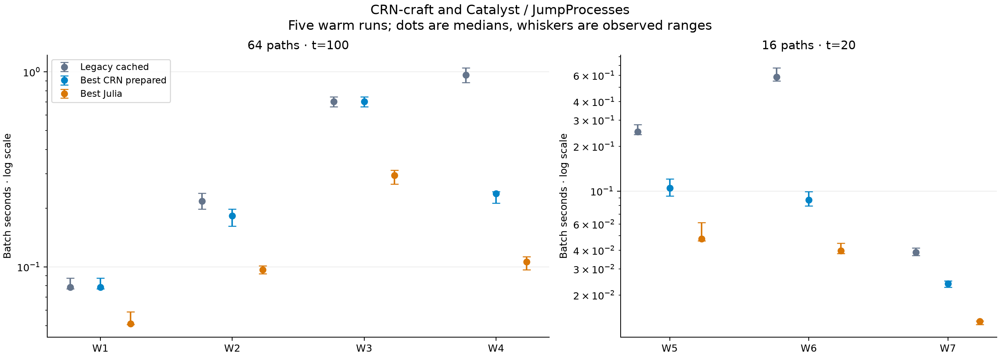

# CRN-craft compared with Catalyst.jl and JumpProcesses.jl

> **Measured with the 0.6.0 network engine (note of 12 November 2026).**
> The CRN-craft numbers on this page come from the network engine of
> releases 0.2.0 to 0.6.0 (its `simulate`, `simulate-cached` and `ssa`
> routes). Release 0.7.0 replaced that engine with one
> engine, whose selectors are ports of the methods measured here. Julia is
> not available on the host of the 0.7.0 measurements, so these comparisons
> were not repeated, and the tables below are left as measured. For the
> 0.7.0 engine against the 0.6.0 network engine on the same host, see the
> [speed gate](technical-report.md#71-speed-gate) and
> `validation/merge/RESULTS.md` ("M4d (speed gate): results").

> **Measured before the 0.2.0 release.** These measurements come from
> development builds of 2 November 2026 and have not been repeated on
> release 0.2.0 (4 November 2026). The network SSA engine changed in
> between: `fast` became the default of `ssa` requests
> (`crn-craft.ssa-run/0.3`), the Ziggurat waiting-time sampler was
> refactored so the rules engine can share it, and
> `crn-craft.ssa-run/0.4` added the `next_reaction` aggregator, which
> this comparison does not include. Requests of the measured versions
> return the same results as before; their timings on 0.2.0 may differ.

Updated **2 November 2026**, after the five-step exact-SSA acceleration campaign.
CRN-craft **0.2.0-dev.1** now has DirectCR, SortingDirect, RSSACR, reusable Python
preparation and a separately versioned exponential Ziggurat sampler. Julia remains
**1.13.3**, Catalyst **17.0.0**, and
JumpProcesses **10.0.1**. Exact source hashes are
retained in the measurement report. The implementation was then an unpushed
patch over GitHub base `baed0e4590f93e4c1dcc77cd7f039a2604a1594c`; it has since
been merged and released in 0.2.0.

**The largest measured improvement over legacy cached Direct is 6.71×
on W6; W4 improves 4.04×.** Julia's fastest measured method remains
1.54–2.39× faster than the fastest CRN option across these
seven workloads. The fastest observed CRN prepared median beats Julia on
**0 of 7** workloads. All slower variants
and timing observations remain in the tables and raw evidence. The rightmost
column compares the current legacy cached solver with the best CRN option at the
same prepared boundary. Ratios use unrounded medians; CRN / Julia above 1 means
Julia was faster.

| Workload | Fastest CRN prepared | Seconds | Fastest Julia | Seconds | CRN / Julia | Cached / best CRN |
|---|---|---|---|---|---|---|
| W1 | CRN Legacy cached | 0.0785 | Julia Direct | 0.0511 | 1.54× | 1.00× |
| W2 | CRN SortingDirect · ziggurat | 0.1827 | Julia DirectCR | 0.0968 | 1.89× | 1.19× |
| W3 | CRN Legacy cached | 0.7048 | Julia SortingDirect | 0.2944 | 2.39× | 1.00× |
| W4 | CRN RSSACR · ziggurat | 0.2379 | Julia RSSACR | 0.1061 | 2.24× | 4.04× |
| W5 | CRN RSSACR · ziggurat | 0.1051 | Julia DirectCR | 0.0477 | 2.20× | 2.39× |
| W6 | CRN RSSACR · ziggurat | 0.0874 | Julia RSSACR | 0.0396 | 2.21× | 6.71× |
| W7 | CRN RSSACR · ziggurat | 0.0238 | Julia RSSACR | 0.0133 | 1.79× | 1.63× |

**Measured with `fast` (2 November 2026).** A direct same-host rerun with
`fast` engines and five Julia methods at one and eight workers is in
[fast mode versus Julia at one and eight threads](comparison-julia-8-threads.md).
Geometric mean of the best fast method's time over Julia's best: 0.69× at
eight workers and 1.15× at one worker on the original batches; 1.04× and 1.12×
on 256-path batches. It supersedes the projection below, which is kept as
recorded.

**Update with `fast` (projected, not remeasured).** Comparisons now time
CRN-craft with the `fast` switch (then opt-in), which emulates JumpProcesses' policy
(Xoshiro256++, running totals without loss or resolution checks, batched stop
polls; see the [0.6.0 README](https://github.com/dietmarwo/CRN-craft/blob/v0.6.0/README.md#exact-ssa-methods-and-the-fast-switch)).
Julia's package hosts were again unreachable, so this table scales the CRN
prepared medians of Astra's same-host rerun
([gap10 comparison](comparison-julia-gap10.md), `validation/julia-gap10/comparison.json`)
by the paired fast/default speedups measured on a different host
(`validation/fast/fast-vs-default.json`). It is a projection, not a Julia
measurement.

| Workload | Fastest projected CRN with `fast` | Projected seconds | Fastest Julia | Julia seconds | CRN / Julia |
|---|---|---|---|---|---|
| W1 | cached Direct | 0.0493 | Direct | 0.0506 | 0.97× |
| W2 | cached Direct | 0.0849 | RSSACR | 0.0980 | 0.87× |
| W3 | cached Direct | 0.2322 | SortingDirect | 0.2920 | 0.80× |
| W4 | RSSACR | 0.1137 | RSSACR | 0.1072 | 1.06× |
| W5 | DirectCR | 0.0580 | DirectCR | 0.0484 | 1.20× |
| W6 | RSSACR | 0.0544 | RSSACR | 0.0388 | 1.40× |
| W7 | cached Direct | 0.0133 | RSSACR | 0.0138 | 0.96× |

Projected geometric mean 1.02× (checked default, measured by Astra on the same
host: 1.44×). A direct rerun with `fast` engines remains the authoritative check.

**Update after the Julia-gap campaign (projected, not remeasured).** A
follow-up campaign ([protocol](decisions/julia-gap-2026-11-02.md),
[log](campaign/julia-gap-implementation-log-2026-11-02.md)) kept five of ten
iterations under predeclared rules: AVX2 ChaCha8 dispatch, an exact Hill-rate
memo, a cached composition envelope, a sums-only lazily checked rate tree and a
joint member/acceptance word. Julia's package hosts were unreachable from that
session, so the table multiplies the CRN medians above by the paired speedups
measured on another host; it is not a Julia measurement, and the tables below
remain the measured comparison.

| Workload | Fastest projected CRN | Projected seconds | Fastest Julia | CRN / Julia |
|---|---|---|---|---|
| W1 | Legacy cached | 0.0749 | Direct | 1.47× |
| W2 | DirectCR | 0.1272 | DirectCR | 1.31× |
| W3 | SortingDirect | 0.3278 | SortingDirect | 1.11× |
| W4 | RSSACR | 0.1946 | RSSACR | 1.83× |
| W5 | DirectCR | 0.0768 | DirectCR | 1.61× |
| W6 | RSSACR | 0.0614 | RSSACR | 1.55× |
| W7 | RSSACR | 0.0187 | RSSACR | 1.41× |

The projected geometric-mean gap is 1.46× (measured 2.02× before). A direct
rerun of `validation/compare_julia_accelerated.py` remains the authoritative
check.

The [earlier comparison](comparison-catalyst-jumpprocesses-before-acceleration.md)
is preserved. Its absolute times are historical, not observations combined with
this rerun. The [GillesPy2 report](comparison-gillespy2.md) uses the same W1–W4
models but was not rerun here, so this is not a three-way timing comparison.

## What was implemented

| Step | Delivered change | What the evidence supports |
|---|---|---|
| 1 | Component profiling and immutable `prepare` / `prepare_ssa` handles | Preparation is a small fraction of the original W1–W4 batches; reusable calls preserve results and support concurrent reuse |
| 2 | DirectCR with dependency updates and power-of-two composition/rejection | Removes ordered-prefix maintenance; balanced-tree and rejection costs can dominate small/dense workloads |
| 3 | SortingDirect and a versioned Ziggurat wait sampler | Both execute and replay; changing only the wait sampler does not guarantee an end-to-end gain |
| 4 | RSSACR with certified integer-box bounds, exact point fallbacks and explicit rejected-work limits | Avoids many actual-rate evaluations while preserving gates, absorption and checked state updates |
| 5 | Fresh Julia rerun and three larger connected networks | Shows where algorithm choice pays and where a measured gap remains |

This reimplements relevant algorithmic techniques in Rust; it does not recreate
Julia's compiler, symbolic model generator or complete solver ecosystem.
[Implementation details and API examples](alternative-ssa.md) explain the
published algorithm families, numerical policy and new contracts. The old
Direct/cached interfaces, schemas and byte identities are preserved. New methods
return `ssa-result/0.1` JSON, not a legacy sealed archive.

## Models and timing boundaries

| ID | Network | Species | Reactions | Paths | Horizon |
|---|---|---|---|---|---|
| W1 | Immigration–death | 1 | 2 | 64 | 100.0 |
| W2 | Sparse independent channels | 33 | 66 | 64 | 100.0 |
| W3 | Repressilator | 6 | 12 | 64 | 100.0 |
| W4 | Dense synchronized custom rates | 8 | 66 | 64 | 100.0 |
| W5 | Diffusion chain | 256 | 510 | 16 | 20.0 |
| W6 | Dense conversion | 32 | 992 | 16 | 20.0 |
| W7 | Compartment binding/diffusion | 96 | 126 | 16 | 20.0 |

W1–W4 are unchanged. W5 has 256 species, four initial molecules each, and
nearest-neighbor conversion at rate 0.5 in each direction. W6 has 32 species,
32 initial molecules each, with heterogeneous pairwise conversion rates
`0.005 * (1 + (7*i + 11*j) % 8)`. W7 has 32 compartments, each initially
A=24, B=12, C=4; A+B binds at 0.015, C dissociates at 0.5, and A diffuses
between adjacent compartments at 0.1. Frozen JSON and hashes accompany the
report. All channels remain separate.

All batches use one numerical worker, seed 4242 and saves at 0 and the horizon.
Julia uses one advancing Xoshiro stream per batch; CRN uses its pinned per-path
ChaCha8 streams. Matching seed numbers do not imply matching paths. Five rounds
use a deterministic shuffled order, then rotate/reverse it. No build or heavy
validation runs during the final warm rounds. No outlier is removed.

| Boundary | Included | Outside the warm timer |
|---|---|---|
| CRN one-shot | Request encoding, native validation/model preparation, simulation, standard metadata/statistics, result encoding and Python decoding | Model bytes/request dictionary creation; archive I/O |
| CRN prepared | Simulation, standard metadata/statistics, result encoding and Python decoding | Validation and preparation; archive I/O |
| Julia | Serial solve calls with SSAStepper, per-path initialization, saved-time/count checks, final statistics reduction | Catalyst construction/JIT setup, copy of pristine batch problem, JSON IPC |

These are application-level boundaries with different result/allocation policies,
not isolated equal-instruction kernels. Julia reuses its problem within each
batch, including SortingDirect's learned order, and starts each batch from a
pristine copy [1]. CRN resets ordering per replicate to retain worker-count
replay. Prepared calls produce identical results to one-shot calls.

Host: AMD EPYC 9V74 80-Core Processor, Linux x86-64, affinity
9 logical CPUs and cgroup quota
`800000 100000`. Release Rust 1.88.0, Python 3.12.14,
NumPy 2.5.4; Julia and BLAS each use one thread.
This shared-host study has five observations per row, not confidence intervals.

## Warm results

Seconds per batch: **median [minimum–maximum]**. CRN rows below use prepared calls.

| Implementation | W1 | W2 | W3 | W4 |
|---|---|---|---|---|
| CRN Legacy Direct | 0.0969 [0.0846–0.1024] | 0.7687 [0.7063–0.8075] | 1.7306 [1.6950–1.7531] | 1.0605 [0.9925–1.0956] |
| CRN Legacy cached | 0.0785 [0.0773–0.0877] | 0.2172 [0.1983–0.2383] | 0.7048 [0.6622–0.7436] | 0.9617 [0.8796–1.0463] |
| CRN Direct · inverse | 0.0974 [0.0909–0.1394] | 0.7595 [0.6941–0.9150] | 1.7668 [1.7016–1.9261] | 0.9886 [0.9325–1.0286] |
| CRN Direct · ziggurat | 0.0840 [0.0755–0.1115] | 0.7304 [0.6974–0.8393] | 1.7824 [1.7421–2.0256] | 0.9909 [0.9107–1.0264] |
| CRN Cached · inverse | 0.0932 [0.0872–0.0982] | 0.2252 [0.2117–0.2634] | 0.7225 [0.6641–0.7381] | 0.9167 [0.8924–0.9607] |
| CRN Cached · ziggurat | 0.0790 [0.0718–0.0926] | 0.2305 [0.2128–0.2476] | 0.7105 [0.6834–0.7723] | 0.9101 [0.8855–0.9507] |
| CRN DirectCR · inverse | 0.1591 [0.1433–0.1644] | 0.2037 [0.1885–0.2754] | 1.1336 [1.0082–1.2327] | 2.0358 [2.0132–2.1290] |
| CRN DirectCR · ziggurat | 0.1423 [0.1205–0.1516] | 0.1831 [0.1809–0.1881] | 1.0168 [1.0017–1.0350] | 2.0256 [1.8392–2.0796] |
| CRN SortingDirect · inverse | 0.0972 [0.0914–0.1194] | 0.1914 [0.1748–0.2126] | 0.8591 [0.7733–0.8979] | 1.8645 [1.8236–2.0355] |
| CRN SortingDirect · ziggurat | 0.0869 [0.0805–0.0903] | 0.1827 [0.1615–0.1978] | 0.7638 [0.7404–0.7645] | 1.8914 [1.6817–1.9740] |
| CRN RSSACR · inverse | 0.1624 [0.1429–0.1742] | 0.2001 [0.1885–0.2201] | 0.9058 [0.8826–0.9628] | 0.2494 [0.2271–0.2621] |
| CRN RSSACR · ziggurat | 0.1253 [0.1235–0.1293] | 0.1951 [0.1750–0.2486] | 0.8548 [0.8259–0.8794] | 0.2379 [0.2124–0.2434] |
| Julia Direct | 0.0511 [0.0507–0.0589] | 0.2014 [0.1897–0.2072] | 0.4299 [0.3952–0.4665] | 0.2576 [0.2488–0.3090] |
| Julia SortingDirect | 0.0593 [0.0537–0.0649] | 0.1354 [0.1281–0.1421] | 0.2944 [0.2653–0.3124] | 0.5682 [0.5081–0.6299] |
| Julia DirectCR | 0.0824 [0.0798–0.1071] | 0.0968 [0.0924–0.1012] | 0.4201 [0.4050–0.4772] | 0.7665 [0.7599–0.8674] |
| Julia NRM | 0.0688 [0.0663–0.0744] | 0.1293 [0.1127–0.1408] | 0.3564 [0.3458–0.4121] | 1.0269 [0.9296–1.1018] |
| Julia RSSACR | 0.0699 [0.0687–0.0897] | 0.1087 [0.1015–0.1119] | 0.3355 [0.3292–0.3662] | 0.1061 [0.0965–0.1126] |

| Implementation | W5 | W6 | W7 |
|---|---|---|---|
| CRN Legacy Direct | 1.6425 [1.6100–1.8219] | 2.1672 [2.1203–2.5283] | 0.1472 [0.1382–0.1606] |
| CRN Legacy cached | 0.2506 [0.2408–0.2798] | 0.5858 [0.5500–0.6724] | 0.0387 [0.0370–0.0415] |
| CRN Direct · inverse | 1.4742 [1.3870–1.4846] | 2.1579 [1.9829–2.4537] | 0.1313 [0.1257–0.1503] |
| CRN Direct · ziggurat | 1.4967 [1.4352–1.6837] | 2.1055 [1.9690–2.3088] | 0.1312 [0.1295–0.1383] |
| CRN Cached · inverse | 0.2583 [0.2453–0.2818] | 0.5452 [0.5036–0.6125] | 0.0389 [0.0382–0.0448] |
| CRN Cached · ziggurat | 0.2543 [0.2410–0.2778] | 0.5779 [0.4825–0.6720] | 0.0382 [0.0373–0.0396] |
| CRN DirectCR · inverse | 0.1167 [0.1098–0.1260] | 0.8003 [0.7205–0.9128] | 0.0352 [0.0336–0.0414] |
| CRN DirectCR · ziggurat | 0.1158 [0.1149–0.1259] | 0.7796 [0.7275–1.0170] | 0.0365 [0.0342–0.0424] |
| CRN SortingDirect · inverse | 0.2026 [0.1843–0.2657] | 0.8717 [0.8162–0.9171] | 0.0363 [0.0337–0.0463] |
| CRN SortingDirect · ziggurat | 0.2184 [0.1924–0.2381] | 0.8177 [0.7745–0.9597] | 0.0325 [0.0314–0.0344] |
| CRN RSSACR · inverse | 0.1064 [0.1056–0.1176] | 0.0936 [0.0833–0.0991] | 0.0273 [0.0252–0.0283] |
| CRN RSSACR · ziggurat | 0.1051 [0.0925–0.1209] | 0.0874 [0.0794–0.0989] | 0.0238 [0.0226–0.0249] |
| Julia Direct | 0.4734 [0.4393–0.5122] | 0.6984 [0.5991–0.7322] | 0.0404 [0.0389–0.0414] |
| Julia SortingDirect | 0.1238 [0.1167–0.1451] | 0.2185 [0.2134–0.2302] | 0.0152 [0.0144–0.0176] |
| Julia DirectCR | 0.0477 [0.0462–0.0614] | 0.2286 [0.1975–0.2290] | 0.0143 [0.0139–0.0155] |
| Julia NRM | 0.0648 [0.0606–2.1120] | 0.3065 [0.2801–0.3471] | 0.0182 [0.0172–0.0215] |
| Julia RSSACR | 0.0551 [0.0534–0.0652] | 0.0396 [0.0381–0.0447] | 0.0133 [0.0127–0.0134] |

The best-new-method boundary comparison is below. All one-shot/prepared
observations for every method are in the raw report, including slower choices.

| Workload | Best new method | One-shot seconds | Prepared seconds | One-shot / prepared |
|---|---|---|---|---|
| W1 | CRN Cached · ziggurat | 0.0763 | 0.0790 | 0.97× |
| W2 | CRN SortingDirect · ziggurat | 0.1745 | 0.1827 | 0.96× |
| W3 | CRN Cached · ziggurat | 0.7494 | 0.7105 | 1.05× |
| W4 | CRN RSSACR · ziggurat | 0.2220 | 0.2379 | 0.93× |
| W5 | CRN RSSACR · ziggurat | 0.1047 | 0.1051 | 1.00× |
| W6 | CRN RSSACR · ziggurat | 0.1141 | 0.0874 | 1.31× |
| W7 | CRN RSSACR · ziggurat | 0.0260 | 0.0238 | 1.09× |

Event normalization is secondary. Julia event counts were not instrumented:
its following values use the legacy CRN count as an explicitly labelled proxy.

| Workload | Best CRN ns / its event | Julia ns / CRN-event proxy |
|---|---|---|
| W1 | 62 | 40 |
| W2 | 148 | 78 |
| W3 | 192 | 80 |
| W4 | 193 | 87 |
| W5 | 322 | 146 |
| W6 | 379 | 173 |
| W7 | 221 | 123 |

## Why the results change

The first-step component measurements found roughly 3 ns per random word and
16–18 ns per inverse exponential draw, but preparation savings were small on
the original W1–W4 batches. On W6, RSSACR/Ziggurat took 0.1141 s one-shot
versus 0.0874 s prepared, but RSSACR/inverse moved only from 0.1076 s to
0.0936 s, and one-shot calls were faster than prepared ones on W1, W2 and W4;
with five shared-host observations per row, the reuse benefit is not resolved. These diagnostic component timings include their own API overhead;
they are not additive percentages of total simulation time.

The new selectors use checked balanced sums and bounded sampling. They pay for
tree maintenance, accounting and rejection draws, so replacing a compact prefix
scan can make a small or dense model slower. RSSACR instead changes how often
actual propensities are evaluated. The following measured work counts compare
cached inverse sampling with RSSACR/Ziggurat at the same batch size; their random
paths and accepted event counts differ.

| Workload | Cached rate evaluations | RSSACR rate evaluations | RSSACR bound updates | Rejected RSSA candidates | Accepted RSSACR events |
|---|---|---|---|---|---|
| W1 | 1,268,293 | 156,153 | 11,635 | 61,800 | 1,274,865 |
| W2 | 1,238,800 | 478,052 | 51,718 | 165,599 | 1,238,950 |
| W3 | 7,327,468 | 3,586,831 | 113,798 | 737,179 | 3,861,776 |
| W4 | 40,459,683 | 3,358,943 | 91,311 | 2,641 | 1,230,636 |
| W5 | 1,308,542 | 709,855 | 21,215 | 351,266 | 326,332 |
| W6 | 14,196,140 | 1,710,433 | 551,087 | 28,824 | 230,450 |
| W7 | 514,625 | 155,348 | 20,308 | 49,808 | 108,043 |

W4 is a particularly favorable RSSA case: every event changes all eight species
and all 33 custom death propensities, while bounded rejection can reuse their
envelopes. It is deliberately synthetic and has an equal-count invariant; its
behavior does not predict arbitrary dense-network performance. W5–W7 add
connected sparse, densely connected and compartmental structures but remain
synthetic. The full median tables, not an algorithm name alone, determine the
measured winner for each model.

No compiler-level attribution follows from these timings. Remaining differences
can include selection/summation design, bounds, checked count updates, RNG and
wait generation, generated rate code, metadata and API costs. This campaign
does not isolate the individual contribution of each difference.

## Correctness before speed

The protocol was committed before experiments. The final engine passed **181
release tests**, strict clippy/fmt, legacy path/CME gates, 69 schema/CLI checks,
normal/-O native/Python/prepared/concurrent checks, and the unchanged default
dependency gate. Rust 1.85 MSRV results are retained separately.

Every one of the ten method/wait combinations ran 100,000 paths on each of the
three linear and four nonlinear fixtures: **7,000,000 paths per full pass**.
All **210 marginal comparisons** passed. With family alpha 0.001, the frozen DKW
limit is 0.00804612; the largest observed error is
0.00491533. Wrong homodimer conventions
were rejected. Normal and Python -O final reports are byte-identical. Additional
million-sample categorical/exponential gates passed, as did forced tail/rejection
limits and independent enumeration of gated integer boxes. No tolerance was
relaxed after a failure.

The Julia comparison ran 512 validation paths per engine/model: **60,928 paths**
across 17 engines and seven workloads. W1/W2 use exact Poisson terminal laws;
other species are checked against legacy cached SSA. With K=6,946 and family
alpha 0.01, the one-sample bound is `sqrt(log(2K/alpha)/(2N))`, and the conservative
two-sample bound is `2*sqrt(log(4K/alpha)/(2N))`. This latter bound applies the
one-sample inequality to both empirical CDFs and uses the triangle inequality.
No independence between species is assumed for the union bound.

| Workload | Checks | Largest CDF distance | Bound | Result |
|---|---|---|---|---|
| W1 | 17 | 0.05650 | 0.11753 | Pass |
| W2 | 561 | 0.06452 | 0.11753 | Pass |
| W3 | 96 | 0.07812 | 0.24075 | Pass |
| W4 | 128 | 0.06250 | 0.24075 | Pass |
| W5 | 4096 | 0.12109 | 0.24075 | Pass |
| W6 | 512 | 0.10742 | 0.24075 | Pass |
| W7 | 1536 | 0.12500 | 0.24075 | Pass |

The "Checks" column counts every engine/species comparison, including rows that
cannot fail. On W3–W7, three CRN engines (`legacy_direct`, `direct/inverse` and
`cached_direct/inverse`) reproduce the legacy cached reference sample exactly at
the shared seed, and `direct/ziggurat` reproduces `cached_direct/ziggurat`; their
distance is 0 by construction (W3 18 of 96 rows, W4 24 of 128, W5 768 of 4096,
W6 96 of 512, W7 288 of 1536). All engines also share the legacy random streams
at that seed, so even different methods are correlated with the reference, which
weakens a two-sample test that assumes independent samples. With N=512 the
two-sample gate detects only CDF differences above 0.24. For W3–W7 these checks
are therefore translation checks of Julia against legacy cached SSA; the
100,000-path exact-law gate above is the evidence for the new methods' laws.
Future runs should use distinct seeds per engine and report distinct-sample
comparisons separately.

Propensity and stoichiometry probes passed on all seven models. W5/W6 preserve
total molecule count; W7 preserves global A+C and each compartment's B+C; W4
retains equal counts. Every timed batch reproduces its own numerical digest.
Compressed sample files retain all individual terminal counts. These conservative
terminal checks are useful translation checks, not proofs about rare tails or
arbitrary model equivalence; the larger 100,000-path laws provide a separate gate.

Catalyst uses ordinary mass-action arrows with the combinatorial convention and
full-rate arrows for custom laws. As in the original comparison, W4's redundant
Julia availability gates are omitted only on its equal-count reachable class.
The Hill and Michaelis–Menten reference bounds are valid for these translated
single-variable monotone laws [2]. CRN's new bounds also handle the distinct-gate
and consumed-repressor cases tested separately. Arbitrary nonmonotone Julia rates
need sound user-supplied bounds; this benchmark does not authorize endpoint-only
bounds for them.

## Startup, scope and retained evidence

The fresh timing process took **71.91 s** to its
ready response, including **9.65 s** of package imports and
**52.36 s** of setup for all seven models and five
algorithms. These nested figures are not additive and are not per-model startup
costs. Installation/precompilation and Rust/wheel builds are excluded. A long-lived
Julia process amortizes setup. Individual setup/first-use observations are retained.

Catalyst/JumpProcesses still offers a richer symbolic/programmatic modeling
interface and additional exact algorithms such as NRM and Coevolve [2]. This
patch focuses on CRN-craft's four existing built-in rate laws and strict JSON
execution contracts. It does not add arbitrary time-dependent rates, hybrid
jump–ODE models, spatial solvers, distributed execution, GPU support or new FSP/
ODE algorithms. Existing CRN FSP, approximate leaps and optional fitting/ODE
integrations are outside these timings.

One shared host, one worker, seven models and five rounds cannot establish a
universal ranking, parallel scaling, memory scaling or production workload result.
Algorithm choice and bracket tuning can change outcomes. Ziggurat changes paths
and must keep its separate sampler identity. New exact-method JSON has no sealed
archive wrapper yet. Other-platform wheels were not tested.

Reproduce with [validation/ssa-acceleration/README.md](../validation/ssa-acceleration/README.md).
The [raw timing report](../validation/ssa-acceleration/julia-comparison.json)
contains **1,015 observations**; the [validation report](../validation/ssa-acceleration/julia-validation.json)
contains all 6,946 checks and hashes of the sample files, sources and pinned Julia
environment. The [implementation log](campaign/ssa-acceleration-implementation-log-2026-11-02.md)
retains development failures and the absorption follow-up. The intentionally
interrupted validation is kept separately and is not used for these conclusions.
The figure and this document can be regenerated with
`python validation/render_acceleration_report.py`.

Sources checked 2 November 2026; timing and validation values are our measurements:

1. [JumpProcesses problem reuse and SortingDirect replay](https://docs.sciml.ai/JumpProcesses/stable/tutorials/ensembles_and_problem_reuse/).
2. [Jump types, exact algorithms, dependency graphs, rate bounds and original papers](https://docs.sciml.ai/JumpProcesses/stable/jump_types/).
3. [Catalyst model semantics](https://docs.sciml.ai/Catalyst/stable/introduction_to_catalyst/math_models_intro/) and [full-rate DSL arrows](https://docs.sciml.ai/Catalyst/stable/model_creation/dsl_advanced/).
4. [Julia 1.13.3 exponential sampler source](https://github.com/JuliaLang/julia/blob/v1.13.3/stdlib/Random/src/normal.jl); adapted MIT notices accompany the patch.
