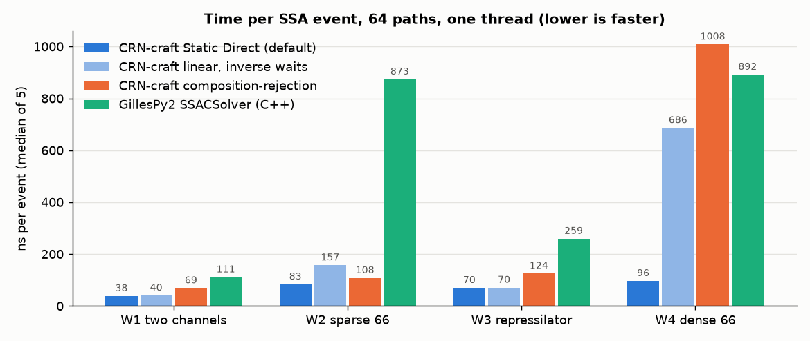

# CRN-craft compared with GillesPy2

Measured on 12 November 2026 with the unified engine of release 0.7.0
(branch `merge/M10c` at `cec91ed`, before the release commit, so the build
still reports the version string 0.6.0) and GillesPy2 1.8.3, Python 3.12.3
and g++ 13.3, on one shared two-CPU cloud host, every run under a CPU lock.
The protocol and the agreement rule were declared before the first run
(`validation/merge/RESULTS.md`, "M10c (GillesPy2 comparison on the unified
engine): declaration"). Script:
[`validation/compare_gillespy2.py`](../validation/compare_gillespy2.py);
raw report:
[`validation/merge/gillespy2-comparison-0.7.json`](../validation/merge/gillespy2-comparison-0.7.json).
An earlier comparison measured the network engine of release 0.2.0; it is
kept, separately, under [History](#history-the-network-engine-of-020).

## Summary

On these four networks GillesPy2's compiled Direct-method solver
(`SSACSolver`) takes longer than CRN-craft on every network, with every
CRN-craft configuration except two selectors on the dense network:

- with CRN-craft's default request (Static Direct, the `auto` selector,
  Ziggurat waits), 2.9 times as long on a two-channel network, 10.6 times
  on a sparse 66-reaction network, 3.6 times on the 12-reaction
  repressilator and 9.3 times on a dense 66-reaction Michaelis–Menten
  network;
- with the linear scan and inverse waits, the configuration closest to
  GillesPy2's algorithm, 2.8, 5.6, 3.7 and 1.3 times as long.

GillesPy2's pure Python solver (`NumPySSASolver`) takes 134 to 358 times as
long as CRN-craft's default. Its C++ solver compiles each model before the
first run, which took 2.1 to 2.9 seconds. Both simulators sample the same
process: all 28 agreement tests passed the declared rule.



## What was measured

| ID | Network | Reactions | Rate laws |
|---|---|---|---|
| W1 | immigration–death | 2 | mass action |
| W2 | 33 independent immigration–death species | 66 | mass action |
| W3 | three-gene repressilator | 12 | Hill repression and mass action |
| W4 | eight species born and removed together | 66 | mass action and gated Michaelis–Menten |

Each run simulates 64 paths over t from 0 to 100, with output at 0 and 100,
on one thread, root seed 4242. These are the frozen workloads of the earlier
performance campaigns. The network models are converted with
`crn_craft.convert` and run as `crn-craft.run/1.0` requests. Each row is the
median of five interleaved runs (three for the NumPy solver).

How each row was timed:

- **CRN-craft CLI:** the wall time of one `crn-craft run MODEL REQUEST`
  process for the default request, from start to exit, output included.
- **CRN-craft Python:** the wall time of `crn.ensemble(...)` and
  `.simulate()`, preparation, the native run and the pandas result included.
  Rows: the default request (`auto` picks the linear scan on W1 and W3 and
  RSSA-CR on W2 and W4), the linear scan with inverse waits (the checked
  configuration of release 0.6.0), and each selector with Ziggurat waits.
- **GillesPy2:** the wall time of `model.run(solver=..., number_of_trajectories=64)`
  with a solver object built beforehand. For the C++ solver this excludes
  the one-time compilation, reported separately.

Time per event divides by each CRN-craft row's own event count, and for
GillesPy2 by the event count of CRN-craft's linear scan with inverse waits
(1,274,177, 1,236,808, 3,648,339 and 1,228,794 events on W1 to W4). Both
simulate the same process, so the expected number of events is the same.

## Results

Median seconds for 64 paths:

| | W1 | W2 | W3 | W4 |
|---|---:|---:|---:|---:|
| CRN-craft CLI `run`, default | 0.049 | **0.099** | 0.269 | **0.107** |
| CRN-craft default (`auto`, Ziggurat) | **0.048** | 0.102 | 0.260 | 0.118 |
| CRN-craft `linear`, inverse waits | 0.051 | 0.194 | **0.257** | 0.843 |
| CRN-craft `linear`, Ziggurat | 0.049 | 0.208 | 0.262 | 0.789 |
| CRN-craft `composition_rejection`, Ziggurat | 0.087 | 0.133 | 0.511 | 1.240 |
| CRN-craft `sorting`, Ziggurat | 0.069 | 0.156 | 0.375 | 1.172 |
| CRN-craft `rssa_cr`, Ziggurat | 0.066 | 0.103 | 0.406 | 0.113 |
| GillesPy2 `SSACSolver` (C++) | 0.141 | 1.080 | 0.945 | 1.096 |
| GillesPy2 `NumPySSASolver` | 6.50 | 31.95 | 37.41 | 42.30 |
| GillesPy2 C++ compile (once per model) | 2.85 | 2.14 | 2.07 | 2.29 |

Time per event, in nanoseconds:

| | W1 | W2 | W3 | W4 |
|---|---:|---:|---:|---:|
| CRN-craft CLI `run`, default | 38 | 80 | 72 | 87 |
| CRN-craft default | 38 | 83 | 70 | 96 |
| CRN-craft `linear`, inverse waits | 40 | 157 | 70 | 686 |
| CRN-craft `composition_rejection` | 69 | 108 | 124 | 1,008 |
| CRN-craft `rssa_cr` | 52 | 83 | 107 | 92 |
| GillesPy2 C++ | 111 | 873 | 259 | 892 |
| GillesPy2 NumPy | 5,098 | 25,834 | 10,255 | 34,423 |

How many times longer GillesPy2's C++ solver takes than CRN-craft:

| | W1 | W2 | W3 | W4 |
|---|---:|---:|---:|---:|
| CRN-craft CLI `run`, default | 2.90 | 10.86 | 3.51 | 10.23 |
| CRN-craft default | 2.91 | 10.56 | 3.63 | 9.27 |
| CRN-craft `linear`, inverse waits | 2.78 | 5.57 | 3.68 | 1.30 |
| CRN-craft `composition_rejection` | 1.61 | 8.14 | 1.85 | 0.88 |
| CRN-craft `sorting` | 2.04 | 6.92 | 2.52 | 0.93 |
| CRN-craft `rssa_cr` | 2.13 | 10.54 | 2.33 | 9.67 |

Run-to-run spread: most timed runs lie within 10% of their median. Single
CRN-craft runs deviated by up to 34% (`rssa_cr` on W2) and GillesPy2's C++
solver by up to 7%; the medians are robust to these outliers. On W1 and W3
the default and the linear scan with Ziggurat waits are the same computation,
so their difference is noise.

## Reading the results

- **The per-event strategies differ.** In GillesPy2 1.8.3
  (`SSASolver.cpp`), after each event the C++ solver:
  - recomputes only the propensities the fired reaction affects;
  - sums all propensities again;
  - picks the reaction by a linear scan;
  - loops over all species to apply the update.

  CRN-craft's linear scan also recomputes only the affected rates, but it
  resumes its running total at the first changed channel and changes only
  the species the channel changes. On the sparse network (W2), where each
  reaction changes one species and one rate, that makes it 5.6 times
  faster.
- **The selector matters most on W2 and W4.** The default `auto` picks
  RSSA-CR there. On W4 every event changes all 33 Michaelis–Menten death
  rates; RSSA-CR keeps bounds on them and evaluates a rate only when a bound
  cannot decide, so it needs far fewer rate evaluations than any Direct
  scan. With the linear scan W4 is 1.3 times faster than GillesPy2; with
  RSSA-CR 9.3 times. Composition–rejection and sorting are slower than
  GillesPy2 on W4 and are not what `auto` picks there.
- **Every configuration keeps CRN-craft's checks.** On every event it checks
  that no positive rate is lost to rounding or too small to be selected,
  draws from a ChaCha8 stream per path, polls for cancellation, and gives
  byte-identical results for every thread count. GillesPy2 makes none of
  these checks. Release 0.6.0 had an opt-in `fast` policy that dropped the
  per-event checks; the unified engine has no such switch, so these rows are
  the checked engine.
- **Compilation matters for short jobs.** GillesPy2's C++ solver compiles
  each model before its first run, in 2.1 to 2.9 seconds, about 20 times the
  W1 run itself. CRN-craft needs no per-model compilation.
- **The NumPy solver** evaluates propensities in Python and takes 134 to 358
  times as long as CRN-craft's default.

## The two tools simulate the same process

Before timing, both simulators ran 512 paths of each network with fixed,
different seeds, twice: once with CRN-craft's linear scan and inverse waits,
once with its default. The declared rule: with a family-wise error rate of
0.01 over the 28 tests below (Bonferroni), a p-value below 3.6e-4 is a
failure; on W4 every species must stay equal within each path.

- **Final counts agree.** Two-sample Kolmogorov–Smirnov tests compared the
  final counts of up to three species per network: 20 tests, smallest
  p-value 0.209. Every mean z-score is at most 1.47 in absolute value.
- **The exact law agrees.** W1 and W2 have Poisson laws at t = 100, with
  means 100 and 15. Pooled chi-square tests against them: 8 tests (both
  simulators, both CRN-craft configurations), smallest p-value 0.044
  (GillesPy2 on W2).
- **W4:** all eight species stay equal in every path of both simulators, as
  the network's structure requires.

No test failed.

## How the models were translated

- **Mass action:** as GillesPy2 mass-action reactions. W1–W4 have only
  zeroth- and first-order reactants, so no combinatorial convention differs.
- **Hill repression:** as the propensity expression
  `basal + vmax / (1 + pow(x/K, n))`.
- **Michaelis–Menten:** as `vmax * S / (Km + S)`.
- **Reactant gates.** CRN-craft fires a whole-rule propensity only when its
  reactants are present. GillesPy2 expressions have no comparisons, so a gate
  is written as `x / (x + 1e-300)`, which is exactly 0 for x = 0 and 1
  otherwise.
- **W4 is timed without gates.** Its eight species always stay equal, so the
  gates on its Michaelis–Menten deaths never change a propensity. The
  validation confirms this. With the gates, GillesPy2's C++ solver took 9.32
  seconds instead of 1.10, about 8.5 times longer. That cost belongs to the
  translation rather than to GillesPy2, so the comparison uses the faster
  form; the gated time is in the raw report.

## Limitations

- **Host:** one shared two-CPU cloud host. Absolute times differ on other
  machines, and the ratios may too.
- **Random streams** are independent, so this compares cost for the same
  process, not identical paths.
- **Event counts:** GillesPy2's are not instrumented. Its time per event uses
  CRN-craft's count, and the 64-path counts of the two tools differ by
  sampling noise.
- **What the timings include:** GillesPy2's include building its result
  objects and, for the C++ solver, launching its compiled program and
  parsing its output. CRN-craft's Python rows include preparation and the
  conversion of the result into pandas objects.
- **Scope:** only exact SSA on one thread. CRN-craft can also divide
  replicates among threads without changing results. GillesPy2 also offers
  tau-leaping, hybrid and ODE solvers, which are not compared here.
- **Workload size:** the networks are small to medium (up to 66 reactions).
- **Build:** measured on a tree that still contained the network engine's
  code, before its deletion; the methods measured here do not call it.

## Reproducing

```sh
python -m pip install -r validation/reference-requirements.txt
maturin build --release --locked --out dist && python -m pip install dist/*.whl
cargo build --release --workspace --locked
python validation/compare_gillespy2.py --binary target/release/crn-craft \
    --output gillespy2.json --figure gillespy2.png
```

GillesPy2 builds its C++ solver with SCons through `python3` on the `PATH`,
so SCons must be importable there; with the virtual environment's `bin`
first on the `PATH` that is the environment's own Python. The script needs a
C++ compiler and takes about ten minutes, mostly in the NumPy solver.
`--only W1` measures one workload; the report above merges four such runs.

## History: the network engine of 0.2.0

These numbers were measured on 2 November 2026 with CRN-craft
0.2.0-dev.1, the network engine that release 0.7.0 replaced, and are not
comparable with the tables above: another engine, another random stream,
Python 3.13, and the `fast` policy, which dropped the per-event checks.
Raw report: [`validation/fast/gillespy2-comparison-fast.json`](../validation/fast/gillespy2-comparison-fast.json);
the first comparison (1 November, checked policy only) is in
[`validation/campaign/gillespy2-comparison.json`](../validation/campaign/gillespy2-comparison.json).

Median seconds for 64 paths, 2 November 2026 (0.2.0-dev.1):

| | W1 | W2 | W3 | W4 |
|---|---|---|---|---|
| CRN-craft `fast` cached Direct | 0.039 | 0.083 | 0.179 | 0.498 |
| CRN-craft `fast` DirectCR | 0.057 | 0.075 | 0.273 | 0.647 |
| CRN-craft `fast` SortingDirect | 0.046 | 0.102 | 0.193 | 0.639 |
| CRN-craft `fast` RSSACR | 0.058 | 0.083 | 0.309 | 0.083 |
| CRN-craft `simulate-cached` (checked) | 0.062 | 0.190 | 0.284 | 0.678 |
| CRN-craft `simulate` (checked) | 0.065 | 0.586 | 0.415 | 0.821 |
| GillesPy2 `SSACSolver` (C++) | 0.113 | 0.681 | 0.646 | 0.761 |
| GillesPy2 `NumPySSASolver` | 4.42 | 24.4 | 27.5 | 31.5 |
| GillesPy2 C++ compile (once per model) | 4.7 | 1.7 | 1.6 | 1.8 |


