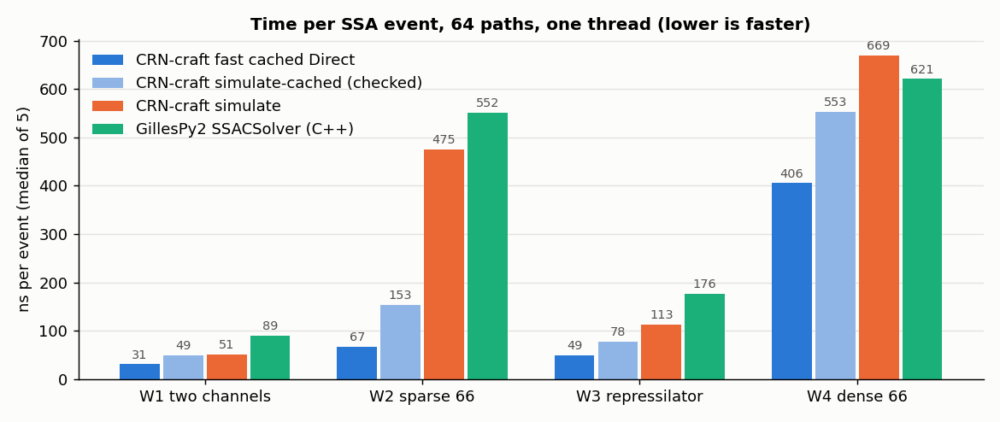

# CRN-craft compared with GillesPy2

> **Measured before the 0.2.0 release.** These measurements come from
> development builds of 2 November 2026 and have not been repeated on
> release 0.2.0 (4 November 2026). The network SSA engine changed in
> between: `fast` became the default of `ssa` requests
> (`crn-craft.ssa-run/0.3`), the Ziggurat waiting-time sampler was
> refactored so the rules engine can share it, and
> `crn-craft.ssa-run/0.4` added the `next_reaction` aggregator, which
> this comparison does not include. Requests of the measured versions
> return the same results as before; their timings on 0.2.0 may differ.
> With 0.2.0, `crn.ssa_spec(...)` without `fast` gives the `fast`
> policy timed here.

Measured on 2 November 2026 with CRN-craft 0.2.0-dev.1 (the `fast` branch on
top of main add6cca) and GillesPy2 1.8.3, Python 3.13 and g++ 13.3, on one
shared 2-vCPU cloud host. Script: [`validation/compare_gillespy2.py`](../validation/compare_gillespy2.py);
raw report: [`validation/fast/gillespy2-comparison-fast.json`](../validation/fast/gillespy2-comparison-fast.json).
The first comparison (1 November, checked policy only) is kept in
[`validation/campaign/gillespy2-comparison.json`](../validation/campaign/gillespy2-comparison.json).

## Summary

Benchmarks use CRN-craft's `fast` setting, which drops the same per-event
checks that GillesPy2 never makes (see [the `fast` switch](../README.md#exact-ssa-methods-and-the-fast-switch)).
With `fast` on, CRN-craft's cached Direct method, the closest match to
GillesPy2's compiled Direct-method solver (`SSACSolver`), is faster on every
network:

- 2.9 times faster on a two-channel network;
- 8.2 times faster on a sparse 66-reaction network;
- 3.6 times faster on the 12-reaction repressilator;
- 1.5 times faster on a dense 66-reaction Michaelis–Menten network, where
  CRN-craft's RSSACR method with `fast` is 9.2 times faster.

The legacy `simulate-cached` command, which always uses the checked policy
(`fast` off), is still 1.1 to 3.6 times faster than GillesPy2's C++ solver.
Against GillesPy2's pure Python solver (`NumPySSASolver`), CRN-craft with
`fast` is 114 to 381 times faster.
GillesPy2's C++ solver also compiles each model before its first run, which
took 1.6 to 4.7 seconds.



## What was measured

| ID | Network | Reactions | Rate laws |
|---|---|---|---|
| W1 | immigration–death | 2 | mass action |
| W2 | 33 independent immigration–death species | 66 | mass action |
| W3 | three-gene repressilator | 12 | Hill repression and mass action |
| W4 | eight species born and removed together | 66 | mass action and gated Michaelis–Menten |

Each run simulates 64 paths over t from 0 to 100, with output at 0 and 100, on
one thread. These are the frozen workloads of the performance campaign. Each
row below is the median of five interleaved runs (three for the NumPy solver).

How each column was timed:

- **CRN-craft `fast`:** the wall time of `crn.simulate_ssa(model, request)`
  for a `crn.ssa_spec(..., waiting_time="ziggurat", fast=True)` request,
  including JSON encoding and decoding.
- **CRN-craft checked:** the wall time of `crn.simulate(model, run)` (legacy
  checked Direct, plain and cached). The command line gives the same times
  within about 5%.
- **GillesPy2:** the wall time of `model.run(solver=..., number_of_trajectories=64)`
  with a solver object built beforehand. For the C++ solver this excludes the
  one-time compilation, which is reported separately.

Time per event uses each CRN-craft method's own event count, and CRN-craft's
legacy count for GillesPy2. Both simulate the same stochastic process, so the
expected number of events is the same.

## Results

Median seconds for 64 paths:

| | W1 | W2 | W3 | W4 |
|---|---|---|---|---|
| CRN-craft `fast` cached Direct | **0.039** | 0.083 | **0.179** | 0.498 |
| CRN-craft `fast` DirectCR | 0.057 | **0.075** | 0.273 | 0.647 |
| CRN-craft `fast` SortingDirect | 0.046 | 0.102 | 0.193 | 0.639 |
| CRN-craft `fast` RSSACR | 0.058 | 0.083 | 0.309 | **0.083** |
| CRN-craft `simulate-cached` (checked) | 0.062 | 0.190 | 0.284 | 0.678 |
| CRN-craft `simulate` (checked) | 0.065 | 0.586 | 0.415 | 0.821 |
| GillesPy2 `SSACSolver` (C++) | 0.113 | 0.681 | 0.646 | 0.761 |
| GillesPy2 `NumPySSASolver` | 4.42 | 24.4 | 27.5 | 31.5 |
| GillesPy2 C++ compile (once per model) | 4.7 | 1.7 | 1.6 | 1.8 |

Time per event, in nanoseconds:

| | W1 | W2 | W3 | W4 |
|---|---|---|---|---|
| CRN-craft `fast` cached Direct | 31 | 67 | 49 | 406 |
| CRN-craft `fast` best method | 31 | 61 | 49 | 67 |
| CRN-craft `simulate-cached` (checked) | 49 | 153 | 78 | 553 |
| GillesPy2 C++ | 89 | 552 | 176 | 621 |
| GillesPy2 NumPy | 3,485 | 19,802 | 7,500 | 25,732 |

How many times longer GillesPy2's C++ solver takes than CRN-craft:

| | W1 | W2 | W3 | W4 |
|---|---|---|---|---|
| CRN-craft `fast` cached Direct | 2.92 | 8.18 | 3.61 | 1.53 |
| CRN-craft `fast` best method | 2.92 | 9.05 | 3.61 | 9.19 |
| CRN-craft `simulate-cached` (checked) | 1.83 | 3.59 | 2.27 | 1.12 |
| CRN-craft `simulate` (checked) | 1.75 | 1.16 | 1.56 | 0.93 |

`fast` makes cached Direct 1.4 to 2.3 times faster than the checked
`simulate-cached` on these networks. The repressilator rows also include the
exact Hill-rate memo added since the first comparison, which made the checked
`simulate-cached` about twice as fast there (0.553 s on 1 November).

Run-to-run spread: most timed runs lie within 5% of their median. Single runs
deviated by up to 29% (CRN-craft `fast` cached Direct on W1, 0.050 s against a
0.039 s median) and 27% (`fast` DirectCR on W4), and GillesPy2's C++ solver
by up to 17% on W1; the medians are robust to these outliers.

## Reading the results

- **The two compiled solvers use different per-event strategies.** In
  GillesPy2 1.8.3 (`SSASolver.cpp`), after each event the C++ solver:
  - recomputes only the propensities the fired reaction affects;
  - sums all propensities again;
  - picks the reaction by a linear scan;
  - loops over all species to apply the update.

  CRN-craft's `simulate-cached` also recomputes only the affected
  propensities. In addition, it resumes its running sums from the first
  changed reaction and finds the reaction by binary search over those sums.
  CRN-craft's plain `simulate` recomputes every propensity after every event.
  That is why plain `simulate` is about twice as slow as GillesPy2 on the
  repressilator, whose Hill laws are expensive, while `simulate-cached` is
  faster on all four networks.
- **The largest gap is on the sparse network (W2).** Each reaction there
  changes one species and therefore one propensity. GillesPy2 then spends most
  of an event summing and scanning 66 propensities and 33 species. CRN-craft
  re-sums only from the changed reaction onward (half the channels on average)
  and finds the reaction by binary search in about six steps.
- **The checked policy does more work per event and is still faster.** On
  every event it checks that no positive propensity is lost to rounding or too
  small to be selected, polls for cancellation before every random number and
  uses a ChaCha8 stream per path. It also guarantees byte-identical results
  across threads and between its two implementations, and seals legacy results
  in checksummed archives. GillesPy2 makes none of these checks; `fast` drops
  the per-event checks too (it keeps sampling budgets, cancellation, checked
  state updates and thread-independent replay), so it is the like-for-like
  setting.
- **Algorithm choice matters most on W4.** Its 33 Michaelis–Menten deaths all
  change after every event. RSSACR keeps bounds on them and evaluates a rate
  only when a bound cannot decide, so it needs far fewer rate evaluations than
  any Direct method.
- **Compilation matters for short jobs.** GillesPy2's C++ solver compiles each
  model before its first run, in 1.5 to 2.1 seconds. That is about 20 times
  the W1 run itself. CRN-craft needs no per-model compilation.
- **The NumPy solver** is 63 to 294 times slower than CRN-craft's `fast`
  cached Direct. That is as expected for a solver that evaluates propensities
  in Python.

## The two tools simulate the same process

Before timing, both simulators ran 512 paths of each network with fixed,
different seeds:

- **Final counts agree.** Two-sample Kolmogorov–Smirnov tests and mean z-scores
  compared the final counts of up to three species per network.
  - W1–W3: five of the seven KS p-values are above 0.05.
  - The two exceptions: W2 species `X2` (mean z 3.14, KS p 0.018) and W3
    species `m2` (KS p 0.038).
  - W4's three species are identical within each path, so all three give
    KS p 0.34.
- **The exact law settles the borderline cases.** W1 and W2 have Poisson laws
  at t = 100, with means 100 and 15. Against those exact laws, both simulators
  pass:
  - CRN-craft: pooled chi-square p 0.17 on W1 and 0.71 on W2, and the root mean
    square of the 33 W2 mean z-scores is 1.03.
  - GillesPy2: pooled chi-square p 0.20 on W1 and 0.81 on W2, with a root mean
    square z of 1.09.
  - The W2 `X2` difference is therefore chance. A separate run of CRN-craft
    with six more seeds and 2,000 paths each gave a root mean square z of 0.99
    over 198 species means.
- **W4:** all eight species stay equal in every path of both simulators, as the
  network's structure requires.
- **The checked samples are the same as on 1 November.** Seeds and the checked
  policy are unchanged, so these figures repeat the first comparison exactly.
- **`fast` also agrees with GillesPy2.** CRN-craft's `fast` cached Direct ran
  512 more paths per network against 512 new GillesPy2 paths (other seeds):
  all ten KS p-values are at least 0.18 and every mean |z| is at most 1.47;
  against the exact Poisson laws, pooled chi-square p is 0.59 (W1) and 0.30
  (W2). Separately, `fast` passes CRN-craft's own 210-comparison exact-law
  gate (100,000 paths per fixture; `validation/fast/fast-laws.json`).

## How the models were translated

- **Mass action:** as GillesPy2 mass-action reactions. W1–W4 have only zeroth-
  and first-order reactants, so no combinatorial convention differs.
- **Hill repression:** as the propensity expression
  `basal + vmax / (1 + pow(x/K, n))`.
- **Michaelis–Menten:** as `vmax * S / (Km + S)`.
- **Reactant gates.** CRN-craft fires a custom-rate reaction only when its
  reactants are present. GillesPy2 expressions have no comparisons, so a gate
  is written as `x / (x + 1e-300)`, which is exactly 0 for x = 0 and 1
  otherwise.
- **W4 is timed without gates.** Its eight species always stay equal, so the
  gates on its Michaelis–Menten deaths never change a propensity. The
  validation confirms this. With the gates, GillesPy2's C++ solver takes 7.39
  seconds instead of 0.76, about 10 times longer. We consider that cost an
  artifact of the translation rather than of GillesPy2, so the comparison
  uses the faster form. The gated time is kept in the raw report.

## Limitations

- **Host:** one shared 2-vCPU cloud host. Absolute times differ on other
  machines, and the ratios may too.
- **Random streams** are independent, so this compares cost for the same
  process, not identical paths.
- **Event counts:** GillesPy2's are not instrumented. Its time per event uses
  CRN-craft's count, and the 64-path counts of the two tools differ by sampling
  noise.
- **What the timings include:** GillesPy2's include building its result
  objects and, for the C++ solver, launching its compiled program and parsing
  its output. CRN-craft's include JSON encoding and decoding in Python.
- **`fast` gives up the checked guarantees.** It drops CRN-craft's per-event
  loss and resolution checks and uses a different random generator, so its
  paths differ from the checked ones. It was opt-in when this was measured
  and is the default of `ssa` requests since `crn-craft.ssa-run/0.3`; see the
  README for when to set `fast: false`.
- **Scope:** only exact SSA on one thread. CRN-craft can also divide
  replicates among threads without changing results. GillesPy2 also offers
  tau-leaping, hybrid and ODE solvers, which are not compared here.
- **Workload size:** the networks are small to medium (up to 66 reactions).
  Larger networks favor dependency-based updates, as W2 shows.

## Reproducing

```sh
python -m pip install -r validation/reference-requirements.txt
maturin build --release --locked --out dist && python -m pip install dist/*.whl
cargo build --release --workspace --locked
cd validation
python compare_gillespy2.py --binary ../target/release/crn-craft \
    --output gillespy2.json --figure gillespy2.png
```

GillesPy2 builds its C++ solver with SCons through the system `python3`, so
SCons must be importable there as well as in the virtual environment.

The script needs a C++ compiler for GillesPy2's `SSACSolver` and takes about
ten minutes, mostly in the NumPy solver.
