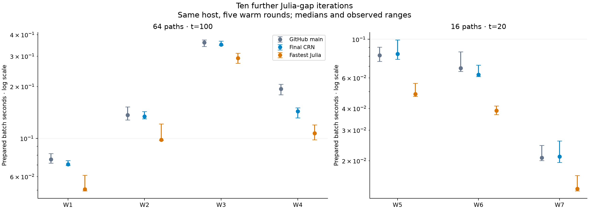

# Ten further CRN-craft / Julia-gap iterations

> **Measured before the 0.2.0 release.** These measurements come from
> development builds of 2 November 2026 and have not been repeated on
> release 0.2.0 (4 November 2026). The network SSA engine changed in
> between: `fast` became the default of `ssa` requests
> (`crn-craft.ssa-run/0.3`), the Ziggurat waiting-time sampler was
> refactored so the rules engine can share it, and
> `crn-craft.ssa-run/0.4` added the `next_reaction` aggregator, which
> this comparison does not include. Requests of the measured versions
> return the same results as before; their timings on 0.2.0 may differ.

Measured 2 November 2026. GitHub base: `add6cca0fb146e8a40418432e963219514086024`
(merged PR #7). Julia 1.13.3, Catalyst
17.0.0, JumpProcesses
10.0.1. This is a direct same-host rerun,
including a separately built GitHub-main Python wheel; it replaces no historical
measurement and uses no cross-host projection.

Ten candidates were implemented and tested in sequence. **3 were kept:
C05, C06, C09.** The fastest final CRN median improves by up to
**1.350×** over the fastest baseline choice. The geometric-mean
CRN/fastest-Julia gap is **1.441×**, versus
**1.540×** for GitHub main on this same host. The aspirational
1.25× target was **missed**.

| Model | Baseline best | s | Final best | s | Gain | Julia best | s | Final / Julia |
|---|---|---|---|---|---|---|---|---|
| W1 | cached Direct/ziggurat | 0.07541 | cached Direct/ziggurat | 0.07084 | 1.065× | Direct | 0.05061 | 1.400× |
| W2 | RSSACR/ziggurat | 0.13661 | DirectCR/ziggurat | 0.13414 | 1.018× | RSSACR | 0.09802 | 1.369× |
| W3 | SortingDirect/ziggurat | 0.36009 | SortingDirect/ziggurat | 0.35007 | 1.029× | SortingDirect | 0.29200 | 1.199× |
| W4 | RSSACR/ziggurat | 0.19371 | RSSACR/ziggurat | 0.14345 | 1.350× | RSSACR | 0.10719 | 1.338× |
| W5 | RSSACR/ziggurat | 0.08091 | RSSACR/ziggurat | 0.08233 | 0.983× | DirectCR | 0.04840 | 1.701× |
| W6 | RSSACR/inverse | 0.06830 | RSSACR/inverse | 0.06263 | 1.091× | RSSACR | 0.03883 | 1.613× |
| W7 | RSSACR/inverse | 0.02083 | RSSACR/inverse | 0.02112 | 0.986× | RSSACR | 0.01380 | 1.531× |

Ratios use unrounded medians. Final / Julia >1 means Julia was faster.
Best methods are selected from twelve prepared CRN options and five Julia
algorithms. These are five observations on one shared host; small differences
are not a precise ranking. All methods, including slower variants, are retained
in [the complete timing CSV](../validation/julia-gap10/all-method-timings.csv)
and [raw report](../validation/julia-gap10/comparison.json).
The fastest W5 and W7 choices were respectively 1.7% and 1.4% slower than
baseline in this run. Julia remained faster on every workload.

## Exposed regressions and follow-up

The all-method run exposed six prepared rows with original baseline/final
ratios below 0.95. A separate diagnostic used five fresh alternating pairs,
two repeats per side, after warmup. It did not replace any primary observation
or change an iteration decision. Original ratios below use the ratio of the
original medians; diagnostic ratios use the median paired speedup.

| Prepared row | Original baseline / final | Diagnostic paired gain |
|---|---|---|
| W3/RSSACR/inverse | 0.944× | 0.987× |
| W4/cached Direct/ziggurat | 0.943× | 1.014× |
| W4/DirectCR/inverse | 0.907× | 0.990× |
| W4/DirectCR/ziggurat | 0.940× | 0.878× |
| W5/cached Direct/inverse | 0.919× | 0.996× |
| W7/legacy cached | 0.916× | 0.977× |

Five of six drops did not reproduce at the 5% level. W4 DirectCR/Ziggurat did:
0.878× throughput, approximately 13.9% more elapsed time. This is a retained
tradeoff outside the declared eleven-row gate, even though W4's best RSSACR
choice improved by 1.350×. Choose RSSACR for the tested W4 workload; these
changes do not establish a win for every algorithm or wait sampler.

To investigate attribution, the same W4 DirectCR paths were run through the
native prepared benchmark at the base and each retained commit (three samples
per binary, median below; inverse and Ziggurat tested separately):

| Native build | DirectCR / inverse seconds | DirectCR / Ziggurat seconds |
|---|---|---|
| base | 1.36985 | 1.51546 |
| C05 | 1.35537 | 1.33345 |
| C06 | 1.34268 | 1.52697 |
| C09 | 1.35862 | 1.37652 |

These sequential native samples do not reproduce a final/base slowdown, and
the exact path digest and event count are identical across builds. The main
and diagnostic Python measurements include serialization and decoding, unlike
this native boundary. Generated-code layout, allocation and host variability
are possible explanations, not measured causes. Without a profiler, the
persistent Python-boundary regression remains unattributed. The patch retains
it explicitly; the original complete CSV includes every slower row.

Diagnostic code (`validation/diagnose_gap10_regressions.py`, deleted in 0.7.0 with the
other gap-10 drivers; see release 0.6.0) and
[all diagnostic observations](../validation/julia-gap10/regression-diagnostics.json)
are included. They are follow-up evidence, not extra attempts to satisfy the
fixed candidate acceptance rule.

## Ten measured iterations

The [protocol](decisions/julia-gap10-2026-11-02.md) was committed before candidate
measurements. Each candidate passed the Rust suite and 35 numerical-identity
checks, then five paired rounds on eleven representative workload/method rows.
Targets and thresholds were not changed after seeing timings. Rejected changes
were reverted, with their diffs and observations kept.

| Iteration | Decision | Target gain | All-row gain |
|---|---|---|---|
| C01 | Revert | 0.9880× | 0.9880× |
| C02 | Revert | 1.0060× | 1.0207× |
| C03 | Revert | 0.9898× | 0.9891× |
| C04 | Revert | 1.0138× | 1.0167× |
| C05 | Keep | 1.0448× | 1.0147× |
| C06 | Keep | 1.3568× | 1.0312× |
| C07 | Revert | 0.9927× | 0.9924× |
| C08 | Revert | 1.0156× | 1.0085× |
| C09 | Keep | 1.0254× | 1.0135× |
| C10 | Revert | 0.9817× | 0.9817× |

C05 avoids a third mass-action bound evaluation when the enabled lower corner
already gives the minimum positive rate. C06 shares successful custom-law ranges
only for bit-identical law parameters, regulator identity and feasible integer
interval; distinct availability gates are still checked. C09 compiles elementary
shapes into enum payloads, retaining the original rounded arithmetic and checked
general fallback. All existing stream/sampler identities remain in place.
C01/C02 polling changes, C03/C04 tree changes, C07 bucket lookup, C08 contiguous
SortingDirect and C10 Thin LTO did not satisfy the fixed rule on this host.

## Why Julia is faster

[The source investigation](campaign/julia-gap10-source-investigation.md) cites
the locally inspected pinned sources and their recorded hashes. Julia uses
compact mutable group sums, typed inlined mass-action loops, endpoint bounds for
appropriate laws, Xoshiro/Ziggurat, and learned SortingDirect order retained
between solves. CRN retains checked population updates, canonical sums and
resolution checks, cooperative stops, counted sampling budgets and worker-count
replay. Some mechanisms can be adopted without changing those guarantees;
source inspection alone does not establish that an implementation is faster.
The seven reverted experiments demonstrate that distinction.

No instruction profiler is installed here. Old callgrind percentages in the
attached log describe another host; they are not claimed as current attribution.
This campaign measures end-to-end effects and records evaluation/work counters.

## Validation before timing

The final engine passed **188 release tests** on Rust 1.88 and the Rust1.85
minimum, core/binding clippy with warnings denied, formatting, strict contract and
installed-package checks, legacy SSA/CME identities, and the dependency gate.
All **210 independent exact-law marginal comparisons** passed at 100,000 paths
per fixture/variant (7 million paths per full pass). Normal/-O reports match
byte for byte. The fixed family alpha is .001, epsilon
0.00804612; largest observed error
0.00491533. Power checks reject the
wrong homodimer convention. No acceptance tolerance was relaxed.

The Julia translation ran 512 paths per final engine/model with distinct seeds,
17 engines and seven workloads: 60,928 validation paths, 6,946 fixed comparisons.
W1/W2 use exact Poisson laws; other marginals use the legacy cached reference.
The same family-alpha .01 DKW rules are retained, including the conservative
two-sample triangle bound. Every timed baseline/final method also returns
identical numerical results; saved work counters are allowed to fall when work
is genuinely avoided.

| Model | Checks | Largest CDF distance | Fixed bound | Result |
|---|---|---|---|---|
| W1 | 17 | 0.05570 | 0.11753 | Pass |
| W2 | 561 | 0.07004 | 0.11753 | Pass |
| W3 | 96 | 0.09375 | 0.24075 | Pass |
| W4 | 128 | 0.10156 | 0.24075 | Pass |
| W5 | 4096 | 0.12695 | 0.24075 | Pass |
| W6 | 512 | 0.09961 | 0.24075 | Pass |
| W7 | 1536 | 0.10938 | 0.24075 | Pass |

All model propensity/stoichiometric probes and conservation checks passed.
Compressed terminal samples and their hashes are retained. These finite checks
support the tested models; they do not establish arbitrary-model or rare-tail
accuracy. Known steep-Hill RSSACR precision limitations remain documented.

## Timing boundaries and limitations

The run includes **1,435 timing observations**: 24 final Rust API rows
(one-shot and prepared), twelve prepared baseline rows, and five Julia rows on
each of seven workloads over five rotated/reversed rounds. All builds and heavy
checks finished before warm timing; no observation was removed. Each engine's
replay digest remained stable. Baseline/final prepared calls include native
simulation, result serialization and Python decoding. The baseline lives in an
isolated process; its IPC is outside its own timer. Julia times serial solves,
saved-state checks and final reduction; problem construction, pristine batch
copy and IPC are outside its warm timer. No archive writing is timed.

One numerical worker; seed4242; original frozen W1–W4 (64 paths,t100) and larger
W5–W7 (16 paths,t20), saving initial/final states. These are application boundaries,
not identical allocation/check pipelines. Julia starts each batch from a pristine
problem and keeps its learned order inside the batch; CRN resets per replicate.
The host is AMD EPYC 9V74 80-Core Processor, affinity
9, quota `800000 100000`.
Julia's fresh timing-process setup took 67.68s
for all seven models/five aggregators, not a per-model charge. Compiler/package
installation costs are outside warm timing. No multithread, GPU, other-host or
memory-scaling claim is made.

[Reproduction and raw evidence](../validation/julia-gap10/README.md),
[implementation log](campaign/julia-gap10-implementation-log-2026-11-02.md), and
[all final gate outputs](../validation/julia-gap10/final/summary.json) accompany
the patch. At import, no remote had been pushed and no package published;
the kept candidates were released in 0.2.0.
