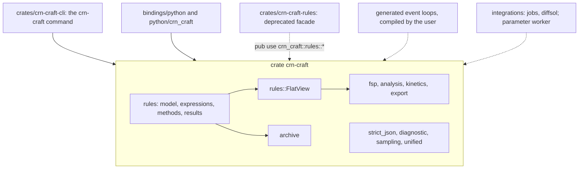
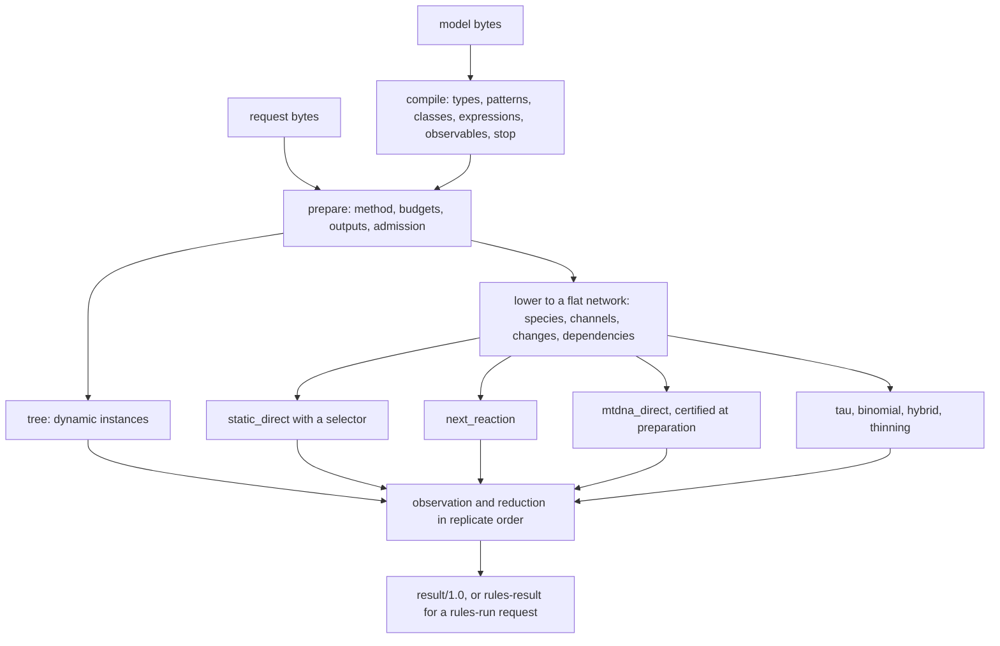
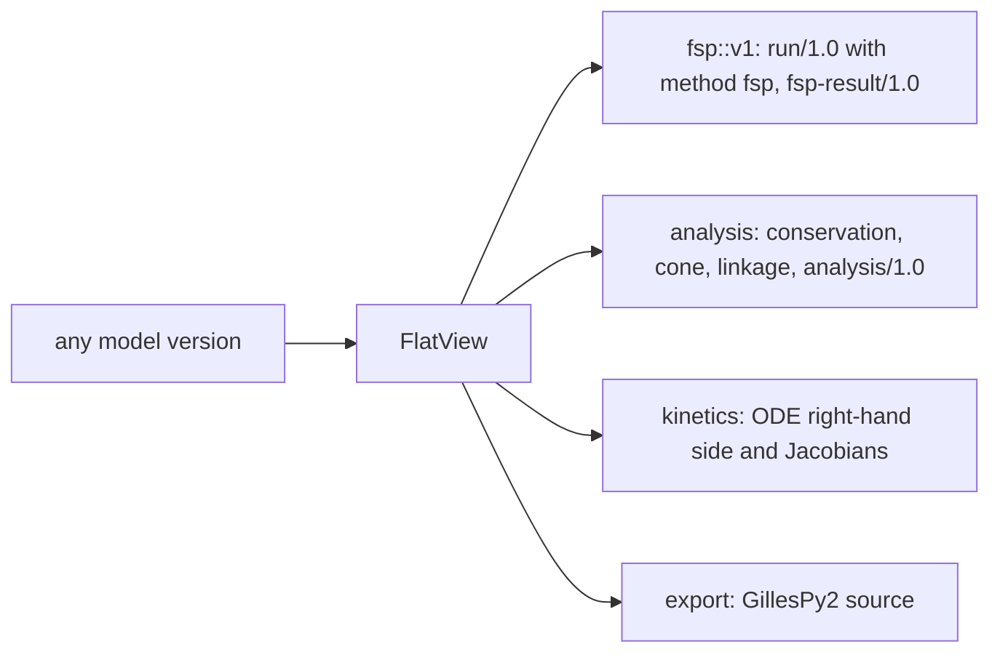

# CRN-craft architecture

CRN-craft has one engine for well-mixed stochastic chemistry, in the crate
`crn-craft`. A model declares species types, with or without attributes,
rules, observables and an optional stop expression. An ordinary reaction
network is a model whose types have no attributes. One model format, one
request and result contract, one expression language, one random number
generator (ChaCha8) and one set of diagnostics serve every method. A request
is bound to the exact bytes of its model, and every result carries its
termination, its sampler identity and the hashes of what it consumed. The
[technical report](../evidence/technical-report.md) covers the numerical methods and the
validation evidence.

Up to release 0.6.0 there were two engines: a network engine with fixed
species lists and a rules engine for attributed species. Release 0.7.0
merged them into the one engine described here. The
[merge plan](../history/plan-0.7.0-engine-merge.md) and the
[implementation log](../campaign/merge-0.7/README.md) record how.

## Package boundaries



| Component | Responsibility |
| --- | --- |
| `crates/crn-craft` | The engine. `crn_craft::rules` holds the model contract, the expression language, preparation, every simulation method, observation and the result contract. Around it: the flat view and the features that read it (finite state projection, network analysis, ODE kinetics, GillesPy2 export), sealed archives, the converter for network models, strict JSON, diagnostics, samplers and the discovery and check entry points. |
| `crates/crn-craft-cli` | The `crn-craft` command: reads files, calls the engine, prints JSON and schemas. |
| `crates/crn-craft-rules` | A deprecated facade: `pub use crn_craft::rules::*;`, so code written for 0.6.0 against `crn_craft_rules::X` still compiles. It also holds the generator examples `generate_rules_kernel`, `generate_rules_loop` and `benchmark_rules`. |
| `bindings/python`, `python/crn_craft` | The Python package: builder, prepared ensembles, pandas and xarray results, reports, importers, the compiled-loop driver and `python -m crn_craft`. The numerical loops run in Rust. |
| `integrations/jobs`, `integrations/diffsol`, `validation/parameter-optimization/worker` | Optional fcmaes job objectives, BDF integration with forward sensitivities, and a benchmark worker. Each has its own workspace and lockfile. |

The engine has no dependency on Python, job infrastructure or diffsol, and
it forbids unsafe code.

## Contracts

Rust types define every JSON schema. `crn-craft describe KIND` prints one,
and the files in `schemas/` are generated from the same types.
[Contracts](../reference/contracts.md) lists them all; in short:

| Contract | Role | Read by |
| --- | --- | --- |
| `crn-craft.model/1.0` | the model ([model reference](../reference/model-language.md)) | every command |
| `crn-craft.run/1.0` | the request: a simulation method, or `fsp` | `run`, `check` |
| `crn-craft.result/1.0` | the result of a simulation request ([result contract](../reference/results.md)) | written by `run` |
| `crn-craft.fsp-result/1.0` | the result of an `fsp` request | written by `run` |
| `crn-craft.check/1.0` | whether `run` would accept the documents | written by `check` |
| `crn-craft.analysis/1.0` | structure, conservation laws and bounds | written by `analyze` |
| `crn-craft.archive/1.0`, `archive-check/1.0` | a sealed run and its verification ([archive contract](../reference/archives.md)) | `run --archive`, `verify` |
| `crn-craft.import/1.0`, `export/0.1`, `state/0.1`, `report/1.0`, `describe/1.0` | importer report, GillesPy2 export, a state for `analyze`, the file of `Result.save`, discovery | see [contracts](../reference/contracts.md) |

Still read, unchanged:

- `crn-craft.rules-model/0.1` to `0.4` and `crn-craft.rules-run/0.1` to
  `0.6`. Their results are `rules-result/0.1` to `0.3` and replay byte for
  byte (`crates/crn-craft/tests/stored_requests.rs` and
  `static_direct_defaults.rs` check the stored requests on every build). A
  `rules-model/0.4` document means what `model/1.0` means, with the smaller
  limits of the `rules-model` versions. `check` reports `rules-check/0.1`
  for a `rules-model` alone.
- The network `crn-craft.model/0.1`, through the converter (below).

No longer read: the network engine's requests and results (`run/0.1`,
`ssa-run`, `tau-request`, `result/0.1` and `0.2`, `ssa-result`,
`tau-result`, `fsp-result/0.1`), `analysis/0.1` and `0.2`, `check/0.1`, and
`archive/0.1` with its check report. Their schema files are gone.

Version dispatch follows the `schema` string. A `model/1.0` model needs a
`run/1.0` request; a `rules-model` model runs under either request family.
The `rules-run` versions refuse every field that arrived with 1.0
(`method.selector`, `outputs.quantiles`, the `fsp` method) with `CRN-R020` at
`/schema`. Inside the engine, 1.0 is the last variant of each ordered version
enum, so every version test gives a 1.0 document the meaning of the newest
`rules-*` version.

Strict parsing rejects duplicate keys, unknown fields, `null` for a present
optional field, and documents over 16 MiB or 48 levels deep. Syntax and shape
errors stop parsing; semantic validation reports every error it finds, each
with a stable code and a JSON path ([diagnostics](../reference/diagnostics.md)). Hashes
are SHA-256 of the exact bytes consumed.

## From documents to results



`crn_craft::rules::prepare` validates exact model and request bytes and
builds an immutable `Prepared` run; `execute` runs it. Preparation parses
the expressions, resolves patterns into classes, compiles stop and
first-passage predicates into bytecode and checks the memory reservation of
the request. A closed model, one whose set of attribute vectors cannot grow
during a run, is lowered to a flat network: species, channels, the count
change of each channel, the species each rate reads and the channels each
firing affects. The rates of the lowered network are compiled into flat
programs with the parameters folded in. A subexpression that several rate
programs of one model share (the vacancy term of a builder model's
whole-rule propensities, for example) is computed once per state, by the
same operations in the same order, so every rate keeps its bits.

| Method | Execution and scope |
| --- | --- |
| `tree` | Exact Direct over dynamic attributed instances; the default method. Instances may change identity and product attributes may be random. Refuses higher-order rules. |
| `static_direct` | Exact Direct on the lowered network, with a selector (below). The generic exact method for closed models. |
| `next_reaction` | Exact Gibson–Bruck clocks on the lowered network; the dependency lists name the clocks to update. |
| `mtdna_direct` | Opt-in exact specialization for the fixed three-class mtDNA structure. If preparation cannot certify the model, Static Direct runs and a `CRN-R051` warning says why. Refuses higher-order rules. |
| `thinning` | Exact thinning for models with the ATP block. |
| `tau`, `binomial`, `hybrid` | Approximate methods with their own sampler identities: adaptive Poisson leaps (Cao–Gillespie–Petzold) with exact fallback; binomial splitting for single-parent unit births and deaths on a fixed step; piecewise-deterministic simulation of continuous variables. |
| `fsp` | Not a simulation: the finite state projection of a closed model, in a `run/1.0` request (below). |

[Exact methods](../reference/methods.md) describe
the methods; [the model reference](../reference/model-language.md) the language.

### Static Direct and its selectors

Each Static Direct event recomputes only the rates the last firing affects,
draws a waiting time and selects a channel. Rates are compiled programs
with dedicated forms for the converted Hill and Michaelis–Menten laws and
for products of a value with constants and counts; a stop of the form
`T > 0 && P >= f * T` over sums of observables has its own form too; count
factors are precomputed per channel; count updates apply in one pass and undo
themselves on an error. A positive channel below 2⁻⁵³ of the total fails the
replicate (`CRN-R031`), and a negative or non-finite rate fails it
(`CRN-R030`). Under `run/1.0` a positive wait too small to move the clock is
accepted, and 1,000,000 such steps in a row fail with `CRN-R030`; every
`rules-run` version fails at the first.

The selector chooses how the next channel is found. Every selector samples
the same law and uses the random stream in its own way, so the sampler
identity names it.

| `selector` | Selection |
| --- | --- |
| `linear` | a scan in channel order over running totals that resume at the first changed channel. The only selector of the `rules-run` versions. |
| `composition_rejection` | groups by the binary exponent of the rate, a group by mass, a member by rejection |
| `sorting` | a scan in a learned order |
| `rssa_cr` | candidates from upper bounds of the rates over population intervals, accepted against lower bounds or the exact rate |
| `auto` | the default of `run/1.0`: RSSA-CR from 8 channels when no rate reads two or more species (from 128 channels when the populations start small), composition–rejection from 128 channels, otherwise the linear scan |

`auto` decides at preparation from the initial counts, and
`describe()["selectors"]["auto"]` lists its thresholds. The selector tables
are reused between the replicates of a worker thread.

## The flat view

`crn_craft::rules::FlatView` is a read-only view of a lowered model, built
with the same lowering that the static methods run. Its species are labels:
the type name for an attribute-free type, `T{a=1,b=0}` for an attributed
one; for a converted network model they are the network's species in order,
and the channels are its reactions. `FlatView::propensity` evaluates a
channel with the engine's own arithmetic, so a feature that reads the view
sees the rates that Static Direct samples. A model without a closed set of
species (products that create attribute vectors, random product attributes,
an ATP block, continuous variables) has no view and is refused with
`CRN-R017`.



- **Finite state projection** (`fsp.rs`, module `fsp::v1`): enumerates the
  states within per-species bounds, propagates the distribution by
  uniformization and reports leakage and error terms separately. A state
  where the model's `stop` holds is absorbing.
- **Analysis** (`analysis.rs`, `conservation.rs`, `cone.rs`, `linkage.rs`):
  exact conservation laws, the nonnegative conservation cone, linkage
  classes and deficiency, and the propensities at a state
  ([network analysis](../reference/analysis.md)).
- **Kinetics** (`kinetics.rs`): the right-hand side of the macroscopic ODE
  and its state and parameter Jacobians, from dual-number evaluation of the
  rule expressions. `crn-diffsol` integrates them. At most 64 species,
  32 parameters and 256 channels.
- **Export** (`export.rs`): GillesPy2 source. A constant rate of at most two
  molecules is mass action; anything else is a custom propensity string.
  What GillesPy2 cannot evaluate is refused with `CRN-E050`.

Analysis and export build the view with every attribute-free type present,
so a species that starts at zero and is never produced keeps its channels.

## Network models and the converter

`crn_craft::rules::convert::from_network` (`crn-craft convert`,
`crn_craft.convert`) turns a network `crn-craft.model/0.1` into
`model/1.0`. Each species becomes an attribute-free type with a count
observable of the same name; each reaction becomes one rule; mass action
becomes a `rate`; Hill and Michaelis–Menten laws become whole-rule
`propensity` expressions in a stable form; stoichiometry above one becomes a
pattern `count`. Names that collide with function names are renamed, and the
model's `description` lists the renamings. Population limits and networks
without reactions are refused with `CRN-R016`. The network model's own
validation runs inside the converter, so an invalid network keeps its
diagnostics. `check`, `analyze` and `export` convert on the fly; `run`
refuses a network model with `CRN-E033`.

## Random streams and reproducibility

Every replicate draws from its own ChaCha8 stream. The key is SHA-256 of the
domain `crn-craft.rules/0.1` and the root seed; the replicate index is the
stream id. A 53-bit uniform is the high 53 bits of a 64-bit word times 2⁻⁵³.
The exponential waits use the inverse transform or the Ziggurat sampler
(tables adapted from the Julia ecosystem), and the leap methods share one
Poisson sampler (`sampling.rs`). A completed numerical result depends on the
input bytes, the sampler identity and the seed, never on the thread count.
A changed request changes its hash. Timing, cancellation and wall-time
limits can change which work completes, and are outside fixed-work
reproducibility.

## Parallelism and observation

An ensemble claims replicate ids from a shared counter. A window of four
replicates per worker limits how far workers run ahead, and results reduce
in ascending id order, also the per-replicate values that quantiles need.
Trackers, event logs and Rust observers run on the native workers. Events of
one replicate are ordered; callbacks from different replicates can
interleave. An observer that always continues leaves the result
byte-identical. Reports are right-continuous: an event at a report time
contributes the post-event state.

## Budgets, cancellation and errors

A request states its budgets: events, sampling steps and instances per
replicate, threads, output bytes and an optional wall time. Admission
reserves the memory a request can need, within a 2 GiB workspace, before
anything runs. Workers poll cooperatively every 1,024 events: the
cancellation flag, the cancel file and the wall clock. The finite state
projection polls the flag at every poll and the file and the clock at the
first and every 1,024th.

Each replicate records how it ended: `completed`, `stopped`, `event_limit`,
`sampling_limit`, `instance_limit`, `wall_time_limit`, `cancelled`, `failed`
or `output_limit`. Ensemble statistics, quantiles included, are withheld
unless every replicate completed or stopped (`CRN-R050`). A result over its
output budget drops kept paths, statistics, observations and kept instances
but keeps the replicate accounting; if that still does not fit, the call
fails with a coded error.

Errors are `Diagnostic { severity, code, path, message, hint }` values with
stable codes ([diagnostics](../reference/diagnostics.md)). They stay structured through
Rust, the CLI and Python, where they surface as `CrnError`. Python runs
native calls off the GIL and checks for signals every 50 ms, so Ctrl-C
cancels through the same control. A callback that blocks also blocks Ctrl-C.

## Archives

`crn-craft run MODEL REQUEST --archive NEW_DIRECTORY` seals a run as
`crn-craft.archive/1.0`: the exact model and request bytes, the result as
`run` prints it, a manifest with the length and SHA-256 of each file, and a
completion marker written last. `crn-craft verify DIRECTORY` checks the files
and digests, prepares the inputs again and checks the relations between
request and result: identity, every record, the aggregates and the
statistics, which are recomputed bit for bit when every path is kept. A
complete archive can hold an incomplete simulation. Integrity checks are not
signatures. [Archive contract](../reference/archives.md)

## Command line and Python

```text
crn-craft describe [KIND]
crn-craft check MODEL [REQUEST]
crn-craft run MODEL REQUEST [--archive NEW_DIRECTORY] [--cancel-file PATH]
crn-craft verify DIRECTORY
crn-craft analyze MODEL [STATE]
crn-craft convert MODEL
crn-craft export MODEL gillespy2
```

`rules` and `rules-check` are aliases of `run` and `check`. `describe`
prints `crn-craft.describe/1.0`; the fields of 0.6.0's rules discovery are
under `legacy.rules`. `python -m crn_craft` has the same commands.

`import crn_craft as crn` gives the API: `Model`, `ensemble`, `prepare`,
`load`, `check`, `convert`, `describe`, `load_example`, `read_sbml`,
`read_bngl`, `compile_loop`, `loop_source`, `archive`, `verify_archive`,
`load_report`, `CrnError` and `CompiledLoopError`. These names write the 1.0
contracts, ask for the quantiles 0.025, 0.5 and 0.975 by default and leave
the selector to `auto`. `crn_craft.rules` is the 0.6.0 module under its old
name: the same names with the 0.6.0 defaults, the `rules-*` documents and the
linear scan. It writes a 1.0 document only when a call asks for a 1.0
feature, and a Static Direct request written that way names
`"selector": "linear"`, so 0.6.0 code keeps its documents, hashes and
results. The
[Migrating](../guide/migrating.md#from-the-060-module-to-the-top-level) lists the differences.

## Prepared runs, parameter binding and generated code

| Route | Reuse |
| --- | --- |
| `Prepared::bind_parameters` (Python `run.bind_parameters`) | A new prepared run with other parameter values and the same request and seed. It serializes and prepares the bound model again, because parameters can change attributes, projections and topology. Its hashes cover the bound documents. [Parameter sweeps](../guide/05-speed.md#parameter-sweeps) |
| Generated rates kernel | Rust source for the rates and projections of one lowered Static Direct model (constant and vacancy rates, weighted sums), run by the engine's scheduler. Rust only. |
| Generated event loop | Rust source for the whole Static Direct event of one model, up to 1 MiB of source: rates and their updates, the total, the resolution check, selection, count updates, projections and the stop predicate. `LoopHost` supplies waits, uniforms, reports, budgets, trackers and event logs, so one loop serves every Static Direct request for its model bytes. |

Generated code names `crn_craft::rules::` paths. Its fingerprint is the
SHA-256 of the emitted source keyed by the model bytes, so other model bytes,
another parameter set or another generator version are refused with
`CRN-R020`. Generated kernels and loops run the linear scan only and refuse
any other selector, also one that `auto` would pick (`CRN-R020` at
`/method/selector`); results are byte-identical to the interpreter.
`crn.compile_loop(model)` writes a small Cargo project around the generated
loop, depending on `crn-craft` at exactly the installed version (from
crates.io, or from a checkout named by `source=` or `CRN_CRAFT_SOURCE`), and
runs the built program as a subprocess, so no Rust ABI is shared with the
extension. Builds are cached by fingerprint, version, toolchain and driver;
loops cached by 0.6.0 are rebuilt once. Measure before adopting a generated
route ([checklist](specialized-kernels.md)).

## Changing the architecture

Start from the contract. Keep numerical execution independent of optional
integrations. A change that keeps a sampler identity must keep its replay
byte for byte; the stored `rules-run` requests must replay unchanged. A
change to a delivered request shape or to sampler semantics needs a new
version. Use independent law checks for new numerical policies and matched
workloads for performance claims. [Extension guide](extending.md)
