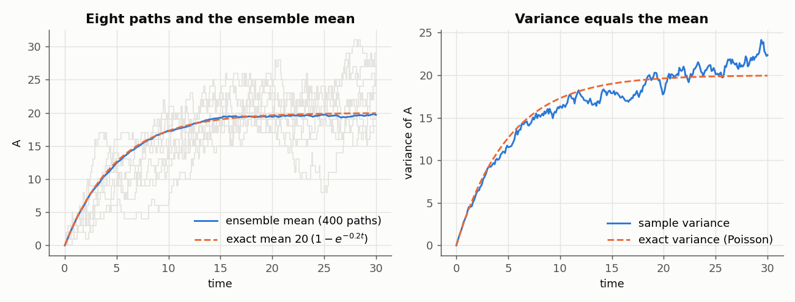

# 3. Running ensembles

An *ensemble* is a set of independent trajectories of one model, called
*replicates*. This chapter runs ensembles, makes them reproducible, and
shows how a run can end. The setup block builds the immigration–death model
of [chapter 2](02-first-model.md). The blocks of this chapter continue from
it:

```python
import numpy as np
import crn_craft as crn

model = crn.Model("immigration_death")
model.add_parameter({"birth": 4.0, "death": 0.2})
model.add_species("A", 0)
model.add_reaction("birth", [], ["A"], name="birth")
model.add_reaction("death * A", ["A"], [], name="death")
```

## Many trajectories in one call

One call runs any number of independent trajectories on native threads and
returns their statistics. There is no loop to write and no result to collect
by hand. `crn.ensemble` builds a run request, checks it and prepares it.
`simulate()` then runs the replicates:

```python
run = crn.ensemble(
    model, end=30.0, report_times=list(np.linspace(0, 30, 31)),
    replicates=400, seed=42, keep_paths=8, method="static_direct",
)
result = run.simulate()
assert result.metadata["termination"] == "completed"

t = np.array(result.metadata["report_times"])
mean = result.statistics["mean"]["A"].to_numpy()
exact = 20 * (1 - np.exp(-0.2 * t))
print(result.metadata["events"], "events")
print(f"mean at t=30: {mean[-1]:.2f}, exact {exact[-1]:.2f}")
assert abs(mean[-1] - exact[-1]) < 4 * np.sqrt(exact[-1] / 400)
```

```text
88037 events
mean at t=30: 20.09, exact 19.95
```

The immigration–death law is Poisson with mean `20 (1 - exp(-0.2 t))`, so
the mean and the variance agree:



`method="static_direct"` is the exact method for a reaction network
(Gillespie's direct method). Name it in every call: without `method`, a
slower exact method for models with changing species runs
([chapter 7](07-methods.md)).

## The everyday arguments

| Argument | Meaning |
| --- | --- |
| `end` | the time at which every replicate ends |
| `report_times` | increasing times in [0, `end`] at which the state is recorded |
| `replicates` | the number of trajectories; 1 by default |
| `seed` | the root seed; 0 by default |
| `threads` | 1 to 64 native threads; 1 by default |
| `keep_paths` | how many replicates keep their whole series: a count, or `"all"` ([chapter 4](04-results.md#single-trajectories)) |
| `method` | a method name, or a dictionary with options ([chapter 7](07-methods.md)) |
| `quantiles` | probabilities for the quantile statistics ([chapter 4](04-results.md#quantiles-and-the-median)) |

Report times are right-continuous: an event exactly at a report time is
included. Statistics exist only at the report times, so choose them for the
question. [Python API](../reference/python-api.md) lists every argument.

## Seeds and threads

Every replicate draws from its own random stream, keyed by the root seed and
the replicate's index. A result therefore depends on the seed and the
method, and not on the number of threads:

```python
def run(seed, threads, replicates=64):
    return crn.ensemble(
        model, end=30.0, report_times=[0.0, 10.0, 20.0, 30.0],
        replicates=replicates, seed=seed, threads=threads, keep_paths="all",
        method="static_direct",
    ).simulate()


one, two, other = run(7, 1), run(7, 2), run(8, 2)
same = one.records.equals(two.records) and one.rule_events.equals(two.rule_events)
print("1 and 2 threads, same seed, identical records:", same)
print("identical statistics:", one.statistics["mean"].equals(two.statistics["mean"]))
print("identical paths:", one.paths.equals(two.paths))
print("seeds 7 and 8, identical events:", one.records["events"].equals(other.records["events"]))
# Replicate i always uses the same stream, whatever the size of the ensemble.
small = run(7, 1, replicates=8)
print("first 8 of 64 equal an 8-replicate run:",
      small.records["events"].equals(one.records["events"].head(8)))
```

```text
1 and 2 threads, same seed, identical records: True
identical statistics: True
identical paths: True
seeds 7 and 8, identical events: False
first 8 of 64 equal an 8-replicate run: True
```

The same seed gives the same result again, on any machine and any number of
threads. Replicate *i* is the same trajectory in a larger ensemble, so a run
can be extended without changing what it already gave. Another seed gives
other trajectories of the same law. [Chapter 5](05-speed.md#threads) times
the threads.

## Check the termination

A run does not always complete. `result.metadata["termination"]` says how
the ensemble ended, and `result.records["termination"]` says it for every
replicate, with one of nine names:

| Termination | Meaning |
| --- | --- |
| `completed` | the replicate reached `end` |
| `stopped` | a stop condition ended it ([chapter 6](06-stops-trackers-logs.md)); this counts as complete |
| `event_limit`, `sampling_limit`, `instance_limit`, `wall_time_limit`, `output_limit` | a budget was reached (next section) |
| `cancelled` | the run was stopped from outside (last section) |
| `failed` | a rate or a stop could not be evaluated; `result.record_diagnostics` says why |

Always check the termination before using statistics. If any replicate ended
on a budget, was cancelled or failed, `result.statistics` is `None`: a
partial ensemble is never averaged as if it were complete.

## Budgets

Every run has explicit limits. A replicate that reaches one stops there.

| Limit | Argument | Default | Termination | Code |
| --- | --- | --- | --- | --- |
| events per replicate | `max_events` | 1,000,000 | `event_limit` | `CRN-R040` |
| random numbers per replicate | `max_sampling_steps` | 8,000,000 | `sampling_limit` | `CRN-R041` |
| live species instances per replicate | `max_instances` | 100,000 | `instance_limit` | `CRN-R042` |
| wall time of the whole run | `wall_time_s` | none | `wall_time_limit` | `CRN-R043` |
| size of the result | `max_output_bytes` | 64 MiB | `output_limit` | `CRN-R045` |

Here 50 events are too few for a run to time 30:

```python
short = crn.ensemble(model, end=30.0, report_times=[0.0, 30.0], replicates=8,
                     seed=1, max_events=50, method="static_direct").simulate()
print(short.metadata["termination"], short.statistics)
print(short.records["termination"].value_counts()["event_limit"], "replicates hit the limit")
```

```text
event_limit None
8 replicates hit the limit
```

The remedy is a larger limit, not an average over cut-off replicates. A long
run needs both `max_events` and `max_sampling_steps` raised. A wall-time
limit ends a run that takes longer than planned:

```python
slow = crn.ensemble(model, end=1e7, report_times=[0.0, 1e7], replicates=4,
                    seed=1, threads=2, max_events=10**9, max_sampling_steps=10**10,
                    wall_time_s=0.2, method="static_direct").simulate()
print(slow.metadata["termination"], slow.statistics)
print([d["code"] for d in slow.metadata["diagnostics"]])
print(sorted(set(slow.records["termination"])))
```

```text
wall_time_limit None
['CRN-R050']
['wall_time_limit']
```

The warning `CRN-R050` says that the ensemble is incomplete and its
statistics are withheld. The records still account for every replicate.

## Stopping a run

A long run can be stopped from outside by creating a file. The run ends with
the termination `cancelled`:

```python
import pathlib

pathlib.Path("stop").touch()
long_run = crn.ensemble(model, end=1e6, report_times=[0.0, 1e6], replicates=8,
                        max_events=10**9, method="static_direct")
stopped = long_run.simulate(cancel_file="stop")
print(stopped.metadata["termination"], stopped.statistics)
```

```text
cancelled None
```

Here the file exists before the run starts, so the run ends at once. On a
batch system, another job or a time limit creates the file. The engine looks
for it every 1,024 events. **Ctrl-C** cancels a running call in the same
way and raises `KeyboardInterrupt` within about 50 ms.

See also: [Results](04-results.md),
[Speed](05-speed.md),
[Troubleshooting](troubleshooting.md#runs-that-end-early).
