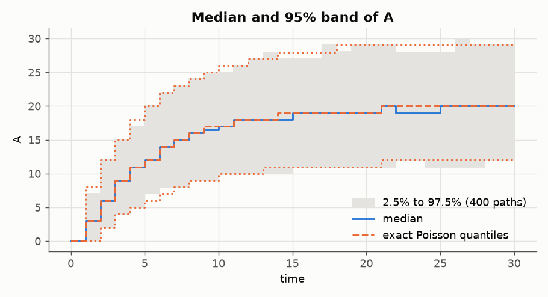

# 4. Results

`simulate()` returns a `Result`. This chapter reads it: statistics, single
trajectories, exports, plots and a file that holds a whole run. The setup
block runs the ensemble of [chapter 3](03-running.md), and every section
reads its `result`:

```python
import pathlib

import numpy as np
import crn_craft as crn

model = crn.Model("immigration_death")
model.add_parameter({"birth": 4.0, "death": 0.2})
model.add_species("A", 0)
model.add_reaction("birth", [], ["A"], name="birth")
model.add_reaction("death * A", ["A"], [], name="death")
result = crn.ensemble(
    model, end=30.0, report_times=list(np.linspace(0, 30, 31)),
    replicates=400, seed=42, keep_paths=8, method="static_direct",
).simulate()
```

## What a result holds

A `Result` holds pandas data frames and xarray arrays, indexed by name:

| Attribute | Content |
| --- | --- |
| `records` | one row per replicate: `termination`, `stop_time`, `events`, `rng_words`, ... |
| `rule_events` | events per replicate, one column per reaction |
| `statistics` | a dictionary of data frames indexed by report time: `mean`, `sample_variance`, `mean_standard_error`, `median`, `quantiles`; and `samples`, the number of replicates |
| `paths` | the kept trajectories, with dimensions `replicate`, `time`, `variable` |
| `metadata` | the whole result document: sampler, termination, totals, hashes |
| `model`, `request` | the documents that ran, as dictionaries |

```python
print(result.records["termination"].value_counts()["completed"], "completed replicates")
print(result.rule_events.mean().round(1).to_dict())
print(result.statistics["sample_variance"]["A"].iloc[-1].round(2))
print(result.statistics["mean_standard_error"]["A"].iloc[-1].round(3))
print(result.paths.dims, result.paths.shape)
```

```text
400 completed replicates
{'birth': 120.1, 'death': 100.0}
18.92
0.217
('replicate', 'time', 'variable') (8, 31, 1)
```

## Select by name

Columns carry the species names, so select by name, never by position:
`result.statistics["mean"]["A"]` is the mean of `A` at every report time, and
`result.paths.sel(variable="A")` is `A` in the kept trajectories. Species are
sorted by name, with continuous variables after them. `.to_numpy()` turns
any frame, column or array into a NumPy array.

## Mean, variance and standard error

At each report time, `mean` is the average over the replicates,
`sample_variance` their variance with the divisor n − 1, and
`mean_standard_error` the square root of the variance over n. The mean plus
and minus 1.96 standard errors is a 95% confidence interval. At t = 30 the
block above gives 20.09 ± 0.43, which contains the exact 19.95. Four times
the replicates halve the standard error.

## Quantiles and the median

`crn.ensemble` asks for the 2.5%, 50% and 97.5% quantiles by default:
`statistics["quantiles"]` is a dictionary from each probability to a data
frame shaped like `mean`, and `statistics["median"]` is the median:

```python
quantiles = result.statistics["quantiles"]
print(sorted(quantiles))
print(result.statistics["median"]["A"].iloc[-1], quantiles[0.025]["A"].iloc[-1], quantiles[0.975]["A"].iloc[-1])
```

```text
[0.025, 0.5, 0.975]
20.0 12.0 30.0
```

These are NumPy's default quantiles (linear interpolation) of the replicate
values at each report time. Pass `quantiles=[0.1, 0.9]` to choose others, up
to 16 probabilities in (0, 1), and `quantiles=()` to ask for none. The
median appears whenever 0.5 is among them:



A mean can mislead: when most replicates stay near zero and a few grow
large, almost no replicate is near the mean
([an example](12a-mtdna-takeover.md#the-mean-hides-the-typical-cell)).

## Single trajectories

`keep_paths` decides which replicates keep their series at the report times:
a count keeps replicates 0, 1, ... and `"all"` keeps every one, in `paths`:

```python
paths = result.paths
print(dict(paths.sizes))
print(paths.sel(replicate=3, variable="A").to_numpy()[:6])  # one trajectory
print(paths.sel(time=30.0, variable="A").to_numpy())  # every kept replicate at t = 30
print(paths.sel(variable="A").mean("replicate").to_numpy()[-2:])  # mean of the kept ones
```

```text
{'replicate': 8, 'time': 31, 'variable': 1}
[0. 1. 2. 5. 9. 9.]
[20. 21. 18. 13. 20. 24. 20. 19.]
[19.25  19.375]
```

`result.paths_frame()` gives the same values as a data frame indexed by
replicate and time, and `result.to_xarray()` as a dataset with one variable
per species. A replicate that ended on a budget has `NaN` after its last
report time.

The statistics are per species. A statistic of a sum of species, such as a
quantile of `M + A`, comes from the kept paths: run with `keep_paths="all"`
and reduce `result.paths.sel(variable=["M", "A"]).sum("variable")` with
NumPy. Kept paths cost memory ([chapter 5](05-speed.md#what-output-costs)).

## Export and plot

Every statistic is a data frame, so pandas writes it. This block writes the
mean with its band and the kept paths to CSV files and plots them:

```python
import matplotlib

matplotlib.use("Agg")  # draw into files, without a window
import matplotlib.pyplot as plt

band = result.statistics["quantiles"]
table = result.statistics["mean"].join(band[0.025], rsuffix="_low").join(band[0.975], rsuffix="_high")
table.to_csv("mean.csv")
result.paths_frame().to_csv("paths.csv")
print(pathlib.Path("mean.csv").read_text().splitlines()[:3])

figure, axis = plt.subplots(figsize=(6, 3.5))
axis.fill_between(table.index, table["A_low"], table["A_high"], alpha=0.2, label="2.5% to 97.5%")
axis.plot(table.index, table["A"], label="mean of 400 replicates")
axis.step(table.index, result.paths.sel(variable="A").to_numpy()[:3].T, where="post", lw=0.8)
axis.set(xlabel="time", ylabel="A")
axis.legend()
figure.savefig("mean.png", dpi=150)
print(pathlib.Path("mean.png").stat().st_size > 10_000)
```

```text
['time,A,A_low,A_high', '0.0,0.0,0.0,0.0', '1.0,3.5325,0.0,7.0']
True
```

## Save a run in one file

`Result.save` writes the model, the request and the results to one file:
`.md` gives a markdown report to read, `.json` one that `crn.load_report`
reads back:

```python
markdown = result.save("immigration-death.md")
result.save("immigration-death.json", paths=False)
report = crn.load_report("immigration-death.json")
print(report["schema"], sorted(report))
print("same sampler:", report["result"]["sampler"] == result.metadata["sampler"])
text = markdown.read_text()  # the markdown report has one section per statistic
print(text[text.index("### median") : text.index("### 97.5% percentile")].rstrip())
```

````text
crn-craft.report/1.0 ['crn_craft_version', 'model', 'request', 'result', 'schema']
same sampler: True
### median

```text
A: 0, 3, 6, 9, 11, 12, 14, 15, 16, 16.5, 17, 18, 18, 18, 18, 19, 19, 19, 19, 19, 19, 20, 19, 19, 19, 20, 20, 20, 20, 20, 20
```
````

`paths=False` leaves the single trajectories out. The report starts like this:

```python
print("\n".join(pathlib.Path("immigration-death.md").read_text().splitlines()[:23]))
```

````text
# Model

Name: immigration_death

## Reactions

```text
0 -> A, birth
A -> 0, death * A
```

## Start values

```text
A = 0
```

## Parameter values

```text
birth = 4
death = 0.2
```
````

The same result always gives the same bytes: a report holds no timestamp,
host name or timing. It names the package version and the SHA-256 hashes of
the model and the request, so it identifies what ran. A report is a readable
record. An *archive* is the sealed record that can be verified later
([chapter 10](10-command-line.md#run-archive-and-verify)).

See also: [Results reference](../reference/results.md),
[chapter 6](06-stops-trackers-logs.md), [chapter 8](08-reproducibility.md).
