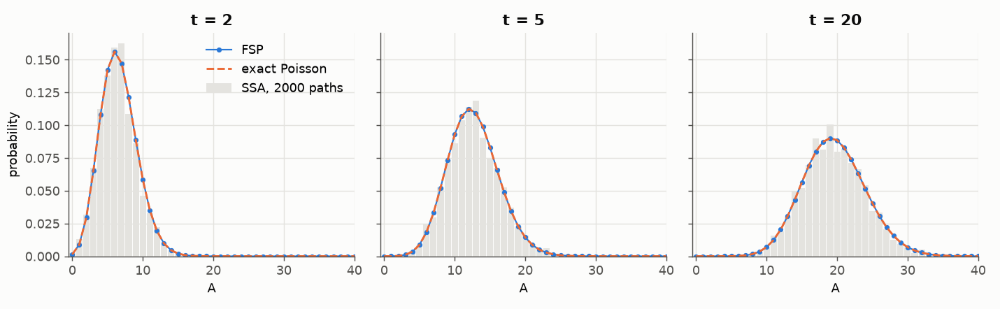
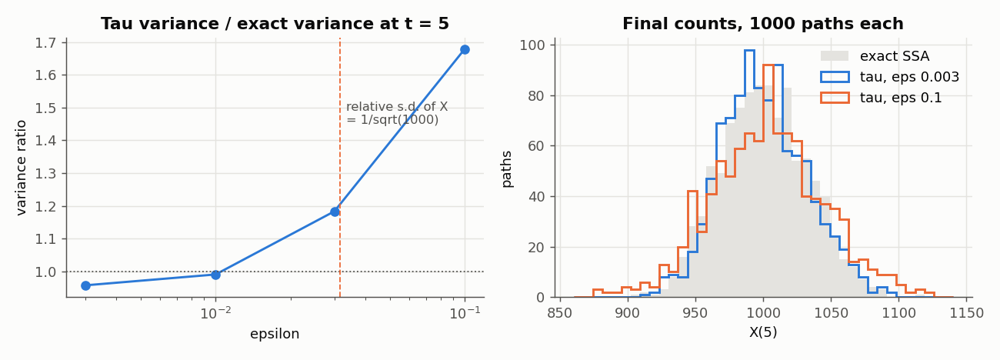

# 7. Choosing a method

Every method reads the same model, and the argument `method` of
`crn.ensemble` selects one. This chapter says which method fits which model
and shows the exact and the approximate ones at work. The setup block builds
the immigration–death model of [chapter 2](02-first-model.md). The blocks of
this chapter continue from it:

```python
import time

import numpy as np
import crn_craft as crn

model = crn.Model("immigration_death")
model.add_parameter({"birth": 4.0, "death": 0.2})
model.add_species("A", 0)
model.add_reaction("birth", [], ["A"], name="birth")
model.add_reaction("death * A", ["A"], [], name="death")
```

## Which method for which model

| Question | Model | Method | Exact? |
| --- | --- | --- | --- |
| Ensembles of a reaction network | any model built with `crn.Model` | `"static_direct"` | exact |
| A second exact method, as a cross-check | the same | `"next_reaction"` | exact |
| The whole distribution of a small system | few species, bounded counts | `model.fsp(...)` | exact up to reported error terms |
| Large populations, where exact events are too many | reaction networks | `{"kind": "tau", "epsilon": ...}` | approximate |
| Rates that read a continuous variable | built with `add_ode` | `"hybrid"` ([chapter 9](09-continuous-variables.md)) | approximate at its tolerances |
| Species that appear during a run, each with its own identity | a model file with attributes | no `method`: the tree method ([chapter 14](14-model-files.md)) | exact |
| The three-class mtDNA model | built with `crn.Model`, or a model file | `"mtdna_direct"`, a fast path ([page 12d](12d-mtdna-methods.md#the-fast-path), [page 14a](14a-mtdna-model-files.md#the-fast-path)) | exact |
| A stored model with an ATP block | a model file | `"thinning"` ([page 14a](14a-mtdna-model-files.md)) | exact |

For a model built with the builder, the answer is `"static_direct"` unless
one of the other rows applies. `crn.describe()["methods"]` lists the names.

## Same law, different random numbers

Exact methods sample the same process, but each uses the random stream in
its own way. The same seed therefore gives different trajectories under
another method or selector. Results agree in distribution, not path by path:
compare means and variances within their sampling error.

Every result names what ran in `result.metadata["sampler"]`, for example
`chacha8-u53-ziggurat/rules-static-direct/1`: the random generator, the
method and the selector. An approximate method has `approximate` in its
sampler, so it cannot be mistaken for an exact one.

## Static Direct and its selectors

Static Direct is Gillespie's direct method: draw the time to the next event,
then select the reaction that fires. A *selector* decides how the reaction
is selected, `selector=` in `crn.ensemble`. All selectors sample the same
law:

| Selector | How it selects |
| --- | --- |
| `linear` | a scan of the reactions in order |
| `composition_rejection` | reactions grouped by the binary exponent of their rate |
| `sorting` | a scan in an order that moves each fired reaction forward |
| `rssa_cr` | candidates from rate bounds over population intervals, then an acceptance test |
| `auto` | one of the others, chosen when the run is prepared (the default) |

```python
rows = []
for selector in ["linear", "composition_rejection", "sorting", "rssa_cr", "auto"]:
    result = crn.ensemble(model, end=30.0, report_times=[0.0, 30.0], replicates=400,
                          seed=42, method="static_direct", selector=selector).simulate()
    rows.append((selector, result.metadata["sampler"].split("/")[1]))
for selector, sampler in rows:
    print(f"{selector:22} {sampler}")
print(crn.describe()["selectors"]["auto"])
```

```text
linear                 rules-static-direct
composition_rejection  rules-static-direct-cr
sorting                rules-static-direct-sorting
rssa_cr                rules-static-direct-rssa-cr
auto                   rules-static-direct
{'composition_rejection_from_channels': 128, 'population_cut': 8.0, 'rssa_cr_from_channels': {'otherwise': 8, 'population_below_cut': 128}}
```

`auto` picks the linear scan for a small network such as this one. It picks
RSSA-CR from 8 reactions when no rate reads two or more species, and from
128 reactions when the species that start with molecules average fewer than
8; otherwise composition–rejection from 128 reactions. The last output line
holds these thresholds. `auto` decides from the initial counts, so a model
whose populations move far from them can get a slower selector.

For a network of some size, time the selectors on a short run before a long
one. This model has twenty strains that compete for room. Each strain grows
into the free room, dies, and gives rise to the next strain:

```python
def strains(count):
    """Strains S0, S1, ... share room K; strain i gives rise to strain i + 1."""
    names = [f"S{i}" for i in range(count)]
    model = crn.Model(f"strains_{count}")
    model.add_parameter({"K": 500.0, "g": 0.02, "mu": 0.001})
    model.add_species({name: 200 if i == 0 else 0 for i, name in enumerate(names)})
    free = f"max(0, K - ({' + '.join(names)})) / K"
    for i, name in enumerate(names):
        model.add_reaction(f"g * {name} * {free}", [name], [name, name], f"grow_{i}")
        model.add_reaction(0.01, [name], [], f"die_{i}")
        if i + 1 < count:
            model.add_reaction(f"mu * {name}", [name], [name, names[i + 1]], f"mutate_{i}")
    return model


twenty = strains(20)
for selector in ("linear", "composition_rejection", "sorting", "rssa_cr", "auto"):
    run = crn.ensemble(
        twenty,
        end=300.0,
        report_times=[0.0, 300.0],
        replicates=200,
        seed=1,
        threads=2,
        method="static_direct",
        selector=selector,
    )
    start = time.perf_counter()
    result = run.simulate()
    seconds = time.perf_counter() - start
    total = result.statistics["mean"].iloc[-1].sum()
    print(
        f"{selector:22s} {seconds:5.2f} s  {result.metadata['events']:>9,} events  "
        f"molecules {total:6.1f}  {result.metadata['sampler']}"
    )
```

```text
linear                  0.15 s    312,169 events  molecules  270.5  chacha8-u53-ziggurat/rules-static-direct/1
composition_rejection   0.21 s    313,771 events  molecules  270.8  chacha8-u53-ziggurat/rules-static-direct-cr/1
sorting                 0.14 s    312,179 events  molecules  270.7  chacha8-u53-ziggurat/rules-static-direct-sorting/1
rssa_cr                 0.20 s    313,771 events  molecules  270.8  chacha8-u53-ziggurat/rules-static-direct-rssa-cr/1
auto                    0.10 s    312,169 events  molecules  270.5  chacha8-u53-ziggurat/rules-static-direct/1
```

The molecule counts agree within sampling error, and each selector names
itself in the sampler. Every rate here reads all strains, so `auto` runs the
linear scan on these 59 reactions, and RSSA-CR draws the same events as
composition–rejection. With 59 reactions none is faster than the scan.

### Larger models

The same function builds a hundred strains. With 299 reactions, `auto` runs
composition–rejection:

```python
hundred = strains(100)
print("schema:", hundred.to_dict()["schema"])
result = crn.ensemble(hundred, end=100.0, report_times=[0.0, 100.0], replicates=20,
                      seed=1, threads=2, method="static_direct").simulate()
print(result.metadata["sampler"], result.metadata["termination"])
print(f"{result.metadata['events']:,} events;", len(result.rule_names), "reactions")
```

```text
schema: crn-craft.model/1.0
chacha8-u53-ziggurat/rules-static-direct-cr/1 completed
10,163 events; 299 reactions
```

Selectors pay off on large networks in which an event changes few rates. In
this model every event changes every rate, so recomputing the rates costs
more than selecting, and the choice of selector matters little. A model
takes up to 4,096 species, 16,384 parameters and 65,536 reactions
([limits](../reference/model-language.md#limits)).
[Methods and their options](../reference/methods.md) describes the selectors
and their sources.

## Exact distributions with finite state projection

For a small state space the chemical master equation can be solved directly.
Finite state projection (FSP) lists the states within bounds that you give
per species, sends every transition out of the bounds to a sink, and
computes the probability of every state at every report time. Probability
that leaves the bounds is reported, not hidden:

```python
projection = model.fsp(end=20.0, report_times=[0.0, 2.0, 5.0, 20.0],
                       bounds={"A": 80}, max_states=81, tolerance=1e-10)
print(projection)
last_mean = projection.mean["A"].iloc[-1]
print(float(last_mean), float(projection.truncation["mass_defect"].iloc[-1]))
assert abs(last_mean - 20 * (1 - np.exp(-4))) < 1e-8
```

```text
FspResult(81 states of A, 4 report times)
19.633687221220555 5.08937336718418e-11
```

`Model.fsp` returns an `FspResult` with the `states`, the `probabilities`
(a `time` by `state` array), the `mean` and the `truncation` error terms per
report time. `mass_defect` is the probability that is not on the projected
states. The other terms say where it went:

| Field | Meaning |
| --- | --- |
| `physical_leakage_estimate` | probability that left the bounds, in the sink |
| `series_tail_upper_bound` | upper bound on the truncated series of the time stepping |
| `discarded_weight_estimate` | the series weight actually omitted |
| `roundoff_mass_residual` | the remaining floating-point imbalance |

Here the projection matches the exact Poisson law to about 1e-12 and agrees
with a histogram of 2,000 sampled paths:



FSP is for small systems with a fixed list of species (`CRN-R017`
otherwise). A projection that leaks needs wider bounds.

## Approximate leaping

Tau leaping fires many reactions in one step. Each reaction fires a Poisson
number of times over a leap whose length keeps the relative change of every
rate below `epsilon` (Cao, Gillespie and Petzold 2006). A leap that would
make a count negative is rejected and halved, and a reaction that is close
to using up a reactant is simulated exactly:

```python
approx = crn.ensemble(model, end=10.0, report_times=[0.0, 10.0], replicates=200,
                      seed=1, method={"kind": "tau", "epsilon": 0.01}).simulate()
exact = crn.ensemble(model, end=10.0, report_times=[0.0, 10.0], replicates=200,
                     seed=1, method="static_direct").simulate()
print(approx.metadata["sampler"])
print(approx.metadata["events"], "leaps and exact steps;", exact.metadata["events"], "exact events")
```

```text
chacha8-u53/rules-approximate-cgp-poisson/2
12477 leaps and exact steps; 12153 exact events
```

For this small system, leaping does no less work than the exact method:
with about 20 molecules a leap holds roughly one firing. It pays off only
when populations are large.

How small must `epsilon` be? The figure compares 1,000 tau paths of a
birth–death process with mean 1,000 against 1,000 exact paths. The mean is
right at every `epsilon`. At `epsilon = 0.1`, three times the relative
standard deviation of the state (`1/sqrt(1000) = 0.032`), each leap moves
the state by more than its own fluctuations, and the variance is 83% too
large. For smaller `epsilon` the variance ratio stays within about two
standard errors of 1, which is the resolution of this experiment.



Rule of thumb: keep `epsilon` below the relative fluctuation of the species
you care about, and compare with an exact method on a reduced case before
you trust a large run.

`{"kind": "binomial", "step": 1.0}` is a second approximate method, with
fixed time steps. It runs only models in which every reaction is a birth or
a death of one molecule with one parent, and it serves to match a fixed-step
scheme ([an example](12d-mtdna-methods.md#matching-an-hourly-scheme)).

## Other methods

`"next_reaction"` is the exact method of Gibson and Bruck, with one clock
per reaction. It samples the same law as Static Direct from other random
numbers, which makes it the natural cross-check of an exact result.

- `"hybrid"` runs models with continuous variables
  ([chapter 9](09-continuous-variables.md)).
- The tree method runs when `method` is absent. It is exact, slower, and
  needed only for species with attributes that appear during a run
  ([chapter 14](14-model-files.md#new-identities-and-random-attributes)).
- `"mtdna_direct"` serves one structure, the three-class mtDNA model, built
  with the builder or as a model file
  ([page 12d](12d-mtdna-methods.md#the-fast-path)). `"thinning"` serves one
  structure of model file ([page 14a](14a-mtdna-model-files.md)).
- The Static Direct options `waiting_time` and `sparse_trackers` reproduce
  results of older releases ([reference](../reference/methods.md)).

## Performance notes

- **Threads** divide the replicates without changing results, and a
  **compiled model** gives byte-identical results in less time
  ([chapter 5](05-speed.md)).
- **Output** costs memory: keep `keep_paths` and the number of report times
  as small as the question allows.
- **FSP** costs states times series terms. Tighter bounds and a shorter end
  time help more than a looser tolerance.
- **Tau leaping** evaluates every reaction in every leap. On a network with
  about a thousand reactions, Static Direct with `auto` is much faster.

See also: [Methods and their options](../reference/methods.md),
[Speed](05-speed.md), [Technical report](../evidence/technical-report.md).
