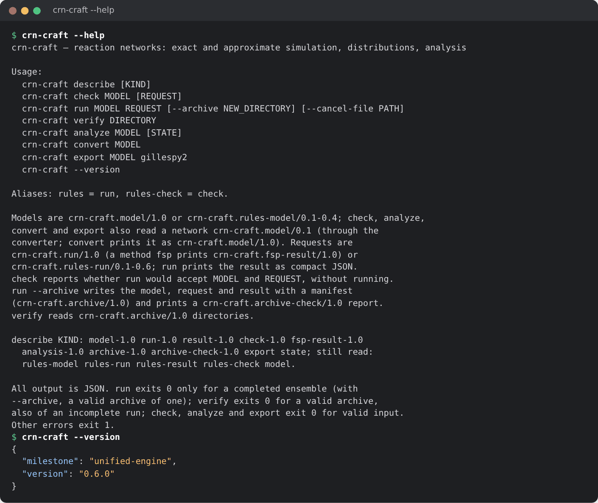
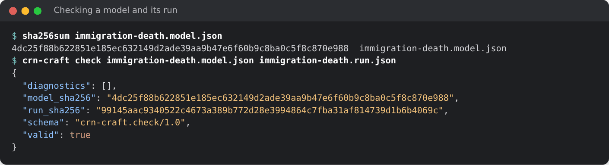
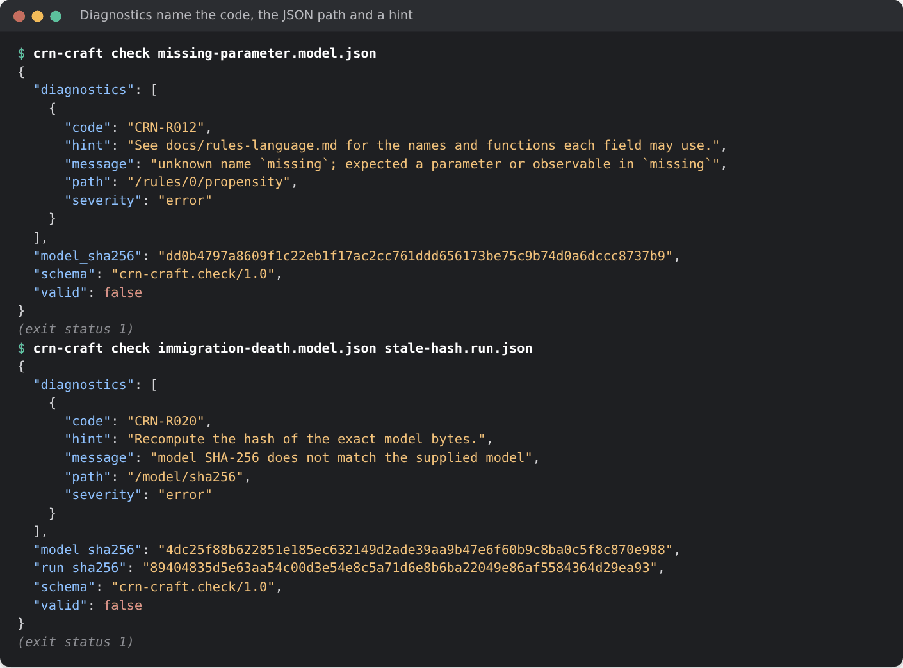
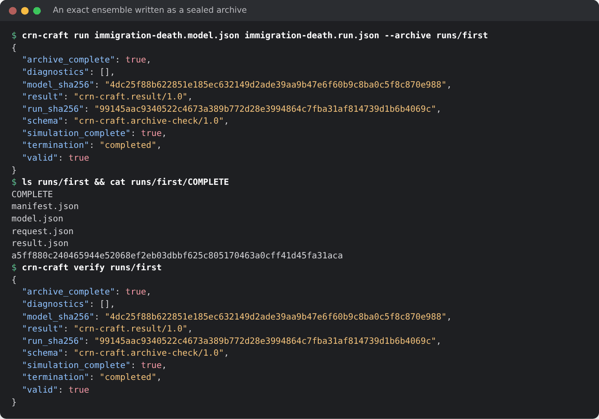
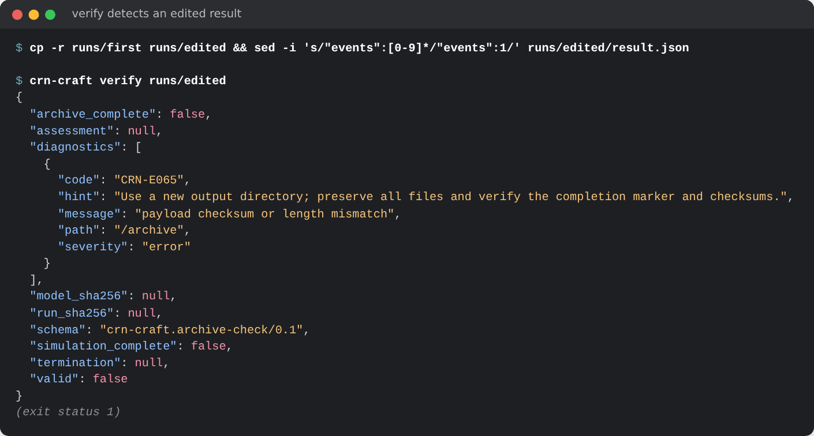
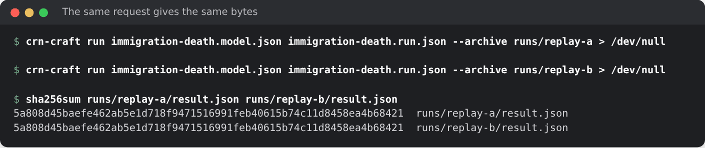
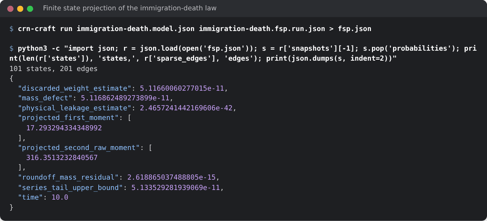
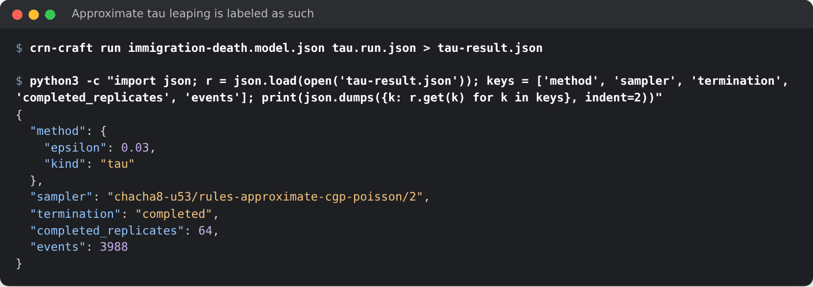
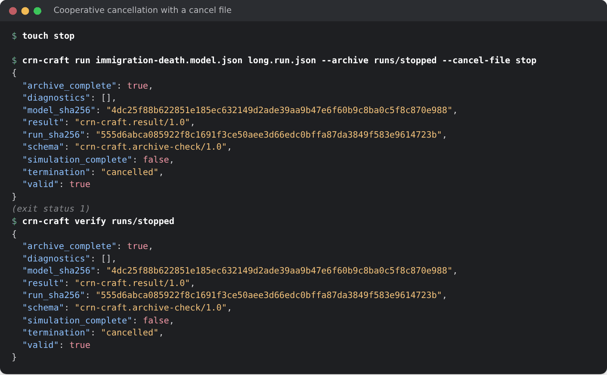

# 10. The command line, request files and archives

Everything that Python does can also be done from a shell, with a model file
and a request file. This is the way to run on a batch system or without
Python, and to seal a run in an archive that can be verified later. The
setup block builds the immigration–death model, writes it to a file and
makes a folder for archives. The sections of this chapter build on each
other's files, so run them in order:

```python
import hashlib
import json
import pathlib

import crn_craft as crn

model = crn.Model("immigration_death")
model.add_parameter({"birth": 4.0, "death": 0.2})
model.add_species("A", 0)
model.add_reaction("birth", [], ["A"], name="birth")
model.add_reaction("death * A", ["A"], [], name="death")
model_file = pathlib.Path("immigration-death.model.json")
model_file.write_text(model.to_json())
pathlib.Path("runs").mkdir(exist_ok=True)
```

## The crn-craft command

The Python package installs the command `crn-craft`. The native tool from
cargo has the same name, the same commands and the same reports
([chapter 1](01-install.md#the-command-line-tool-is-optional)). Every
command reads and writes JSON and exits 0 on success:



| Command | What it does | In Python |
| --- | --- | --- |
| `crn-craft describe [KIND]` | lists commands, methods and limits, or prints the JSON Schema of a document | `crn.describe()`, `crn.describe("run-1.0")` |
| `crn-craft check MODEL [REQUEST]` | validates without running | `crn.check(model, request)` |
| `crn-craft run MODEL REQUEST` | runs a request and prints the result | `crn.prepare(model, request).simulate()` |
| `crn-craft run ... --archive DIR` | writes the run as a sealed archive | `run.archive(directory)` |
| `crn-craft verify DIR` | checks an archive | `crn.verify_archive(directory)` |
| `crn-craft analyze MODEL` | structure and conservation laws | `Model.analyze()` ([chapter 11](11-analysis-import-export.md)) |
| `crn-craft convert MODEL` | converts a model of release 0.6.0 | `crn.convert(data)` (chapter 11) |
| `crn-craft export MODEL gillespy2` | writes GillesPy2 source | `Model.to_gillespy2()` (chapter 11) |
| `crn-craft-import` | imports SBML and BioNetGen files | `crn.read_sbml`, `crn.read_bngl` (chapter 11) |

`crn-craft describe run-1.0` prints the JSON Schema of a request, and
`model-1.0`, `result-1.0` and `fsp-result-1.0` those of the other documents.

## A request file

A *request* says what to compute: the method, the report times, the
replicates, the seed and the budgets. `crn.ensemble` writes one from its
arguments; here you write it yourself. (To repeat from the shell a run that
`crn.ensemble` prepared, archive it in Python and replay the archive:
[Replay](#replay).) It names its model by path **and by
the SHA-256 of the file's exact bytes**, so a result can never be attributed
to a model that was edited afterwards:

```python
request = {
    "schema": "crn-craft.run/1.0",
    "model": {
        "path": model_file.name,
        "sha256": hashlib.sha256(model_file.read_bytes()).hexdigest(),
    },
    "method": {"kind": "static_direct"},
    "time": {"end": 10.0, "report_times": [0.0, 1.0, 2.0, 5.0, 10.0]},
    "ensemble": {"replicates": 64, "root_seed": 42},
    "outputs": {"statistics": ["mean", "variance"], "keep_paths": 2, "keep_instances": 0},
    "budget": {
        "max_events_per_replicate": 1_000_000,
        "max_sampling_steps_per_replicate": 8_000_000,
        "max_instances": 100_000,
        "wall_time_s": 60.0,
        "threads": 1,
        "max_output_bytes": 1_048_576,
    },
}
pathlib.Path("immigration-death.run.json").write_text(json.dumps(request, indent=2) + "\n")
print(crn.check(model_file.read_bytes(), request)["valid"])
```

```text
True
```

| Field | Meaning |
| --- | --- |
| `model` | path and SHA-256 of the model file |
| `method` | `static_direct`, `next_reaction`, `tau`, `fsp`, ... ([chapter 7](07-methods.md)) |
| `time` | the `end` and strictly increasing `report_times` in [0, end] |
| `ensemble` | the number of `replicates` and the `root_seed` |
| `outputs` | which `statistics` to compute, `quantiles`, and how many paths to keep |
| `budget` | the limits of [chapter 3](03-running.md#budgets), all explicit |

## Check a model and a request

`check` takes a model file and an optional request and runs nothing:

```bash
sha256sum immigration-death.model.json
crn-craft check immigration-death.model.json immigration-death.run.json
```



Every problem is a diagnostic with a stable code, a JSON pointer to the
field, a message and a hint. This block writes two broken files: a model
whose rate reads a parameter that does not exist, and a request with the
hash of some other model:

```python
broken = crn.Model("immigration_death")
broken.add_species("A", 0)
broken.add_reaction("missing", [], ["A"], name="birth")
broken.add_reaction(0.2, ["A"], [], name="death")
pathlib.Path("missing-parameter.model.json").write_text(broken.to_json())
stale = json.loads(pathlib.Path("immigration-death.run.json").read_text())
stale["model"]["sha256"] = "0" * 64
pathlib.Path("stale-hash.run.json").write_text(json.dumps(stale, indent=2) + "\n")
```

```bash
crn-craft check missing-parameter.model.json || echo "exit status $?"
crn-craft check immigration-death.model.json stale-hash.run.json || echo "exit status $?"
```



Commands exit 1 for invalid input. Warnings (`CRN-W...`) do not change the
exit status. [Diagnostics](../reference/diagnostics.md) lists every code.

## Run, archive and verify

`run` prints the result as JSON and exits 0 only when every replicate
completed. With `--archive` it writes a **new** directory instead: the exact
model and request bytes, the result, a manifest with the SHA-256 and length
of each file, and a `COMPLETE` marker that holds the manifest's hash:

```bash
crn-craft run immigration-death.model.json immigration-death.run.json --archive runs/first
crn-craft verify runs/first
```



`verify` reads everything again, checks every hash and length, validates
the inputs and the result's accounting, and exits 0 for a valid archive
([Archives](../reference/archives.md)). Change one byte and it fails:



The same from Python, on a prepared run. The result file has the same bytes
as the one the command wrote:

```python
request_file = pathlib.Path("immigration-death.run.json")
run = crn.prepare(model_file.read_bytes(), request_file.read_bytes(), quantiles=())
run.archive("runs/python")
print(crn.verify_archive("runs/python")["valid"])
print(pathlib.Path("runs/python/result.json").read_bytes() == pathlib.Path("runs/first/result.json").read_bytes())
```

```text
True
True
```

## Replay

The same request gives the same bytes in a second run. The result of an
archived run is a file, so two runs can be compared with a hash:

```bash
crn-craft run immigration-death.model.json immigration-death.run.json --archive runs/replay-a > /dev/null
crn-craft run immigration-death.model.json immigration-death.run.json --archive runs/replay-b > /dev/null
sha256sum runs/replay-a/result.json runs/replay-b/result.json
```



An archive can be replayed later, on any host. It stores the model as
`model.json`, and its `request.json` still names the model by the original
path. So copy the model next to the request under the name that the request
gives in `model.path`, run the two, and compare the new `result.json` with
the old one:

```bash
mkdir replay
cp runs/first/request.json replay/request.json
cp runs/first/model.json replay/immigration-death.model.json
crn-craft run replay/immigration-death.model.json replay/request.json --archive runs/replayed > /dev/null
cmp runs/first/result.json runs/replayed/result.json && echo "same bytes"
```

```text
same bytes
```

Nothing in a result depends on timing, on the number of threads or on the
host. An archive that Python wrote replays in the same way, also one of a
run that `crn.ensemble` prepared: `crn.ensemble(model, ...).archive(directory)`
writes the model and the request that the call made.

## Python and the command line give the same result

`crn.prepare` takes the same two files as bytes. `quantiles=()` keeps the
request as written: by default Python adds quantiles, which changes the
request hash. The result then agrees with the one that `crn-craft run`
prints, apart from the per-replicate records, which Python moves into
`result.records`:

```bash
crn-craft run immigration-death.model.json immigration-death.run.json > cli-result.json
```

```python
request_file = pathlib.Path("immigration-death.run.json")
same = crn.prepare(model_file.read_bytes(), request_file.read_bytes(), quantiles=()).simulate()
cli = json.load(open("cli-result.json"))
keys = ["run_sha256", "model_sha256", "sampler", "events", "statistics", "paths"]
print(all(same.metadata[key] == cli[key] for key in keys))
print(same.metadata["run_sha256"][:16], cli["run_sha256"][:16])
```

```text
True
99145aac9340522c 99145aac9340522c
```

## Requests for fsp and tau

Another method is another `method` field in the same request. Finite state
projection ([chapter 7](07-methods.md#exact-distributions-with-finite-state-projection))
names its bounds and has no `ensemble` or `outputs`: nothing is sampled.

```python
request = json.loads(pathlib.Path("immigration-death.run.json").read_text())
tau = dict(request, method={"kind": "tau", "epsilon": 0.03})
pathlib.Path("tau.run.json").write_text(json.dumps(tau, indent=2) + "\n")
fsp = {
    "schema": request["schema"],
    "model": request["model"],
    "method": {"kind": "fsp", "bounds": {"A": 100}, "max_states": 102, "tolerance": 1e-10},
    "time": request["time"],
    "budget": {"wall_time_s": 60.0, "max_output_bytes": 1_048_576},
}
pathlib.Path("immigration-death.fsp.run.json").write_text(json.dumps(fsp, indent=2) + "\n")
for field, value in fsp.items():
    print(f"{field}: {json.dumps(value)}")
```

```text
schema: "crn-craft.run/1.0"
model: {"path": "immigration-death.model.json", "sha256": "4dc25f88b622851e185ec632149d2ade39aa9b47e6f60b9c8ba0c5f8c870e988"}
method: {"kind": "fsp", "bounds": {"A": 100}, "max_states": 102, "tolerance": 1e-10}
time: {"end": 10.0, "report_times": [0.0, 1.0, 2.0, 5.0, 10.0]}
budget: {"wall_time_s": 60.0, "max_output_bytes": 1048576}
```

The result of an `fsp` request is a `crn-craft.fsp-result/1.0` document with
one snapshot per report time:

```bash
crn-craft run immigration-death.model.json immigration-death.fsp.run.json > fsp.json
python3 -c "import json; print(json.load(open('fsp.json'))['snapshots'][-1]['mass_defect'])"
```



The tau request runs like any other, and its result names an approximate
sampler:

```bash
crn-craft run immigration-death.model.json tau.run.json > tau-result.json
```



## Stop a run with a cancel file

A long run can be stopped by creating a file. This request would run for a
very long time:

```python
long = json.loads(pathlib.Path("immigration-death.run.json").read_text())
long["time"] = {"end": 1e6, "report_times": [0.0, 1e6]}
long["budget"]["max_events_per_replicate"] = 10**12
del long["budget"]["wall_time_s"]
pathlib.Path("long.run.json").write_text(json.dumps(long, indent=2) + "\n")
```

```bash
touch stop
crn-craft run immigration-death.model.json long.run.json --archive runs/stopped --cancel-file stop || echo "exit status $?"
crn-craft verify runs/stopped > /dev/null && echo "partial archive verifies"
```



`run` exits 1 for an incomplete ensemble. The stopped archive is still
sealed and verifiable: it says `cancelled` and withholds the statistics.
[Chapter 3](03-running.md#stopping-a-run) does the same from Python.

## Versions of requests and models

This chapter writes `crn-craft.run/1.0` requests for `crn-craft.model/1.0`
models, the current versions. Documents of earlier releases are still read
([Contracts and versions](../reference/contracts.md)).

See also: [Archives](../reference/archives.md),
[chapter 8](08-reproducibility.md), [chapter 11](11-analysis-import-export.md).
