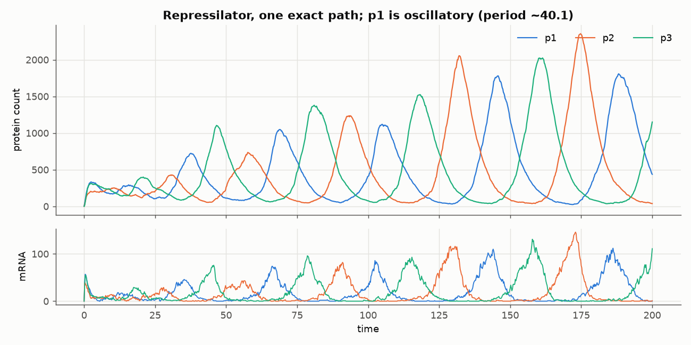
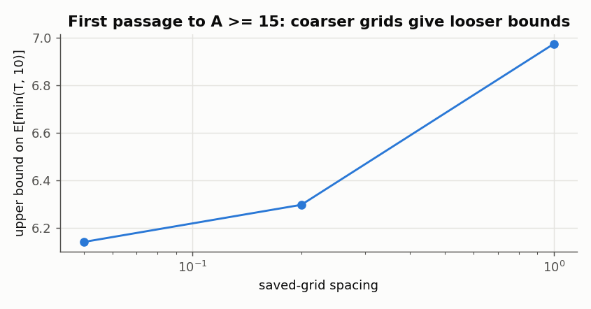
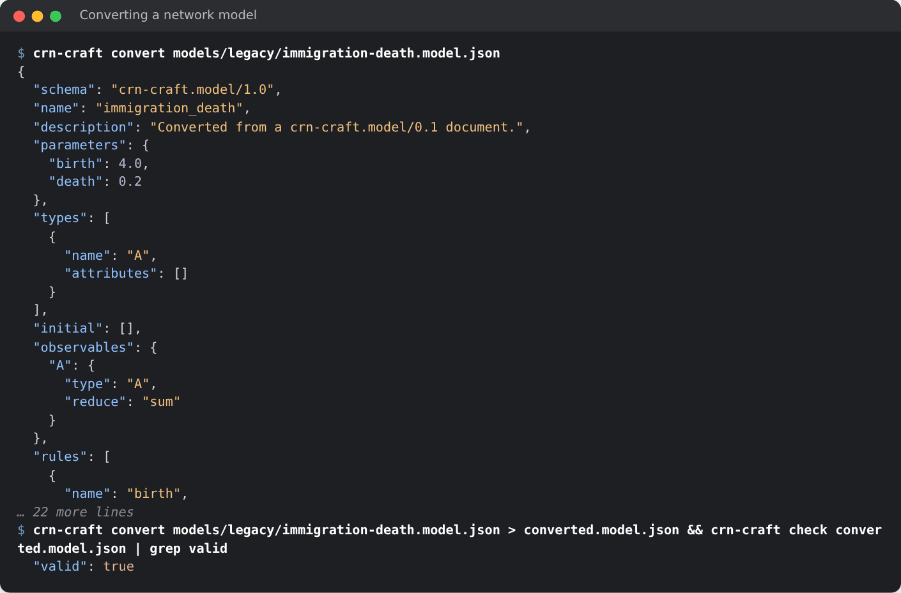
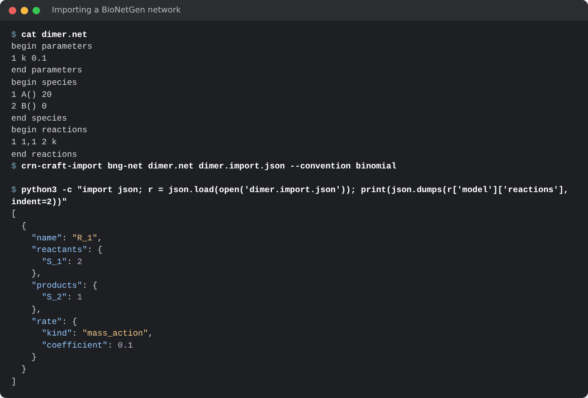
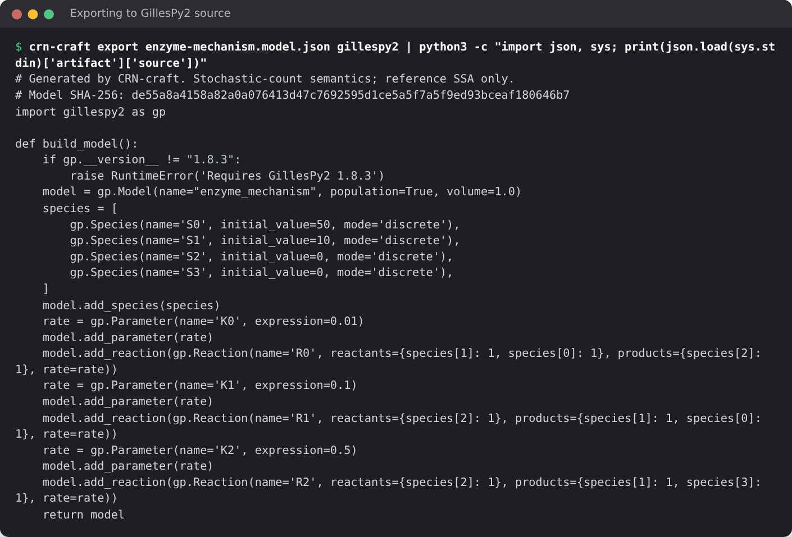

# 11. Analysis, import and export

<!-- fixtures: models/legacy/immigration-death.model.json examples/guide/dimer.xml -->

This chapter collects what surrounds a simulation: the structure of a
network, two diagnostics of saved paths, and the exchange of models with
other formats and tools. The setup block builds the immigration–death model.
The blocks of this chapter continue from it:

```python
import json
import pathlib

import numpy as np
import crn_craft as crn

model = crn.Model("immigration_death")
model.add_parameter({"birth": 4.0, "death": 0.2})
model.add_species("A", 0)
model.add_reaction("birth", [], ["A"], name="birth")
model.add_reaction("death * A", ["A"], [], name="death")
```

Two sections read a repository file:
[`models/legacy/immigration-death.model.json`](https://github.com/dietmarwo/CRN-craft/blob/main/models/legacy/immigration-death.model.json)
and [`examples/guide/dimer.xml`](https://github.com/dietmarwo/CRN-craft/blob/main/examples/guide/dimer.xml).
Copy them under the same paths, or work in the root of a clone.

## Conservation laws and structure

`Model.analyze` reports structure without simulating: the stoichiometry, a
basis of conservation laws in exact integer arithmetic, the bounds they
imply for the initial state, and complexes, linkage classes and deficiency.
The example is an enzyme mechanism, `S + E <-> ES -> E + P`:

```python
enzyme = crn.Model("enzyme_mechanism")
enzyme.add_species({"S": 50, "E": 10, "ES": 0, "P": 0})
enzyme.add_reaction(0.01, ["S", "E"], ["ES"], name="bind")
enzyme.add_reaction(0.1, ["ES"], ["S", "E"], name="unbind")
enzyme.add_reaction(0.5, ["ES"], ["E", "P"], name="catalysis")
report = enzyme.analyze()["analysis"]
print(report["species"])
print(report["conservation"]["basis"])           # E + ES and S + ES + P
print(report["initial_class_upper_bounds"])      # S, E, ES, P cannot exceed these
print("deficiency", report["linkage"]["deficiency"])
pathlib.Path("enzyme-mechanism.model.json").write_text(enzyme.to_json())  # for the last section
```

```text
['S', 'E', 'ES', 'P']
[{'coefficients': ['0', '1', '1', '0'], 'initial_total': '10'}, {'coefficients': ['1', '0', '1', '1'], 'initial_total': '50'}]
['50', '10', '10', '50']
deficiency 0
```

The laws are `E + ES = 10` and `S + ES + P = 50`, so every count is bounded,
and the deficiency is zero. The limits of the analysis are explicit: when
one is reached, the report says `unavailable` and never implies that no law
exists. A model with continuous variables has no such report (`CRN-R017`).
`crn-craft analyze MODEL` prints the same report for a model file
([Analysis report](../reference/analysis.md)).

## Oscillations

`observables.oscillation` classifies one time series. The example is a
repressilator: three genes that repress each other in a ring, with Hill
repression, built in a loop over the genes:

```python
from crn_craft.observables import oscillation

circuit = crn.Model("repressilator")
circuit.add_parameter({"alpha0": 0.216, "alpha": 216.0, "K": 40.0, "n": 2.0})
circuit.add_parameter({"beta": 5.0, "gamma_m": 1.0, "gamma_p": 0.2})
circuit.add_species("p1", 5)
for gene, repressor in ((1, 3), (2, 1), (3, 2)):
    mrna, protein = f"m{gene}", f"p{gene}"
    hill = f"alpha0 + alpha / (1 + (p{repressor} / K)^n)"
    circuit.add_reaction(hill, [], [mrna], name=f"tx{gene}")
    circuit.add_reaction(f"beta * {mrna}", [mrna], [mrna, protein], name=f"tl{gene}")
    circuit.add_reaction(f"gamma_m * {mrna}", [mrna], [], name=f"dm{gene}")
    circuit.add_reaction(f"gamma_p * {protein}", [protein], [], name=f"dp{gene}")

grid = list(np.linspace(0, 200, 1001))
path = crn.ensemble(circuit, end=200.0, report_times=grid, replicates=1,
                    keep_paths=1, method="static_direct").simulate()
p1 = path.paths.isel(replicate=0).sel(variable="p1").to_numpy()
verdict = oscillation(grid, p1)
print(verdict["classification"], round(verdict["period"], 1))
```

```text
oscillatory 40.1
```

A single exact path oscillates, with amplitudes that vary between cycles:



`oscillation` drops a burn-in (20% by default), removes the mean, and calls
a series *oscillatory* only when the dominant Fourier peak holds at least
30% of the power, spans at least three cycles, and the autocorrelation at
that period is at least 0.2. Fewer than three cycles is *ambiguous*. It is a
diagnostic of one trajectory, not a validated biological detector.

## First passage from saved paths

`sampled_first_passage` estimates when paths first reach a threshold, from
saved states only. A path can cross and fall back between two report times,
so the first saved hit is an upper bound on the passage time, and the
detected fraction is a lower bound on the probability of a passage:

```python
from crn_craft.observables import sampled_first_passage

fine = list(np.linspace(0, 10, 201))
paths = crn.ensemble(model, end=10.0, report_times=fine, replicates=500, seed=42,
                     keep_paths=500, method="static_direct").simulate()
counts = list(paths.paths.sel(variable="A").to_numpy())
for step in [1, 20]:
    bound = sampled_first_passage(fine[::step], [c[::step] for c in counts], 15)
    print(step * 0.05, bound["detected_fraction"], bound["restricted_mean_upper"])
```

```text
0.05 0.928 6.075
1.0 0.88 6.878
```



A finer grid gives tighter bounds. For the exact time, use a tracker with a
first-passage condition, which sees every event
([chapter 6](06-stops-trackers-logs.md#trackers)).

## Convert a network model of release 0.6.0

Release 0.6.0 had a second model format for reaction networks,
`crn-craft.model/0.1`. `check`, `analyze`, `convert` and `export` read it.
`crn-craft convert` prints it as a current model:

```bash
crn-craft convert models/legacy/immigration-death.model.json > converted.model.json
crn-craft check converted.model.json > /dev/null && echo "the converted model is valid"
```



`crn.convert` does the same in Python, from bytes to bytes:

```python
legacy = pathlib.Path("models/legacy/immigration-death.model.json")
converted = crn.Model.from_dict(json.loads(crn.convert(legacy.read_bytes())))
print(converted)
```

```text
Model('immigration_death': 1 species, 2 reactions)
```

A network without reactions, or with population limits, is refused with
`CRN-R016`. [Migrating](migrating.md) has the other changes since 0.6.0.

## Import SBML and BioNetGen

`crn.read_sbml`, `crn.read_bngl` and the command `crn-craft-import` convert
an explicit subset of SBML Level 3 Version 2 and of expanded BioNetGen
`.net` files. They reject what they cannot represent exactly (events, rules,
fast reactions, non-integer stoichiometry, unit ambiguity) instead of
guessing. The rate convention must be stated. This block writes a BioNetGen
network of the dimerization `2 A -> B`:

```python
pathlib.Path("dimer.net").write_text(
    "begin parameters\n1 k 0.1\nend parameters\n"
    "begin species\n1 A() 20\n2 B() 0\nend species\n"
    "begin reactions\n1 1,1 2 k\nend reactions\n"
)
```

```bash
crn-craft-import bng-net dimer.net dimer.import.json --convention binomial
```



The command writes a `crn-craft.import/1.0` report with the provenance and
the model. In Python the import returns a `Model` with an `import_report`:

```python
dimer = crn.read_bngl("dimer.net", convention="binomial")
print(dimer, dimer.import_report["source_format"])
sbml = crn.read_sbml("examples/guide/dimer.xml", convention="stochastic_count_propensity")
print(sbml, sbml.import_report["source_format"])
means = crn.ensemble(sbml, end=50.0, report_times=[0.0, 50.0], replicates=100,
                     seed=1, method="static_direct").simulate().statistics["mean"]
print(means.iloc[-1].to_dict())
```

```text
Model('ImportedBioNetGen': 2 species, 1 reactions) bionetgen_expanded_net_subset
Model('Dimer': 2 species, 1 reactions) sbml_l3v2_core_subset
{'A': 0.0, 'B': 10.0}
```

The 20 molecules of `A` pair up into 10 of `B`. An imported model runs under
every method, like a built one.

## Export to GillesPy2

`crn-craft export MODEL gillespy2` writes GillesPy2 1.8.3 source for a model
file, here the enzyme mechanism that the first section wrote. It is meant
for a cross-check with another simulator
([chapter 8](08-reproducibility.md#reproducing-a-published-simulation)). The
command never runs the source:

```bash
crn-craft export enzyme-mechanism.model.json gillespy2 > export.json
```



In Python, `enzyme.to_gillespy2()` returns the `gillespy2.Model` when
GillesPy2 is installed. [GillesPy2 export](../reference/gillespy2-export.md)
says which models can be exported.

See also: [Analysis report](../reference/analysis.md),
[Comparison with GillesPy2](../evidence/comparison-gillespy2.md).
