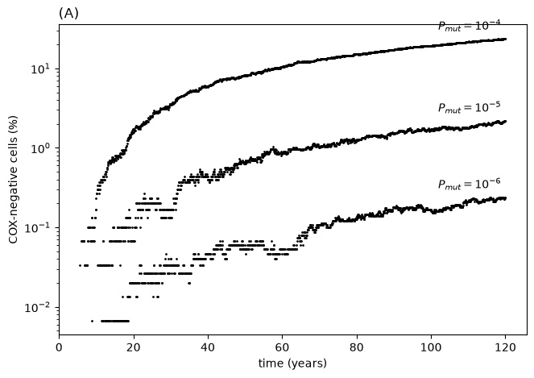

# Fig 1A: COX-negative cells over time

Author: Axel Kowald

Part of [chapter 16](16-published-study.md). Every section of this page
starts from these definitions:

```python
import math
import os

import numpy as np
import crn_craft as crn

nMolecules   = 1000
halfLifeDays = 10.0
degRate      = math.log(2)/(24.0*halfLifeDays)                   # 1/h
coxThreshold = 0.6
hoursPerYear = 24.0 * 360.0
nThreads     = max(1, (os.cpu_count() or 1) - 2)

def buildModel(pmut) -> crn.Model:
    model = crn.Model("mtdna_random_drift")
    model.add_reaction("delta*wt * ((wt-1) * pmut + mt) / (wt+mt-1)", ["wt"], ["mt"], "wt_to_mt")
    model.add_reaction("delta*mt * wt * (1 - pmut) / (wt+mt-1)",      ["mt"], ["wt"], "mt_to_wt")
    model.add_species({"wt": nMolecules, "mt": 0})
    model.add_parameter({"delta": degRate, "pmut": pmut})
    checkReport = crn.check(model)                        # validate before simulating
    assert checkReport["valid"], checkReport["diagnostics"]
    return model
```

## Lumping the model into two reactions

Fig 1A needs only the number of wild-type (`wt`) and mutant (`mt`)
molecules. A degradation followed by a replacement is one event, and only
two kinds of event change the state:

| Event | What happens | Propensity |
| --- | --- | --- |
| wt → mt | a wt is degraded and replaced by a mutant copy, made either by another wt that mutates or by any mt | δ·wt·((wt−1)·P_mut + mt)/(N−1) |
| mt → wt | an mt is degraded and replaced by an unmutated wt copy | δ·mt·wt·(1−P_mut)/(N−1) |

The other replacements (wt by wt, mt by mt) leave the counts unchanged and
need not be simulated. This makes the network exact and very small.
CRN-craft accepts the full propensity as an expression string, so
non-mass-action kinetics like these can be written directly: that is
`buildModel` above.

> **Validation tip.** Before trusting a lumped model, compare it with an
> explicit "degrade, then replicate" model over a short horizon. At 3 years
> the two gave 10.85 % and 11.25 % COX-negative cells in the author's run,
> which agree within sampling error.

## Fast ensembles: `static_direct` and batches

A 120-year cell has millions of events and the rare-mutation scenario needs
15,000 cells. Gillespie's direct method for a fixed set of species,
`method="static_direct"`, makes this cheap. The script runs the cells in
batches of 1,000, one seed per batch, and counts the COX-negative cells at
every monthly report time. Here is one batch of 200 cells at
P_mut = 10⁻⁴, which runs in a few seconds:

```python
endTime     = 120 * hoursPerYear
reportTimes = np.linspace(0.0, endTime, 120 * 12 + 1)            # monthly, 1441 points
run = crn.ensemble(buildModel(1e-4),
                   end          = endTime,
                   report_times = reportTimes.tolist(),
                   replicates   = 200,
                   seed         = 1000,                           # one seed per batch -> reproducible
                   threads      = nThreads,
                   method       = "static_direct",
                   keep_paths   = "all",                          # keep every cell's trajectory
                   strict       = True)                           # an incomplete cell is an error
result = run.simulate()
mt = result.paths.sel(variable="mt").to_numpy()                   # (cells x times)
nNegative = (mt > coxThreshold * nMolecules).sum(axis=0)
print(f"COX-negative at 120 years: {100 * nNegative[-1] / 200:.1f} %")
```

```text
COX-negative at 120 years: 24.0 %
```

Two habits are worth copying:

- **Batching.** `keep_paths="all"` stores cells × report times values.
  Running batches of 1,000 cells bounds the memory used.
- **Checking that every cell completed.** A cell that stops early because
  it hit a budget would silently bias the statistics. With `strict=True` an
  incomplete ensemble raises `crn.IncompleteEnsembleError`; without it,
  `simulate()` warns (`crn.IncompleteEnsembleWarning`) and names the limit
  to raise. Since 0.8 the default limits are large enough for these runs,
  so no limit needs raising (see [limits](16d-limits-lessons.md)).

## Result

The author's run with CRN-craft 0.7.1:

| P_mut | Cells | COX-negative at 120 y (author's run) | Paper |
| --- | ---: | ---: | ---: |
| 10⁻⁴ | 3,000 | 22.6 % | 22.3 % |
| 10⁻⁵ | 3,000 | 2.4 % | 2.7 % |
| 10⁻⁶ | 15,000 | 0.20 % | ≈ 0.25 % |

The draft run with CRN-craft 0.8 (`--size draft`, the same cell counts;
the ± is one binomial standard error):

<!-- kk13-table: fig1a -->
| P_mut | Cells | COX-negative at 120 y (this run) | Author's run (0.7.1) | Paper |
| --- | ---: | ---: | ---: | ---: |
| 10^-4 | 3,000 | 23.63 % ± 0.78 | 22.6 % | 22.3 % |
| 10^-5 | 3,000 | 2.20 % ± 0.27 | 2.4 % | 2.7 % |
| 10^-6 | 15,000 | 0.24 % ± 0.04 | 0.20 % | ≈ 0.25 % |
<!-- /kk13-table -->



## Compiling the event loop

`crn.compile_loop(model)` compiles the event loop of this model into
native code, which needs a Rust toolchain
([chapter 5](05-speed.md)). A compiled loop is specific to one parameter
set; it is built once per P_mut and cached. The script uses it for the
120-year batches of Fig 1A:

```python
model     = buildModel(1e-4)
modelComp = crn.compile_loop(model)                               # about a minute the first time
run = crn.ensemble(model, end=120 * hoursPerYear, report_times=[0.0, 120 * hoursPerYear],
                   replicates=200, seed=2000, threads=nThreads,
                   method="static_direct", keep_paths="all", strict=True)
result = run.simulate(compiled=modelComp)
mt = result.paths.sel(variable="mt").isel(time=-1).to_numpy()
print("COX-negative cells:", int((mt > coxThreshold * nMolecules).sum()), "of 200")
```

```text
COX-negative cells: 50 of 200
```

The full Fig 1A: `python examples/kk13/kowald_kirkwood_2013.py --size full
--part 1A`.

Next: [Fig 1B](16b-fig1b.md).
