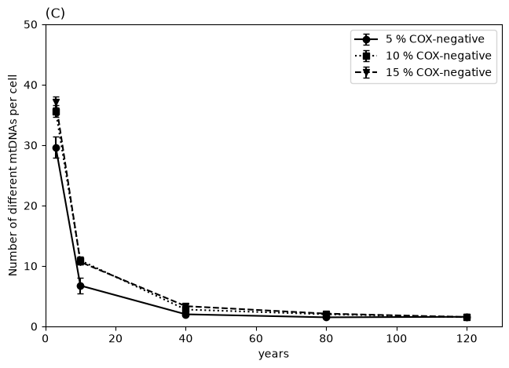
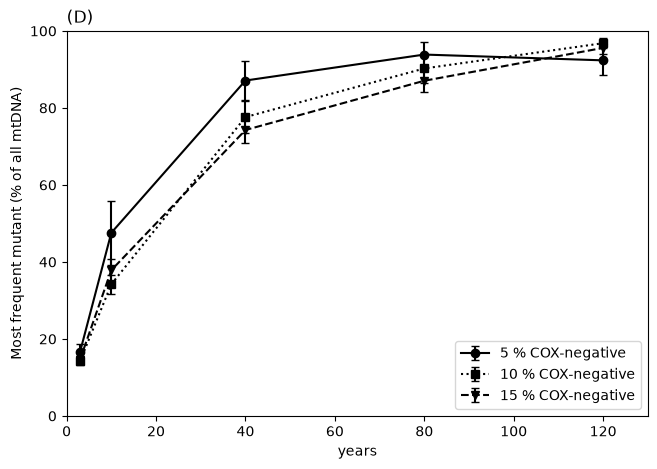

# Fig 1C/1D: how many different mutants are in a COX-negative cell?

Author: Axel Kowald

Part of [chapter 16](16-published-study.md). Every section of this page
starts from these definitions; `buildCloneModel` is explained below:

```python
import math
import os

import numpy as np
import crn_craft as crn

nMolecules   = 1000
degRate      = math.log(2)/(24.0*10.0)                            # 1/h
coxThreshold = 0.6
hoursPerYear = 24.0 * 360.0
nThreads     = max(1, (os.cpu_count() or 1) - 2)

def buildCloneModel(pmut) -> crn.Model:
    model = crn.Model("mtdna_clones")
    model.add_parameter({"K": nMolecules, "delta": degRate, "pmut": pmut, "r": 10.0})
    model.add_species("mtDNA", attributes=["clone"])           # observable "mtDNA" = all molecules
    model.add_initial("mtDNA", nMolecules, clone=0)            # clone 0 = wild type
    model.add_observable("mutants",  "mtDNA", where="x.clone > 0")
    model.add_observable("types",    "mtDNA", reduce="distinct")
    model.add_observable("mutTypes", "mtDNA", where="x.clone > 0", reduce="distinct")
    model.add_observable("largest",  "mtDNA", where="x.clone > 0", reduce="max_count")
    refill = "r * max(0, K - mtDNA) / mtDNA"                   # per molecule: free places shared by survivors
    model.add_reaction(degRate, ["mtDNA"], [], name="degradation")
    model.add_reaction(crn.mass_action(f"{refill} * (1 - pmut)"), ["mtDNA"],
                       [crn.copy("x"), crn.copy("x")], name="replication")
    model.add_reaction(crn.mass_action(f"{refill} * pmut"), ["mtDNA"],
                       [crn.copy("x"), crn.new("mtDNA", clone="new_id()")], name="mutation")
    return model
```

## The difficult part

Fig 1C counts the number of different mtDNA types per COX-negative cell,
wild type included. Fig 1D gives the copy number of the most frequent
mutant as a percentage of all mtDNA. Every mutation event founds a new
mutant lineage (a clone), and its descendants must be told apart from those
of every other mutation. The two-species model of [Fig 1A](16a-fig1a.md)
cannot do this, because all mutants are lumped into `mt`.

In a classic reaction network this would need one species per clone. The
number of clones is unknown in advance: at 3 years a COX-negative cell holds
about 35 of them, and over a lifetime thousands arise and go extinct. Such a
network cannot be written down beforehand.

## The solution: species with attributes, `new_id()` and the tree method

CRN-craft solves this directly ([chapter 14](14-model-files.md)):

- `add_species("mtDNA", attributes=["clone"])`: every molecule carries an
  attribute `clone`. Molecules with equal attribute values form one
  instance, that is, one species created during the run. `clone = 0` is
  the wild type (`add_initial`).
- A product can copy a reactant (`crn.copy("x")`), so a faithful replication
  keeps the clone id.
- A product attribute can be set to `new_id()` (`crn.new("mtDNA",
  clone="new_id()")`), an identifier never used before in that run. A
  mutation therefore founds a brand-new clone.
- Observables summarize the instances. `reduce="distinct"` counts how many
  different instances match, which is exactly the number of types. A
  `where` filter restricts an observable to mutants. `reduce="max_count"`
  is the largest copy number among the matching instances: the largest
  clone. Every species also has an observable under its own name, its total
  count (`mtDNA`).
- `crn.mass_action(expression)` gives a rate per molecule, like a number
  does (`degRate` above). A plain string would be the whole propensity of
  the reaction.
- Only the tree method (the default when no method is given) supports
  species that are created during the run. `static_direct` and
  `compile_loop` require a fixed species set.

**Why degradation and replication are separate here.** The lumped "degrade
one, replicate another" event of Fig 1A could also be written as a rule
over pairs of molecules (see [the last section](#the-exact-moran-step-as-a-pair-rule)).
The model of the author's run keeps the two steps separate: every molecule
degrades at rate δ. Free places (K − N) are refilled at total rate
r·(K − N), and each survivor is equally likely to be the template, hence
the factor 1/N in the per-molecule rate. With r = 10 h⁻¹ a free place is
refilled within about 6 minutes, so the mean N is 999.7 instead of exactly
1000, a negligible difference.

The same model as a model document, the form the tutorial used with
CRN-craft 0.7.1 (`crn.Model.to_json()` writes an equivalent one, and a run
with the same seed gives the same paths):

<details>
<summary>The clone model as a <code>crn-craft.model/1.0</code> document (P_mut = 7.5·10⁻³)</summary>

```json
{
  "schema": "crn-craft.model/1.0",
  "name": "mtdna_clones",
  "parameters": {"K": 1000, "delta": 0.0028881132523331052, "pmut": 0.0075, "r": 10.0},
  "types": [{"name": "mtDNA", "attributes": ["clone"]}],
  "initial": [{"type": "mtDNA", "attributes": {"clone": 0}, "count": 1000}],
  "observables": {
    "N":        {"type": "mtDNA"},
    "mutants":  {"type": "mtDNA", "where": "x.clone > 0"},
    "types":    {"type": "mtDNA", "reduce": "distinct"},
    "mutTypes": {"type": "mtDNA", "where": "x.clone > 0", "reduce": "distinct"},
    "largest":  {"type": "mtDNA", "where": "x.clone > 0", "reduce": "max_count"}
  },
  "rules": [
    {"name": "degradation", "reactants": [{"label": "x", "type": "mtDNA"}],
     "rate": "delta", "products": []},
    {"name": "replication", "reactants": [{"label": "x", "type": "mtDNA"}],
     "rate": "r * max(0, K - N) / N * (1 - pmut)",
     "products": [{"type": "mtDNA", "copy": "x"}, {"type": "mtDNA", "copy": "x"}]},
    {"name": "mutation", "reactants": [{"label": "x", "type": "mtDNA"}],
     "rate": "r * max(0, K - N) / N * pmut",
     "products": [{"type": "mtDNA", "copy": "x"},
                  {"type": "mtDNA", "attributes": {"clone": "new_id()"}}]}
  ]
}
```

</details>

## Reading the results

The observables `mutants`, `types`, `mutTypes` and `largest` appear in
`result.paths` like ordinary species. The P_mut values come from Fig 1B
(`fig1b.csv`); each of the 15 (lifespan, target) combinations is simulated
separately, and only the COX-negative cells enter the statistics. Here are
200 cells for 3 years at the 10 % rate:

```python
endT = 3 * hoursPerYear
run = crn.ensemble(buildCloneModel(7.5e-3), end=endT, report_times=[0.0, endT], replicates=200,
                   seed=3000, threads=nThreads, keep_paths="all",
                   keep_instances=200,                            # only for the cross-check below
                   strict=True)                                   # no method -> tree method
result  = run.simulate()
final   = result.paths.isel(time=-1)
total   = final.sel(variable="mtDNA").to_numpy()
neg     = final.sel(variable="mutants").to_numpy() > coxThreshold * total
types   = final.sel(variable="types").to_numpy()[neg]
largest = final.sel(variable="largest").to_numpy()[neg]
print(f"{neg.sum()} COX-negative cells: {types.mean():.1f} types, "
      f"largest clone {100 * (largest / total[neg]).mean():.1f} % of all mtDNA")

# Cross-check: the largest clone from the final instances (needs keep_instances)
for cell in result.metadata["final_instances"]:
    counts = [inst["count"] for inst in cell["instances"] if inst["attributes"][0] > 0]
    assert (max(counts) if counts else 0) == final.sel(variable="largest").to_numpy()[cell["id"]]
```

```text
19 COX-negative cells: 35.3 types, largest clone 16.3 % of all mtDNA
```

Before 0.8 the largest clone could only be read from the final instances,
as in the cross-check; `reduce="max_count"` makes it an observable, so the
full runs need neither `keep_instances` nor raised memory limits.

## Result

The author's run with CRN-craft 0.7.1 (3,000 cells per combination).
Number of mtDNA types per COX-negative cell (Fig 1C):

| Lifespan | 5 % | 10 % | 15 % | Paper | Mutant types only |
| --- | ---: | ---: | ---: | --- | --- |
| 3 y | 31.3 | 35.9 | 38.4 | 31.5 / 35.7 / 38.7 | 30.3 / 34.9 / 37.4 |
| 10 y | 8.45 | 10.34 | 12.02 | 7.8 / 10.4 / 12.2 | 7.46 / 9.35 / 11.04 |
| 40 y | 2.25 | 2.95 | 3.29 | 2.3 / 2.8 / 3.5 | 1.66 / 2.29 / 2.69 |
| 80 y | 1.56 | 1.78 | 2.06 | 1.44 / 1.75 / 2.08 | 1.19 / 1.46 / 1.75 |
| 120 y | 1.31 | 1.51 | 1.66 | 1.35 / 1.46 / 1.61 | 1.13 / 1.29 / 1.45 |

Most frequent mutant in % of all mtDNA (Fig 1D):

| Lifespan | 5 % | 10 % | 15 % | Paper |
| --- | ---: | ---: | ---: | --- |
| 3 y | 17.3 | 15.6 | 14.3 | 17 / 16 / 15 |
| 10 y | 44.9 | 38.9 | 36.7 | 44 / 40 / 37 |
| 40 y | 80.2 | 76.4 | 74.4 | 81 / 76 / 72 |
| 80 y | 90.1 | 88.1 | 87.2 | 92 / 90 / 86 |
| 120 y | 95.5 | 92.3 | 91.6 | 95 / 93 / 92 |

Having both `types` and `mutTypes` as observables settled an ambiguity in
the paper. Table 1 speaks of "types of mutants", but only the count
including the wild type matches at every lifespan. With mutants only, the
40-year values of the author's run fall about 10 standard errors below the
paper. In long-lived cells the wild type is often lost entirely (≈ 80 % of
COX-negative cells at 120 years), so including it adds less than 1 there.

The biology is clear-cut. Short-lived COX-negative cells contain many small
clones, while long-lived ones are taken over by one clone. That is the
signature of random drift, and the paper uses it as an argument against
drift as the mechanism in short-lived animals.

The draft run with CRN-craft 0.8 (`--size draft`: 200 cells per
combination, so only 10 to 30 COX-negative cells per entry; mean ±
standard error):

<!-- kk13-table: fig1c -->
| Lifespan | 5 % (this run) | 10 % | 15 % | COX-negative cells | Author's run | Paper | Mutant types only (this run) |
| --- | --- | --- | --- | --- | --- | --- | --- |
| 3 y | 29.67 ± 1.72 | 35.59 ± 0.97 | 37.14 ± 0.93 | 12 / 17 / 28 | 31.3 / 35.9 / 38.4 | 31.5 / 35.7 / 38.7 | 28.67 / 34.59 / 36.14 |
| 10 y | 6.75 ± 1.25 | 10.91 ± 0.61 | 10.66 ± 0.44 | 4 / 23 / 32 | 8.45 / 10.34 / 12.02 | 7.8 / 10.4 / 12.2 | 5.75 / 9.91 / 9.69 |
| 40 y | 2.00 ± 0.19 | 2.79 ± 0.29 | 3.34 ± 0.23 | 8 / 19 / 29 | 2.25 / 2.95 / 3.29 | 2.3 / 2.8 / 3.5 | 1.50 / 2.05 / 2.83 |
| 80 y | 1.50 ± 0.17 | 2.00 ± 0.20 | 2.11 ± 0.18 | 10 / 18 / 27 | 1.56 / 1.78 / 2.06 | 1.44 / 1.75 / 2.08 | 1.30 / 1.67 / 1.81 |
| 120 y | 1.58 ± 0.19 | 1.52 ± 0.18 | 1.54 ± 0.13 | 12 / 23 / 28 | 1.31 / 1.51 / 1.66 | 1.35 / 1.46 / 1.61 | 1.33 / 1.39 / 1.39 |
<!-- /kk13-table -->

<!-- kk13-table: fig1d -->
| Lifespan | 5 % (this run) | 10 % | 15 % | COX-negative cells | Author's run | Paper |
| --- | --- | --- | --- | --- | --- | --- |
| 3 y | 16.6 ± 2.2 | 14.2 ± 1.0 | 14.6 ± 0.9 | 12 / 17 / 28 | 17.3 / 15.6 / 14.3 | 17 / 16 / 15 |
| 10 y | 47.6 ± 8.3 | 34.2 ± 2.4 | 37.9 ± 2.9 | 4 / 23 / 32 | 44.9 / 38.9 / 36.7 | 44 / 40 / 37 |
| 40 y | 87.1 ± 5.0 | 77.6 ± 4.1 | 74.3 ± 3.5 | 8 / 19 / 29 | 80.2 / 76.4 / 74.4 | 81 / 76 / 72 |
| 80 y | 93.9 ± 3.4 | 90.3 ± 3.8 | 87.1 ± 3.0 | 10 / 18 / 27 | 90.1 / 88.1 / 87.2 | 92 / 90 / 86 |
| 120 y | 92.4 ± 3.7 | 96.8 ± 1.3 | 95.6 ± 1.7 | 12 / 23 / 28 | 95.5 / 92.3 / 91.6 | 95 / 93 / 92 |
<!-- /kk13-table -->





The full run (`python examples/kk13/kowald_kirkwood_2013.py --size full
--part 1CD`) took about 2.6 hours on 18 threads (12–14 M events/s) in the
author's run. Most of that time goes to the 80- and 120-year cells, which
have about 6 million events each.

## The exact Moran step as a pair rule

Two identical reactants over one species form unordered pairs of distinct
molecules. Since CRN-craft 0.8 the two molecules of a pair get the labels
`x` and `y` at random, so "y is degraded and replaced by a copy of x" is
one rule, and N stays exactly 1000. Each unordered pair fires at
2δ/(N − 1) in total, so every molecule is degraded at rate δ, as in the
paper:

```python
def buildPairModel(pmut) -> crn.Model:
    model = crn.Model("mtdna_clones_pairs")
    model.add_parameter({"delta": degRate, "pmut": pmut})
    model.add_species("mtDNA", attributes=["clone"])
    model.add_initial("mtDNA", nMolecules, clone=0)
    model.add_observable("mutants",  "mtDNA", where="x.clone > 0")
    model.add_observable("types",    "mtDNA", reduce="distinct")
    model.add_observable("largest",  "mtDNA", where="x.clone > 0", reduce="max_count")
    pairRate = "2 * delta / (mtDNA - 1)"
    model.add_reaction(crn.mass_action(f"{pairRate} * (1 - pmut)"), ["mtDNA", "mtDNA"],
                       [crn.copy("x"), crn.copy("x")], name="x_replaces_y")
    model.add_reaction(crn.mass_action(f"{pairRate} * pmut"), ["mtDNA", "mtDNA"],
                       [crn.copy("x"), crn.new("mtDNA", clone="new_id()")], name="x_mutant_replaces_y")
    return model

endT = 3 * hoursPerYear
for build in (buildCloneModel, buildPairModel):
    run = crn.ensemble(build(7.5e-3), end=endT, report_times=[0.0, endT], replicates=200,
                       seed=3000, threads=nThreads, keep_paths="all", strict=True)
    result = run.simulate()
    final  = result.paths.isel(time=-1)
    total  = final.sel(variable="mtDNA").to_numpy()
    neg    = final.sel(variable="mutants").to_numpy() > coxThreshold * total
    types  = final.sel(variable="types").to_numpy()[neg]
    print(f"{build.__name__}: N = {total.min():.0f}..{total.max():.0f}, {neg.sum()} COX-negative, "
          f"{types.mean():.1f} types, {result.records['events'].mean() / 1e3:.0f} k events per cell")
```

```text
buildCloneModel: N = 998..1000, 19 COX-negative, 35.3 types, 150 k events per cell
buildPairModel: N = 1000..1000, 15 COX-negative, 36.5 types, 75 k events per cell
```

The pair form keeps N constant and needs half the events, because a
replacement is one event instead of two. Both models describe the same
biology; the tables above come from the separate rules of the author's
run.

Next: [limits and lessons](16d-limits-lessons.md).
