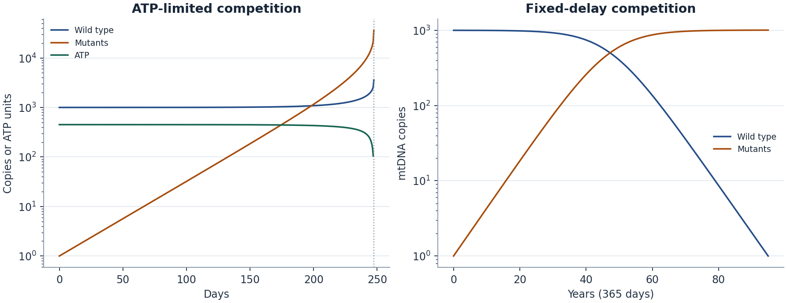
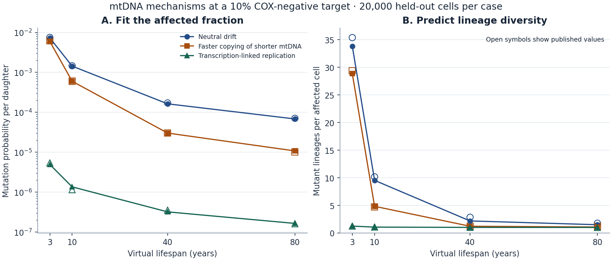
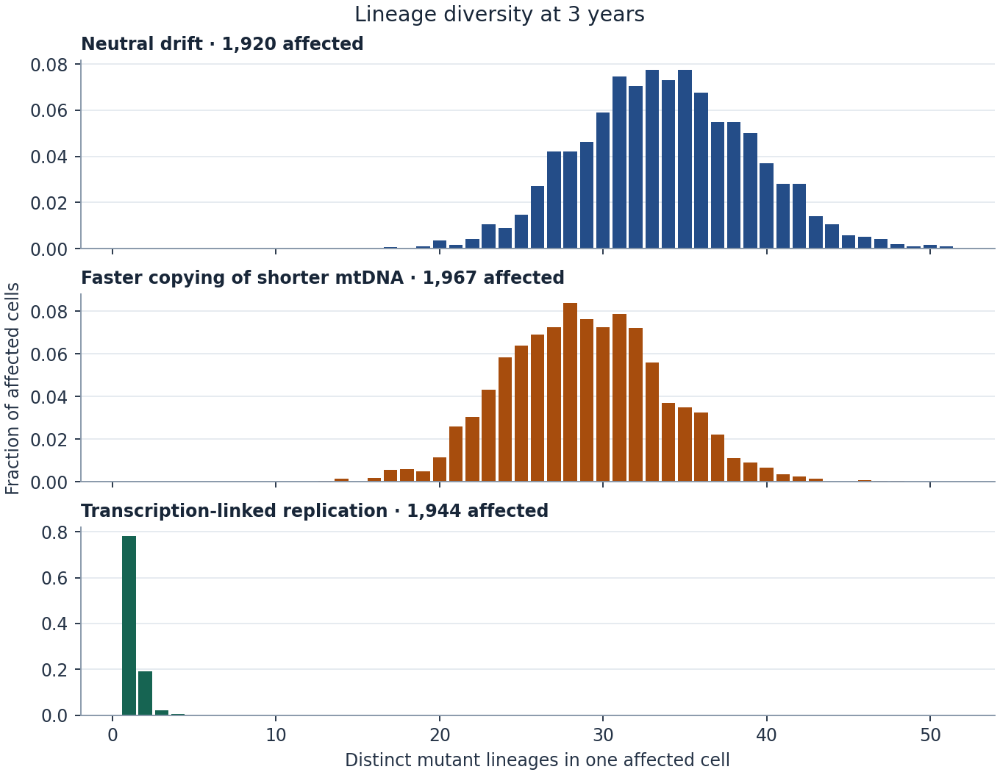

# Which mechanism explains the few mtDNA lineages in an affected cell?

<!-- fixtures: examples/kk14/native.py examples/kk14/reference.py -->

Start with the [mtDNA introduction](12-mtdna.md) and the
[neutral-drift study](16-published-study.md). Here you will give three models
the same prevalence target, then compare their predictions about the
number of surviving mutant lineages. The published comparison uses virtual
lifespans of 3, 10, 40 and 80 years. Its most informative case is three
years. [Kowald & Kirkwood (2014), Figure 3](https://pmc.ncbi.nlm.nih.gov/articles/PMC3939916/figure/fig03/)

You need Python, the CRN-craft 0.8.0 wheel, SciPy, Matplotlib and a C++17
compiler. The compiler builds the reference samplers in a temporary
directory. The native examples also run with the installed wheel. Run the
commands from the repository root.

```sh
python -m pip install 'crn-craft==0.8.0' scipy matplotlib
python examples/kk14/study.py single-cell --size quick
python examples/kk14/study.py compare --size quick --ages 3 --threads 2
```

The quick comparison uses the saved fitted rates and 128 new cells per
mechanism. Its intervals are wide. For a fresh three-year calibration and
an independent 1,000-cell check, use `compare --size draft --ages 3`.
The example prints the output for each completed cohort and writes
the tables and figures in its results directory.
[Example files](../../examples/kk14/README.md)

## Decide what to count

A lineage is the descendants of one simulated deletion event. Suppose
one cell has 600 copies of the same mutant and another has 20 copies each
from 30 distinct mutants. With 1,000 mtDNAs in each cell, both cross the
inclusive 60% boundary and their lineage counts are 1 and 30.

- Let `M` and `W` be the surviving mutant and wild-type counts at the
  horizon. Count a cell as COX-negative if its population is nonempty and
  `5*M >= 3*(W+M)`. COX deficiency is the simulated respiratory endpoint.
- Count each surviving mutant lineage once. For a historical comparison,
  add one more type if any wild type survives. Compute both means among
  COX-negative cells.
- Save the strict comparison `5*M > 3*(W+M)`, exact ties and the largest
  mutant's share of all copies. Add the free and busy copies before
  classifying a cell or counting its lineages.

An ATP collapse freezes the counts at ATP zero in the primary comparison.
The results also give the prevalence and clone counts among survivors.
An empty cell is unclassifiable. The result files give lower and upper
prevalence bounds when such cells occur. Separate numerical failures remain
visible in each cohort's assigned-cell count.

## Reuse the neutral-drift pair

A death at rate `delta = ln(2)/240` per molecule leaves a place for a new
copy from one of the other molecules. Count lineage 0 as wild type. A
faithful daughter inherits the parent's ID. A mutation receives a new ID,
including when the template is already a mutant. The exact pair rule in
[chapter 16c](16c-fig1cd.md#the-exact-moran-step-as-a-pair-rule) keeps the
population at 1,000 throughout. The earlier chapter also implements
a death-and-vacancy-refill model in which the population can briefly
drop below 1,000.

The calibration sampler works with wild-type and mutant counts only. If
there are `M` mutants and `W = N-M` wild types, the downward mutant transition
has rate `delta * M * (1-p) * W/(N-1)`. The upward transition adds
`delta * W * p` to that rate. The labelled sampler skips faithful replacements
within a lineage. Each ordered pair of copies from different lineages has
the same faithful replacement rate. The validation script checks both
samplers and the native `tree` pair against a small exact count distribution.

## Give copying a duration

In the size model, both genotypes initiate copying at the same rate per free
molecule. A copy stays busy for its whole copying time, 2 h for a wild type
and 1 h for a half-size mutant. The cell counts each busy template once
until completion. To model Figure 6 of the size paper, repeat each hour in
this order.

1. Complete due copies. Return the template and add one daughter. The
   daughter acquires a fresh mutant lineage with probability `p`.
2. Degrade free and still-busy copies with probability `ln(2)/half_life`.
   A busy template that degrades loses its scheduled completion.
3. Start replications from the surviving free pool with probability
   `r*C/(C+N)`. Schedule each completion using that template's delay.

For the deterministic model, let `F` and `B` be the free and busy
counts of a genotype. Initiation has flux `J(t) = r*C*F(t)/(C+N(t))`.
Surviving completions have flux `Q(t) = exp(-delta*tau)*J(t-tau)`.
Then `F' = 2*Q-J-delta*F` and `B' = J-Q-delta*B`. Calibrate `C`
to a wild-type equilibrium of 1,000 total copies. The implementation chooses
`r = 1 / h` because the supplied paper gives the name of that parameter
without a numerical default. One-cell checks repeat the solve at
`r = 0.1 / h` with `C` recalculated. [Kowald, Dawson & Kirkwood (2014)](https://doi.org/10.1016/j.jtbi.2013.09.009)

For a native CRN-craft exercise, replace the waiting state with a chain of
`k` exponential stages at rate `k/tau`. Apply degradation in every stage.
Its mean delay is `tau`, its delay variance is `tau²/k`, and a template
survives the chain with probability `(1 + delta*tau/k)^(-k)`. Try 1, 4 and 16
stages and inspect the reported endpoint mutant fractions. Sum the free
and busy counts when reading the output. Here is the four-stage model at
time zero and after four hours.

```python
import sys

import crn_craft as crn

sys.path.insert(0, "examples/kk14")
from native import staged_size

run = crn.ensemble(
    staged_size(4), end=4, report_times=[0, 4], replicates=16, seed=12,
    method="static_direct", strict=True,
)
mutant = run.simulate().statistics["mean"][["M", "M1", "M2", "M3", "M4"]].sum(axis=1)
print(mutant.round(2).tolist())
```

```text
[10.0, 9.88]
```

```sh
python examples/kk14/study.py native --threads 2
```

The native chain approaches a continuous fixed delay as `k` increases.
The hourly reference completes a one-hour template at the next tick before
that hour's degradation trial. The difference in event timing persists
even with many native stages.

## Make replication respond to ATP

Use the [ATP example](12c-mtdna-atp.md) with one mutant class. Mutants in
this model initiate replication 1.5 times as fast as wild type. Both
replicate at a rate multiplied by `c/(c+ATP)` and degrade at rate `delta`.
Wild type supplies ATP. All copies consume it through maintenance.

- Wild-type copies follow `W' = (1.0*c/(c+ATP) - delta)*W`.
- Mutant copies follow `M' = (1.5*c/(c+ATP) - delta)*M`.
- The energy balance is `ATP' = 0.1*W - 0.01*(W+M) - 0.2*ATP`.

With 1,000 wild types the wild-only ATP equilibrium is 450 and
`c = 450*delta/(1-delta)`. Add one mutant for the single-cell exercise.
In the tissue exercise every cell starts with 1,000 wild types and zero
mutants. The paper identifies an hourly Java program. This reconstruction
samples death and then births from survivors, with each birth probability
given by the corresponding hazard over one hour. It advances ATP using
the post-update counts. The hourly implementation uses mutations on
daughters from either genotype. The native check compares hybrid
ODE integration with legacy ATP thinning. [Kowald & Kirkwood (2014), Methods and Table 1](https://pmc.ncbi.nlm.nih.gov/articles/PMC3939916/)

The native hybrid solver takes a fixed set of states. To recover lineages
in the small native exercise, mark each mutation event with a new ID and
sample a lineage proportional to its current count for each faithful
mutant birth or death. The callback uses its own random stream and checks
its lineage sum after each event. Both mutation reactions keep a separate
identity even when their net count change equals a faithful birth.



The deterministic exercises give **247.406 days** to zero ATP and
**94.952 years** to fewer than one wild-type copy. With a 2-day mtDNA
half-life, the size model reaches that endpoint in **3.866 years**.
Both delay checks use a 365-day year.

## Fit prevalence, then test diversity

For each mechanism and each lifespan, bracket the probability of mutation
per daughter on a log scale. Fit the response to the fraction of cells
that cross the inclusive threshold. Freeze the fitted probability at 10%.
Use new seeds to generate validation cells. Measure both lineage counts
and the fraction affected on this separate cohort. Count bootstrap
resamples by cell. Fit-stage counts, held-out cells and the original-size
1,000-cell repeat are available as separate tables.

An interval that intersects 9.5–10.5% is compatible with the target band.
If the entire interval is inside the band, the data also confirm
prevalence within that narrow band at the stated precision. At 10%,
1,000 cells give a binomial standard error of about 0.95 percentage
points. This explains why two 1,000-cell samples at the same rate can
look quite different.



Solid symbols show this reconstruction. Open symbols show published
values read from Figure 3. Panel B uses mutant-only lineages for the
reconstruction. The earlier drift tabulation includes wild type in its
type count. The numeric comparison gives both conventions.
[Published figure](https://pmc.ncbi.nlm.nih.gov/articles/PMC3939916/figure/fig03/)

<!-- kk14-comparison -->
| Age | Mechanism | Affected / cells | Prevalence (95% Wilson) | Mutant lineages (95% bootstrap) | Target band |
| ---: | --- | ---: | --- | --- | --- |
| 3 y | Neutral drift | 1920 / 20000 | 9.60% (9.20–10.02%) | 33.83 (33.59–34.06) | compatible |
| 3 y | Faster copying of shorter mtDNA | 1967 / 20000 | 9.84% (9.43–10.26%) | 28.86 (28.64–29.07) | compatible |
| 3 y | Transcription-linked replication | 1944 / 20000 | 9.72% (9.32–10.14%) | 1.25 (1.23–1.28) | compatible |
| 10 y | Neutral drift | 2088 / 20000 | 10.44% (10.02–10.87%) | 9.54 (9.42–9.66) | compatible |
| 10 y | Faster copying of shorter mtDNA | 1947 / 20000 | 9.74% (9.33–10.15%) | 4.84 (4.76–4.92) | compatible |
| 10 y | Transcription-linked replication | 2088 / 20000 | 10.44% (10.02–10.87%) | 1.07 (1.06–1.08) | compatible |
| 40 y | Neutral drift | 1908 / 20000 | 9.54% (9.14–9.95%) | 2.19 (2.14–2.23) | compatible |
| 40 y | Faster copying of shorter mtDNA | 1979 / 20000 | 9.89% (9.49–10.32%) | 1.23 (1.21–1.25) | compatible |
| 40 y | Transcription-linked replication | 2042 / 20000 | 10.21% (9.80–10.64%) | 1.02 (1.01–1.03) | compatible |
| 80 y | Neutral drift | 2098 / 20000 | 10.49% (10.07–10.92%) | 1.50 (1.47–1.53) | compatible |
| 80 y | Faster copying of shorter mtDNA | 1852 / 20000 | 9.26% (8.87–9.67%) | 1.09 (1.07–1.10) | compatible |
| 80 y | Transcription-linked replication | 2071 / 20000 | 10.36% (9.94–10.78%) | 1.01 (1.01–1.02) | compatible |
<!-- /kk14-comparison -->

In a three-year affected cell, the transcription mechanism yields roughly
one mutant lineage. Drift and size advantage yield several dozen
under the common 10-day turnover assumption. Inspect the per-cell
distributions before using the mean to summarize the result.



### Exercises

1. Switch from the inclusive to the strict 60% boundary. Compare the
   affected counts and lineage means in the saved CSV.
2. Fit the size model again at a **2-day** half-life. Predict the direction
   of the change in lineage diversity before viewing the fit. Figure 7 of
   the size paper reports **1.16 types per affected cell** at this turnover.
   The saved refit gives **1.11 mutant lineages** and 2,014 affected cells
   out of 20,000. [Size paper](https://doi.org/10.1016/j.jtbi.2013.09.009)
3. Compare results with a 360-day year at 3 and 80 years, at the same
   mutation probability. In the ATP model, check what happens when
   mutations are permitted only from wild-type templates or when the
   time step is halved.

```sh
python examples/kk14/study.py figures --results examples/kk14/results/reconstruction
python examples/kk14/study.py compare --size full --ages 3 10 40 80 --threads 8 --resume --seed 20261121
python validation/check_kk14.py --output kk14-validation.json
```

The first command redraws the saved comparison without simulation. The
second carries out the full calibration, historical-size repeats and
20,000-cell validation cohorts. The last checks both deterministic
targets, the count laws on small models, thread reproducibility and this
page's table. See the [example README](../../examples/kk14/README.md)
for the output files, source precision and reconstruction choices.
