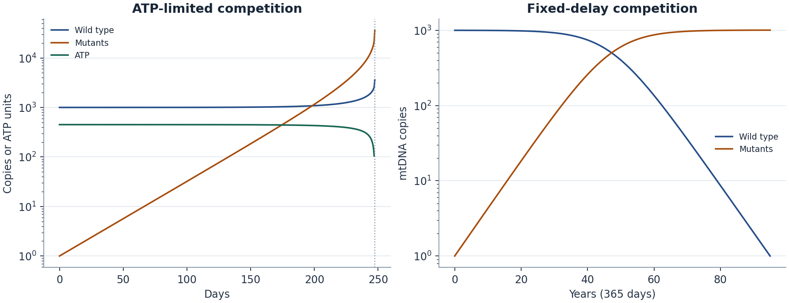

# The three models

Part of [chapter 17](17-mtdna-mechanisms.md).

<!-- fixtures: examples/kk14/native.py examples/kk14/reference.py -->

All three models describe one post-mitotic cell with about 1,000 mtDNA
copies, a half-life of 10 days (`delta = ln(2)/240` per hour) and time in
hours. Every tissue simulation starts with 1,000 wild-type copies and no
mutant. A new deletion appears on a daughter copy with probability `p`
per replication. `p` is the parameter that the
[fit](17b-mtdna-mechanisms-results.md) adjusts. The three models differ
in what decides which copy replicates.

## Neutral drift

Applies: [chapter 16c, The exact Moran step as a pair rule](16c-fig1cd.md#the-exact-moran-step-as-a-pair-rule).

Every copy degrades at rate `delta`. Each degradation is followed at once
by the replication of one of the other 999 copies, chosen at random, so the
cell always holds exactly 1,000 copies. The daughter is a new mutant with
probability `p`, whatever its template; otherwise it copies the template.
No genotype has an advantage. This is the model of
[chapter 16](16-published-study.md), with its pair rule.

To fit `p` only the mutant count matters. With `M` mutants and `W = N - M`
wild-type copies (`N = 1000`), the count falls by one at rate
`delta * M * W * (1-p) / (N-1)` (a mutant dies, a wild type is copied
faithfully) and rises by one at rate `delta * W * (M*(1-p) + (N-1)*p) / (N-1)`
(a wild type dies and is replaced by a mutant copy or a new deletion). The
reference sampler draws these two transitions. When lineages are needed,
a second sampler follows every lineage; it skips replacements inside one
lineage, which change nothing.

## Size advantage

The size paper models a copy as either *free* or *busy*. Only free copies
can start a replication. A busy copy stays busy for its copying time, 2 h
for wild type and 1 h for a mutant half its size, and then returns to the
free pool together with its daughter. Every copy, free or busy, degrades.
A free copy starts replicating with probability

    r * C / (C + N)

per hour, where `N` counts all copies, free and busy. `C` is set so that a
wild-type cell holds 1,000 copies at equilibrium (`C` = 2.93 for
`r` = 1 per hour). The paper names `r` but gives no value; the
reconstruction uses 1 per hour and checks 0.1 per hour
([choices](17c-mtdna-mechanisms-limits.md#reconstruction-choices)).

The stochastic program of the paper repeats three tasks every hour, and
the reference sampler follows them in this order:

1. Copies whose copying time is over return to the free pool, each with
   one daughter. The daughter is a new deletion mutant with probability
   `p`, also when the template is a mutant.
2. Every free or busy copy degrades with probability `ln(2)/240`. A busy
   copy that degrades loses its daughter.
3. Free copies start replicating with the probability above.

A copy that starts in hour `h` completes at the start of hour `h + 1` (a
mutant) or `h + 2` (wild type). A mutant therefore never meets a
degradation trial while busy, and a wild-type copy meets one.

The paper's deterministic version is a delay differential equation. For
each genotype with free copies `F` and busy copies `B`, starts have flux
`J(t) = r*C*F(t)/(C+N(t))`, and the copies that survive their copying time
`tau` return with flux `Q(t) = exp(-delta*tau)*J(t-tau)`:

    F' = 2*Q - J - delta*F
    B' = J - Q - delta*B

### The size model in CRN-craft

Applies: [chapter 2, Rates as numbers and as strings](02-first-model.md#rates-as-numbers-and-as-strings).

A reaction network has no fixed delay. It can replace the busy state by a
chain of `k` stages, each left at rate `k/tau`. The time in the chain then
has mean `tau` and variance `tau²/k`, and the chain approaches a fixed delay
as `k` grows. Degradation applies in every stage. `staged_size(k)` in
`examples/kk14/native.py` builds this model for a small cell of 100 copies
(10 mutants, half-life 48 h): species `W, W1, ..., Wk` and
`M, M1, ..., Mk`, a start reaction with the whole propensity
`C * W / (C + total)`, `k` stage reactions and degradation of every
species. Count a genotype as the sum of its free and busy species. The
four-stage model at time zero and after four hours:

```python
import sys

import crn_craft as crn

sys.path.insert(0, "examples/kk14")
from native import staged_size

run = crn.ensemble(
    staged_size(4), end=4, report_times=[0, 4], replicates=16, seed=12,
    method="static_direct", strict=True,
)
mutant = run.simulate().statistics["mean"][["M", "M1", "M2", "M3", "M4"]].sum(axis=1)
print(mutant.round(2).tolist())
```

```text
[10.0, 9.88]
```

`python examples/kk14/study.py native` runs the staged model for 120
days with 1, 4 and 16 stages next to the hourly sampler, 320 cells each.
At that size the endpoint mutant fraction has a standard error of about
0.017, and the four-stage value (0.171) lies 1.6 combined standard errors
below the others (0.210 to 0.211). A rerun with 4,000 cells per choice
(`native --cells 4000`) gives:

| Copying time | Mean mutant fraction at 120 days | Standard error |
| --- | ---: | ---: |
| Hourly fixed delay (reference sampler) | 0.193 | 0.005 |
| 1 exponential stage | 0.185 | 0.005 |
| 2 stages | 0.194 | 0.005 |
| 4 stages | 0.191 | 0.005 |
| 8 stages | 0.195 | 0.005 |
| 16 stages | 0.197 | 0.005 |

No two choices differ by more than 1.8 standard errors. In this small
cell the advantage of a 1-h copying time is too weak for the shape of
the delay distribution to show in the endpoint at this sample size. The
staged model is an exercise in expressing a delay; the tissue study uses
the hourly sampler.

## Transcription-linked replication

Applies: [chapter 9, A variable between events](09-continuous-variables.md#a-variable-between-events).

The PNAS paper proposes that deletion mutants gain their advantage
through the link between transcription and replication. Its model
represents this with three rules, all rates per hour (PNAS Table 1):

- Wild-type copies are synthesized at a maximal rate of 1, mutants at 1.5.
  Both rates are multiplied by `c/(c+ATP)`, which is one half at `ATP = c`.
- Both genotypes degrade with a half-life of 240 h.
- Wild-type copies produce ATP at rate 0.1 each, every copy costs 0.01
  for maintenance, and other processes consume ATP at rate 0.2 per unit.

As equations, with `W` wild-type and `M` mutant copies:

    W'   = (1.0*c/(c+ATP) - delta) * W
    M'   = (1.5*c/(c+ATP) - delta) * M
    ATP' = 0.1*W - 0.01*(W+M) - 0.2*ATP

With 1,000 wild-type copies and no mutant the ATP equilibrium is 450, and
`c = 450*delta/(1-delta)` = 1.303 keeps that cell at 1,000 copies. A mutant
copy consumes ATP without producing it. As mutants spread, ATP falls,
replication speeds up for both genotypes, and the mutants, which start 1.5
times as often, outgrow the wild type until ATP runs out.

The tissue simulation of the paper is an hourly Java program that
applies degradation, replication, mutation and ATP production. The
reference sampler does this per hour: degrade each copy with probability
`1 - exp(-delta)`; let each survivor replicate with probability
`1 - exp(-rate)` for its rate above; make each daughter a new deletion with
probability `p`, from either genotype; then relax ATP for one hour with the
new counts held fixed. A cell whose ATP reaches zero is frozen at that
moment ([choices](17c-mtdna-mechanisms-limits.md#reconstruction-choices)).

### The ATP model in CRN-craft

Applies: [chapter 12c, Variable population: ATP](12c-mtdna-atp.md).

`coupled_atp` in `native.py` builds the same rules as a continuous-time
model: ATP as a continuous variable with `add_ode(..., lower_bound=0)`
for `hybrid`, and as the stored `atp` block for exact `thinning`. Both stop
a cell when ATP reaches zero, as the reference sampler does. A deletion is
a separate reaction (`mutate_W`, `mutate_M`) with rate `p` times the
replication rate.

The hybrid solver tracks counts, not lineages. `marked_hybrid` recovers
lineages in a small run with a callback: a mutation event opens a new
lineage, and a faithful mutant birth or death picks a lineage in
proportion to its count, from the callback's own random stream. The
callback checks after every event that the lineage counts add up to the
mutant count, and the run with the callback has the same trajectories as
the run without it.

In a small test cell (100 copies, one founder mutant, half-life 120 h,
one year), hybrid and thinning gave 121 and 139 COX-negative cells of 320
(z = −1.45); with 4,000 cells each, 1,690 and 1,639 (z = 1.16). The hourly
sampler gave 131 and 1,663. The continuous-time and the hourly versions
agree at this precision.

## One cell, deterministic

Both papers start with a deterministic single cell: 1,000 wild-type copies
(999 in the size paper) and one mutant.



`study.py single-cell` integrates the ATP equations with Radau and the delay
equations with Heun's method on a 0.25-h mesh:

| Quantity | Reconstruction | Paper |
| --- | --- | --- |
| ATP reaches zero | 247.406 days, mutants 10.07 times the wild type | about 250 days, mutants about ninefold (PNAS Figure 2) |
| Wild type below one copy, size model | 94.952 years | about 95 years (size paper, Figure 2) |
| Same, 2-day half-life | 3.866 years | about 3.9 years (Figure 3) |
| Same, 10-h wild-type copying time | 19.330 years | 19.33 years (Figure 4) |
| Same, mutant 70% of wild-type size | 158.331 years | almost 160 years (Figure 5) |
| Busy fraction, wild-type cell and mutant cell | 0.579% and 0.289% | 0.58% and 0.29% (Figure 2) |

The size results use a 365-day year. Meshes of 0.5 h and 0.125 h give the
same 94.952 years, and `r` = 0.1 per hour with `C` recomputed gives 94.954
years. All values are in `examples/kk14/results/reconstruction/single-cell.json`.

Next: [Fitting and the comparison](17b-mtdna-mechanisms-results.md).
