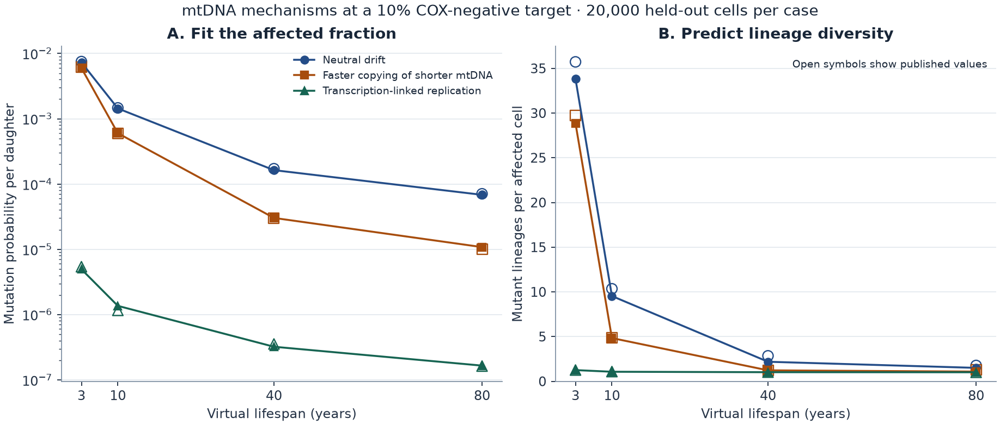
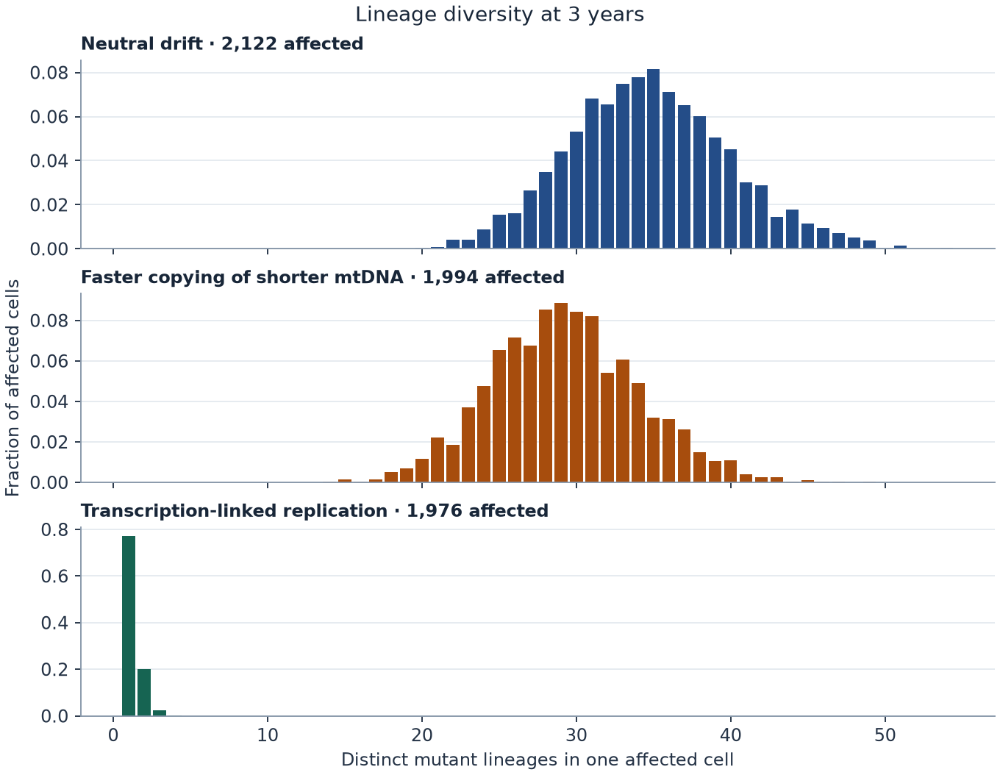

# Fitting and the comparison

Part of [chapter 17](17-mtdna-mechanisms.md).

Both papers ran 1,000 cells per lifespan and adjusted the mutation rate
until 10 ± 0.5% of them were COX-negative at the end. Then they reported
the number of types in the affected cells. This page does the same with a
fit on one set of cells and the reported numbers from a second,
independent set, so that the fitted rate is not judged on the cells it
was fitted to.

## The protocol

Applies: [chapter 8, Reproducing a published simulation](08-reproducibility.md#reproducing-a-published-simulation).

Everything below is fixed in `examples/kk14/campaign.py` and recorded in
`results/reconstruction/manifest.json` (seed 20261121, tier `full`):

- **Target**: 10% COX-negative cells, inclusive 60% threshold. A
  prevalence interval is called *within* the band if it lies inside
  9.5–10.5%, *compatible* if it intersects the band, and *outside*
  otherwise.
- **Fit**, for each of the 12 mechanism–lifespan cases (and the 2-day
  sensitivity case): start from a bracket around the published rate,
  halve or double it until 400-cell runs at the two ends enclose 10%,
  run 1,600 cells at a logistic interpolation, 1,600 cells each at 1/1.2
  and 1.2 times the resulting rate, and 4,800 cells at the local
  interpolation. The final rate inverts a logistic regression of the
  affected fraction on `log10(p)` through the local and confirmation
  points at 10%; its 95% interval comes from the regression (delta
  method). Only the affected fraction enters
  the fit, never a lineage count.
- **Separation**: the runner fits all 13 rates and writes `rates.csv`
  before it simulates any validation cell. Every batch of cells has its
  own seed base, a hash of the run seed, the sampler code, the full
  configuration (including the fitted rate) and the phase name, so fit
  cells and validation cells come from different streams.
- **Validation**: 20,000 new cells per case at the frozen rate, and a
  1,000-cell repeat at the papers' sample size. Prevalence gets a 95%
  Wilson interval; lineage means get a 95% percentile bootstrap interval
  (1,999 resamples of whole cells).
- **Decision rule for the main question**: the three-year transcription
  interval must lie below both other intervals, and all three three-year
  prevalence intervals must be compatible with the band. The manifest
  records the outcome, `separated`.

## Results



Solid symbols are this reconstruction; open symbols are values read from
PNAS Figure 3. Panel B shows mutant lineages; for drift the open symbols
are the 2013 counts, which include the wild type.
[Published figure](https://pmc.ncbi.nlm.nih.gov/articles/PMC3939916/figure/fig03/)

The validation cohorts (the table is generated from
`results/reconstruction/comparison.csv` and checked by
`validation/check_kk14.py`):

<!-- kk14-comparison -->
| Age | Mechanism | Affected / cells | Prevalence (95% Wilson) | Mutant lineages (95% bootstrap) | Target band |
| ---: | --- | ---: | --- | --- | --- |
| 3 y | Neutral drift | 1920 / 20000 | 9.60% (9.20–10.02%) | 33.83 (33.59–34.06) | compatible |
| 3 y | Faster copying of shorter mtDNA | 1967 / 20000 | 9.84% (9.43–10.26%) | 28.86 (28.64–29.07) | compatible |
| 3 y | Transcription-linked replication | 1944 / 20000 | 9.72% (9.32–10.14%) | 1.25 (1.23–1.28) | compatible |
| 10 y | Neutral drift | 2088 / 20000 | 10.44% (10.02–10.87%) | 9.54 (9.42–9.66) | compatible |
| 10 y | Faster copying of shorter mtDNA | 1947 / 20000 | 9.74% (9.33–10.15%) | 4.84 (4.76–4.92) | compatible |
| 10 y | Transcription-linked replication | 2088 / 20000 | 10.44% (10.02–10.87%) | 1.07 (1.06–1.08) | compatible |
| 40 y | Neutral drift | 1908 / 20000 | 9.54% (9.14–9.95%) | 2.19 (2.14–2.23) | compatible |
| 40 y | Faster copying of shorter mtDNA | 1979 / 20000 | 9.89% (9.49–10.32%) | 1.23 (1.21–1.25) | compatible |
| 40 y | Transcription-linked replication | 2042 / 20000 | 10.21% (9.80–10.64%) | 1.02 (1.01–1.03) | compatible |
| 80 y | Neutral drift | 2098 / 20000 | 10.49% (10.07–10.92%) | 1.50 (1.47–1.53) | compatible |
| 80 y | Faster copying of shorter mtDNA | 1852 / 20000 | 9.26% (8.87–9.67%) | 1.09 (1.07–1.10) | compatible |
| 80 y | Transcription-linked replication | 2071 / 20000 | 10.36% (9.94–10.78%) | 1.01 (1.01–1.02) | compatible |
<!-- /kk14-comparison -->

How to read the prevalence column:

- All 12 intervals intersect 9.5–10.5%, and none lies inside it. So the
  data are compatible with the band but do not confirm it. 11 of the 12
  point estimates lie in the band. The exception is the size advantage at
  80 years: 9.26%, an interval that reaches only 9.67%, and an exact
  binomial test against 10% gives p = 0.0004. The fitted rates carry their
  own uncertainty: the 95% intervals in `rates.csv` are ±2% to ±9% of the
  rate at three years and up to ±14% at 40 and 80 years.
- At the papers' sample size the criterion is much weaker than it looks.
  With 1,000 cells at 10% the binomial standard error is 0.95 percentage
  points, so a ±0.5-point band is narrower than one standard error. The
  1,000-cell repeats at the fitted rates gave 95, 111, 99 (3 y), 105, 96,
  100 (10 y), 97, 98, 97 (40 y) and 94, 87, 116 (80 y) affected cells, in
  the order drift, size, transcription. Four of the twelve, 111, 94, 87
  and 116, are outside 95–105 although the rates are the same as above.

How to read the lineage column: at three years the transcription
interval (1.23–1.28) lies far below drift (33.6–34.1) and size advantage
(28.6–29.1), so the decision rule gives `separated`. 78% of the affected
transcription cells hold a single mutant lineage, 19% two, and none more
than four, while drift and size cells hold between 13 and 51.



Under the transcription mechanism almost every affected cell is a cell
whose ATP ran out: 1,863 of the 1,944 at three years, and 2,064, 2,035
and 2,069 of the affected cells at 10, 40 and 80 years. Only 81 of the
18,137 three-year cells that kept their ATP are affected (0.45%), with
1.06 lineages each. What the papers did with such cells is not stated;
[the last page](17c-mtdna-mechanisms-limits.md#reconstruction-choices)
discusses this choice.

## Comparison with the published values

`results/reconstruction/reference-differences.csv` compares the
reconstruction with 42 published values: 23 read from PNAS Figure 3 and
the 1.26 printed in its text, 9 read from Figures 6 and 7 of the size
paper and the 1.16 printed in its text, and the 8 values of the 2013
Table 1 at 10% (as transcribed in chapter 16). Values read from a figure carry an interval of ±2 pixels; a printed
value is exact to its last digit. Neither includes the papers' own
sampling error, which they do not report: a published mean of types rests
on about 100 affected cells, and a published rate on a ±0.5-point band at
1,000 cells.

Most values agree within a few percent. These do not, judged by the two
intervals:

| Published value | Published | Reconstruction | Difference |
| --- | ---: | ---: | ---: |
| PNAS Fig 3A, transcription, 10 y, rate | 1.16e-6 (1.08–1.25) | 1.36e-6 (1.29–1.43) | +17% |
| 2013 Table 1, drift, 3 y, rate | 7.6e-3 | 7.29e-3 (7.16–7.43) | −4% |
| Size paper Fig 7A, 2-day half-life, 3 y, rate | 1.79e-5 (1.74–1.85) | 1.55e-5 (1.42–1.70) | −13% |
| Size paper Fig 6B, size, 3 y, types | 29.8 (29.7–30.0) | 28.86 (28.64–29.07) | −3.3% |
| PNAS Fig 3B, size, 3 y, types | 29.7 (29.5–30.0) | 28.86 (28.64–29.07) | −3.0% |
| PNAS Fig 3B, drift, 3 y, types with wild type | 35.7 (35.5–36.0) | 34.83 (34.59–35.06) | −2.5% |
| 2013 Table 1, drift, 3 y, types with wild type | 35.7 | 34.83 (34.59–35.06) | −2.4% |
| 2013 Table 1, drift, 80 y, types with wild type | 1.75 | 1.81 (1.77–1.84) | +3.2% |
| Size paper Fig 7B, 2-day half-life, types | 1.16 | 1.107 (1.092–1.121) | −4.6% |

The same quantity can appear in two sources. The PNAS figure takes its
drift and size values from the two earlier papers, and the readings agree
with them: 35.7 and 29.7 at three years against the printed 35.7 of the
2013 table and the 29.8 read from the size paper's Figure 6B. At 40 and 80
years the markers of PNAS Figure 3B overlap, so those readings are
coarse: the 80-year size-advantage marker reads 1.26 (1.01–1.52), the
size paper's own bar 1.12, the reconstruction 1.09. The drift rows depend
on the counting convention: with
mutant lineages only, every drift count would be about one lower at three
years. The 2013 drift model also differs from this one in its 360-day
year and its strict 60% threshold
([choices](17c-mtdna-mechanisms-limits.md#reconstruction-choices)).

None of these differences changes the comparison between the mechanisms:
at three years the transcription mechanism gives about one lineage and the
two others about 30.

## Rerunning the study

```sh
python examples/kk14/study.py compare --size full --ages 3 10 40 80 --threads 8 --resume --seed 20261121
python examples/kk14/study.py figures --results examples/kk14/results/full
python validation/check_kk14.py --output kk14-validation.json
```

The full tier simulates 417,800 cells and writes its tables and figures
to `examples/kk14/results/full/`. It took 53 minutes on two x86-64 cores
and reproduced every saved table under `results/reconstruction/` byte for
byte; `--resume` continues an interrupted run from its saved batches. The
`draft` tier (`--size draft`) runs the same steps with 240 and 800
calibration cells, no local refinement and 1,000 validation cells.

The draft run came first (seed 20261120). Its fits were not precise
enough: 4 of its 24 primary rows have prevalence intervals outside the
band (10-year size advantage, validation, 133 of 1,000; and the
1,000-cell repeats of 40-year size advantage, 127; 40-year transcription,
129; 80-year drift, 134). The full tier, with its local refinement and
confirmation points and a new seed, was set up after that run. The draft
results are kept in `results/reconstruction/draft-*.csv` and
`draft-manifest.json`; the band rule is the same in both tiers.

Next: [Choices, checks and limits](17c-mtdna-mechanisms-limits.md).
