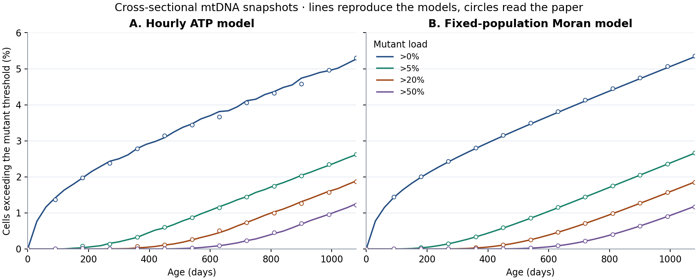
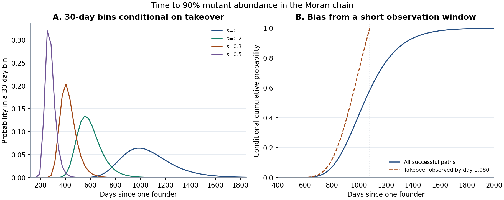

# Infer mtDNA takeover times from cell snapshots

<!-- fixtures: examples/kk26/model.py -->

[Chapter 17](17-mtdna-mechanisms.md) compares mechanisms that can reproduce
a prevalence target. Here we ask how much a set of cell snapshots tells
us about the dynamics. We use the synthetic examples of Kowald & Kirkwood
(2026) and the fixed-copy-number intuition of [chapter 16](16-published-study.md).
[Open-access paper](https://pmc.ncbi.nlm.nih.gov/articles/PMC13272806/)

## Build the observations

Suppose you know each cell's age and its proportion of mutant mtDNA.
At each age, sort cells into five bins. A cell exactly at a threshold
goes into the bin whose upper limit equals that threshold.

| Bin | Mutant fraction |
| --- | --- |
| 0 | Exactly zero |
| 1 | Greater than zero, at most 5% |
| 2 | Greater than 5%, at most 20% |
| 3 | Greater than 20%, at most 50% |
| 4 | Greater than 50% |

The last four cumulative counts are the observables in Figure 6.
Use ratios with the total number of cells of that age as the
denominator. The synthetic experiment reports at 0, 30, …, 1,080 days.
Its trajectories are longitudinal. The objective sees only the five
aggregate counts at each age. A fresh synthetic cohort generates all
of its own snapshots in the parametric bootstrap.

## Give a Moran step its published meaning

Write `W`, `U` and `A` for wild-type, neutral-mutant and
advantageous-mutant copies. The population `N = W+U+A` stays fixed.
Weight reproductive draws by `W`, `U` and `(1+s)*A`. A wild-type
parent produces a mutant with probability `p`. A fraction `f` of those
mutants are advantageous. Mutant parents copy their class.

Independently draw the replaced copy from the three counts divided
by `N`. Each Moran tick draws one daughter and one replaced copy.
A same-class outcome uses a tick and leaves the counts as they were.
The discrete model uses `floor(days * N * ln(2) / half_life)` ticks.
In chapter 16, a replacement parent comes from the survivors of the
death event. The independent draws here implement Equation 7.
[Published transition law](https://pmc.ncbi.nlm.nih.gov/articles/PMC13272806/)

The same count transitions can be written as six CRN-craft reactions.
Place a Poisson clock on the published ticks and the Markov generator
is `N * ln(2) / half_life * (P - I)`, where `P` is the one-tick
transition matrix. Static Direct samples that continuous-time law.
Finite state projection computes it over the reachable lattice.
Try a seven-copy example first.

```python
import sys

sys.path.insert(0, "examples/kk26")
from model import Model, native_model

seven_copies = native_model(Model(0.05, 0.27, 0.7, copies=7))
result = seven_copies.fsp(
    end=12, report_times=[0.0, 12.0], bounds={"W": 7, "U": 7, "A": 7},
    max_states=36, tolerance=1e-10,
)
states = result.metadata["states"]
last = result.metadata["snapshots"][-1]["probabilities"]
mutant_fraction = sum(p for state, p in zip(states, last, strict=True) if state[0] < 7)
print(f"{mutant_fraction:.4f}")
```

```text
0.2017
```

The full model has 501,501 joint count states. The example's discrete
reference advances their probabilities directly. The fit evaluates a
precomputed local spline of forward curves from a faster implicit solver.
The solver splits transitions along three directions on the count
lattice. It records escaped mass from a cap on the neutral count.
For the discrete projection a tail probability lies between the
reported tail and that tail plus escaped mass. The stored fast fit
curves were checked against the discrete implementation, and the
baseline cap was checked against the complete lattice.

## Reconstruct Figure 6

Use 1,000 mtDNA copies and a 10-day half-life. Start all cells wild type
and set `p = 6.8e-6`, `s = 0.1` and `f = 0.8`. The left panel
reconstructs the separate ATP model used to make synthetic data. It
updates degradation, replication and ATP on an hourly clock, with
mutations from wild-type templates. The right panel propagates
Equation 7 directly. The paper's curves were read from its PDF.
[Figure 6](https://pmc.ncbi.nlm.nih.gov/articles/PMC13272806/)



The largest ordinate differences from the digitized curves are 0.158
percentage points in the ATP panel and 0.038 percentage points in the
Moran panel. The ATP values include finite-cohort variation and the
choice of hourly update. A 30,000-cell half-hour run provides a
second check of the scale of those differences.

## Fit the snapshots

Install CRN-craft, fcmaes, SciPy and Matplotlib. The full-size example
uses a local C++17 compiler. Run these commands from the repository root.

```sh
python -m pip install 'crn-craft==0.8.0' fcmaes scipy matplotlib
python examples/kk26/study.py bootstrap --size quick --threads 2
python examples/kk26/study.py fit examples/kk26/results/reconstruction/snapshots-baseline.csv
```

The fit uses the paper's unweighted sum of squared differences between
the four observed and predicted fractions across ages. The three search
coordinates are the log of `p`, the selection advantage `s`, and the
advantageous fraction `f`. fcmaes differential evolution minimizes this
objective. The exact same forward table can serve multiple datasets.
[Paper Methods](https://pmc.ncbi.nlm.nih.gov/articles/PMC13272806/)

The stored experiment contains 40 independently generated data sets
of 10,000 cells in each of two regimes. The following intervals are
the empirical 2.5th and 97.5th percentiles across the fitted data sets.

| Regime | Parameter | True value | Fitted mean | Reconstructed interval | Published interval |
| --- | --- | ---: | ---: | ---: | ---: |
| Baseline | Mutation probability | 6.80e-6 | 6.76e-6 | 6.43e-6–7.25e-6 | 6.11e-6–7.22e-6 |
| Baseline | Selection advantage | 0.10 | 0.101 | 0.092–0.112 | 0.089–0.125 |
| Baseline | Advantageous fraction | 0.80 | 0.786 | 0.654–0.927 | 0.65–1.00 |
| Strong | Mutation probability | 3.00e-5 | 3.02e-5 | 2.91e-5–3.10e-5 | 2.80e-5–2.99e-5 |
| Strong | Selection advantage | 0.50 | 0.509 | 0.445–0.601 | 0.461–0.628 |
| Strong | Advantageous fraction | 0.20 | 0.198 | 0.172–0.235 | 0.18–0.24 |

The baseline leaves a much wider absolute range for the advantageous
fraction. Use `fraction-profile.csv` to see how changing that fraction
shifts the preferred mutation rate and selection advantage for the
first synthetic cohort. These intervals describe parameter recovery
under the synthetic model. The paper also discusses uncertainty in
turnover and copy number and the relation between RNA and DNA mutant
fractions when applying the method to measured data.
[Tables 2–5 and the discussion](https://pmc.ncbi.nlm.nih.gov/articles/PMC13272806/)

## Translate a fitted advantage into a time

Start the time at one advantageous copy, with further mutation switched
off. Absorb the chain at extinction or at 90% advantageous copies,
whichever comes first. Divide the takeover CDF by the eventual takeover
probability to obtain the duration distribution among successful founders.
Keep the success probability alongside the conditional median.



At selection advantage 0.10, about 9.1% of single founders eventually
reach the threshold. Among those, the median time is about 1,038 days.
Only about 58% of those takeovers are seen by day 1,080 even when the
founder is present at the start of that window. Omitting later takeovers
pushes the observed distribution toward shorter times. The saved table
also contains times computed from the fitted mean advantages.

```sh
python examples/kk26/study.py bootstrap --size full --threads 8
python examples/kk26/study.py figures
python validation/check_kk26.py --output kk26-validation.json
```

See the [example README](../../examples/kk26/README.md) for the fit bounds,
data columns and commands to rebuild the discretization checks and figures.
