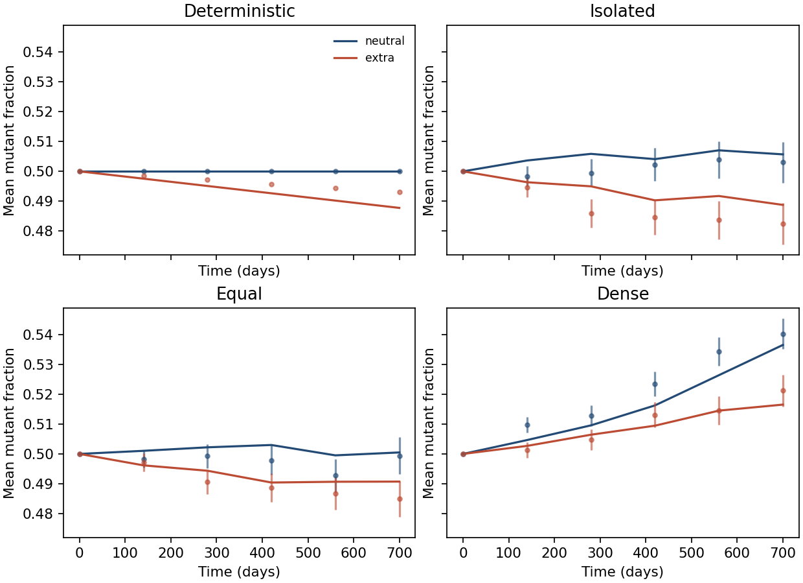
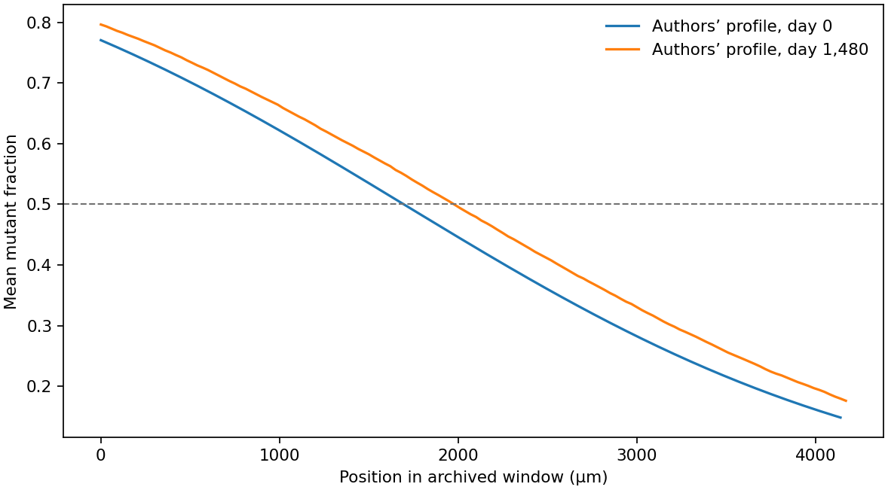
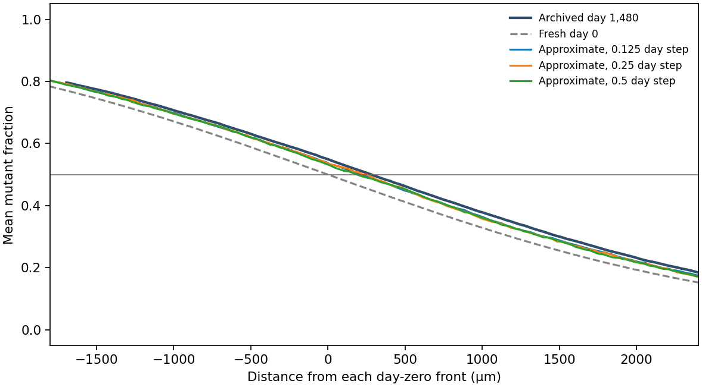

# 19. Case study of spatial mtDNA spread

[Chapter 18](18-mtdna-inference.md) follows the takeover of a single cell. A
skeletal muscle fiber can contain many regions, each with its own local
population of mitochondrial DNA (mtDNA). The 2022 study by Insalata,
Hoitzing, Aryaman and Jones asks what happens if molecules can move between
those populations. [Paper and supplement](https://doi.org/10.1073/pnas.2122073119)

## Two connected regions

Each region has counts `W` and `M`. Births of both types use the same
per-copy rate, `max(0, mu + c * (Nss - W - delta * M))`. At the same
value of `W + delta * M`, a population consisting entirely of mutants
can hold more copies when `delta < 1`. Degradation occurs at rate `mu`
per copy. A hop changes two counts, one at the source and one at the
destination. Here is the migration reaction in isolation.

```python
import crn_craft as crn

model = crn.Model("one_hop")
model.add_species({"M0": 1, "M1": 0})
model.add_reaction(0.2, ["M0"], ["M1"], name="hop")
run = crn.ensemble(model, end=10, report_times=[0, 10], method="static_direct")
mean = run.simulate().statistics["mean"]
print(mean[["M0", "M1"]].sum(axis=1).astype(int).tolist())
```

```text
[1, 1]
```

Compute the mutant fraction in each region of each replicate before
taking the mean. The two regional observations from a realization stay
paired when estimating its uncertainty. The fresh run uses 2,000
realizations per stochastic condition. Figure 1C has an equal-density
control, an isolated stochastic control, and a deterministic control.

| Neutral stochastic model | Archived mean at day 700 | Fresh mean |
| --- | ---: | ---: |
| Isolated region | 0.50300 | 0.50570 |
| Connected, equal density | 0.49944 | 0.50050 |
| Connected, higher mutant density | 0.54026 | 0.53652 |

The three differences are within the prespecified simultaneous intervals
around the archived means. The fresh higher-density mean exceeds the
equal-density mean by 0.0360, with a simultaneous lower bound of 0.0139.
The result is an example of stochastic survival of the densest.



## Measure a traveling front

Find the descending 50% crossing in each profile and linearly interpolate
between neighboring positions. Each archive file carries its own position
grid. The Figure 2E crossing moves 280.80 µm in 1,480 days, giving
**0.18973 µm/day**. The Figure 2B regression on rhesus muscle fibers
reports **0.131 ± 0.025 µm/day**, with a standard error. The archived
profiles are simulation outputs. [Numerical reference](https://github.com/ferdinando17/Survival-of-the-Densest/tree/45462390b4c27cf2ffe4860c4f526e67d49ad6c8/Simulated_data/Main_text/Figure2/2E)



An independent, approximate 500-region run with a 0.125-day step gives
0.14617 µm/day over 96 fibers. Its 99% interval, 0.13016–0.16360,
overlaps only part of the prespecified equivalence range around
the archived speed.



Run `python examples/mtdna_spread/study.py --size quick` to generate a short
chain and check the archived crossings. Use `--size draft` for the Figure 1C
ensembles. The example describes the longer fiber runs and their costs.
[Example and result files](../../examples/mtdna_spread/README.md)

[Chapter 20](20-mtdna-network.md) uses the same mutant fraction to measure
how different cells become over time.
