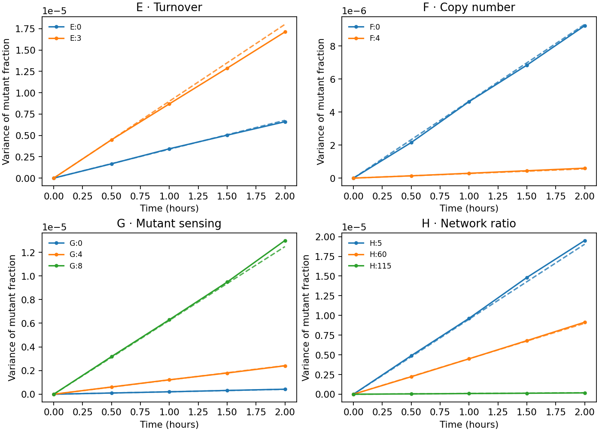

# 20. Mitochondrial networks and the rate of drift

Keep one cell and give each copy two labels. Its genotype is wild type or
mutant, and its mitochondrial state is singleton or fused. In the 2019
model, fission and fusion change the state. Mitophagy removes singletons.
The total population can fluctuate around a target set by replication
feedback. [Aryaman et al., paper](https://doi.org/10.1534/genetics.119.302423)

## Make pairs with mass action

Two wild-type singletons can fuse to form a pair of fused copies. Each
unordered pair contributes one hazard. With (n) identical reactants
there are (n(n-1)/2) pairs.

```python
import crn_craft as crn

model = crn.Model("fusion_only")
model.add_species({"WS": 3, "WF": 0})
model.add_reaction(0.4, ["WS", "WS"], ["WF", "WF"], name="fusion")
run = crn.ensemble(model, end=1, report_times=[0, 1], method="static_direct")
mean = run.simulate().statistics["mean"]
print(mean[["WS", "WF"]].sum(axis=1).astype(int).tolist())
```

```text
[3, 3]
```

The full example adds fission, mixed-genotype fusion, replication of both
states and degradation of singletons. A singleton that replicates becomes
two fused copies. The state changes preserve each genotype count until
a birth or death fires.

## Estimate a slope from independent cells

Start replicas at the supplied near-steady counts. Let `h` be the mutant
fraction, `n` the total copy number, `mu` the singleton degradation rate
and `fs` the singleton fraction. Equation 13 predicts the initial
heteroplasmy variance slope `2 * mu * fs * h * (1 - h) / n` under fast
network switching. Estimate it by regressing ensemble variance on time
through the origin. Resample whole paths for an interval on the slope.



The shipped comparisons include the turnover, copy-number, mutant-sensing
and fusion/fission sweeps from Figures 2E–H, plus the rate-magnitude sweep
from Figure S3D. The archived 0–100 hour summary and the fresh short-time
slopes answer related questions on different time windows.

Run `python examples/mtdna_network/study.py --size quick` for one short
case. The example includes the condition table, the archived variance
series and the full-run slope and uncertainty for each condition.
[Example and result files](../../examples/mtdna_network/README.md)

[Chapter 21](21-mtdna-bottleneck.md) follows variance across scheduled
cell divisions.
