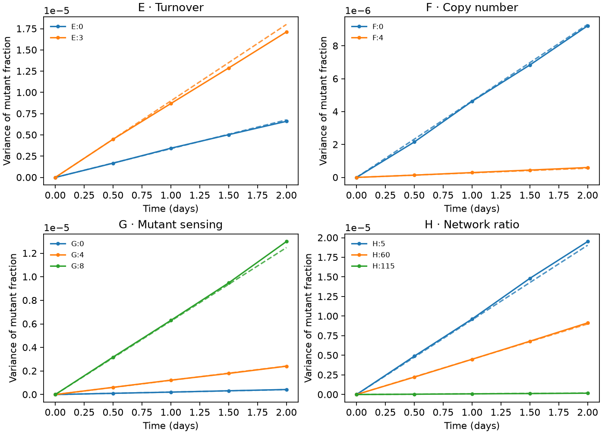
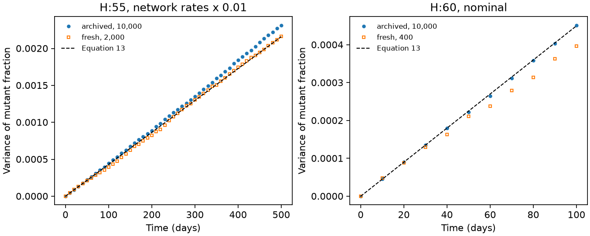

# 20a. Network state and drift: results, choices and limits

This page belongs to [chapter 20](20-mtdna-network.md). All tables are
generated from the CSV files in `examples/mtdna_network/results/`, and
`validation/check_mtdna_network.py` compares them with this page.

## The primary check

The three conditions fixed in `manifest.json` before the runs: turnover
E:0 (`μ` = 0.01725 per day), copy number F:0 and the nominal H:60. Each
has 2,000 paths over 0–2 days. The ratio is the measured slope of `Var(h)`
divided by the Equation 13 slope.

<!-- mtdna-network-primary -->
| Condition | Paths | Ratio | 99% simultaneous, 600 replicates | Same, 20,000 replicates | Inside 0.80–1.20 |
|---|---|---|---|---|---|
| E:0 | 2,000 | 0.986 | 0.904–1.074 | 0.903–1.073 | yes |
| F:0 | 2,000 | 0.986 | 0.903–1.062 | 0.904–1.065 | yes |
| H:60 | 2,000 | 1.010 | 0.935–1.084 | 0.929–1.096 | yes |
<!-- /mtdna-network-primary -->

All three intervals lie inside the declared band: numerical agreement.
The shipped intervals used 600 bootstrap replicates, so each end rests on
about one replicate (tail 0.01/6). Rerunning the same paths (identical
seeds give identical paths) with 20,000 replicates moves the ends by up to
0.012; five other 600-replicate seeds differ from the 20,000-replicate
ends by up to 0.017 (`review-primary-intervals.csv`). The decision is the same either way.

## Every source condition

The same estimator for all 39 conditions. Intervals use the same
Bonferroni tails as the primary check and are descriptive. "Archive"
is the authors' 10,000-path variance series regressed through the origin
over 0–100 days, divided by the same Equation 13 slope.

<!-- mtdna-network-all -->
| Condition | Varied | Paths | Window (days) | f_s | Eq. 13 (1e-6/day) | Ratio | 99% interval | Archive 0–100 d / Eq. 13 |
|---|---|---|---|---|---|---|---|---|
| E:0 | μ = 0.01725/day | 2,000 | 2 | 0.466 | 3.385 | 0.986 | 0.904–1.074 | 1.004 |
| E:1 | μ = 0.0345/day | 2,000 | 2 | 0.466 | 6.770 | 1.042 | 0.965–1.130 | 1.041 |
| E:2 | μ = 0.04025/day | 2,000 | 2 | 0.466 | 7.878 | 1.010 | 0.930–1.091 | 1.005 |
| E:3 | μ = 0.046/day | 2,000 | 2 | 0.466 | 9.003 | 0.955 | 0.888–1.051 | 1.007 |
| F:0 | κ = 0 | 2,000 | 2 | 0.472 | 4.653 | 0.986 | 0.903–1.062 | 1.011 |
| F:1 | κ = 583 | 2,000 | 2 | 0.322 | 1.694 | 1.005 | 0.929–1.080 | 1.020 |
| F:2 | κ = 1166 | 2,000 | 2 | 0.256 | 0.970 | 0.985 | 0.910–1.058 | 0.994 |
| F:3 | κ = 2333 | 2,000 | 2 | 0.186 | 0.467 | 1.047 | 0.960–1.126 | 0.997 |
| F:4 | κ = 3499 | 2,000 | 2 | 0.147 | 0.280 | 1.067 | 0.987–1.155 | 1.000 |
| G:0 | δ = -5 | 2,000 | 2 | 0.189 | 0.208 | 1.018 | 0.933–1.090 | 0.990 |
| G:1 | δ = -1 | 2,000 | 2 | 0.189 | 0.484 | 1.005 | 0.923–1.084 | 1.011 |
| G:2 | δ = -0.1 | 2,000 | 2 | 0.239 | 0.974 | 1.015 | 0.937–1.116 | 1.019 |
| G:3 | δ = -0.01 | 2,000 | 2 | 0.257 | 1.163 | 0.982 | 0.907–1.056 | 0.996 |
| G:4 | δ = 0.01 | 2,000 | 2 | 0.262 | 1.209 | 0.995 | 0.922–1.073 | 1.001 |
| G:5 | δ = 0.1 | 2,000 | 2 | 0.281 | 1.427 | 1.021 | 0.950–1.104 | 1.017 |
| G:6 | δ = 1 | 2,000 | 2 | 0.471 | 4.652 | 1.012 | 0.943–1.090 | 0.976 |
| G:7 | δ = 1.5 | 2,000 | 2 | 0.578 | 10.320 | 0.980 | 0.900–1.062 | 1.019 |
| G:8 | δ = 2 | 2,000 | 2 | 0.567 | 6.240 | 1.028 | 0.955–1.106 | 0.993 |
| H:5 | R = 0.01, M = 1 | 2,000 | 2 | 0.987 | 9.520 | 1.027 | 0.946–1.120 | 1.010 |
| H:16 | R = 0.0251, M = 1 | 2,000 | 2 | 0.971 | 9.380 | 1.018 | 0.947–1.110 | 1.008 |
| H:27 | R = 0.0631, M = 1 | 2,000 | 2 | 0.932 | 8.999 | 0.982 | 0.901–1.060 | 0.986 |
| H:38 | R = 0.158, M = 1 | 2,000 | 2 | 0.846 | 8.172 | 0.994 | 0.916–1.082 | 0.992 |
| H:49 | R = 0.398, M = 1 | 2,000 | 2 | 0.687 | 6.636 | 1.013 | 0.940–1.090 | 1.015 |
| H:55 | R = 1, M = 0.01 | 2,000 | 2 | 0.446 | 4.319 | 1.009 | 0.943–1.080 | 1.023 |
| H:56 | R = 1, M = 0.0251 | 2,000 | 2 | 0.458 | 4.416 | 0.944 | 0.880–1.015 | 1.004 |
| H:57 | R = 1, M = 0.0631 | 2,000 | 2 | 0.463 | 4.473 | 1.008 | 0.920–1.091 | 0.998 |
| H:58 | R = 1, M = 0.158 | 2,000 | 2 | 0.465 | 4.512 | 1.035 | 0.949–1.117 | 0.990 |
| H:59 | R = 1, M = 0.398 | 2,000 | 2 | 0.466 | 4.513 | 1.011 | 0.940–1.086 | 1.006 |
| H:60 | R = 1, M = 1 | 2,000 | 2 | 0.467 | 4.500 | 1.010 | 0.935–1.084 | 0.996 |
| H:61 | R = 1, M = 2.51 | 2,000 | 2 | 0.467 | 4.511 | 1.016 | 0.938–1.098 | 1.016 |
| H:62 | R = 1, M = 6.31 | 1,024 | 0.957 | 0.467 | 4.511 | 0.996 | 0.883–1.117 | 0.990 |
| H:63 | R = 1, M = 15.8 | 1,024 | 0.381 | 0.467 | 4.511 | 0.998 | 0.896–1.094 | 1.022 |
| H:64 | R = 1, M = 39.8 | 1,024 | 0.152 | 0.467 | 4.511 | 1.028 | 0.909–1.180 | 1.002 |
| H:65 | R = 1, M = 100 | 1,024 | 0.0604 | 0.467 | 4.511 | 0.879 | 0.755–1.033 | 1.021 |
| H:71 | R = 2.51, M = 1 | 2,000 | 2 | 0.258 | 2.483 | 0.984 | 0.912–1.071 | 0.995 |
| H:82 | R = 6.31, M = 1 | 2,000 | 2 | 0.122 | 1.187 | 0.965 | 0.895–1.040 | 1.001 |
| H:93 | R = 15.8, M = 1 | 2,000 | 2 | 0.052 | 0.508 | 1.038 | 0.936–1.130 | 1.008 |
| H:104 | R = 39.8, M = 1 | 2,000 | 2 | 0.022 | 0.204 | 0.971 | 0.872–1.081 | 0.981 |
| H:115 | R = 100, M = 1 | 2,000 | 2 | 0.009 | 0.093 | 0.905 | 0.819–1.028 | 0.945 |
<!-- /mtdna-network-all -->

38 of the 39 intervals lie inside 0.80–1.20. The exception is H:65, the
fastest switching magnitude (`β` = 3,312 per day). Its window is 0–0.060
days, in which a path sees about 1.3 births or deaths, so its interval is
0.28 wide, against 0.13–0.21 for the 2,000-path rows over 2 days. Its rerun is below.

## What the two-day window can and cannot show

At time zero every path is in the same state, and the variance grows only
through births and deaths. A birth or death changes `h` by about `h/n` or
`(1−h)/n`. If the singletons have the same mutant fraction as the whole
cell and births balance deaths (`λn = μ·n·f_s`), the sum of hazard times
squared jump is exactly `2μ f_s h(1−h)/n`, Equation 13, whatever the
fusion and fission rates are. So the early ratios check the hazards and
the estimator. They cannot show the failure of Equation 13 when fusion and
fission are slow; that failure builds up over many turnover times, as the
singleton and fused pools drift apart.

The authors' archived runs cover 500 days (about 17 half-lives). By their
own estimator (the mean finite-difference gradient of `Var(h)` over
0–500 days), the largest deviation in the whole 121-condition network
sweep is 9% (magnitude 0.01, ratio 0.063, a row not among the 39);
H:55 (magnitude 0.01, ratio 1) deviates by 7%. No path reaches fixation by
day 500 in any of the 39 archived conditions.

## Review runs

Four runs, each declared with its decision rule before it ran
(`review.py`, `results/review-*.csv`):

1. H:65 again, same window, fresh seed, 2,000 paths. Rule: a single 99%
   interval containing 1 means the shipped 0.879 is sampling noise.
2. H:55, the slowest switching magnitude of Figure S3D, 2,000 paths over
   0–500 days, and H:60 (nominal), 400 paths over 0–100 days, on the
   archive's 10-day grid with the authors' estimator. Rule: the 99%
   interval of fresh/archived containing 1 means numerical agreement.

<!-- mtdna-network-review -->
| Run | Paths | Days | Quantity | Value (99% interval) |
|---|---|---|---|---|
| H:65 again, fresh seed | 2,000 | 0–0.060 | fresh / Equation 13 | 1.042 (0.925–1.187) |
| H:55 fresh vs archive | 2,000 | 0–500 | fresh / archived | 0.938 (0.864–1.016) |
| H:55 vs Equation 13 | 2,000 | 0–500 | fresh / Equation 13 | 1.004 (0.925–1.088); archived 1.070 |
| H:60 fresh vs archive | 400 | 0–100 | fresh / archived | 0.879 (0.720–1.063) |
| H:60 vs Equation 13 | 400 | 0–100 | fresh / Equation 13 | 0.885 (0.725–1.070); archived 1.007 |
<!-- /mtdna-network-review -->

- H:65: the interval contains 1. The shipped 0.879 was sampling noise of
  the short window, not a loss of accuracy.
- Both fresh-versus-archive intervals contain 1: numerical agreement with
  the authors' simulations. The nominal run is small (400 paths), so its
  interval, 0.72–1.06, is wide.
- H:55 against Equation 13: inconclusive. The fresh interval contains both
  1 and the archive's 1.070, so this run cannot tell whether slow
  switching makes the drift 7% faster.

`results/nominal-long.csv` holds the smaller H:60 run of the full
campaign (96 paths to day 50); its variance at day 50, 2.40e-4, is close
to the Equation 13 value 2.25e-4.

## Reconstruction choices

| Choice | Alternative | Measured effect |
|---|---|---|
| Equation 13 evaluated at the integer initial counts, as the authors' analysis does | the floating-point deterministic steady state reached from them | ≤ 0.2% in all rows except H:93 (0.5%), H:104 (2.2%) and H:115 (3.6%), where only 9–22 copies are singletons |
| Slope from 0–2 days, through the origin | the authors' mean gradient over 0–500 days | changes the question (see above); archive ratios are 0.96–1.07 over 0–500 days and 0.94–1.04 over 0–100 days |
| Window `2·100/β` days and 1,024 paths for H:62–H:65 | 2 days and 2,000 paths | interval widths 0.20–0.28, against 0.13–0.21 for the 2-day rows |
| Bootstrap of the variance with divisor `n` | divisor `n − 1`, as in the archive | 0.05% |
| 600 bootstrap replicates | 20,000 | interval ends move by up to 0.017 |
| Fused copies never degraded | the authors' `xi > 0` variant | not run; outside Figure 2 |
| Pair hazard `γ·k(k−1)/2` for identical singletons | `γ·k²/2` | identical to the authors' simulator; the check would catch either factor-two error |

## What the check guards

`validation/check_mtdna_network.py` runs in under a second and offline. It
compares hand-computed hazards with finite state projection over one tiny
time step: identical-singleton fusion at 0, 1, 2 and 3 copies, all
13 one-event destinations of a mixed state with feedback `b` > 0, the clamp
of a negative replication rate at zero, and that fused copies are never
degraded. It checks that a single-genotype cell never gains a mutant, the
Equation 13 value for one state, the row and value counts of the
reference files, the structure of the saved results, and that the three
tables above equal the saved CSV files.

## Limits and what was not verified

- The supplement (Table S2) was not read; parameter values come from the
  authors' parameter tables at the pinned revision, which match
  `conditions.csv` exactly.
- Figure S4A (the error heatmap over the full network grid) is not
  reproduced; only the archive was read for it.
- The review reran only the three primary conditions of the full campaign
  (bit-identical to the shipped rows; one and two threads give identical
  paths). The other 36 rows were not rerun.
- The early-window ratios do not test the fast-switching assumption of
  Equation 13, and the slow-switching deviation in the archive (7% for
  H:55) is not resolved by the fresh runs.
- `conditions.csv` and `reference-variance.csv` are derived from the data
  files of a GPL-3.0 repository. They are not covered by this repository's
  MIT license and stay under the terms of their source
  ([notice](../../THIRD_PARTY_NOTICES.md#reference-data-of-the-guide-case-studies));
  `fetch.py` regenerates both from the pinned revision.

## Exercises

1. Multiply `early_days` in `manifest.json` by 400 and run `study.py
   --size quick` (a 0–100 day window, about two minutes). Does the ratio
   for H:60 stay near 1?
2. Change the fusion hazard in `study.py` to count ordered pairs
   (`γ·k(k−1)`) and run the check. Which line fails?
3. Raise the H:55 path count in `review.py` from 2,000 to 8,000 (about
   seven minutes). Does the interval against Equation 13 still contain
   1?
