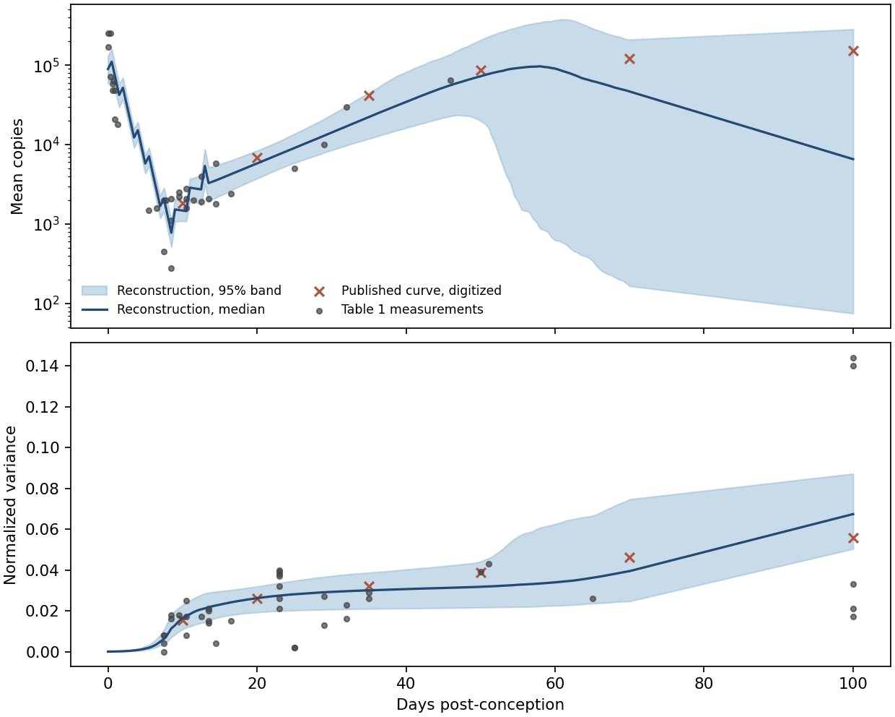

# 21. Inheriting an mtDNA bottleneck

A mouse germ cell can lose many mitochondrial DNA copies over several
divisions, then recover its copy number later in development. Cells that
have the same average mutant fraction can still vary considerably in
what a daughter inherits. Johnston and colleagues use observations of
both mean copy number and heteroplasmy variance to infer how this
variation arises. [Paper, tables and appendix](https://doi.org/10.7554/eLife.07464)

## Alternate turnover and division

Between divisions a copy can replicate or disappear. A scheduled
division draws from a binomial distribution for each genotype, with
probability one half of entering the tracked daughter. The simulation
advances to the same time for every lineage and then applies the
partitioning rule. Here's the exact distribution for the number of
mutant copies a daughter inherits from a mother with two mutant copies.

```python
from math import comb

probabilities = [comb(2, copies) * 0.5**2 for copies in range(3)]
print(probabilities)
```

```text
[0.25, 0.5, 0.25]
```

The example runs one lineage by joining CRN-craft segments and checks
that the expected copy number grows as `exp((birth - death) * hours)`
in each segment. It halves at each division. At paper-scale counts
the generating-function calculation reduces the descendant count
from each original copy to a zero-or-geometric distribution.

## Fit copy number and variance together

The distance sums squared differences in log mean copy number and in
normalized variance. The threshold for Figure 3 is 40. Approximate
Bayesian computation accepts a parameter draw only when the distance
is below that value and its rates and copy numbers meet the stated
constraints. The code approximates the normalized heteroplasmy variance by the
copy-number variance divided by the square of the mean copy number.
This follows from expanding the mutant fraction around its mean when
both genotypes follow independent, neutral turnover. At a fixed age an independent calculation draws copies
from the exact founder-family law.



The dots are separate group measurements. The shaded region describes
variation in the predicted population statistic over accepted
parameter sets. The validation then uses group-sized samples of
individual heteroplasmies from the founder-family law. This distinction
matters when a litter contributes only a few observed cells.

Run `python examples/mtdna_bottleneck/study.py --size quick` for a short
inference. The example documents the priors, the display convention for
mature oocytes, the comparison and the effective sample sizes.
[Example and result files](../../examples/mtdna_bottleneck/README.md)

[Chapter 22](22-two-stage-expression.md) turns to the shape of a different
stochastic count distribution.
