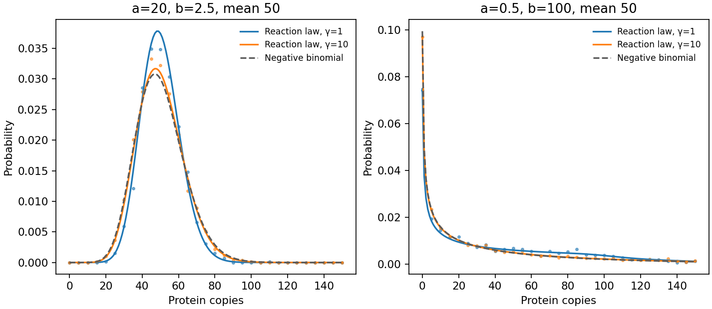

# 22. Protein distributions from four reactions

An mRNA arrives at a constant rate, each mRNA translates proteins
independently, and both species decay. Shahrezaei and Swain compare the
protein distribution from these four reactions with an analytical
negative-binomial approximation. [Paper](https://doi.org/10.1073/pnas.0803850105)

## A model with two kinds of noise

Measure time in protein lifetimes, so the protein degradation rate is
one. Let `a` be the transcription rate in these units, `gamma` the rate
of mRNA degradation, and `b` the number of proteins an mRNA produces on
average before it degrades. Translation then has per-mRNA rate
`b * gamma`.

```python
import crn_craft as crn

model = crn.Model("two_stage")
model.add_species({"M": 0, "P": 0})
model.add_reaction(0.7, [], ["M"], name="transcription")
model.add_reaction(2.4, ["M"], ["M", "P"], name="translation")
model.add_reaction(2.0, ["M"], [], name="mrna_decay")
model.add_reaction(1.0, ["P"], [], name="protein_decay")
result = model.fsp(end=1.0, report_times=[1.0], bounds={"M": 5, "P": 8})
print(f"{result.metadata['snapshots'][0]['probabilities'][0]:.4f}")
```

```text
0.6637
```

## Compare the whole distribution

In both parameter regimes drawn in Figure 1B–C the stationary mean
`a * b` is 50. The narrow regime has many small translation bursts.
The broad regime has infrequent mRNAs and many proteins per burst.
When mRNA lifetimes are short, the negative-binomial curve with shape
`a` and success probability `1 / (1 + b)` closely follows the simulation.



The example checks CRN-craft's finite state projection with an
independent matrix exponential and the protein marginal with a
generating function. Four ensembles of 10,000 cells validate the
marginal in the plotted cases. The divergence curve uses counts 0–150
and a single tail bin. Open circles mark the digitized paper values.
Both curves fall with the lifetime ratio. The broad-burst curves
differ at small ratios.


Run `python examples/two_stage_expression/study.py --size full` to
generate the lifetime sweep. [Example and result files](../../examples/two_stage_expression/README.md)

[Chapter 23](23-yeast-rna-fit.md) compares what fitting just the mean and
fitting the count distribution can tell us about a real experiment.
