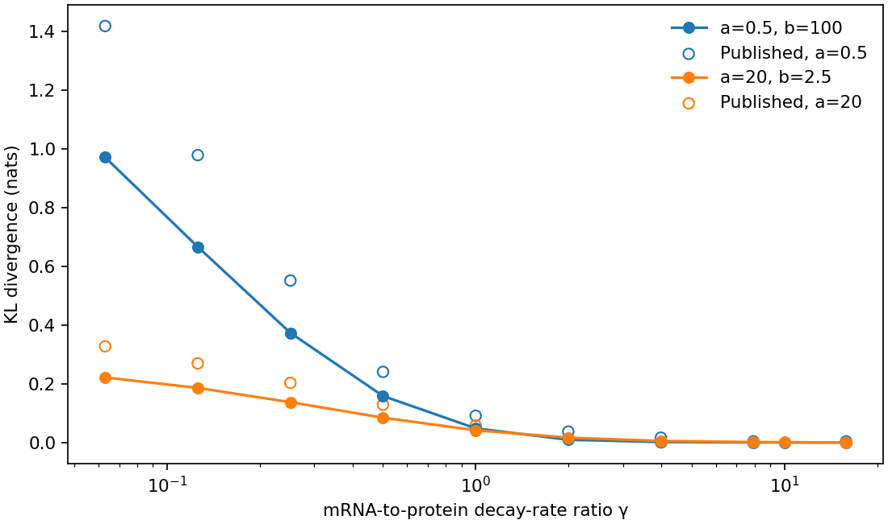

# 22. Protein distributions from four reactions

## What this chapter reproduces

An mRNA arrives at a constant rate, each mRNA translates proteins
independently, and both species decay. How well does a negative-binomial
law describe the protein count of these four reactions, and when does it
fail? The chapter reconstructs Figure 1B–D of

> Shahrezaei V., Swain P.S. (2008). Analytical distributions for
> stochastic gene expression. *PNAS* 105, 17256–17261.
> [doi:10.1073/pnas.0803850105](https://doi.org/10.1073/pnas.0803850105)
> (Equation 9 and Figure 1; author manuscript
> [arXiv:0812.3344](https://arxiv.org/abs/0812.3344))

The paper publishes no data or code for Figure 1. Everything here is
computed from the reactions; the only values taken from the paper are the
18 marker heights of Figure 1D, read from the figure image
(`reference-figure1d.csv`, `digitize.py`). The paper's authors did not
write or review this chapter.

The result in three lines:

- Two protein distributions with the same mean of 50 copies: one peaks
  at 47–48 copies, the other at zero and puts 5–8% of its mass above 150 copies.
  Four ensembles of 10,000 cells agree with the computed laws within a
  99% simultaneous band.
- The negative-binomial law of Equation 9 becomes exact as mRNA lifetimes
  shrink (γ large). At γ = 0.063 its Kullback–Leibler divergence from the
  reaction law is 0.22 nats for the narrow and 0.97 nats for the broad
  regime.
- The published Figure 1D values are 1.45–1.52 times these numbers in both
  regimes. In bits (logarithm base 2) they agree within 0.024, about the
  reading error of the figure. The paper does not state the unit, and the
  review could not inspect the figure's axis labels, so this is the likely
  cause, not a confirmed one.

## The model

Time is measured in protein lifetimes, so the protein decay rate is one.
The paper writes transcription rate `v0`, translation rate `v1` per mRNA,
and decay rates `d0` (mRNA) and `d1` (protein). It sets `a = v0/d1`,
`b = v1/d0` and `γ = d0/d1`.

| Reaction | Propensity | Meaning |
| --- | --- | --- |
| ∅ → M | `a` | transcription, `a` mRNAs per protein lifetime |
| M → M + P | `b·γ·M` | translation, `b` proteins per mRNA lifetime on average |
| M → ∅ | `γ·M` | mRNA decay |
| P → ∅ | `P` | protein decay |

The stationary protein law has mean `a·b` and Fano factor (variance over
mean) `1 + b·γ/(1 + γ)` for every γ. For γ → ∞, Equation 9 of the paper
gives the negative-binomial law with shape `a` and success probability
`1/(1 + b)`, which is SciPy's `nbinom(a, 1/(1 + b))`. The paper gives no
physical rate for Figure 1; the results here hold for any `d1`.

The two regimes are `a = 20, b = 2.5` (narrow) and `a = 0.5, b = 100`
(broad). The caption of Figure 1 gives the mean mRNA number `a/γ` as 2 or
20 in panel B and 0.05 or 0.5 in panel C, which fits these `a` at γ = 10
and 1. The values of `b` and the use of the same `a, b` across the
γ sweep of panel D come from the study plan; the caption does not state
them.

A small model checks CRN-craft's finite state projection (FSP). The
printed number is the probability that neither an mRNA nor a protein is
present after one protein lifetime.

```python
import crn_craft as crn

model = crn.Model("two_stage")
model.add_species({"M": 0, "P": 0})
model.add_reaction(0.7, [], ["M"], name="transcription")
model.add_reaction(2.4, ["M"], ["M", "P"], name="translation")
model.add_reaction(2.0, ["M"], [], name="mrna_decay")
model.add_reaction(1.0, ["P"], [], name="protein_decay")
result = model.fsp(end=1.0, report_times=[1.0], bounds={"M": 5, "P": 8})
print(f"{result.metadata['snapshots'][0]['probabilities'][0]:.4f}")
```

```text
0.6637
```

## How the distributions are computed

Three independent calculations are compared.

1. **Native FSP.** On the small model above it agrees with SciPy's matrix
   exponential of the same truncated generator to 1.9e-13 in every state
   probability. On the narrow regime at γ = 1 and three protein lifetimes
   (box M ≤ 50, P ≤ 106), its protein marginal differs from the
   generating function below by 5.1e-8 in the cumulative distribution
   function (CDF), with 7.3e-8 probability leaving the box. The sweep
   needs 32 lifetimes of the slower species (below). With this box the
   native solver still runs to 6 protein lifetimes but stops before 12
   with `CRN-E070`, because it caps a projection at 200,000,000 work units.
   FSP is therefore not used for the sweep.
2. **Generating function (production).** mRNAs arrive as a Poisson
   process. An mRNA of age `s` that is still alive has left a Poisson
   number of surviving proteins; one that died has left a Poisson number
   that decays further. Integrating over arrival times and lifetimes
   gives the probability generating function of the protein count at
   time `T` from zero counts. It is inverted on 2,048 or 4,096 roots of
   unity. `T` is 32 lifetimes of the slower species: 507 protein
   lifetimes at γ = 0.063. Doubling `T` changes no CDF by more than
   1.4e-12; doubling the support and refining the quadrature by no more
   than 1.1e-7. The mass above 2,047 copies is at most 2.5e-13.
3. **Stationary master equation (review).** `review.py` solves the
   truncated joint master equation for its stationary vector with a sparse
   LU factorization. It shares no code with the production solver. At all
   20 parameter rows the two agree within 1.5e-12 in divergence, and
   within 2.4e-10 in the CDF of the four tabulated cases. Both reproduce
   the exact mean and Fano factor within 1.1e-9 (relative).
   `stationary_check.py` solves the same 20 rows with CRN-craft's
   `stationary_fsp` (closed classes and a sparse LU in the native engine)
   and agrees with this solver within 1e-13 in the CDF.

Exact stochastic simulation (Gillespie's direct method) gives 10,000
independent cells per Figure 1B–C case, each started from zero and read
once at time `T`.

## The protocol

The targets in `manifest.json` were fixed before the runs: numerical tail
below 1e-6, CDF change below 0.001 when `T` doubles, mean and Fano factor
within 1% of the exact values. The four simulated CDFs are compared with
the computed laws by the Dvoretzky–Kiefer–Wolfowitz (DKW) inequality,
two-sided, at 99% simultaneous over the four panels:
`sqrt(ln(2·4/0.01)/(2·10,000)) = 0.0183`. The divergence convention was
fixed as the reaction law relative to the negative-binomial law, counts
0–150 and one bin above 150. The review's convention tests and their
decision rules were declared before the review run (see the limits
below).

## Two distributions with mean 50


Lines: computed laws. Dots: every fifth count of the 10,000 simulated cells.

<!-- two-stage-same-mean -->
| a, b | γ | Mean mRNA a/γ | Most likely count | P(0) | Mass above 150: reaction law / NB / sample | Sample CDF gap | DKW bound |
| --- | ---: | ---: | ---: | ---: | ---: | ---: | ---: |
| 20, 2.5 | 1 | 20 | 48 | 0.0000 | 0.0000 / 0.0000 / 0.0000 | 0.0062 | 0.0183 |
| 20, 2.5 | 10 | 2 | 47 | 0.0000 | 0.0000 / 0.0000 / 0.0000 | 0.0107 | 0.0183 |
| 0.5, 100 | 1 | 0.5 | 0 | 0.0749 | 0.0491 / 0.0833 / 0.0486 | 0.0059 | 0.0183 |
| 0.5, 100 | 10 | 0.05 | 0 | 0.0971 | 0.0830 / 0.0833 / 0.0799 | 0.0066 | 0.0183 |
<!-- /two-stage-same-mean -->

All four sample gaps lie inside the bound: numerical agreement. The broad
regime puts 5–8% of the cells beyond the plotted axis; a fit or a
divergence that drops them misses that mass.

## Approximation error across lifetime ratios



Solid lines: the divergence of the exact reaction law from Equation 9, in
bits. Dashed lines: the same divergence estimated from 10,000 draws of the
reaction law (mean of 20 repeats, ± standard deviation in the table),
which is what a divergence from a simulated histogram measures. Open
circles: the digitized paper values; their reading error is 0.017.

<!-- two-stage-divergence -->
| γ | a=20: published | a=20: bits | a=20: bits, 10,000 draws | a=0.5: published | a=0.5: bits | a=0.5: bits, 10,000 draws |
| ---: | ---: | ---: | ---: | ---: | ---: | ---: |
| 0.0631 | 0.327 | 0.319 | 0.324 ± 0.006 | 1.417 | 1.400 | 1.409 ± 0.009 |
| 0.126 | 0.269 | 0.268 | 0.275 ± 0.008 | 0.978 | 0.961 | 0.975 ± 0.011 |
| 0.251 | 0.203 | 0.198 | 0.203 ± 0.006 | 0.551 | 0.538 | 0.549 ± 0.009 |
| 0.501 | 0.128 | 0.122 | 0.125 ± 0.005 | 0.240 | 0.228 | 0.237 ± 0.006 |
| 1 | 0.058 | 0.060 | 0.067 ± 0.005 | 0.091 | 0.070 | 0.081 ± 0.005 |
| 2 | 0.012 | 0.024 | 0.031 ± 0.002 | 0.037 | 0.014 | 0.024 ± 0.002 |
| 3.98 | 0.000 | 0.008 | 0.015 ± 0.001 | 0.017 | 0.003 | 0.014 ± 0.002 |
| 7.94 | 0.000 | 0.002 | 0.010 ± 0.001 | 0.004 | 0.001 | 0.012 ± 0.001 |
| 15.8 | 0.000 | 0.001 | 0.008 ± 0.001 | 0.004 | 0.000 | 0.011 ± 0.001 |
<!-- /two-stage-divergence -->

The paper says only that it plots "the Kullback–Leibler divergence between
the analytical and simulated protein distributions". Direction, binning,
tail handling, logarithm base and sample size are open. The review
computed each choice at all 18 digitized points:

<!-- two-stage-conventions -->
| Convention | Published / candidate, 8 values ≥ 0.1 | Largest gap, 18 values |
| --- | ---: | ---: |
| Reaction law vs NB, nats, 0–150 + tail (shipped) | 1.45–1.52 | 0.447 |
| Reversed direction, nats | 0.52–1.45 | 1.296 |
| No tail bin, nats | 1.28–1.52 | 0.447 |
| 0–150 renormalized, nats | 1.45–1.85 | 0.534 |
| All counts, nats | 1.42–1.52 | 0.447 |
| Tail bin above 100, nats | 1.45–1.89 | 0.458 |
| Tail bin above 300, nats | 1.42–1.52 | 0.447 |
| Bins of width 5, nats | 1.47–1.57 | 0.451 |
| Shipped convention in bits | 1.00–1.05 | 0.024 |
| Bits, 1,000 simulated draws | 0.70–0.95 | 0.118 |
| Bits, 10,000 simulated draws | 0.98–1.02 | 0.018 |
<!-- /two-stage-conventions -->

Reversing the direction or changing the bins changes the ratio from point
to point, so neither explains a common factor. The ratio in nats is
nearly constant at 1.47, close to 1/ln 2 = 1.443, and the bits convention
matches every point within 1.5 reading errors. Estimating the divergence
from 10,000 simulated cells adds a small positive bias. That bias also
explains why the published broad-regime values stay above zero at
γ = 4–16, where the exact divergence is below 0.003 bits.

One alternative remains open: if the figure's top tick were 1.0 instead
of the 1.5 used in `digitize.py`, the published values would shrink by
1.5 and agree with nats within 0.026. The review could not see the
figure image to rule this out. The result is therefore labeled
**unresolved between logarithm base and axis calibration, with bits the
better fit**. The paper's statement that the two laws become almost
indistinguishable for γ above 1 is reproduced.

## Reconstruction choices

| Choice | Value here | Paper | Measured effect |
| --- | --- | --- | --- |
| `b` in both regimes, same `a, b` along the γ sweep | 2.5 and 100, fixed | not stated in the text | not testable without the figure |
| Divergence direction | reaction law relative to NB | not stated | reversing: ratio 0.52–1.45 instead of 1.45–1.52 |
| Logarithm base | nats in `divergence.csv`, bits in the figure | not stated | factor 1.443 |
| Bins and tail | 0–150 and one tail bin | not stated | narrow: at most 4% (width-5 bins); broad: 9–13% at γ ≤ 0.13, up to a factor 3 at γ ≥ 2 |
| Reference law | exact stationary law | finite simulation | +0.003 to +0.014 bits at 10,000 cells |
| Initial state of simulated cells | zero counts, read at `T` | not stated | CDF change below 1.4e-12 when `T` doubles |
| γ grid | 0.3-decade steps, 10^-1.2 to 10^1.2 | read from figure | none |

## Limits

- The figure image was not available to the review: the arXiv PDF could
  not be downloaded and the text versions carry no image. Axis
  calibration, the values of `b` and the marker assignment in
  `digitize.py` are unchecked.
- The digitized values have a reading error of 0.017 in the plotted unit;
  zero readings at large γ only mean "below about 0.02".
- The simulated checks cover the four Figure 1B–C cases; the sweep rows
  rely on the two solvers and the moment identities.
- The paper's simulation sample size is unknown; the 10,000-cell bias
  column shows its size for one choice.

## Running the example

| Size | What it does | Cost |
| --- | --- | --- |
| `--size quick` | small FSP and matrix-exponential check, 1,000 cells | 2 s |
| `--size draft` | the four Figure 1B–C cases with 10,000 cells each | 30 s |
| `--size full` | all 20 rows of the sweep and the four ensembles | 90 s |
| `review.py` | stationary master equation and the convention table | 90 s |

`study.py --figures docs/guide/img/two_stage_expression` redraws both
figures from the stored results. The draft size uses other seeds than the
full run, so its sample gaps differ. [Example and result
files](../../examples/two_stage_expression/README.md)

## Exercises

1. Compute the stationary Fano factor at γ = 1 for both regimes from the
   formula and check it against `divergence.csv`.
2. Put the tail bin above count 50 (`binned(pmf, 50)` in `review.py`)
   and recompute the broad regime. Which γ changes most, and why?
3. Draw 1,000 instead of 10,000 cells. How large does the bias of the
   divergence become at γ = 16?

## What carries over to chapter 23

The two regimes have the same mean and very different shapes, so a fit to
means alone cannot tell them apart. A distribution comparison has to fix
its direction, binning, tail handling, unit and sample size before the
fit, because each choice changes the number. [Chapter 23](23-yeast-rna-fit.md)
fits the mean and the count distribution of a real experiment.
