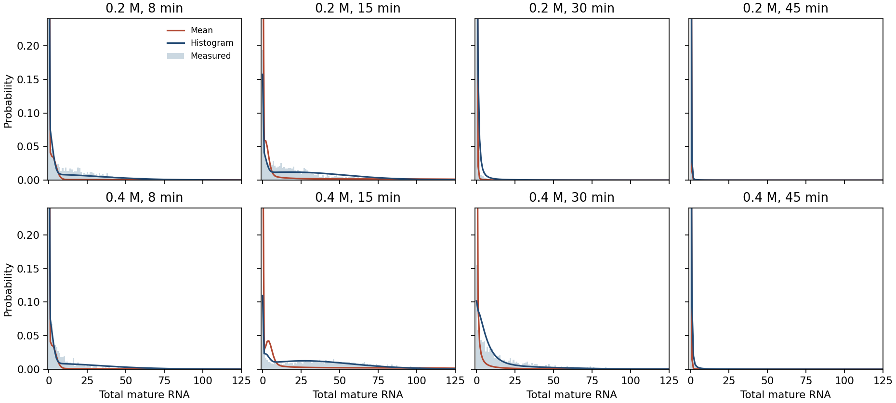
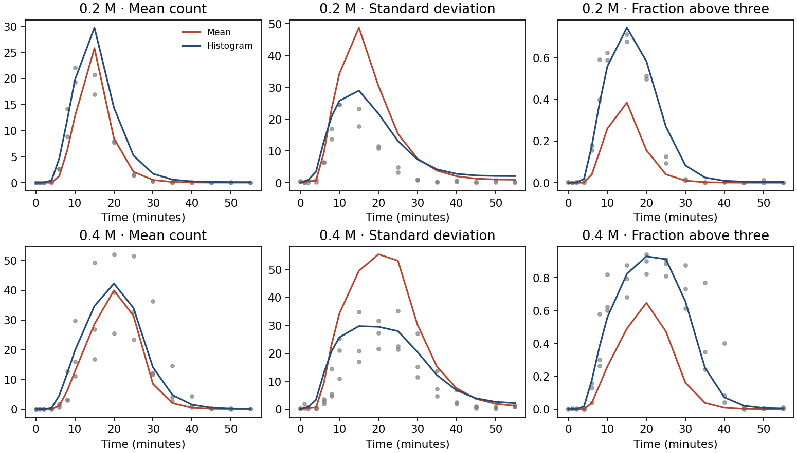
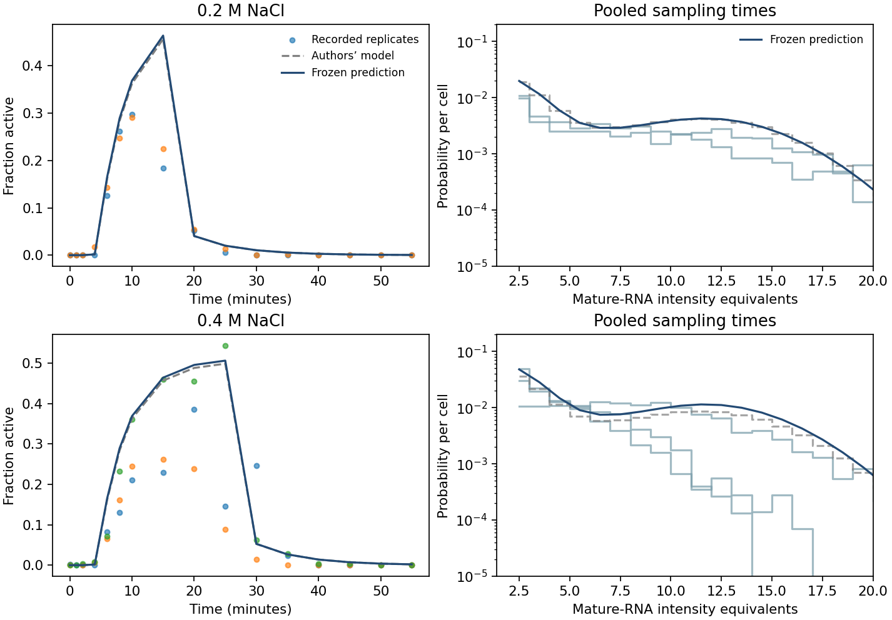

# 23. Fitting single-cell RNA distributions with fcmaes

Munsky and colleagues measured STL1 RNA in individual yeast cells after
an osmotic shock. Different cells sampled at the same time can have
different RNA counts. The fitted chemical master equation follows four
promoter states and transcription and decay. The nuclear Hog1 signal
changes the rate of switching from state 2 to state 1. The spatial model
also includes nuclear export and separate degradation rates for the
two compartments. [Paper and supplement](https://doi.org/10.1073/pnas.1804060115)

## Score a distribution

A count histogram preserves the zero arm as well as the part of the
population with many RNAs. If a bin contains (n_k) cells and the model
assigns it probability (p_k), that bin contributes (-n_klog p_k)
to the negative log likelihood.

```python
from math import log

counts = [7, 2, 1]
probabilities = [0.6, 0.3, 0.1]
score = -sum(n * log(p) for n, p in zip(counts, probabilities, strict=True))
print(f"{score / sum(counts):.4f} nats per cell")
```

```text
0.8286 nats per cell
```

The paper reports 25,511 cells at 0.2 M NaCl and 39,943 at 0.4 M. The
authors’ mature-count archive contains 40,132 cells at 0.4 M. This
example uses those rows as recorded. The separate transcription-site
file matches both reported totals.
The fit excludes the time-zero samples, as in the paper's distribution
analysis. The example fits the same model to means and to histograms
with fcmaes differential evolution. Mean residuals use the observed
sampling uncertainty. Histograms use each measured integer count and
an explicit overflow bin. A separate refit excludes one entire
biological replicate for each dose. [Count data and processing](https://doi.org/10.1038/s41597-019-0106-6)





## Predict activity at the transcription site

At 63 nucleotides per second, a polymerase is visible to the model for
about 26 seconds. At each report time, propagate the promoter from
the start of this look-back window and count new initiations. The
paper's extended model assigns each unfinished transcript a fractional
fluorescence intensity between zero and one. A site is active above
two mature RNA intensity equivalents. The prediction uses parameters
frozen from mature RNA. It compares with measured site activity at each observation time and
with the pooled intensity distributions saved by the authors at both doses.



Use `python examples/yeast_rna_fit/study.py --size draft --cross-validate`
to run the two fits and the replicate comparisons. The example documents
the model, the numerical refinement, the fit bounds and the source of
the controls. [Example and result files](../../examples/yeast_rna_fit/README.md)
