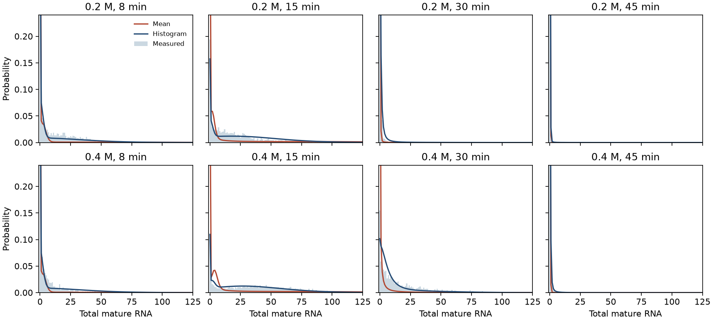
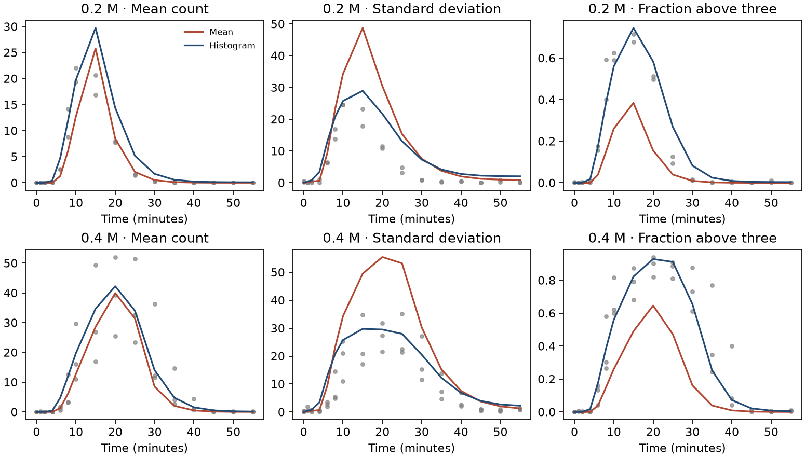
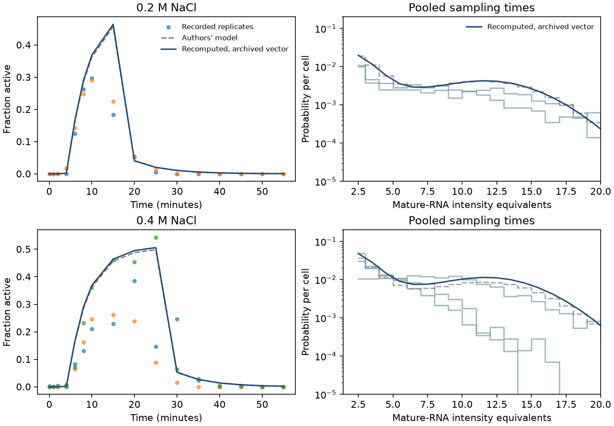

# 23b. Fits and predictions

[Chapter 23](23-yeast-rna-fit.md) ·
[Data and model](23a-yeast-rna-fit-model.md) · Fits and predictions ·
[Choices, checks and limits](23c-yeast-rna-fit-limits.md)

## The protocol

The plan for this chapter fixed, before the runs: the same model, data,
box and evaluation budget for both objectives; a fit with all replicates;
refits with one replicate per dose held out; scores in nats per cell on
whole histograms; and a refinement target of less than 0.01 nats per cell
between the fit's solver settings and refined ones
(`manifest.json`). The held-out replicates, 20140429 for 0.2 M and
20160509 for 0.4 M, are named in `manifest.json`; why these two was not
recorded.

Both fits use `fcmaes.decpp` (differential evolution, population 26). The
search runs in the logarithm of each coefficient, in a box around the
authors' archived histogram fit: a factor 3 each way for most rates, 4
for `k21`, `k21¹`, `k_1`, `k_3` and `k_4`, and 1.6 for the delay (0.41 to
1.20 decades wide). The signal coefficient keeps its sign. Each restart
first evaluates the archived vector itself and returns it if the search
does not beat it.

The full run made eight restarts of 2,000 requested evaluations and one of
8,000 per objective. The actual counts, 24,174 and 24,175, include one
evaluation of the archived vector per restart. The held-out refits are
draft size: four restarts of 500 and one of 2,000.

## Results

All scores are histogram negative log likelihoods in nats per cell,
recomputed with the refined solver. Smaller is better.

<!-- yeast-scores -->
| Evaluation set | Cells | Run size | Mean fit | Histogram fit | Archived histogram vector |
| --- | ---: | --- | ---: | ---: | ---: |
| All usable cells, both doses (in sample) | 59,557 | full | 2.39690 | 2.03845 | 2.04126 |
| 0.2 M replicate 20140429, held out | 9,101 | draft | 1.41756 | 1.33373 | 1.32248 |
| 0.4 M replicate 20160509, held out | 13,371 | draft | 2.38211 | 2.17447 | 2.14287 |
<!-- /yeast-scores -->

The mean fit reproduces the means but not the shape. During the response
(15 minutes at both doses, 30 minutes at 0.4 M) it puts too much
probability on cells with few RNAs and too little on the broad arm of
cells with 20 to 100. The histogram fit follows both arms.

Numerical quality of the full fits:

- Changing the solver from the fit's settings to a 1.5 s step and a larger
  cap changes the scores by at most 0.00278 nats per cell (mean fit, cap
  360 → 720; almost all of it is RNA beyond 360 copies). The target was
  0.01. The review reproduced 2.396902 and 2.038454 with its own scoring
  code; halving the step again and doubling the cap moves them by 2.4e-4
  and 2.4e-5.
- The largest refined leakage of a nonspatial fit is 6.57e-6 (the draft
  mean fit with all replicates). The full fits leak 7.5e-10 and 2.5e-7.
- The eight histogram restarts end between 2.03822 and 2.04050 nats per
  cell (fit settings), the archived vector scores 2.04113, and the 8,000
  evaluation run ends at 2.03838. The eight mean restarts end between
  cost 3,234.1 and 3,292.2 and the long run at 3,237.9.

## What the comparison shows

**It shows** that, among models close to the authors' published histogram
fit, the one that matches the means best predicts the histograms much
worse than the one that matches the histograms best: 0.36 nats per cell
over all cells, 0.08 and 0.21 on the two held-out replicates. It also
shows that the means do not pin the distribution down. The draft mean fit,
with a slightly worse mean cost (3,285.5 against 3,252.5), scores 2.14495
on histograms, against 2.39690 for the full mean fit.

**It does not show** what either objective finds without knowing the
answer, for three reasons:

1. **The box favors the archived vector.** It is centered on the authors'
   histogram fit, and the archived vector is evaluated first. The
   histogram fit stays within 0.23 of the half-width of that center in
   every coefficient (`k3` moved by a factor 1.37, `k34` by 1.22, `k21` by
   0.74). It improves on the archived vector by 0.0028 nats per cell. On
   the authors' own data selection (no 20131022, total = nuclear +
   cytoplasmic) the archived vector is better: 2.01804 against 2.02052
   (`results/review-data-choices.csv`). The change is a shift toward
   replicate 20131022, which the authors did not fit.
2. **The mean fit is held by the box.** It ends near the upper edge in
   `k21` (0.995 of the half-width), `k43` (0.95) and `k2` (0.95). The
   authors' own fit to means lies far outside this box (up to 25
   half-widths away). The mean fit here is therefore the best mean fit
   near the histogram answer, not the best mean fit.
3. **The held-out replicates were not held out from the box center.** The
   authors fitted their archived vector to data that include both held-out
   replicates. The archived vector scores 1.32248 on 20140429 and 2.14287
   on 20160509, better than the refits without these replicates (1.33373
   and 2.17447). The held-out scores therefore measure the refits'
   distance from a vector that has seen the test data.

Only two of the five replicates were held out. The plan asked for a held-out
score for each biological replicate; the other three refits were not run.

### Does the search find this level from a wider box?

A small review experiment, declared before it ran (question, runs and
rule below), asks whether the optimizer reaches the archived level when
the box does not favor it. It fits the histogram objective to the 0.2 M
data only, at draft solver settings, with four restarts of 2,000
evaluations in two boxes, never evaluating the archived vector:
*narrow*, the box of the fits; and *wide*, two decades each way for the
rates and a factor two for the delay, centered up to one decade (random,
seed 4242) away from the archived vector. Rule: if the best wide restart
is within 0.01 nats per cell of the archived vector's score, it "reaches
the archived level at this budget".

<!-- yeast-start -->
| Box | Seed | Evaluations | Invalid | Change vs archived (nats/cell) | Farthest parameter (decades) |
| --- | ---: | ---: | ---: | ---: | ---: |
| narrow | 7001 | 2,019 | 0 | -0.0228 | 0.47 |
| narrow | 7002 | 2,016 | 0 | -0.0221 | 0.41 |
| narrow | 7003 | 2,023 | 0 | -0.0229 | 0.50 |
| narrow | 7004 | 2,039 | 0 | -0.0228 | 0.45 |
| wide | 7001 | 2,037 | 57 | -0.0218 | 0.80 |
| wide | 7002 | 2,001 | 9 | -0.0229 | 0.75 |
| wide | 7003 | 2,036 | 26 | -0.0076 | 1.74 |
| wide | 7004 | 2,026 | 113 | -0.0158 | 1.89 |
<!-- /yeast-start -->

Result: **reaches the archived level at this budget.** Two of four wide
restarts end as low as the narrow ones, 0.022 nats per cell below the
archived vector (fitting one dose alone leaves more freedom than fitting
both). Two stop 0.007 and 0.015 above the best. The good solutions differ
from the archived vector by up to 0.8 decades in one coefficient
(`k21¹`), and the two others lie up to 1.9 decades away: very different
parameter sets give similar scores. This is one dose, one budget and one
set of seeds; it shows search behavior, not identifiability, and it does
not repeat the mean-versus-histogram comparison from a wide box. Rerun
with `python examples/yeast_rna_fit/review.py start` (about four minutes).

## The spatial model

The spatial model was not refitted. Only `k_3` and `γ_cyt` were varied, on
a 3 × 3 grid of full sparse solves, a factor 1.35 each way around the
authors' archived spatial histogram fit. An interpolated surface was then
searched with fcmaes. For both objectives the interpolated optimum was
worse when solved directly than the best grid point, so the grid point was
kept (`results/spatial-fits.csv`).

- For the histogram objective, the best grid point is the center: the
  authors' published vector. It scores 2.65027 nats per cell on the joint
  nuclear and cytoplasmic counts; the refinement changes this by 2.6e-7.
- For the mean objective, the best grid point is a corner of the grid
  (`k_3` divided by 1.35, `γ_cyt` multiplied by 1.35), at the edge of the
  searched range. It scores 2.93792.
- Leakage of the joint solves is below 3.9e-13 at every time
  (`results/spatial-accounting.csv`); the smallest probability of any
  state is positive.

## The transcription-site prediction

Figure 4D–E of the paper predicts, from the fitted spatial model, the
fraction of cells with an active STL1 transcription site and the
brightness of active sites. The example recomputes this prediction from
the authors' archived spatial histogram vector. It does not test a model
fitted here.

The observation model follows the paper's supplement. A polymerase is
visible for `L/v = 1630/63 = 25.9 s`, where `L = 1630 nt` is the distance
from the first FISH probe to the end of the gene (Table S1) and `v =
63 nt/s` is the elongation rate the authors fitted to CTT1. The promoter
is propagated to the start of this window and new initiations are counted
within it. Each unfinished RNA adds a Uniform(0, 1) intensity, so `k`
polymerases give an Irwin–Hall intensity. A site counts as active above 2
mature-RNA equivalents. The forcing delay, 226.86 s, comes from the
archived vector.

The reference curves are the numerical series saved in the authors'
figure files (`Figures/1_TS_Figures/STL1_*_Spatial_TS_*.fig`): their model
curve and the measured points they plotted. They were read from the
files, not digitized from images. The measured points in these files do
not equal the activity computed from the authors' raw site array
(`RNA_TS_Brian.mat`, shipped as `source-sites.csv`): per replicate the
largest difference is 0.09 to 0.27. The cause is not known.

- Against the authors' model curve, the mean absolute difference in active
  fraction is 0.0014 at 0.2 M and 0.0024 at 0.4 M (largest 0.0075):
  **numerical agreement** of the reimplementation.
- Against the measured points, the mean absolute difference is 0.027 to
  0.029 per replicate at 0.2 M and 0.018 to 0.088 at 0.4 M; the largest
  single misses are 0.28 (0.2 M, 15 minutes) and 0.42 (0.4 M, 25 minutes). This is the model's error, the same as in the
  paper's figure.
- The paper reports 7.0 full-length RNA equivalents per active site for
  this model, and 4.2–7.5 measured. Weighted over sampling times with
  bin midpoints, the recomputed prediction gives 7.3 at 0.2 M and 7.5 at
  0.4 M; the raw site array gives 3.9 to 6.3 per replicate (bins of one
  equivalent, so ±0.5). These are approximate and not checked by the
  validation script.

## Rerunning the study

| Command | What it does | Cost here |
| --- | --- | --- |
| `study.py --size quick` | 0.2 M, five times, 80 evaluations per objective | 3 s |
| `study.py --size draft --cross-validate --budget-check` | all fits at draft size, two held-out refits | 9.5 min, one worker |
| `study.py --size full --budget-check` | the full fits of the table, then the spatial evaluation | not timed by the review |
| `study.py --size full --spatial-only --spatial-fit` | the spatial grid | not timed by the review |
| `review.py start`, `review.py choices` | the review files of this page | 4 min, 5 s |

All commands take `--workers N` (one thread per restart) and write to
`examples/yeast_rna_fit/runs/SIZE/` unless `--output` is given. Results do
not depend on the worker count. The review reran the draft command; every
score and restart value equals the saved draft rows to a relative 2e-7.
The full and spatial runs were not rerun. The shipped `scores.csv` and
`optimizer-work.csv` combine the full and draft runs with a `preset`
column; `study.py` writes them per run as `scores.csv` and `restarts.csv`.
