# CRN-craft tutorial

This tutorial walks through CRN-craft from a first model to exact ensembles,
finite state projection, approximate tau leaping, analysis and model import.
It uses the Python package (`import crn_craft as crn`) and the command line
(`crn-craft run`, `check`, `convert`, `describe`, `analyze`, `export` and
`verify`). Both run the same engine and read the same documents,
`crn-craft.model/1.0` models and `crn-craft.run/1.0` requests.

Every terminal screenshot is a real run of the commands shown, against the
example models in `models/examples/`, and every figure is computed with the
package. `examples/tutorial/make_assets.py` regenerates both.
`validation/check_tutorial.py` runs every `bash` and `python` block of this
page in order and compares every `text` block with the output of the block
before it, so the examples and their printed output stay correct as the code
changes.

Contents:

1. [Install](#1-install)
2. [A first model with the builder](#2-a-first-model-with-the-builder)
3. [Checking inputs and reading diagnostics](#3-checking-inputs-and-reading-diagnostics)
4. [Exact simulation](#4-exact-simulation)
5. [Results as data frames](#5-results-as-data-frames)
6. [Quantiles and the median](#6-quantiles-and-the-median)
7. [Saving a result](#7-saving-a-result)
8. [Oscillations: the repressilator](#8-oscillations-the-repressilator)
9. [Exact distributions with finite state projection](#9-exact-distributions-with-finite-state-projection)
10. [Approximate tau leaping, and when to trust it](#10-approximate-tau-leaping-and-when-to-trust-it)
11. [Budgets, cancellation and Ctrl-C](#11-budgets-cancellation-and-ctrl-c)
12. [Reproducibility: seeds, streams and threads](#12-reproducibility-seeds-streams-and-threads)
13. [Analysis](#13-analysis)
14. [Importing, converting and exporting models](#14-importing-converting-and-exporting-models)
15. [Choosing a method](#15-choosing-a-method)
16. [Where to go next](#16-where-to-go-next)

## 1. Install

The Python package contains the native engine. Install a release from PyPI:

```sh
python -m pip install crn-craft
```

The package installs the module `crn_craft` and two console scripts:
`crn-craft`, which has the same commands as the native tool, and
`crn-craft-import`. The native command-line tool needs Rust 1.85 or newer.
Build it from a clone of the repository, and build the Python package from
the same clone with maturin:

```sh
git clone https://github.com/dietmarwo/CRN-craft
cd CRN-craft
cargo build --release --workspace --locked
./target/release/crn-craft --help
python -m pip install maturin==1.9.6
maturin build --release --locked --out dist
python -m pip install dist/*.whl
```

A release of the command-line tool also installs from crates.io with
`cargo install crn-craft-cli --locked`. The binary is `crn-craft`.

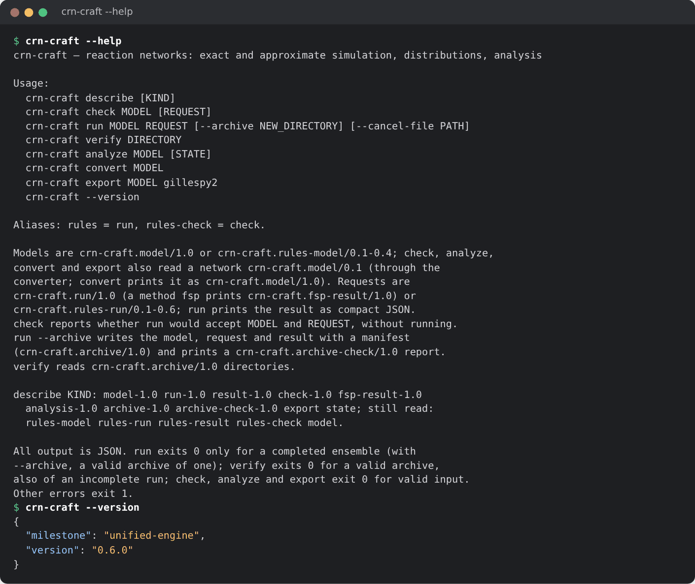

Every command reads and writes JSON. `crn-craft describe` lists the commands,
methods, selectors and limits. `crn-craft describe model-1.0` (or `run-1.0`,
`result-1.0`, `fsp-result-1.0`, ...) prints the JSON Schema of a document, so
a script or an agent can discover the interface without reading this page.
`crn.describe()` returns the same documents in Python.

Release 0.7.0 merged two earlier engines into this one. Models written for
the old network engine convert with `crn-craft convert` (section 14), and
code written for `crn_craft.rules` keeps running, because `crn_craft.rules`
is the same module under its old name.

## 2. A first model with the builder

A model has species, parameters and reactions. The builder `crn.Model` writes
one. Molecules of `A` arrive at rate 4, and each one decays at rate 0.2:

```python
import json
import numpy as np
import crn_craft as crn

model = crn.Model("immigration_death")
model.add_parameter({"birth": 4.0, "death": 0.2})
model.add_species("A", 0)
model.add_reaction("birth", [], ["A"], name="birth")
model.add_reaction("death * A", ["A"], [], name="death")
print(model)
print(model.reaction_names)
```

```text
Model('immigration_death': 1 species, 2 reactions)
('birth', 'death')
```

`add_reaction(rate, reactants, products)` takes the species as lists, with a
species repeated for its multiplicity (`["A", "A"]` is `2 A`). A number is a
mass-action constant. A string is the whole propensity: an expression of
parameters and species counts. So `model.add_reaction(0.2, ["A"], [])` is the
same reaction as the one above. Counts are integers. Mass-action propensities
use falling factorials, so `2 A -> B` with constant `k` fires at
`k * A * (A - 1) / 2`.

The builder writes a `crn-craft.model/1.0` document. Species are *types* with
no attributes, and each reaction is a *rule* over them:

```python
document = model.to_dict()
print(document["schema"])
print(json.dumps(document["rules"][1]))
```

```text
crn-craft.model/1.0
{"name": "death", "reactants": [{"label": "x", "type": "A"}], "propensity": "death * A", "products": []}
```

A string rate becomes a `propensity`, the whole expression. A number would
become a `rate`, the constant that multiplies the count of each reactant. The
same document can carry species with numeric attributes, which
the [model reference](rules-language.md) describes. `model.to_json()` gives
the text of the file, and `crn.Model.from_dict(document)` reads a document
back.

The repository ships the same model as
`models/examples/immigration-death.model.json`, converted from the network
format of release 0.6.0. `crn.load_example` returns it, and it runs the same
paths as the model built above:

```python
example = crn.load_example("immigration-death")
for candidate in (model, example):
    result = crn.ensemble(
        candidate, end=30.0, report_times=[0.0, 30.0], replicates=400, seed=42,
        method="static_direct",
    ).simulate()
    print(result.metadata["events"], result.statistics["mean"]["A"].iloc[-1])
```

```text
88037 20.092500000000012
88037 20.092500000000012
```

The packaged examples are `immigration-death`, `michaelis-menten`,
`enzyme-mechanism`, `repressilator` and `vilar-noise`.

## 3. Checking inputs and reading diagnostics

`crn.check` validates a model, or a model and its request, without
simulating. It returns the report that `crn-craft check` prints:

```python
report = crn.check(model)
print(report["valid"], report["diagnostics"])
```

```text
True []
```

On the command line, `check` takes a model file and an optional request. A
**request** says what to compute: the method, the report times, the number of
replicates, the seed and the budgets. It names its model by path **and by the
SHA-256 of its exact bytes**, so a result can never be attributed to a model
that was edited afterwards. This block writes the request for the packaged
model file in the working directory:

```python
import hashlib
import pathlib

model_file = pathlib.Path("immigration-death.model.json")
request = {
    "schema": "crn-craft.run/1.0",
    "model": {
        "path": model_file.name,
        "sha256": hashlib.sha256(model_file.read_bytes()).hexdigest(),
    },
    "method": {"kind": "static_direct"},
    "time": {"end": 10.0, "report_times": [0.0, 1.0, 2.0, 5.0, 10.0]},
    "ensemble": {"replicates": 64, "root_seed": 42},
    "outputs": {"statistics": ["mean", "variance"], "keep_paths": 2, "keep_instances": 0},
    "budget": {
        "max_events_per_replicate": 1_000_000,
        "max_sampling_steps_per_replicate": 8_000_000,
        "max_instances": 100_000,
        "wall_time_s": 60.0,
        "threads": 1,
        "max_output_bytes": 1_048_576,
    },
}
pathlib.Path("immigration-death.run.json").write_text(json.dumps(request, indent=2) + "\n")
print(crn.check(model_file.read_bytes(), request)["valid"])
```

```text
True
```

The request has the following fields. `crn.ensemble` writes one for you, and
the budgets are explicit in the file so a run cannot exceed them
unnoticed (section 11):

| Field | Meaning |
|---|---|
| `model` | path and SHA-256 of the model file |
| `method` | `static_direct`, `next_reaction`, `tree`, `tau`, `fsp`, ... (section 15) |
| `time` | the horizon `end` and strictly increasing `report_times` in [0, end] |
| `ensemble` | the number of `replicates` and the `root_seed` |
| `outputs` | which `statistics` to compute, `quantiles`, and how many paths to keep |
| `budget` | event, sampling, memory, wall-clock and thread limits |

The command line checks the model and the request together:

```bash
sha256sum immigration-death.model.json
crn-craft check immigration-death.model.json immigration-death.run.json
```

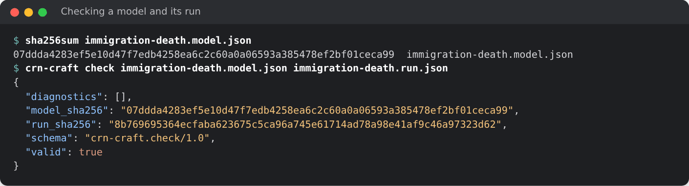

Every problem is reported as a diagnostic with a stable code, a JSON pointer
to the offending field, a message and a hint. Here a rate refers to an
undeclared name, and a request carries a stale model hash:

```bash
crn-craft check missing-parameter.model.json || echo "exit status $?"
crn-craft check immigration-death.model.json stale-hash.run.json || echo "exit status $?"
```

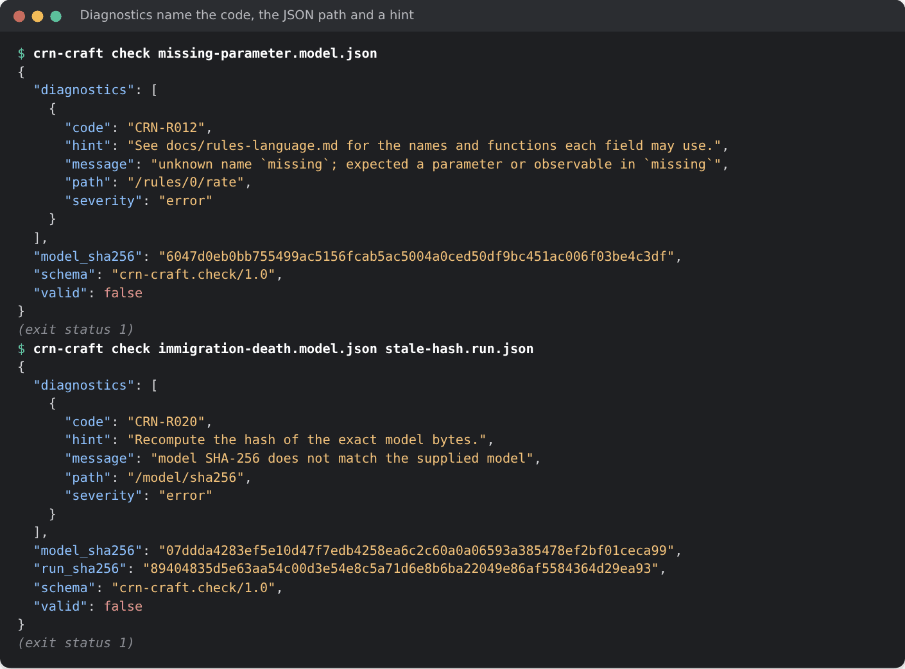

[Diagnostics](diagnostics.md) lists every code. Commands exit 0 on success
and 1 on invalid input. Warnings (codes `CRN-W...`) do not change the exit
status.

In Python, a rejected model or request raises `crn.CrnError`, a `ValueError`
that carries the diagnostics:

```python
try:
    crn.ensemble(model, end=1.0, report_times=[0.0, 2.0], method="static_direct")
except crn.CrnError as error:
    print(error)
    print(error.diagnostics[0]["path"])
```

```text
CRN-R020: report times must be strictly increasing within [0, end] at /time/report_times/1
/time/report_times/1
```

## 4. Exact simulation

`crn.ensemble` builds and checks a request and prepares it. `simulate()`
then runs the replicates on native threads. The exact Static Direct method
(Gillespie's direct method on a lowered network) is `method="static_direct"`:

```python
run = crn.ensemble(
    model, end=30.0, report_times=list(np.linspace(0, 30, 31)),
    replicates=400, seed=42, keep_paths=8, method="static_direct",
)
result = run.simulate()
assert result.metadata["termination"] == "completed"

t = np.array(result.metadata["report_times"])
mean = result.statistics["mean"]["A"].to_numpy()
exact = 20 * (1 - np.exp(-0.2 * t))
print(result.metadata["events"], "events")
print(f"mean at t=30: {mean[-1]:.2f}, exact {exact[-1]:.2f}")
assert abs(mean[-1] - exact[-1]) < 4 * np.sqrt(exact[-1] / 400)
```

```text
88037 events
mean at t=30: 20.09, exact 19.95
```

The immigration-death law is Poisson with mean `20 (1 - exp(-0.2 t))`, so
the mean and the variance agree:

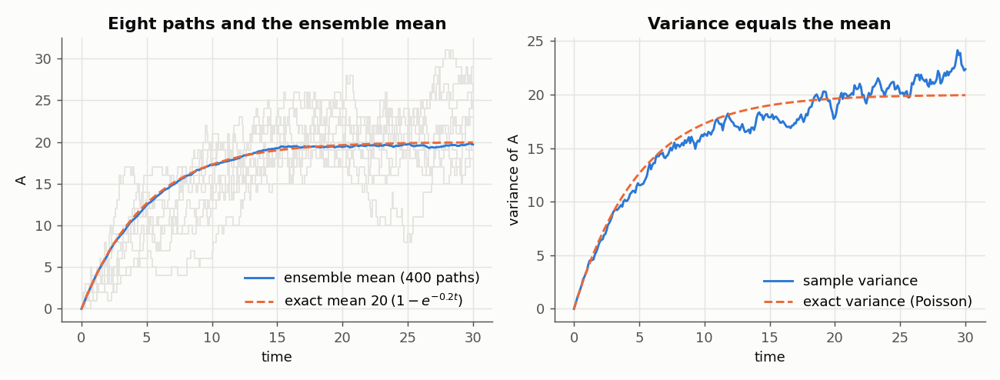

Always check `termination` before using statistics. An ensemble that did not
complete has `statistics` withheld (`None`), so a partial ensemble is never
mistaken for a complete one (section 11).

The same request runs from the command line. `run` prints the result as JSON
and exits 0 only when every replicate completed. With `--archive` it writes a
**new** directory instead: the exact model and request bytes, the result, a
manifest with the SHA-256 and length of each file, and a `COMPLETE` marker
written last that holds the manifest's hash:

```bash
crn-craft run immigration-death.model.json immigration-death.run.json --archive runs/first
crn-craft verify runs/first
```

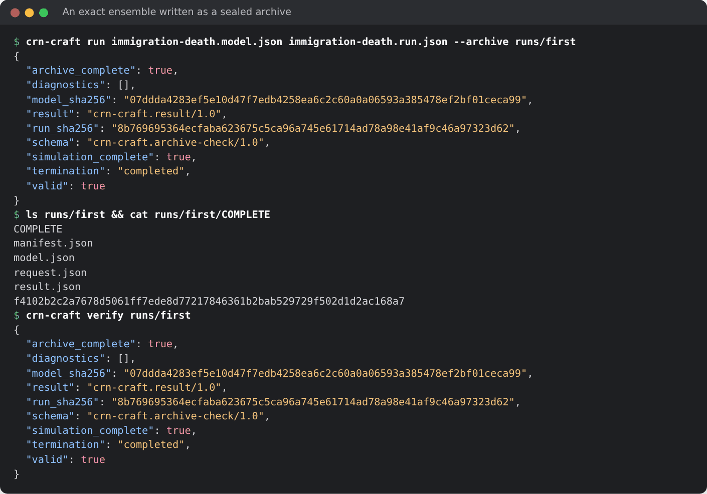

`verify` re-reads everything, checks every hash and length, re-validates the
inputs and the result's internal accounting, and exits 0 for a valid archive.
That includes one whose simulation was stopped early (section 11). Change one
byte and verification fails:

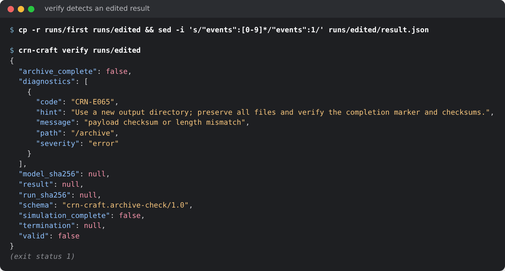

The Python call and the command line run one engine. `crn.prepare` takes
the same two files as bytes, and `quantiles=()` keeps the request as written
(by default Python adds the quantiles of section 6, which changes the request
hash). The result then agrees with the one `crn-craft run` prints, apart from
the per-replicate records, which Python moves into `result.records`:

```bash
crn-craft run immigration-death.model.json immigration-death.run.json > cli-result.json
```

```python
request_file = pathlib.Path("immigration-death.run.json")
same = crn.prepare(model_file.read_bytes(), request_file.read_bytes(), quantiles=()).simulate()
cli = json.load(open("cli-result.json"))
keys = ["run_sha256", "model_sha256", "sampler", "events", "statistics", "paths"]
print(all(same.metadata[key] == cli[key] for key in keys))
print(same.metadata["run_sha256"][:16], cli["run_sha256"][:16])
```

```text
True
8b769695364ecfab 8b769695364ecfab
```

## 5. Results as data frames

A `Result` holds pandas data frames and xarray arrays, indexed by name:

| Attribute | Content |
|---|---|
| `records` | one row per replicate: `termination`, `stop_time`, `events`, `rng_words`, ... |
| `rule_events` | events per replicate and reaction |
| `statistics` | `mean`, `sample_variance`, `mean_standard_error`, and the quantiles (section 6) |
| `paths` | kept trajectories, dimensions `replicate`, `time`, `variable` |
| `metadata` | the whole result document |
| `model`, `request` | the documents that ran |

```python
print(result.records["termination"].value_counts()["completed"], "completed replicates")
print(result.rule_events.mean().round(1).to_dict())
print(result.statistics["sample_variance"]["A"].iloc[-1].round(2))
print(result.paths.dims, result.paths.shape)
```

```text
400 completed replicates
{'birth': 120.1, 'death': 100.0}
18.92
('replicate', 'time', 'variable') (8, 31, 1)
```

Observables are sorted by name, so select a column by name, as in
`result.statistics["mean"]["A"]`, and a variable of the paths with
`result.paths.sel(variable="A")`. Use `.to_numpy()` on any frame, column or
array to get a NumPy array. `result.paths_frame()` gives the
kept paths as a frame, and `result.to_xarray()` gives a dataset.
A replicate that ended on a budget has values only up to its last saved
report time and `NaN` after it.

## 6. Quantiles and the median

`crn.ensemble` asks for the 2.5%, 50% and 97.5% quantiles by default. They
are in `result.statistics["quantiles"]`, a dictionary from each probability
to a data frame shaped like `mean`, and the median is `statistics["median"]`:

```python
quantiles = result.statistics["quantiles"]
print(sorted(quantiles))
print(result.statistics["median"]["A"].iloc[-1], quantiles[0.025]["A"].iloc[-1], quantiles[0.975]["A"].iloc[-1])
```

```text
[0.025, 0.5, 0.975]
20.0 12.0 30.0
```

These are NumPy's default (linear interpolation) quantiles of the replicate
values at each report time. Pass `quantiles=[0.1, 0.9]` to choose others, up
to 16 probabilities in (0, 1), and `quantiles=()` to ask for none. The median
appears in the statistics whenever 0.5 is among them. For Poisson counts the
quantiles are integers, and the band they form follows the exact one:

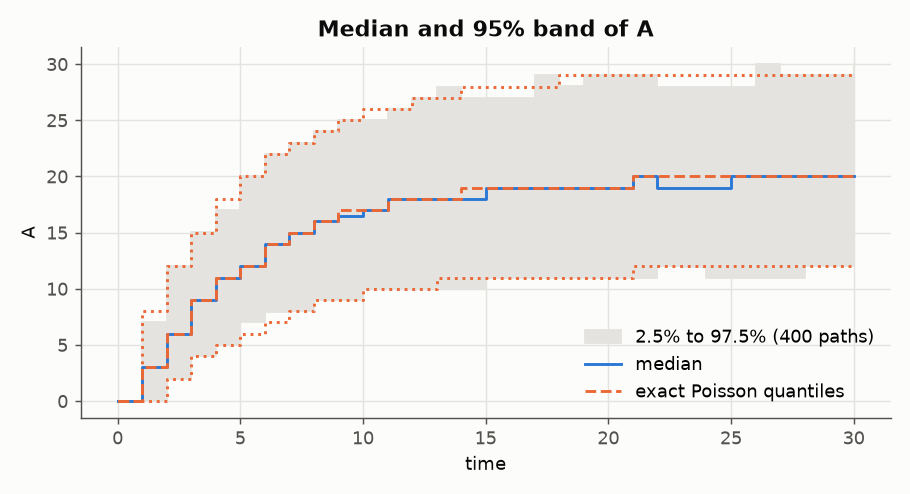

In a request file, `outputs.quantiles` holds the list.

## 7. Saving a result

`Result.save` writes the model, the request and the results to one file. The
extension decides the format: `.md` or `.markdown` for markdown, `.json` for
JSON. The same result always gives the same bytes, because the file holds no
timestamp or host name:

```python
result.save("immigration-death.md")
result.save("immigration-death.json", paths=False)
report = crn.load_report("immigration-death.json")
print(report["schema"], sorted(report))
```

```text
crn-craft.report/1.0 ['crn_craft_version', 'model', 'request', 'result', 'schema']
```

```bash
head -n 30 immigration-death.md
```

````text
# Model

Name: immigration_death

## Reactions

```text
0 -> A, birth
A -> 0, death * A
```

## Start values

```text
A = 0
```

## Parameter values

```text
birth = 4
death = 0.2
```

# Simulation

```text
seed = 42
end = 30
replicates = 400
````

`paths=False` leaves the single trajectories out. `crn.load_report` reads a
JSON report back as a dictionary. A report is a readable record of a run. An
archive (section 4) is the sealed record that `verify` can replay.

## 8. Oscillations: the repressilator

The packaged repressilator is three genes repressing each other in a ring,
with Hill repression. A single exact path oscillates, with amplitudes that
vary from cycle to cycle:

```python
from crn_craft.observables import oscillation

circuit = crn.load_example("repressilator")
grid = list(np.linspace(0, 200, 1001))
path = crn.ensemble(circuit, end=200.0, report_times=grid, replicates=1,
                    keep_paths=1, method="static_direct").simulate()
p1 = path.paths.isel(replicate=0).sel(variable="p1").to_numpy()
verdict = oscillation(grid, p1)
print(verdict["classification"], round(verdict["period"], 1))
```

```text
oscillatory 40.1
```

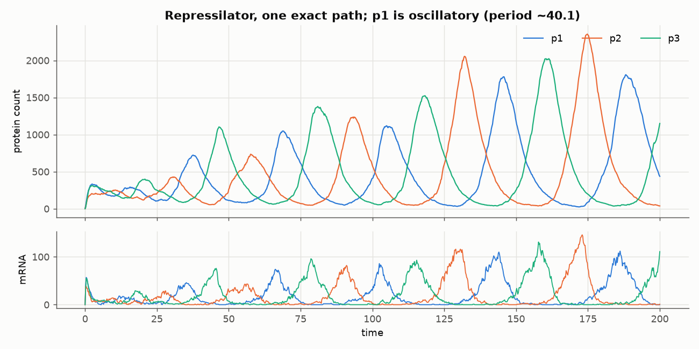

`oscillation` drops a burn-in (20% by default), removes the mean, and calls a
series *oscillatory* only when the dominant Fourier peak holds at least 30% of
the power, spans at least three cycles, and the autocorrelation at that period
is at least 0.2. Fewer than three cycles is *ambiguous*. It is a trajectory
diagnostic with synthetic controls, not a validated biological detector.

## 9. Exact distributions with finite state projection

For small state spaces the chemical master equation can be solved directly.
Finite state projection (FSP) enumerates the states reachable within
per-species bounds, sends every transition out of the bounds to an absorbing
sink, and propagates the probability vector by uniformization. Nothing is
renormalized: the lost mass is reported, not hidden.

```python
projection = model.fsp(end=20.0, report_times=[0.0, 2.0, 5.0, 20.0],
                       bounds={"A": 80}, max_states=81, tolerance=1e-10)
print(projection)
last_mean = projection.mean["A"].iloc[-1]
print(float(last_mean), float(projection.truncation["mass_defect"].iloc[-1]))
assert abs(last_mean - 20 * (1 - np.exp(-4))) < 1e-8
```

```text
FspResult(81 states of A, 4 report times)
19.633687221220555 5.08937336718418e-11
```

`Model.fsp` returns an `FspResult` with the projected `states`, the
`probabilities` (a `time` by `state` array), the projected `mean` and the
`truncation` error terms per report time. The model must be closed: a model
whose set of species is not finite is refused with `CRN-R017`.

On the command line, FSP is a method of an ordinary request. The request
`immigration-death.fsp.run.json` names the bounds and has no `ensemble` or
`outputs`, because there is nothing to sample:

```json
{
  "schema": "crn-craft.run/1.0",
  "model": {"path": "immigration-death.model.json",
            "sha256": "07ddda4283ef5e10d47f7edb4258ea6c2c60a0a06593a385478ef2bf01ceca99"},
  "method": {"kind": "fsp", "bounds": {"A": 100}, "max_states": 102, "tolerance": 1e-10},
  "time": {"end": 10.0, "report_times": [0.0, 1.0, 2.0, 5.0, 10.0]},
  "budget": {"wall_time_s": 60.0, "max_output_bytes": 1048576}
}
```

The result is a `crn-craft.fsp-result/1.0` document:

```bash
crn-craft run immigration-death.model.json immigration-death.fsp.run.json > fsp.json
python3 -c "import json; print(json.load(open('fsp.json'))['snapshots'][-1]['mass_defect'])"
```

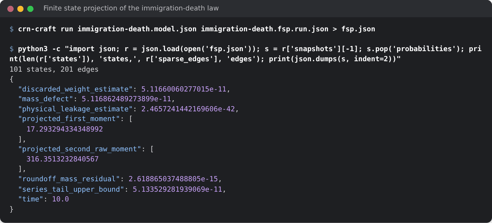

Each snapshot separates the error sources:

| Field | Meaning |
|---|---|
| `physical_leakage_estimate` | probability that left the bounds (in the sink) |
| `series_tail_upper_bound` | upper bound on the truncated uniformization series |
| `discarded_weight_estimate` | the series weight actually omitted |
| `roundoff_mass_residual` | the remaining floating-point imbalance |
| `projected_first_moment` | moments over the projected states only |

The projection matches the exact Poisson law to about 1e-12 and agrees with a
2,000-path SSA histogram:

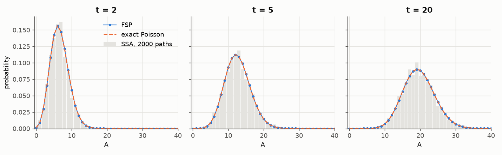

## 10. Approximate tau leaping, and when to trust it

Tau leaping fires many reactions per step: each channel fires a Poisson number
of times over a leap whose length keeps the relative change of every
propensity below `epsilon` (Cao, Gillespie and Petzold 2006). Proposals that
would make a count negative are rejected and the leap halved, and channels
close to exhausting a reactant are simulated exactly. The result names an
approximate sampler, so it cannot be mistaken for an exact one:

```python
approx = crn.ensemble(model, end=10.0, report_times=[0.0, 10.0], replicates=200,
                      seed=1, method={"kind": "tau", "epsilon": 0.01}).simulate()
exact = crn.ensemble(model, end=10.0, report_times=[0.0, 10.0], replicates=200,
                     seed=1, method="static_direct").simulate()
print(approx.metadata["sampler"])
print(approx.metadata["events"], "leaps and exact steps;", exact.metadata["events"], "exact events")
```

```text
chacha8-u53/rules-approximate-cgp-poisson/2
12477 leaps and exact steps; 12153 exact events
```

The same method runs from a request file. `tau.run.json` is the request of
section 3 with `"method": {"kind": "tau", "epsilon": 0.03}`:

```bash
crn-craft run immigration-death.model.json tau.run.json > tau-result.json
```

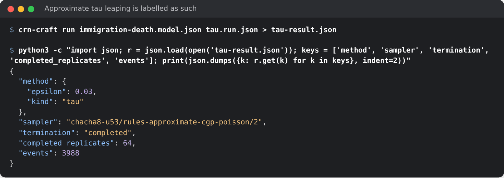

For this small system, tau leaping does no less work than the exact method:
with only about 20 molecules, the leap condition allows roughly one firing per
leap, so it does the work of the exact method with an approximation on top. It
pays off only when populations are large.

How small must `epsilon` be? The figure compares 1,000 tau paths of a
birth-death process with mean 1,000 against 1,000 exact paths. The mean is
right at every `epsilon`. At `epsilon = 0.1`, more than three times the
relative standard deviation of the state (here `1/sqrt(1000) = 0.032`), each
leap moves the state by more than its own fluctuations and the variance is
83% too large. For smaller `epsilon` the variance ratio stays within about two
standard errors of 1 (a standard error is about 6% with 1,000 paths per
method), so this experiment cannot resolve an error below that size.

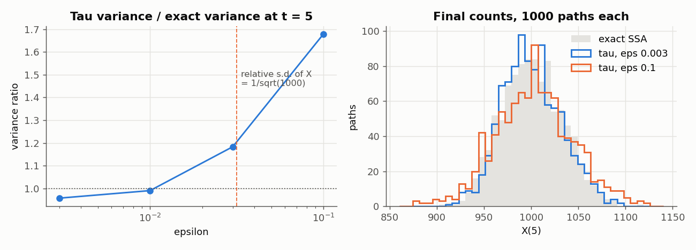

Rule of thumb: keep `epsilon` below the relative fluctuation size of the
species you care about, and compare against an exact method on a reduced case.
Leap means above 16 are drawn by Hormann's transformed rejection (PTRS), so
large populations cost a few random numbers per channel and leap. On networks
with about a thousand channels, each attempted leap evaluates every channel,
and Static Direct with a selector (section 15) is much faster.

## 11. Budgets, cancellation and Ctrl-C

Every run has explicit budgets: `max_events` per replicate (`budget.max_events_per_replicate`
in a request), an optional `wall_time_s`, `max_output_bytes`, the number of
`threads`, and a limit on the live instances. A run is admitted only if its
memory reservation fits the published limits (`crn-craft describe` lists
them). A replicate that reaches a budget stops with a termination such as
`event_limit`, and the ensemble keeps every replicate's accounting but
withholds the statistics:

```python
short = crn.ensemble(model, end=30.0, report_times=[0.0, 30.0], replicates=8,
                     seed=1, max_events=50, method="static_direct").simulate()
print(short.metadata["termination"], short.statistics)
print(short.records["termination"].value_counts()["event_limit"], "replicates hit the limit")
```

```text
event_limit None
8 replicates hit the limit
```

Long runs can be stopped cooperatively by creating a file. The run ends with
the termination `cancelled`:

```bash
touch stop
crn-craft run immigration-death.model.json long.run.json --archive runs/stopped --cancel-file stop || echo "exit status $?"
crn-craft verify runs/stopped > /dev/null && echo "partial archive verifies"
```

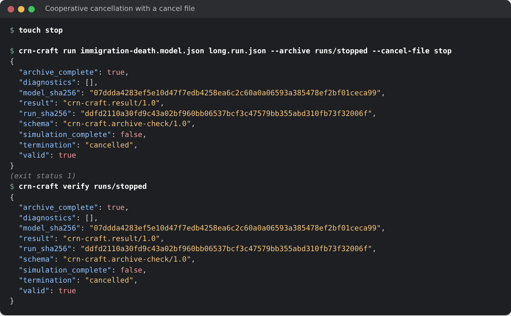

`run` exits 1 for an incomplete ensemble. The stopped archive is still sealed
and verifiable. It says `cancelled` and withholds statistics. In Python,
`cancel_file=` does the same for `simulate`, and **Ctrl-C** cancels a running
native call and raises `KeyboardInterrupt` within about 50 ms:

```python
pathlib.Path("stop").touch()
long_run = crn.ensemble(model, end=1e6, report_times=[0.0, 1e6], replicates=8,
                        max_events=10**9, method="static_direct")
stopped = long_run.simulate(cancel_file="stop")
print(stopped.metadata["termination"], stopped.statistics)
```

```text
cancelled None
```

## 12. Reproducibility: seeds, streams and threads

Replicate *i* of a run draws from its own ChaCha8 stream, keyed by the
SHA-256 of a domain string and the root seed, with *i* as the stream number.
Replicates never share random numbers, and workers reduce results in
replicate order, so the numerical result does not depend on the number of
threads:

```python
digests = set()
for threads in [1, 2, 8]:
    result = crn.ensemble(circuit, end=50.0, report_times=[0.0, 50.0], replicates=64,
                          threads=threads, keep_paths=4, seed=42,
                          method="static_direct").simulate()
    numbers = dict(result.metadata)
    numbers.pop("run_sha256")  # the run's own hash covers `threads`
    digests.add(json.dumps(numbers, sort_keys=True))
assert len(digests) == 1
print("identical across 1, 2 and 8 threads")
```

```text
identical across 1, 2 and 8 threads
```

The same seed gives the same bytes in a second run, also from the command
line. The result of an archived run is a file, so two runs can be compared
with a hash:

```bash
crn-craft run repressilator.model.json repressilator.run.json --archive runs/replay-a > /dev/null
crn-craft run repressilator.model.json repressilator.run.json --archive runs/replay-b > /dev/null
sha256sum runs/replay-a/result.json runs/replay-b/result.json
```

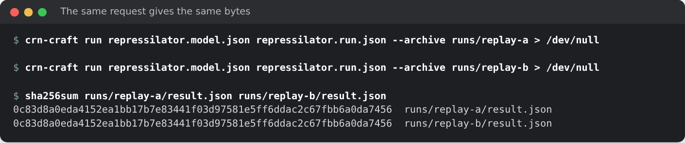

Sums of propensities are computed in a fixed order, with checks that no
positive rate is lost to rounding. A result also records the sampler
identity, which includes the selector, so a change of random mapping cannot
silently reuse old seeds. Different selectors, and the approximate methods,
sample the same law with different random numbers, so the same seed gives
different paths (section 15).

## 13. Analysis

`Model.analyze` reports structure without simulating: stoichiometry,
evaluated propensities, a basis of conservation laws and nonnegative
conservation rays with exact integer arithmetic, the bounds they imply for the
initial conservation class, and complexes, linkage classes and deficiency.
`crn-craft analyze MODEL` prints the same `crn-craft.analysis/1.0` report.

```python
report = crn.load_example("enzyme-mechanism").analyze()["analysis"]
print(report["species"])
print(report["conservation"]["basis"])           # E + ES and S + ES + P
print(report["initial_class_upper_bounds"])      # S, E, ES, P cannot exceed these
print("deficiency", report["linkage"]["deficiency"])
```

```text
['S', 'E', 'ES', 'P']
[{'coefficients': ['0', '1', '1', '0'], 'initial_total': '10'}, {'coefficients': ['1', '0', '1', '1'], 'initial_total': '50'}]
['50', '10', '10', '50']
deficiency 0
```

For the enzyme mechanism `S + E <-> ES -> E + P`, the laws are
`E + ES = 10` and `S + ES + P = 50`, so every count is bounded, and the
deficiency is zero. Analysis limits (species, reactions, work) are explicit.
When a limit is hit, the report says `unavailable` rather than implying that no
law exists. A model without a flat view (continuous variables, or products
that create new attribute tuples) gives `success: false` with `CRN-R017`.

`sampled_first_passage` estimates when paths first reach a threshold, from
saved states only. A path can cross and fall back between saved times, so a
saved grid supports one-sided statements: the first saved hit is an upper
bound on the passage time, and the detected fraction is a lower bound on the
probability of a passage before the horizon.

```python
from crn_craft.observables import sampled_first_passage

fine = list(np.linspace(0, 10, 201))
paths = crn.ensemble(model, end=10.0, report_times=fine, replicates=500, seed=42,
                     keep_paths=500, method="static_direct").simulate()
counts = list(paths.paths.sel(variable="A").to_numpy())
for step in [1, 20]:
    bound = sampled_first_passage(fine[::step], [c[::step] for c in counts], 15)
    print(step * 0.05, bound["detected_fraction"], bound["restricted_mean_upper"])
```

```text
0.05 0.928 6.075
1.0 0.88 6.878
```

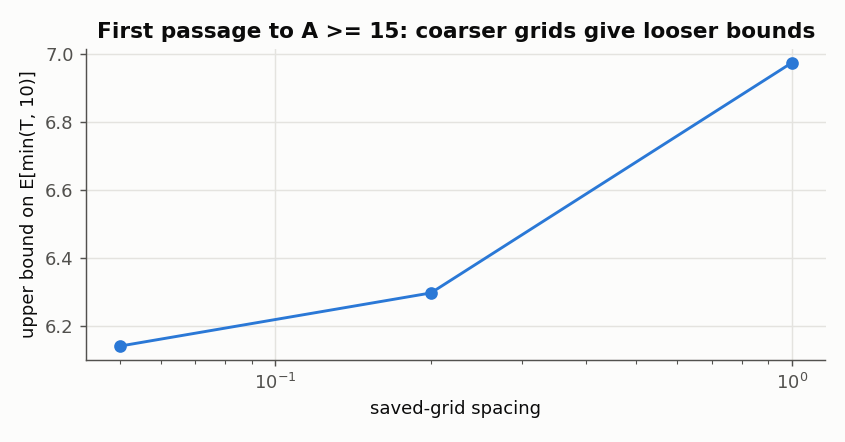

Finer grids give tighter bounds, so save densely around the event of
interest.

## 14. Importing, converting and exporting models

**Convert.** A network model of release 0.6.0 (`crn-craft.model/0.1`) is
read by `check`, `analyze`, `convert` and `export`. `crn-craft convert`
prints it as `crn-craft.model/1.0`, and `crn.convert` does the same in Python:

```bash
crn-craft convert immigration-death.network.json > converted.model.json
crn-craft check converted.model.json > /dev/null && echo "the converted model is valid"
```

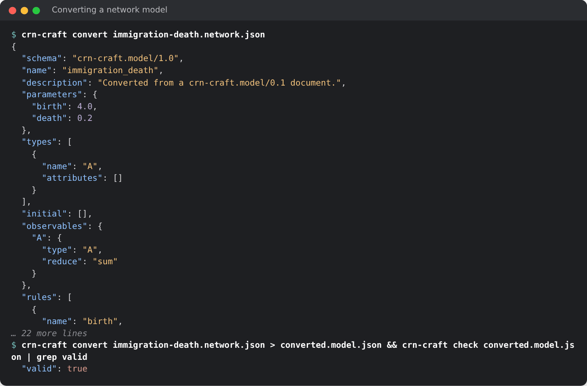

```python
converted = crn.Model.from_dict(json.loads(crn.convert(pathlib.Path("immigration-death.network.json").read_bytes())))
print(converted)
```

```text
Model('immigration_death': 1 species, 2 reactions)
```

The files of 0.6.0 are in `models/legacy/`. A network without reactions, or
with population limits, is refused with `CRN-R016`.

**Import.** `crn-craft-import` and `crn.read_sbml` and `crn.read_bngl` convert
an explicit subset of SBML Level 3 Version 2 and of BioNetGen `.net` files. They
reject what they cannot represent exactly (events, rules, fast reactions,
non-integer stoichiometry, unit ambiguity) instead of guessing. The rate
convention must be stated:

```bash
crn-craft-import bng-net dimer.net dimer.import.json --convention binomial
```

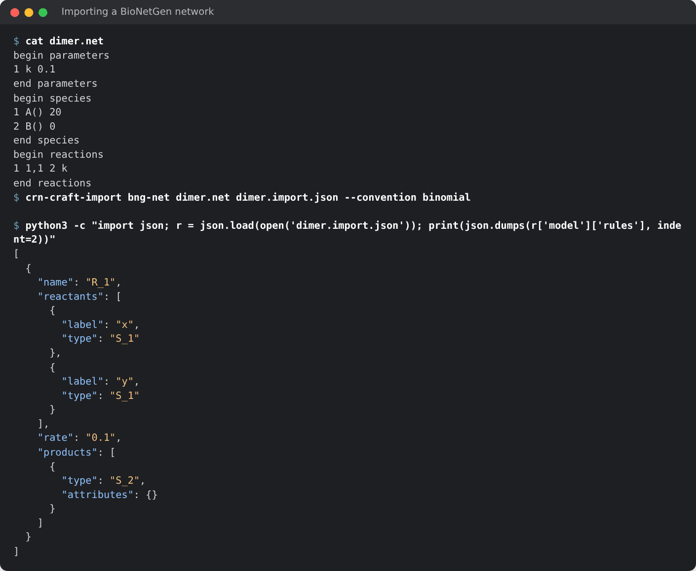

The report is a `crn-craft.import/1.0` document with the provenance and the
`model/1.0` model. In Python the import returns a `Model`, which keeps the
provenance in `import_report`:

```python
dimer = crn.read_bngl("dimer.net", convention="binomial")
print(dimer, dimer.import_report["source_format"])
sbml = crn.read_sbml("dimer.xml", convention="stochastic_count_propensity")
print(sbml, sbml.import_report["source_format"])
means = crn.ensemble(sbml, end=50.0, report_times=[0.0, 50.0], replicates=100,
                     seed=1, method="static_direct").simulate().statistics["mean"]
print(means.iloc[-1].to_dict())
```

```text
Model('ImportedBioNetGen': 2 species, 1 reactions) bionetgen_expanded_net_subset
Model('Dimer': 2 species, 1 reactions) sbml_l3v2_core_subset
{'A': 0.0, 'B': 10.0}
```

The 20 molecules of `A` pair up into 10 of `B`. The same model, imported from
either file, runs under every method.

**Export.** `crn-craft export MODEL gillespy2` writes GillesPy2 1.8.3 source
for cross-checking with another simulator. It never executes it. In Python,
`Model.to_gillespy2()` returns the `gillespy2.Model` when GillesPy2 is
installed.

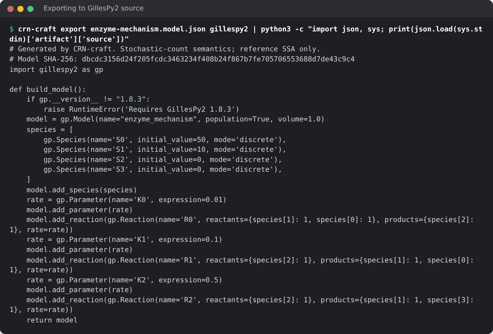

## 15. Choosing a method

Every method reads the same model and request, and the request's `method`
selects it. `crn.describe()["methods"]` lists them.

| Question | Method |
|---|---|
| Exact ensembles of a reaction network | `static_direct` with the default selector `auto` |
| Exact paths of a model whose instances change identity or have attributes | `tree` (the default of `crn.ensemble`), or `mtdna_direct` for the three-class mtDNA structure |
| A second exact method for cross-checks | `next_reaction` (a different random stream) |
| The exact distribution of a small system | `fsp` |
| Large populations where exact simulation is too slow | `tau`, with `epsilon` below the relative fluctuation size, checked against an exact method on a reduced case |
| A system that mixes discrete counts and continuous variables | `hybrid` |
| Structure, conservation and bounds | `analyze` |
| Deterministic dynamics and parameter sensitivities | the optional `crn-diffsol` integration |

The [mtDNA ensembles](mtdna-rules.md) page describes `tree`, `mtdna_direct`,
`binomial`, `thinning` and `hybrid`.

**Selectors.** `static_direct` selects the next channel with one of five
selectors, `method.selector` in a request or `selector=` in `crn.ensemble`.
All of them sample the same law, and each uses the random stream
differently, so the same seed gives different paths. The sampler identity
names the selector:

| Selector | How it selects |
|---|---|
| `linear` | a scan of the channels in order |
| `composition_rejection` | channels grouped by the binary exponent of their rate |
| `sorting` | a scan in an order that moves each fired channel forward |
| `rssa_cr` | candidates from rate bounds over population intervals, then an acceptance test |
| `auto` | one of the others, chosen at preparation (the default) |

```python
rows = []
for selector in ["linear", "composition_rejection", "sorting", "rssa_cr", "auto"]:
    result = crn.ensemble(model, end=30.0, report_times=[0.0, 30.0], replicates=400,
                          seed=42, method="static_direct", selector=selector).simulate()
    rows.append((selector, result.metadata["sampler"].split("/")[1]))
for selector, sampler in rows:
    print(f"{selector:22} {sampler}")
print(crn.describe()["selectors"]["auto"])
```

```text
linear                 rules-static-direct
composition_rejection  rules-static-direct-cr
sorting                rules-static-direct-sorting
rssa_cr                rules-static-direct-rssa-cr
auto                   rules-static-direct
{'composition_rejection_from_channels': 128, 'population_cut': 8.0, 'rssa_cr_from_channels': {'otherwise': 8, 'population_below_cut': 128}}
```

`auto` chooses from the number of channels and from the initial counts. It
picks the linear scan for a small network such as this one, and
composition-rejection or RSSA-CR for networks with hundreds of channels, where
the scan costs more than the bookkeeping of the others. It decides from the
initial counts, so a model whose populations later grow or shrink far from
them can end up with a slower selector. `describe()["selectors"]["auto"]`
lists the thresholds. For a large network, time the selectors on a short run
before a long one. [Exact methods](direct-ssa.md) describes them and their
sources.

Performance notes, from the measurements in the
[technical report](technical-report.md):

- `threads` divides replicates among workers without changing results. Use it
  for large ensembles.
- Keep `keep_paths` and the number of report times as small as the question
  allows. Output size and memory reservations scale with
  `observables x report times x kept paths`.
- FSP cost scales with states times series terms. Tighter bounds and a
  smaller final time help more than a looser tolerance.
- Tau leaping costs a few random numbers per channel and leap whatever the
  leap mean, so large populations are cheap. Its accuracy, not its speed,
  limits `epsilon`.
- `compile_loop` compiles a generated event loop for one model and gives
  byte-identical results, only faster. See
  [specialized kernels](specialized-kernels.md).

## 16. Where to go next

- [Model reference](rules-language.md): the full `model/1.0` language,
  including attributes and higher-order rules.
- [Architecture](architecture.md): how the pieces fit together.
- [Technical report](technical-report.md): design, validation and measured
  performance.
- [Comparison with GillesPy2](comparison-gillespy2.md): the same models timed
  against GillesPy2's C++ and NumPy solvers.
- [Exact methods and selectors](direct-ssa.md),
  [archive contract](archive-contract.md), [result contract](result-contract.md),
  [diagnostics](diagnostics.md) and [contracts](contracts.md).
- [Alternative exact SSA methods](alternative-ssa.md) and
  [mtDNA ensembles](mtdna-rules.md).
- [mtDNA user manual](mtdna-user-manual.md): a complete study with attributes,
  trackers, event logs and parameter sweeps.
- [Campaign guide](campaign/README.md) for the fcmaes worker, the ODE and
  sensitivity integration and the fitting example.
