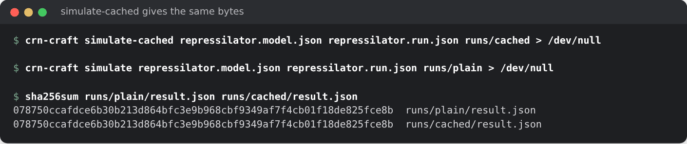

# CRN-craft tutorial

This tutorial walks through CRN-craft from a first model to exact ensembles,
finite state projection, approximate tau leaping and the Python interface.
Every terminal screenshot is a real run of the commands shown, against the
example models in `models/examples/`, and every figure is computed with the
package. `examples/tutorial/make_assets.py` regenerates both, and
`validation/check_tutorial.py` runs every `bash` and `python` block of this
page in order, so the examples stay correct as the code changes.

Contents:

1. [Build and install](#1-build-and-install)
2. [A first model](#2-a-first-model)
3. [Checking inputs and reading diagnostics](#3-checking-inputs-and-reading-diagnostics)
4. [Exact simulation and sealed archives](#4-exact-simulation-and-sealed-archives)
5. [The Python interface](#5-the-python-interface)
6. [Oscillations: the repressilator](#6-oscillations-the-repressilator)
7. [Exact distributions with finite state projection](#7-exact-distributions-with-finite-state-projection)
8. [Approximate tau leaping, and when to trust it](#8-approximate-tau-leaping-and-when-to-trust-it)
9. [Budgets, cancellation and Ctrl-C](#9-budgets-cancellation-and-ctrl-c)
10. [Reproducibility: seeds, streams and threads](#10-reproducibility-seeds-streams-and-threads)
11. [Network analysis](#11-network-analysis)
12. [First-passage times from saved grids](#12-first-passage-times-from-saved-grids)
13. [Importing and exporting models](#13-importing-and-exporting-models)
14. [Choosing a method and performance tips](#14-choosing-a-method-and-performance-tips)
15. [Where to go next](#15-where-to-go-next)

## 1. Build and install

CRN-craft is a Rust workspace. The command-line tool needs Rust 1.85 or newer:

```sh
git clone https://github.com/dietmarwo/CRN-craft
cd CRN-craft
cargo build --release --workspace --locked
./target/release/crn-craft --help
```

The Python package is an optional PyO3 extension built with maturin. It
installs the `crn_craft` module and two console scripts, `crn-craft` (a
Python front end with the same commands) and `crn-craft-import`:

```sh
python -m pip install maturin==1.9.6 numpy
maturin build --release --locked --out dist
python -m pip install dist/*.whl
python -c "import crn_craft; print(crn_craft.__version__)"
```


Every command reads and writes JSON. `crn-craft describe` lists the commands,
methods and limits, and `crn-craft describe model` (or `run`, `result`,
`fsp-result`, `tau-request`, …) prints the JSON Schema of each document, so a
script or an agent can discover the interface without reading this page.

## 2. A first model

A model is a JSON document with species, parameters and reactions. This is
`models/examples/immigration-death.model.json`: molecules of `A` arrive at
rate 4 and each one decays at rate 0.2.

```json
{
  "schema": "crn-craft.model/0.1",
  "name": "immigration_death",
  "convention": "stochastic_counts",
  "omega": 1.0,
  "parameters": {"birth": 4.0, "death": 0.2},
  "species": [{"name": "A", "initial_count": 0}],
  "reactions": [
    {"name": "birth", "reactants": {}, "products": {"A": 1},
     "rate": {"kind": "mass_action", "coefficient": "birth"}},
    {"name": "death", "reactants": {"A": 1}, "products": {},
     "rate": {"kind": "mass_action", "coefficient": "death"}}
  ]
}
```

Things to notice:

- Counts are integers (`stochastic_counts`). Mass-action propensities use
  falling factorials, so `2A -> B` with coefficient `k` fires at
  `k * A * (A - 1) / 2`.
- Besides `mass_action`, rates can be `hill_activation`, `hill_repression`
  and `michaelis_menten` laws; see [contracts](contracts.md) and
  `crn-craft describe model`.
- Unknown fields and duplicate keys are errors, never silently ignored.

A **run** says what to compute: the method, save times, number of
replicates, seed and budgets. A run names its model by path **and by the
SHA-256 of its exact bytes**, so a result can never be attributed to a model
that was edited afterwards:

```json
{
  "schema": "crn-craft.run/0.1",
  "model": {"path": "immigration-death.model.json",
            "sha256": "3f647f5a88bfbaf5136ccbcb45b90ca8c16737a0ba88e157ef40f4a86810f1b4"},
  "method": {"kind": "ssa", "aggregator": "direct"},
  "time": {"end": 10.0, "save_times": [0.0, 1.0, 2.0, 5.0, 10.0]},
  "ensemble": {"replicates": 64, "root_seed": 42},
  "outputs": {"statistics": ["mean", "variance"], "keep_trajectories": 2},
  "budget": {"max_events_per_replicate": 1000000, "wall_time_s": 60.0,
             "threads": 1, "max_output_bytes": 1048576}
}
```

## 3. Checking inputs and reading diagnostics

`check` validates a model, or a model and its run, without simulating. Compute
the model hash with any SHA-256 tool:

```bash
sha256sum immigration-death.model.json
crn-craft check immigration-death.model.json immigration-death.run.json
```


Every problem is reported as a diagnostic with a stable code, a JSON pointer
to the offending field, a message and a hint. Here a rate refers to an
undeclared parameter, and a run carries a stale model hash:

```bash
crn-craft check missing-parameter.model.json || echo "exit status $?"
```


`docs/diagnostics.md` lists every code. Commands exit 0 on success and 1 on
invalid input; warnings (codes `CRN-W…`) do not change the exit status.

## 4. Exact simulation and sealed archives

`simulate` runs the exact Direct stochastic simulation algorithm (Gillespie)
and writes a **new** directory. The directory is an archive: the exact model
and run bytes, the result, a provenance record, a manifest with the SHA-256 and
length of each file, and a `COMPLETE` marker written last that holds the
manifest's hash.

```bash
mkdir -p runs
crn-craft simulate immigration-death.model.json immigration-death.run.json runs/first
crn-craft verify runs/first
```


`verify` re-reads everything, checks every hash and length, re-validates the
inputs and the result's internal accounting, and exits 0 for a valid archive,
including one whose simulation was stopped early. Change one byte and
verification fails:


`simulate` exits 0 only when every replicate completed. A replicate can also
stop at its event limit, a population limit, the wall-clock limit or a
cancellation; the archive then records `termination` and `assessment:
incomplete`, keeps every replicate's accounting and **withholds the
statistics**, so a partial ensemble is never mistaken for a complete one.

`simulate-cached` is a second exact implementation that recomputes only the
propensities a reaction can change and resumes the running sums from the
first changed channel. It draws the same random numbers and makes the same
choices, so its result is byte-identical to `simulate`, only faster on larger
networks:

```bash
crn-craft simulate-cached repressilator.model.json repressilator.run.json runs/cached > /dev/null
crn-craft simulate repressilator.model.json repressilator.run.json runs/plain > /dev/null
cmp runs/plain/result.json runs/cached/result.json && echo identical
```



## 5. The Python interface

The Python package takes models and runs as dictionaries, strings or bytes and
returns plain dictionaries. `run_spec` builds a run bound to the exact model
bytes:

```python
import json
import numpy as np
import crn_craft as crn

model = crn.load_example("immigration-death")  # bytes of the packaged model
run = crn.run_spec(model, end=30.0, save_times=list(np.linspace(0, 30, 31)),
                   replicates=400, seed=42, keep=8)
result = crn.simulate(model, run)
assert result["termination"] == "completed"

t = np.array(result["save_times"])
mean = np.array(result["statistics"]["mean"])[:, 0]
variance = np.array(result["statistics"]["sample_variance"])[:, 0]
exact = 20 * (1 - np.exp(-0.2 * t))
print(f"{result['events']} events; mean at t=30: {mean[-1]:.2f} (exact {exact[-1]:.2f})")
assert abs(mean[-1] - exact[-1]) < 4 * np.sqrt(exact[-1] / 400)
```

Always check `termination` before using statistics: an incomplete ensemble
has `statistics: null`. The immigration-death law is Poisson with mean
`20 (1 - exp(-0.2 t))`, so mean and variance agree:


Rejected requests raise `crn_craft.CrnError`, a `ValueError` carrying the
parsed diagnostics:

```python
try:
    crn.simulate(model, dict(run, time={"end": 1.0, "save_times": [0.0, 2.0]}))
except crn.CrnError as error:
    print(error)
    print(error.diagnostics[0]["path"])
```

`crn.check`, `crn.analyze`, `crn.fsp`, `crn.tau` and `crn.describe` mirror the
command-line commands. The installed `crn-craft` script offers the same
commands from Python (`python -m crn_craft --help`).

## 6. Oscillations: the repressilator

The packaged repressilator is three genes repressing each other in a ring,
with Hill repression. A single exact path oscillates, with amplitudes that
vary from cycle to cycle:

```python
from crn_craft.observables import oscillation

circuit = crn.load_example("repressilator")
grid = list(np.linspace(0, 200, 1001))
path = crn.simulate(circuit, crn.run_spec(circuit, end=200.0, save_times=grid,
                                          replicates=1, keep=1))
names = [s["name"] for s in json.loads(circuit)["species"]]
p1 = np.array(path["trajectories"][0]["counts"])[:, names.index("p1")]
verdict = oscillation(path["save_times"], p1)
print(verdict["classification"], round(verdict["period"], 1))
```


`oscillation` drops a burn-in (20% by default), removes the mean, and calls a
series *oscillatory* only when the dominant Fourier peak holds at least 30% of
the power, spans at least three cycles, and the autocorrelation at that period
is at least 0.2. Fewer than three cycles is *ambiguous*. It is a trajectory
diagnostic with synthetic controls, not a validated biological detector.

## 7. Exact distributions with finite state projection

For small state spaces the chemical master equation can be solved directly.
`fsp` enumerates the states reachable within per-species bounds, sends every
transition out of the bounds to an absorbing sink, and propagates the
probability vector by uniformization. Nothing is renormalized: the lost mass
is reported, not hidden.

```bash
crn-craft fsp immigration-death.model.json immigration-death.fsp.run.json > fsp.json
python3 -c "import json; print(json.load(open('fsp.json'))['snapshots'][-1]['mass_defect'])"
```


Each snapshot separates the error sources:

| Field | Meaning |
|---|---|
| `physical_leakage_estimate` | probability that left the bounds (in the sink) |
| `series_tail_upper_bound` | upper bound on the truncated uniformization series |
| `discarded_weight_estimate` | the series weight actually omitted |
| `roundoff_mass_residual` | the remaining floating-point imbalance |
| `projected_first_moment` | moments over the projected states only |

The projection matches the exact Poisson law to about 1e-12 and agrees with a
2,000-path SSA histogram:


From Python:

```python
fsp_run = {k: v for k, v in crn.run_spec(model, end=20.0,
           save_times=[0.0, 2.0, 5.0, 20.0]).items() if k != "ensemble"}
fsp_run["method"] = {"kind": "fsp", "bounds": {"A": 80}, "max_states": 81,
                     "tolerance": 1e-10}
fsp_run["outputs"] = {"statistics": ["mean"], "keep_trajectories": 0}
fsp_run["budget"] = {"threads": 1, "max_output_bytes": 10_000_000}
projection = crn.fsp(model, fsp_run)
last = projection["snapshots"][-1]
print(last["projected_first_moment"], last["mass_defect"])
assert abs(last["projected_first_moment"][0] - 20 * (1 - np.exp(-4))) < 1e-8
```

## 8. Approximate tau leaping, and when to trust it

Tau leaping fires many reactions per step: each channel fires a Poisson number
of times over a leap whose length keeps the relative change of every
propensity below `epsilon` (Cao, Gillespie and Petzold 2006). Proposals that
would make a count negative are rejected and the leap halved; channels close
to exhausting a reactant are simulated exactly. Results are labelled
`approximate_ensemble` and use their own schema, so they cannot be mistaken
for exact ones:

```bash
crn-craft tau immigration-death.model.json tau.json > tau-result.json
```


The request wraps an ordinary run:

```python
request = {"schema": "crn-craft.tau-request/0.1", "epsilon": 0.01,
           "max_leaps_per_replicate": 1_000_000,
           "reference_run": crn.run_spec(model, end=10.0, replicates=200, keep=200)}
approx = crn.tau(model, request)
print(approx["assessment"], approx["leaps"], "leaps for", approx["events"], "firings")
```

For this small system the output is about 12,600 leaps for 12,500 firings:
with only about 20 molecules, the leap condition allows roughly one firing
per leap, so tau leaping does the work of the exact method with an
approximation on top. It pays off only when populations are large.

How small must `epsilon` be? The figure compares 1,000 tau paths of a
birth–death process with mean 1,000 against 1,000 exact paths. The mean is
right at every `epsilon`, but once `epsilon` exceeds the relative standard
deviation of the state (here `1/sqrt(1000) ≈ 0.032`), each leap moves the
state by more than its own fluctuations and the variance is inflated: by 18%
at `epsilon = 0.03` and 68% at `0.1`.


Rule of thumb: keep `epsilon` below the relative fluctuation size of the
species you care about, and compare against `simulate` on a reduced case.
Leap means above 16 are drawn by Hörmann's transformed rejection (PTRS), so
large populations cost a few random numbers per channel and leap.

## 9. Budgets, cancellation and Ctrl-C

Every run has explicit budgets: `max_events_per_replicate`, an optional
`wall_time_s`, `max_output_bytes`, the number of `threads`, and species can
declare a `population_limit`. A run is admitted only if its memory
reservation fits the published limits (`crn-craft describe` lists them).

Long runs can be stopped cooperatively by creating a file:

```bash
touch stop
crn-craft simulate immigration-death.model.json long.run.json runs/stopped --cancel-file stop || echo "exit status $?"
crn-craft verify runs/stopped > /dev/null && echo "partial archive verifies"
```


The stopped archive is still sealed and verifiable; it says `cancelled` and
withholds statistics. In Python, `cancel_file=` does the same for
`simulate`, `fsp` and `tau`, and **Ctrl-C** cancels a running native call and
raises `KeyboardInterrupt` within about 50 ms:

```python
import pathlib
pathlib.Path("stop").touch()
long_run = crn.run_spec(model, end=1e6, replicates=8, max_events=10**9)
stopped = crn.simulate(model, long_run, cancel_file="stop")
print(stopped["termination"], stopped["statistics"])
```

## 10. Reproducibility: seeds, streams and threads

Replicate *i* of a run draws from its own ChaCha8 stream, keyed by the
SHA-256 of a domain string and the root seed, with *i* as the stream number.
Replicates never share random numbers, and workers reduce results in
replicate order, so the numerical result does not depend on the number of
threads:

```python
digests = set()
for threads in [1, 2, 8]:
    result = crn.simulate(circuit, crn.run_spec(circuit, end=50.0, replicates=64,
                                                threads=threads, keep=4))
    result.pop("run_sha256")  # the run's own hash covers `threads`
    digests.add(json.dumps(result, sort_keys=True))
assert len(digests) == 1
print("identical across 1, 2 and 8 threads")
```

Sums of propensities are computed in a fixed order with checks that no
positive rate is lost to rounding, and every comparison uses the same
floating-point operations in both exact implementations. A result also
records the sampler identity, so a future change of random mapping cannot
silently reuse old seeds.

## 11. Network analysis

`analyze` reports structure without simulating: stoichiometry, evaluated
propensities, a basis of conservation laws and nonnegative conservation rays
with exact integer arithmetic, the bounds they imply for the initial
conservation class, and complexes, linkage classes and deficiency.

```python
report = crn.analyze(crn.load_example("enzyme-mechanism"))["analysis"]
print(report["conservation"]["basis"])           # E + ES and S + ES + P
print(report["initial_class_upper_bounds"])      # S, E, ES, P cannot exceed these
print("deficiency", report["linkage"]["deficiency"])
```

For the enzyme mechanism `S + E <-> ES -> E + P`, the laws are
`E + ES = 10` and `S + ES + P = 50`, so every count is bounded, and the
deficiency is zero. Analysis limits (species, reactions, work) are explicit;
when a limit is hit the report says `unavailable` rather than implying that no
law exists.

## 12. First-passage times from saved grids

`sampled_first_passage` estimates when paths first reach a threshold, from
saved states only. A path can cross and fall back between saved times, so a
saved grid supports one-sided statements: the first saved hit is an upper
bound on the passage time, and the detected fraction is a lower bound on the
probability of a passage before the horizon.

```python
from crn_craft.observables import sampled_first_passage

fine = list(np.linspace(0, 10, 201))
paths = crn.simulate(model, crn.run_spec(model, end=10.0, save_times=fine,
                                         replicates=500, keep=500))
counts = [np.array(p["counts"])[:, 0] for p in paths["trajectories"]]
for step in [1, 20]:
    bound = sampled_first_passage(fine[::step], [c[::step] for c in counts], 15)
    print(step * 0.05, bound["detected_fraction"], bound["restricted_mean_upper"])
```


Finer grids give tighter bounds; save densely around the event of interest.

## 13. Importing and exporting models

`crn-craft-import` converts an explicit subset of SBML Level 3 Version 2 and
BioNetGen `.net` files. It rejects what it cannot represent exactly (events,
rules, fast reactions, non-integer stoichiometry, unit ambiguity) instead of
guessing. The rate convention must be stated:

```bash
crn-craft-import bng-net dimer.net dimer.import.json --convention binomial
```


`export MODEL gillespy2` writes GillesPy2 1.8.3 source for cross-checking with
another simulator (it never executes it):


## 14. Choosing a method and performance tips

| Question | Method |
|---|---|
| Exact sample paths or ensemble statistics | `simulate` (or `simulate-cached` for networks with more than a few dozen reactions) |
| The exact distribution of a small system | `fsp` |
| Large populations where exact simulation is too slow | `tau`, with `epsilon` below the relative fluctuation size, checked against `simulate` on a reduced case |
| Deterministic dynamics and parameter sensitivities | the optional `crn-diffsol` integration |
| Structure, conservation and bounds | `analyze` |

Performance notes, from the measurements in the
[technical report](technical-report.md) (one core of a shared 2-vCPU host):

- Exact SSA costs about 50 ns per event for a two-channel network and
  150–650 ns per event for the 12- and 66-reaction benchmark networks.
- `simulate-cached` pays off as soon as a reaction changes only some
  propensities: it is 3.3 times faster than `simulate` on a sparse
  66-reaction network, 2.1 times on the 12-reaction three-gene circuit and
  1.2 times on a dense 66-reaction network, with identical results. On a
  two-channel network both cost the same.
- `threads` divides replicates among workers without changing results; use
  it for large ensembles.
- Keep `keep_trajectories` and the number of save times as small as the
  question allows; output size and memory reservations scale with
  `species × save_times × kept paths`.
- FSP cost scales with states × series terms; tighter bounds and a smaller
  final time help more than a looser tolerance.
- Tau leaping costs a few random numbers per channel and leap whatever the
  leap mean, so large populations are cheap; its accuracy, not its speed, is
  what limits `epsilon`.

## 15. Where to go next

- [Architecture](architecture.md): how the pieces fit together.
- [Technical report](technical-report.md): design, validation and measured
  performance.
- [Direct SSA guide](direct-ssa.md), [archive contract](archive-contract.md),
  [diagnostics](diagnostics.md) and [contracts](contracts.md).
- [Campaign guide](campaign/README.md) for the fcmaes worker, the ODE and
  sensitivity integration and the fitting example.
