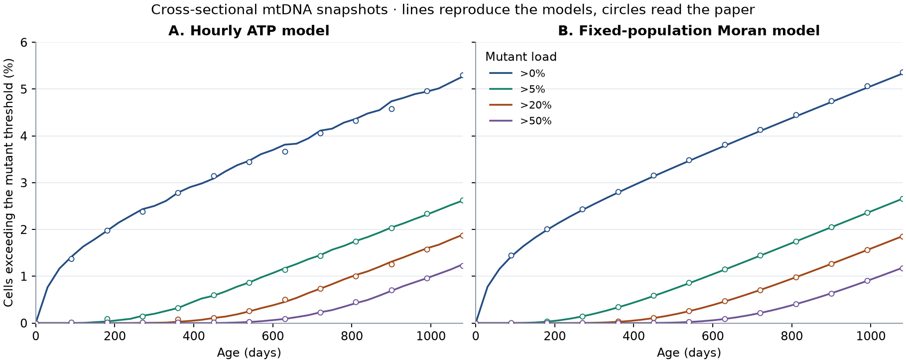

# The model and Figure 6

Part of [tutorial O2](O2-mtdna-inference.md).

<!-- fixtures: examples/kk26/model.py -->

## One Moran step

Write `W`, `U` and `A` for the wild-type, neutral-mutant and
advantageous-mutant copies of a cell, `N = W + U + A = 1000`. One Moran
step draws a daughter type and, independently, a degraded copy:

- The daughter comes from a parent chosen with weights `W`, `U` and
  `(1+s)*A`. A wild-type parent gives a wild-type daughter with
  probability `1-p`, a neutral mutant with probability `p*(1-f)` and an
  advantageous mutant with probability `p*f`. Mutant parents give their
  own type.
- The degraded copy is `W`, `U` or `A` with probability `W/N`, `U/N` and
  `A/N`.

The step adds the daughter and removes the degraded copy. When both are of
the same type nothing changes, and the step still counts. This is the
paper's Equation 7: the probability of a birth of type γ and a death of
type δ is the fitness-weighted share of parents giving rise to γ times
`m_δ/N`. It differs from the pair rule of
[tutorial S2c](../simulation/S2c-fig1cd.md#the-exact-moran-step-as-a-pair-rule), where the
parent is chosen among the copies that survive the degradation.

The paper converts days to steps with the replication rate
`ln(2)/halfLife`: `Δt` days are about `N*ln(2)/halfLife*Δt` steps, 69.3
steps per day for a 10-day half-life. The reconstruction uses
`floor(days*N*ln(2)/halfLife)` steps, 74,860 for 1,080 days.

## Snapshots as five bins

At each age a cell falls into one of five bins of its mutant count
`M = U + A`. A cell exactly at a threshold goes into the lower bin.

| Bin | Mutant fraction | Integer test |
| --- | --- | --- |
| 0 | exactly zero | `M == 0` |
| 1 | above 0%, at most 5% | `M > 0` and `20*M <= N` |
| 2 | above 5%, at most 20% | `20*M > N` and `5*M <= N` |
| 3 | above 20%, at most 50% | `5*M > N` and `2*M <= N` |
| 4 | above 50% | `2*M > N` |

The four curves of Figure 6, the fractions of cells above 0%, 5%, 20% and
50%, are the sums of bins 1–4, 2–4, 3–4 and 4 divided by the number of
cells. The fit uses only these four fractions at each age.

## The Moran step in CRN-craft

Applies: [chapter 2, Rates as numbers and as strings](../../guide/02-first-model.md#rates-as-numbers-and-as-strings).

Six reactions move one copy from one type to another, for example
`W_to_A` (a wild-type copy degraded, an advantageous daughter born). Each
has the probability of its Moran step times the step rate
`N*ln(2)/halfLife`. `native_model` in `examples/kk26/model.py` builds them.
With these rates the steps arrive as a Poisson process instead of a fixed
clock: the count law is the paper's step law with a random number of steps.
Static Direct samples that continuous-time law; FSP computes it. A
seven-copy cell after 12 days:

```python
import sys

sys.path.insert(0, "examples/kk26")
from model import Model, native_model

seven_copies = native_model(Model(0.05, 0.27, 0.7, copies=7))
result = seven_copies.fsp(
    end=12, report_times=[0.0, 12.0], bounds={"W": 7, "U": 7, "A": 7},
    max_states=36, tolerance=1e-10,
)
states = result.metadata["states"]
last = result.metadata["snapshots"][-1]["probabilities"]
mutant_fraction = sum(p for state, p in zip(states, last, strict=True) if state[0] < 7)
print(f"{mutant_fraction:.4f}")
```

```text
0.2017
```

The printed value is the probability that the cell holds at least one
mutant. `validation/check_kk26.py` compares this FSP law with the matrix
exponential of the step chain (largest difference 2e-12) and 16,000 Static
Direct cells with it (see [checks](O2c-mtdna-inference-limits.md#how-the-reconstruction-was-checked)).

## The full-size forward law

A 1,000-copy cell has 501,501 states `(U, A)`. The example's C++ library
computes their probabilities in two ways:

- **Discrete reference**: the paper's law, step by step, including the
  steps that change nothing. It is exact up to rounding and takes about a
  minute for 1,080 days.
- **Continuous-time solver** for the fit: the Poisson-clock law above,
  advanced in 5-day steps. Each step splits the moves into three
  directions on the `(U, A)` lattice (`U` up or down, `A` up or down, a
  copy moving between `U` and `A`) and solves each direction implicitly
  (Crank–Nicolson, Strang splitting). It takes about three seconds.

To save time both may cap the neutral count, at 192 copies for the
baseline and 320 for the strong regime. Probability that would cross the
cap is counted as *escaped* and never put back, so a reported tail
fraction is a lower bound and the tail plus the escaped mass an upper
bound. The escaped mass is at most 3.2e-4 at the grid nodes of the fit's
search box; at the true baseline parameters the capped law differs from the full
lattice by 5.6e-5.

The two clocks give almost the same curves because a cell changes slowly
compared with its 69 steps per day. At the true parameters the
continuous-time solver differs from the discrete reference by at most
2.6e-6 (baseline) and 1.2e-5 (strong); at two corners of each search box
by at most 3.4e-5.

## Figure 6



Lines are this reconstruction, open circles every third value read from
the paper's Figure 6. Both panels use the baseline parameters.

**Panel B** is the Moran law of this page, propagated with the discrete
reference. All 144 published points at 30 to 1,080 days are matched to
0.038 percentage points or better. The difference is systematic in one
curve: the reconstructed fraction above 0% lies 0.016 to 0.038 points
below the published one at every age (the published value at 1,080 days
reads 5.361%, the reconstruction gives 5.332%). The other three curves
agree within 0.026 points. The cause is not known;
a 0.03-point difference is a seventh of the sampling error of a
10,000-cell cohort, so it does not matter for the fit.

**Panel A** comes from a different model, the paper's Model-1: wild-type
and mutant copies whose replication is slowed by ATP, which only
wild-type copies produce. The paper uses it to make synthetic data that
are not drawn from the Moran model. Its equations are

    wt'  = wt/(1+ATP/c) - ln(2)/halfL*wt
    mt'  = (1+s)*mt/(1+ATP/c) - ln(2)/halfL*mt
    ATP' = f_ATP*wt - v2*(wt+mt) - v1*ATP

with a stochastic version in one-hour steps in which only wild-type
replication produces mutants. This is the transcription model of
[tutorial S3](../simulation/S3a-mtdna-mechanisms-models.md#transcription-linked-replication),
and the reconstruction reuses its hourly scheme and its choices: degrade,
replicate the survivors, mutate, then relax ATP for one hour with the new
counts; constants from the 2014 PNAS Table 1 (`f_ATP = 0.1`, `v2 = 0.01`,
`v1 = 0.2`, `c` = 1.303 from the steady state of 1,000 wild-type copies);
a cell whose ATP reaches zero keeps its counts. Three things differ from
tutorial S3, as the 2026 paper prescribes: mutants replicate `1+s` times as
fast as wild type instead of 1.5 times, a fraction `1-f` of new mutants is
neutral and replicates like wild type, and only wild-type daughters
mutate (in tutorial S3 mutant templates mutate too).

The figure shows 100,000 such cells (`examples/kk26/moran.cpp`,
`sample_atp`). The largest difference from the 144 published points is
0.158 percentage points; the paper's curve also comes from about 100,000
cells, so two sampling errors of about 0.07 points meet here. A second run
of 30,000 cells with half-hour steps differs from the hourly run by at
most 0.28 points, and by at most 2.3 standard errors over the 122 points
where the fraction is not zero; a pure sampling difference gives such a
maximum as often as not. The comparison cannot detect a step-size effect
smaller than about 0.3 points. The hourly ATP cells and the Moran law of
panel B differ by at most 2.5 standard errors of the ATP cohort (6 of 144
points beyond 2): at this baseline the two models make indistinguishable
snapshots.

### How the published curves were read

The paper's Figure 6 was digitized from the article PDF: the axes are
calibrated on the 0–1,000 day and 0.01–0.05 ticks of each panel, the
curves read at the 30-day ages with a reading interval of 3 to 5 pixels
(`examples/kk26/paper-figure6.csv`, 296 points). The review checked panel
B against an independent image: a companion preprint of the same authors
(bioRxiv [10.64898/2026.01.30.702741](https://doi.org/10.64898/2026.01.30.702741),
Figure 4B) reproduces Figure 6B with the same axes and curves ending at
1,080 days. Read there by pixel analysis, 132 of the 148 points are
readable (the others lie under another curve near zero), and all agree
with the saved readings within 1.05 pixels of that image, 0.017
percentage points; on the steep start of the 0% curve within 0.42 pixels.
The same image also shows the 0% curve 1.2 to 2 pixels above the
reconstruction.

Both panels were then read again from the figure in the preprint of the
paper itself (bioRxiv [10.64898/2026.01.30.702736](https://doi.org/10.64898/2026.01.30.702736), version 1; an 878 × 321 pixel image, one pixel is 0.022
percentage points). After day 0, 127 of the 144 points of panel A are
readable, and all agree with the saved readings within 1.05 pixels, 0.023
percentage points. In panel B the same number is readable; the largest
difference is 1.7 pixels, on the steep start of the 0% curve, where one
pixel along the time axis already moves the curve by 0.04 percentage
points.

Next: [Fitting snapshots and takeover times](O2b-mtdna-inference-results.md).
