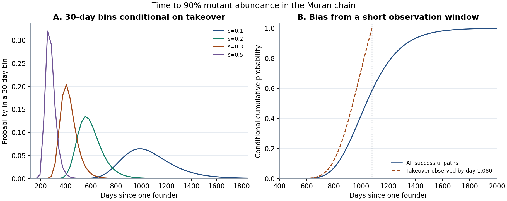

# Fitting snapshots and takeover times

Part of [tutorial O2](O2-mtdna-inference.md).

The paper tests its method on synthetic data with known parameters: it
simulates cohorts, fits each one, and reports the spread of the 40 fits
as a 95% interval (its Tables 2 and 3, a *parametric bootstrap*). This
page does the same with new cohorts and compares the intervals.

## The protocol

Applies: [chapter 8, Reproducing a published simulation](../../guide/08-reproducibility.md#reproducing-a-published-simulation).

The targets were written in a plan before any run; everything below is
fixed in `examples/kk26/fitting.py` and recorded in
`results/reconstruction/manifest.json` (root seed 20261120):

- **Data**: 40 cohorts per regime, 10,000 cells each, simulated with the
  exact discrete Moran law (a sampler that skips unchanged steps with
  geometric waiting times). Every cohort has its own seed, a hash of the
  root seed, the regime and the cohort number. Cohort and optimizer seeds
  come from different labels, so data and search are independent.
- **Objective**: the paper's unweighted sum of squared differences between
  the observed and predicted fractions above 0%, 5%, 20% and 50%, over all
  37 ages.
- **Search**: fcmaes differential evolution (`fcmaes.decpp`), population
  32, 1,800 evaluations requested (1,801 to 1,848 used, as a generation
  finishes), over `log10(p)`, `s` and `f` in the box of the table below.
- **Forward law in the search**: a tensor-product cubic spline through
  precomputed curves of the continuous-time solver
  ([model page](O2a-mtdna-inference-model.md#the-full-size-forward-law))
  at 192 (baseline) and 216 (strong) parameter points. The search box is
  the extent of this grid.
- **Acceptance targets** (from the plan): the forward solver and the spline
  within 0.001 in probability of their references; all 40 fits per regime
  completed; mean, coefficient of variation and the 2.5th and 97.5th
  percentiles reported, with whether the truth lies inside.

The grid nodes, the same in every cohort:

| Regime | `p` nodes | `s` nodes | `f` nodes |
| --- | --- | --- | --- |
| Baseline | 3.8e-6, 4.9e-6, 6.1e-6, 7.5e-6, 9.1e-6, 1.12e-5 | 0.052, 0.072, 0.086, 0.100, 0.115, 0.136, 0.166, 0.210 | 0.32, 0.54, 0.77, 1.00 |
| Strong | 1.65e-5, 2.08e-5, 2.63e-5, 3.30e-5, 4.15e-5, 5.2e-5 | 0.26, 0.35, 0.415, 0.465, 0.515, 0.57, 0.64, 0.73, 0.87 | 0.065, 0.15, 0.295, 0.47 |

The nodes were placed around the true values and the published intervals
by the contributor; they are denser near the truth.

## Results

The table is generated from `results/reconstruction/parameter-differences.csv`
and checked by `validation/check_kk26.py`. Percentiles use linear
interpolation between order statistics (NumPy's default); with 40 fits the
2.5th and 97.5th percentiles lie close to the second smallest and second
largest fit. The paper names its percentiles but not their definition.

<!-- kk26-recovery -->
| Regime | Parameter | Truth | Search box | Mean (CV) | 2.5–97.5% | Published mean (CV) | Published 2.5–97.5% | Truth inside: here / paper |
| --- | --- | ---: | ---: | ---: | ---: | ---: | ---: | --- |
| Baseline | Mutation probability `p` | 6.80e-6 | 3.80e-6–1.12e-5 | 6.76e-6 (3.2%) | 6.43e-6–7.25e-6 | 6.65e-6 (4.2%) | 6.11e-6–7.22e-6 | yes / yes |
| Baseline | Selection advantage `s` | 0.100 | 0.052–0.210 | 0.101 (5.8%) | 0.092–0.112 | 0.107 (9.7%) | 0.089–0.125 | yes / yes |
| Baseline | Advantageous fraction `f` | 0.800 | 0.320–1.000 | 0.786 (9.7%) | 0.654–0.927 | 0.870 (13.0%) | 0.650–1.000 | yes / yes |
| Strong | Mutation probability `p` | 3.00e-5 | 1.65e-5–5.20e-5 | 3.02e-5 (1.6%) | 2.91e-5–3.10e-5 | 2.90e-5 (1.8%) | 2.80e-5–2.99e-5 | yes / no |
| Strong | Selection advantage `s` | 0.500 | 0.260–0.870 | 0.509 (9.3%) | 0.445–0.601 | 0.538 (8.1%) | 0.461–0.628 | yes / yes |
| Strong | Advantageous fraction `f` | 0.200 | 0.065–0.470 | 0.198 (9.0%) | 0.172–0.235 | 0.210 (8.1%) | 0.180–0.240 | yes / yes |
<!-- /kk26-recovery -->

All six reconstructed intervals contain the true value. The published
interval of the strong-regime mutation probability, 2.80e-5–2.99e-5, does
not: its upper end lies just below the true 3.0e-5, which the paper itself
remarks on.

## How to read the recovery

**The search box.** The optimizer can only return values inside the box,
and the box was centered on the true parameters: about 0.56 to 1.7 times
the true mutation probability and 0.5 to 2 times the true selection
advantage. A real application does not know where the truth is. So the
results above measure how precisely the snapshots pin the parameters down
*near* the truth; they do not show that a search over all plausible
values would find it. Three review checks bear on this:

- No fit lies within 1% of the box width of a bound except one: the
  largest baseline advantageous fraction, 0.996, at the upper bound 1.0,
  which the paper imposes too. In parameter units the fits use 0.94 to
  1.07 times the true `p` and 0.83 to 1.26 times the true `s`, well inside
  the box.
- Four cohorts (baseline 0 and 8, strong 0 and 2, the latter two holding
  the largest `f` and the largest `s`) were refitted without the spline,
  with the continuous-time solver itself, by the same optimizer over much
  wider boxes: baseline `p` 2e-6–3e-5, `s` 0.01–0.5, `f` 0.05–1; strong `p`
  8e-6–1e-4, `s` 0.1–2, `f` 0.02–1. All four returned the saved fit within
  0.2% in `p` and `s` and 0.004 in `f`
  (`examples/kk26/review.py wide-box`). The local box did not hide a
  better optimum in these cohorts.
- The fixed-`f` profile of the first strong cohort
  (`fraction-profile.csv`) runs into the box: below `f` = 0.12 the refitted
  `s` sits at the upper bound 0.87, above 0.43 at the lower bound 0.26.
  Lower `f` and higher `s` trade against each other along a ridge that
  leaves the box, but the objective there is 4 to 110 times the minimum.

**The surrogate.** The spline was compared with the continuous-time solver
at 16 points spread over each whole box (a scrambled Sobol sequence), at
3 fixed points near the truth and at 3 of the fitted points per regime.
The largest difference is 1.1e-4 in probability, at a strong-regime point
far from the truth, and at most 1.2e-6 at the fitted points
(`grid-checks.csv`).

**Convergence.** Refitting all 80 cohorts with ten times the budget, and
with a second set of optimizer seeds, changed no parameter by more than
2e-6 relative (`review.py budget`). The intervals are not optimizer noise.

**The baseline intervals are narrower than the published ones.** The
reconstructed coefficients of variation are 3.2%, 5.8% and 9.7% for `p`,
`s` and `f`; Table 2 gives 4.2%, 9.7% and 13.0%. The published means are
also shifted: `s` 0.107 and `f` 0.87 against the truth 0.10 and 0.80,
while the reconstruction's means are 0.101 and 0.786. The paper's Table 1,
which is not reproduced here, shows the same shift with 100,000 cells
per cohort (`s` 0.108, `f` 0.87), so it is not sampling noise. Something
systematic differs between the published experiment and this one. The
review tested two candidates:

- *Data from Model-1.* The paper's Methods say the bootstrap cohorts were
  simulated with the Moran model, its Results describe the synthetic data
  as output of the ATP model (Model-1) or a fixed-copy-number model
  (Model-2). The 100,000 hourly ATP cells of Figure 6A, fitted with the
  Moran law, give `p` = 6.77e-6, `s` = 0.104 and `f` = 0.757
  (`review.py atp-fit`, the same with four optimizer seeds): `s` moves
  toward the published mean, `f` away from it. By the rule fixed before
  the run this is inconclusive. Model-2 could not be reconstructed.
- *Cohort design.* The reconstruction follows the same 10,000 cells
  through all 37 ages, so a chance early mutation in one cell shows up at
  every later age. With a new set of 10,000 cells at every age, as in real
  cross-sectional data, the 40 fits are two to three times as precise: CVs of
  1.2%, 2.0% and 4.5% in the baseline, with means within 0.1% of the truth
  (`review.py design`, `review-design.csv`). The rule fixed before the run
  asked whether the intervals become at least 25% *wider*; they became
  50% to 65% narrower, which the rule's categories did not foresee (it
  classifies this as "partial"). Either way the design does not explain
  wider published intervals, unless the published cohorts were correlated
  across ages in some stronger way. It does show that the saved intervals
  are wider than real snapshot data of the same size would give.

The optimizer settings, search bounds and percentile definition of the
paper are not published. In the strong regime the reconstructed and
published coefficients of variation agree within 1.3 percentage points.

**The advantageous fraction near 1.** The published baseline interval of
`f` reaches the imposed maximum 1.00. The reconstructed one ends at 0.927;
only one of 40 fits comes close to 1. The objective is flat in this
direction: for the first baseline cohort the best objective with `f`
fixed changes by at most 13% between `f` = 0.75 and 0.95
(`fraction-profile.csv`), while `p` and `s` adjust along with it.

## From a selection advantage to a takeover time

The paper's Figure 5 turns a selection advantage into the time a single
advantageous mutant needs to reach 90% of the copies. The reconstruction
starts with one advantageous copy among 999 wild-type copies, switches off
further mutation, and follows the exact probability law of the Moran
chain until the mutant is lost or reaches at least 900 copies. Dividing the
probability of having reached 900 copies by day `t` by the eventual
success probability gives the distribution of takeover times among the
mutants that succeed.

The success probability is the gambler's-ruin result for a birth–death
chain whose up and down probabilities have the constant ratio `1+s`:
`(1 - 1/(1+s)) / (1 - (1+s)^-900)`, which is `s/(1+s)` to many digits.
The computed absorption agrees with it to 1e-12.



From `results/reconstruction/takeover-summary.csv` (days; the modal bin is
the 30-day bin with the most probability, named by its first day):

| Selection advantage | Success probability | Median | 95% interval | Modal bin | Reached by day 1,080 |
| ---: | ---: | ---: | --- | ---: | ---: |
| 0.10 | 9.09% | 1,038 | 737–1,553 | 990 | 58.4% |
| 0.20 | 16.67% | 584 | 438–834 | 540 | 99.9% |
| 0.30 | 23.08% | 416 | 319–584 | 390 | 100.0% |
| 0.50 | 33.33% | 275 | 214–376 | 240 | 100.0% |
| 0.101 (baseline mean fit) | 9.18% | 1,029 | 732–1,539 | 960 | 60.1% |
| 0.509 (strong mean fit) | 33.73% | 270 | 213–370 | 240 | 100.0% |

Quantiles are interpolated linearly in a CDF reported every 30 days. The
modal bins 990, 540, 390 and 240 days are the four labels printed in the
paper's Figure 5.

The bars of that figure were read from the preprint of the paper (bioRxiv [10.64898/2026.01.30.702736](https://doi.org/10.64898/2026.01.30.702736), version 1;
`examples/kk26/paper-figure5.csv`, 60 bars, one pixel is 0.0009 in
probability) and compared with the reconstruction's probability of the
same 30-day bin (`fig5-differences.csv`):

| Selection advantage | Bars | Largest difference | Sum of the published bars | Sum of the same bins here |
| ---: | ---: | ---: | ---: | ---: |
| 0.10 | 15 | 0.0021 | 0.562 | 0.582 |
| 0.20 | 21 | 0.0037 | 0.982 | 0.997 |
| 0.30 | 15 | 0.0057 | 0.987 | 0.998 |
| 0.50 | 9 | 0.0085 | 0.992 | 0.998 |

The shapes agree within 0.0085 per bin, and the comparison settles two
choices of the reconstruction. A bar labeled `L` is the takeover
probability in the 30 days from `L` on; with the 30 days up to `L` the
largest difference would be 0.19. And the bars are probabilities among all
founders that ever take over: at `s` = 0.10 the published bars up to day
1,080 sum to 0.56, as the 58% of the table above, where a distribution of
the takeovers inside the window would sum to 1.

The agreement is not complete: 35 of the 60 bars differ by more than the
reading interval of one pixel, and the reconstruction's bars sum to 0.6%
to 3.6% more. Moving the published distributions 1.5 to 3 days earlier brings
every bar within 0.0015. This was found after the comparison and is a
description, not a tested explanation; such a shift is 0.3% to 0.6% of the
median times.

Two cautions follow from the first row. Most single founders, 91% at
`s` = 0.10, are lost, so a takeover time describes only the successful
ones. And with weak selection a three-year window sees only part of the
distribution: a founder present from day 0 that will succeed has reached
90% by day 1,080 with probability 58%. Keeping only takeovers seen inside
the window, as panel B shows, makes takeover look faster than it is.

## Rerunning the study

```sh
python examples/kk26/study.py bootstrap --size full --threads 8
python examples/kk26/study.py evidence --threads 8 --complete-grid --results examples/kk26/results/local/full
python examples/kk26/study.py figures --results examples/kk26/results/local/full
python validation/check_kk26.py --output kk26-validation.json
```

`bootstrap --size full` builds the two forward grids if they are not
cached (about 10 minutes on two x86-64 cores), simulates the 800,000 cells
of the 80 cohorts (about 10 seconds) and fits them (a few seconds). Its
results go to `examples/kk26/results/local/full/`. `evidence` computes the
discrete reference curves, the solver and corner checks, the complete
lattice and the 130,000 ATP cells, and the takeover tables (about 11
minutes on two cores). The saved results under `results/reconstruction/`
are the output of these two commands, copied together with the two grids.
The review checks of the previous section are rerun with
`python examples/kk26/review.py budget|wide-box|atp-fit|design`.

Next: [Choices, checks and limits](O2c-mtdna-inference-limits.md).
