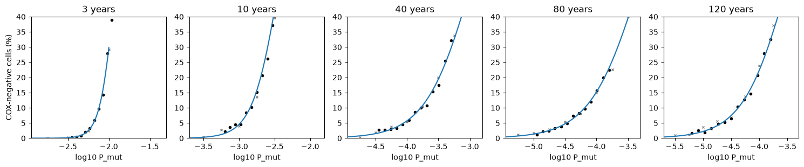

# Fig 1B: which mutation rate gives 5, 10 or 15 % COX-negative cells?

Author: Axel Kowald

Part of [tutorial S2](S2-published-study.md). Every section of this page
starts from the definitions of [Fig 1A](S2a-fig1a.md) and the regression
functions of the script:

```python
import math
import os

import numpy as np
import crn_craft as crn

nMolecules   = 1000
degRate      = math.log(2)/(24.0*10.0)                            # 1/h
coxThreshold = 0.6
hoursPerYear = 24.0 * 360.0
nThreads     = max(1, (os.cpu_count() or 1) - 2)

def buildModel(pmut) -> crn.Model:
    model = crn.Model("mtdna_random_drift")
    model.add_reaction("delta*wt * ((wt-1) * pmut + mt) / (wt+mt-1)", ["wt"], ["mt"], "wt_to_mt")
    model.add_reaction("delta*mt * wt * (1 - pmut) / (wt+mt-1)",      ["mt"], ["wt"], "mt_to_wt")
    model.add_species({"wt": nMolecules, "mt": 0})
    model.add_parameter({"delta": degRate, "pmut": pmut})
    return model

def fitLogistic(x, k, n):
    """Binomial GLM logit(f) = b0 + b1*x by iteratively reweighted least squares."""
    X = np.column_stack([np.ones_like(x), x])
    b = np.zeros(2)
    for _ in range(100):
        p = 1.0 / (1.0 + np.exp(-(X @ b)))
        w = n * p * (1.0 - p)
        z = X @ b + (k - n * p) / np.maximum(w, 1e-300)
        bNew = np.linalg.solve(X.T @ (w[:, None] * X), X.T @ (w * z))
        converged = np.max(np.abs(bNew - b)) < 1e-12
        b = bNew
        if converged:
            break
    p = 1.0 / (1.0 + np.exp(-(X @ b)))
    cov = np.linalg.inv(X.T @ ((n * p * (1.0 - p))[:, None] * X))
    chi2 = float(np.sum((k - n * p) ** 2 / (n * p * (1.0 - p))))
    return b, cov, chi2

def invertLogistic(b, cov, target):
    """log10 P_mut for a target fraction, with a 95 % CI by the delta method."""
    logit = math.log(target / (1.0 - target))
    x = (logit - b[0]) / b[1]
    grad = np.array([-1.0 / b[1], -x / b[1]])
    se = math.sqrt(float(grad @ cov @ grad))
    return x, x - 1.96 * se, x + 1.96 * se
```

## A sweep and a logistic regression

Fig 1B inverts the question: for lifespans of 3, 10, 40, 80 and 120 years,
which P_mut produces 5, 10 or 15 % COX-negative cells at the end of life?
The output is a binary outcome per cell (COX-negative or not), so
optimizing a trajectory loss as in the [fitting chapter](../optimization/O1-fitting.md) is
not needed. A sweep plus logistic regression is statistically more natural
and very robust:

1. **Pilot sweep.** A coarse grid of 17 points (log₁₀ P_mut from −6 to −2,
   500 cells each) brackets the region where the COX-negative fraction
   passes 5 % and 15 %.
2. **Fine sweep.** 13 log-spaced points cover that region plus a margin of
   0.2 decades, with 3,000 cells each (1,000 in the draft run).
3. **Binomial GLM.** Fit logit f = b0 + b1·log10(P_mut) by iteratively
   reweighted least squares (`fitLogistic`). Invert it for each target p:
   log10 P_mut = (logit p − b0)/b1. Get a 95 % CI by the delta method
   (`invertLogistic`), and check the fit with the Pearson χ².

## Independent seeds per grid point

The regression assumes independent binomial counts at the grid points.
`PreparedEnsemble.bind_parameters(...)` can re-use one prepared ensemble
with new parameters, but it keeps the seed. That gives common random
numbers and correlated counts across the grid. Each grid point therefore
gets its own ensemble and seed. Only the start and end states are
reported. A small version for a 3-year lifespan, 7 grid points of 300
cells:

```python
endT = 3 * hoursPerYear
log10Grid = np.linspace(-2.35, -1.95, 7)
counts = np.zeros(len(log10Grid))
for i, x in enumerate(log10Grid):
    run = crn.ensemble(buildModel(10.0**x), end=endT, report_times=[0.0, endT], replicates=300,
                       seed=500 + i, threads=nThreads, method="static_direct",
                       keep_paths="all", strict=True)
    result = run.simulate()          # no compile_loop: every grid point has a new parameter
    mtEnd = result.paths.sel(variable="mt").isel(time=-1).to_numpy()
    counts[i] = int((mtEnd > coxThreshold * nMolecules).sum())

b, cov, chi2 = fitLogistic(log10Grid, counts, np.full(len(log10Grid), 300.0))
x, lo, hi = invertLogistic(b, cov, 0.10)
print(f"10 % COX-negative at 3 years: P_mut = {10**x:.2e} (95 % CI {10**lo:.2e} to {10**hi:.2e})")
print(f"Pearson chi2 = {chi2:.1f} on {len(log10Grid) - 2} degrees of freedom")
```

```text
10 % COX-negative at 3 years: P_mut = 7.76e-03 (95 % CI 7.48e-03 to 8.05e-03)
Pearson chi2 = 2.1 on 5 degrees of freedom
```

Here compiling the loop does not pay off, because each compiled loop would
be used for only one grid point.

> **Exact alternative?** CRN-craft also has a finite-state-projection
> solver (`Model.fsp`), which would give f(P_mut) without sampling noise.
> For N = 1000 over years it stopped with `CRN-E070` (work limit exceeded)
> even at 3 years in the author's run, so sampling was the practical
> route.

## Result

The author's run with CRN-craft 0.7.1, against Table 1 of the paper:

| Lifespan | 5 % (author / paper) | 10 % | 15 % |
| --- | --- | --- | --- |
| 3 y | 6.41e-3 / 6.5e-3 | 7.53e-3 / 7.6e-3 | 8.32e-3 / 8.5e-3 |
| 10 y | 9.69e-4 / 9.5e-4 | 1.39e-3 / 1.45e-3 | 1.74e-3 / 1.8e-3 |
| 40 y | 8.77e-5 / 9e-5 | 1.69e-4 / 1.7e-4 | 2.53e-4 / 2.7e-4 |
| 80 y | 3.38e-5 / 3e-5 | 6.55e-5 / 7e-5 | 9.86e-5 / 1.1e-4 |
| 120 y | 1.97e-5 / 2e-5 | 4.03e-5 / 4e-5 | 6.27e-5 / 8e-5 |

Fourteen of the 15 values agree with Table 1 of the paper. The exception,
120 y / 15 %, is inconsistent with the paper's own Fig 1A: P_mut = 8·10⁻⁵
yields about 18.5 % COX-negative cells.

The draft run with CRN-craft 0.8 (`--size draft`: pilot sweeps of 500
cells, fine sweeps of 1,000 cells per point):

<!-- kk13-table: fig1b -->
| Lifespan | 5 % (this run / author / paper) | 10 % | 15 % |
| --- | --- | --- | --- |
| 3 y | 6.50e-3 / 6.41e-3 / 6.5e-3 | 7.59e-3 / 7.53e-3 / 7.6e-3 | 8.34e-3 / 8.32e-3 / 8.5e-3 |
| 10 y | 1.04e-3 / 9.69e-4 / 9.5e-4 | 1.43e-3 / 1.39e-3 / 1.45e-3 | 1.74e-3 / 1.74e-3 / 1.8e-3 |
| 40 y | 8.87e-5 / 8.77e-5 / 9e-5 | 1.65e-4 / 1.69e-4 / 1.7e-4 | 2.43e-4 / 2.53e-4 / 2.7e-4 |
| 80 y | 3.33e-5 / 3.38e-5 / 3e-5 | 6.50e-5 / 6.55e-5 / 7e-5 | 9.83e-5 / 9.86e-5 / 1.1e-4 |
| 120 y | 2.16e-5 / 1.97e-5 / 2e-5 | 4.23e-5 / 4.03e-5 / 4e-5 | 6.43e-5 / 6.27e-5 / 8e-5 |
<!-- /kk13-table -->

`fig1b_fits.png` shows the sweeps with the fitted logistic curves and is a
useful diagnostic:



The full Fig 1B: `python examples/kk13/kowald_kirkwood_2013.py --size full
--part 1B`. Its result file `fig1b.csv` is the input of Fig 1C/1D.

Next: [Fig 1C/1D](S2c-fig1cd.md).
