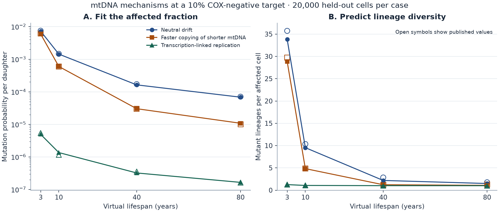
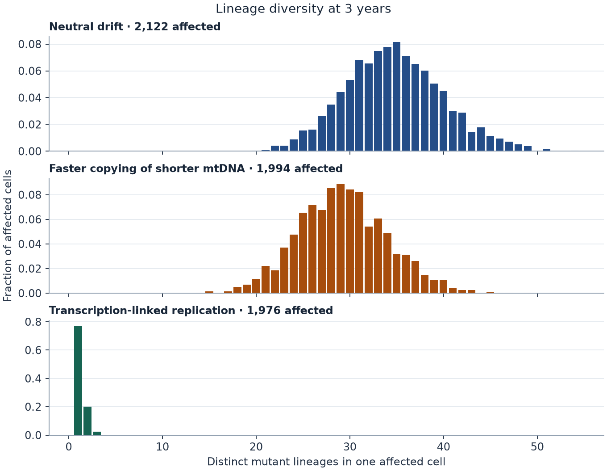

# Fitting and the comparison

Part of [tutorial S3](S3-mtdna-mechanisms.md).

Both papers ran 1,000 cells per lifespan and adjusted the mutation rate
until 10 ± 0.5% of them were COX-negative at the end. A year has 360 days,
so the lifespans of 3, 10, 40 and 80 years are 25,920, 86,400, 345,600 and
691,200 hours. Then they reported
the number of types in the affected cells. This page does the same with a
fit on one set of cells and the reported numbers from a second,
independent set, so that the fitted rate is not judged on the cells it
was fitted to.

## The protocol

Applies: [chapter 8, Reproducing a published simulation](../../guide/08-reproducibility.md#reproducing-a-published-simulation).

Everything below is fixed in `examples/kk14/campaign.py` and recorded in
`results/reconstruction/manifest.json` (seed 20261121, tier `full`):

- **Target**: 10% COX-negative cells, inclusive 60% threshold. A
  prevalence interval is called *within* the band if it lies inside
  9.5–10.5%, *compatible* if it intersects the band, and *outside*
  otherwise.
- **Fit**, for each of the 12 mechanism–lifespan cases (and the 2-day
  sensitivity case): start from a bracket around the published rate,
  halve or double it until 400-cell runs at the two ends enclose 10%,
  run 1,600 cells at a logistic interpolation, 1,600 cells each at 1/1.2
  and 1.2 times the resulting rate, and 4,800 cells at the local
  interpolation. The final rate inverts a logistic regression of the
  affected fraction on `log10(p)` through the local and confirmation
  points at 10%; its 95% interval comes from the regression (delta
  method). Only the affected fraction enters
  the fit, never a lineage count.
- **Separation**: the runner fits all 13 rates and writes `rates.csv`
  before it simulates any validation cell. Every batch of cells has its
  own seed base, a hash of the run seed, the sampler code, the full
  configuration (including the fitted rate) and the phase name, so fit
  cells and validation cells come from different streams.
- **Validation**: 20,000 new cells per case at the frozen rate, and a
  1,000-cell repeat at the papers' sample size. Prevalence gets a 95%
  Wilson interval; lineage means get a 95% percentile bootstrap interval
  (1,999 resamples of whole cells).
- **Decision rule for the main question**: the three-year transcription
  interval must lie below both other intervals, and all three three-year
  prevalence intervals must be compatible with the band. The manifest
  records the outcome, `separated`.

## Results



Solid symbols are this reconstruction; open symbols are values read from
PNAS Figure 3. Panel B shows mutant lineages; for drift the open symbols
are the 2013 counts, which include the wild type.
[Published figure](https://pmc.ncbi.nlm.nih.gov/articles/PMC3939916/figure/fig03/)

The validation cohorts (the table is generated from
`results/reconstruction/comparison.csv` and checked by
`validation/check_kk14.py`):

<!-- kk14-comparison -->
| Age | Mechanism | Affected / cells | Prevalence (95% Wilson) | Mutant lineages (95% bootstrap) | Target band |
| ---: | --- | ---: | --- | --- | --- |
| 3 y | Neutral drift | 2122 / 20000 | 10.61% (10.19–11.04%) | 34.72 (34.51–34.93) | compatible |
| 3 y | Faster copying of shorter mtDNA | 1994 / 20000 | 9.97% (9.56–10.39%) | 29.30 (29.11–29.51) | within |
| 3 y | Transcription-linked replication | 1976 / 20000 | 9.88% (9.47–10.30%) | 1.26 (1.24–1.28) | compatible |
| 10 y | Neutral drift | 1953 / 20000 | 9.77% (9.36–10.18%) | 9.46 (9.35–9.57) | compatible |
| 10 y | Faster copying of shorter mtDNA | 1831 / 20000 | 9.16% (8.76–9.56%) | 4.92 (4.84–5.01) | compatible |
| 10 y | Transcription-linked replication | 2049 / 20000 | 10.24% (9.83–10.67%) | 1.07 (1.06–1.08) | compatible |
| 40 y | Neutral drift | 1945 / 20000 | 9.72% (9.32–10.14%) | 2.21 (2.16–2.25) | compatible |
| 40 y | Faster copying of shorter mtDNA | 2125 / 20000 | 10.62% (10.21–11.06%) | 1.26 (1.24–1.28) | compatible |
| 40 y | Transcription-linked replication | 1966 / 20000 | 9.83% (9.43–10.25%) | 1.01 (1.01–1.01) | compatible |
| 80 y | Neutral drift | 1935 / 20000 | 9.68% (9.27–10.09%) | 1.50 (1.47–1.53) | compatible |
| 80 y | Faster copying of shorter mtDNA | 2009 / 20000 | 10.04% (9.64–10.47%) | 1.10 (1.08–1.11) | within |
| 80 y | Transcription-linked replication | 1985 / 20000 | 9.93% (9.52–10.35%) | 1.01 (1.00–1.01) | within |
<!-- /kk14-comparison -->

How to read the prevalence column:

- All 12 intervals intersect 9.5–10.5%, and three lie inside it (size
  advantage at 3 and 80 years, transcription at 80 years). So the data are
  compatible with the band everywhere but confirm it only for those three.
  9 of the 12 point estimates lie in the band. The exceptions are drift at
  3 years (10.61%, interval from 10.19%), the size advantage at 10 years
  (9.16%, interval up to 9.56%) and at 40 years (10.62%, interval from
  10.21%); exact binomial tests against 10% give p = 0.004, 0.00006 and
  0.003. These misses come from the fits, not from the validation cells:
  the 95% intervals of the fitted rates in `rates.csv` are ±1.5% to ±7% of
  the rate at three years and up to ±14% at 10 and 40 years.
- At the papers' sample size the criterion is much weaker than it looks.
  With 1,000 cells at 10% the binomial standard error is 0.95 percentage
  points, so a ±0.5-point band is narrower than one standard error. The
  1,000-cell repeats at the fitted rates gave 84, 96, 92 (3 y), 95, 113,
  123 (10 y), 90, 105, 102 (40 y) and 108, 110, 100 (80 y) affected cells,
  in the order drift, size, transcription. Seven of the twelve, 84, 92,
  113, 123, 90, 108 and 110, are outside 95–105 although the rates are the
  same as above.

How to read the lineage column: at three years the transcription
interval (1.24–1.28) lies far below drift (34.5–34.9) and size advantage
(29.1–29.5), so the decision rule gives `separated`. 77% of the affected
transcription cells hold a single mutant lineage, 20% two, and none more
than four, while drift and size cells hold between 14 and 54.



Under the transcription mechanism almost every affected cell is a cell
whose ATP ran out: 1,904 of the 1,976 at three years, and 2,031, 1,959
and 1,983 of the affected cells at 10, 40 and 80 years. Such a cell keeps
zero ATP and its wild-type and mutant counts for the rest of the
simulation, and at the end of the lifespan it is classified and its
lineages are counted like those of any other cell, as an author of the
papers confirmed (personal communication, November 2026). Only 72 of the
18,096 three-year cells that kept their ATP are affected (0.40%), with
1.03 lineages each
([choices](S3c-mtdna-mechanisms-limits.md#reconstruction-choices)).

An extension in [tutorial S4c](S4c-mtdna-spread-de-novo-results.md) applies
this protocol to a fourth mechanism, stochastic survival of the densest in
a spatial chain, with de novo deletions added: at 3 years an affected
region of that model holds about 1,460 mutant types.

## Comparison with the published values

`results/reconstruction/reference-differences.csv` compares the
reconstruction with 42 published values: 23 read from PNAS Figure 3 and
the 1.26 printed in its text, 9 read from Figures 6 and 7 of the size
paper and the 1.16 printed in its text, and the 8 values of the 2013
Table 1 at 10% (as transcribed in tutorial S2). Values read from a figure carry an interval of ±2 pixels; a printed
value is exact to its last digit. Neither includes the papers' own
sampling error, which they do not report: a published mean of types rests
on about 100 affected cells, and a published rate on a ±0.5-point band at
1,000 cells.

Most values agree within a few percent. These do not, judged by the two
intervals (a printed value is taken as exact to half its last digit):

| Published value | Published | Reconstruction | Difference |
| --- | ---: | ---: | ---: |
| PNAS Fig 3A, transcription, 10 y, rate | 1.16e-6 (1.08–1.25) | 1.42e-6 (1.25–1.61) | +22% |
| Size paper Fig 6A, size, 80 y, rate | 1.00e-5 (0.96–1.04) | 1.13e-5 (1.06–1.22) | +13% |
| Size paper Fig 7A, 2-day half-life, 3 y, rate | 1.79e-5 (1.74–1.85) | 1.46e-5 (1.37–1.55) | −19% |
| Size paper Fig 6B, size, 3 y, types | 29.8 (29.7–30.0) | 29.30 (29.11–29.51) | −1.8% |
| 2013 Table 1, drift, 80 y, types with wild type | 1.75 | 1.81 (1.78–1.85) | +3.7% |
| Size paper Fig 7B, 2-day half-life, types | 1.16 | 1.117 (1.102–1.134) | −3.7% |

Against PNAS Figure 3 itself, every interval of the reconstruction
overlaps the reading interval except for the 10-year transcription rate. At three years the
reconstruction is close to every published value: rates differ by +0.8%
(drift), −1.4% (size) and −5.6% (transcription), lineage counts by 0.0%
(drift, with the wild type), −1.5% (size) and 0.0% (transcription,
1.26 printed). At 10 to 80 years the other rates differ by −9% to +12%
and the lineage counts by −13% to +4%; there the fitted rates have 95%
intervals of ±4% to ±14%, so differences of that size are within the
fit's own uncertainty.

The same quantity can appear in two sources. The PNAS figure takes its
drift and size values from the two earlier papers, and the readings agree
with them: 35.7 and 29.7 at three years against the printed 35.7 of the
2013 table and the 29.8 read from the size paper's Figure 6B. At 40 and 80
years the markers of PNAS Figure 3B overlap, so those readings are
coarse: the 80-year size-advantage marker reads 1.26 (1.01–1.52), the
size paper's own bar 1.12, the reconstruction 1.10. The drift rows depend
on the counting convention: with mutant lineages only, every drift count
would be about one lower at three years. The 2013 drift model uses the
same 360-day year; it differs from this one in its strict 60% threshold
([choices](S3c-mtdna-mechanisms-limits.md#reconstruction-choices)).

None of these differences changes the comparison between the mechanisms:
at three years the transcription mechanism gives about one lineage and the
two others about 30.

## Rerunning the study

```sh
python examples/kk14/study.py compare --size full --ages 3 10 40 80 --threads 8 --resume --seed 20261121
python examples/kk14/study.py figures --results examples/kk14/results/full
python validation/check_kk14.py --output kk14-validation.json
```

The full tier writes its tables and figures to
`examples/kk14/results/full/`; the saved tables under
`results/reconstruction/` are copies of that output. With one thread on a
two-core Intel x86-64 host shared with another job it took 2 hours 19
minutes (136 minutes of sampling); thread count does not change the
result, and `--resume` continues an interrupted run from its saved
batches. The `draft` tier (`--size draft`) runs the same steps with 240
and 800 calibration cells, no local refinement and 1,000 validation
cells.

The draft run came first (seed 20261120), on a 365-day year. Its fits
were not precise enough: 4 of its 24 primary rows have prevalence
intervals outside the band (10-year size advantage, validation, 133 of
1,000; and the 1,000-cell repeats of 40-year size advantage, 127; 40-year
transcription, 129; 80-year drift, 134). The full tier, with its local
refinement and confirmation points and a new seed, was set up after that
run. The draft results are kept in `results/reconstruction/draft-*.csv`
and `draft-manifest.json` as the record of that run; the band rule is the
same in both tiers, and a rerun of `--size draft` uses the 360-day year.

Next: [Choices, checks and limits](S3c-mtdna-mechanisms-limits.md).
