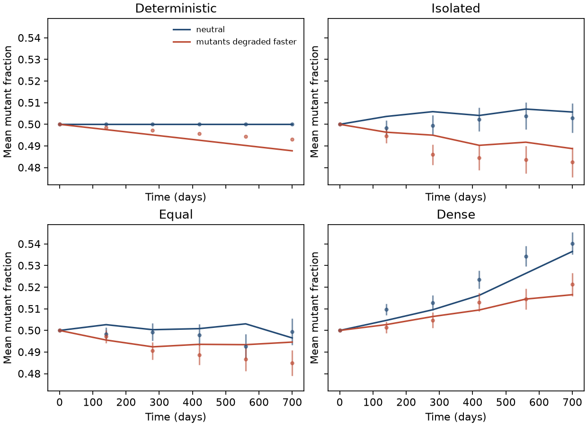
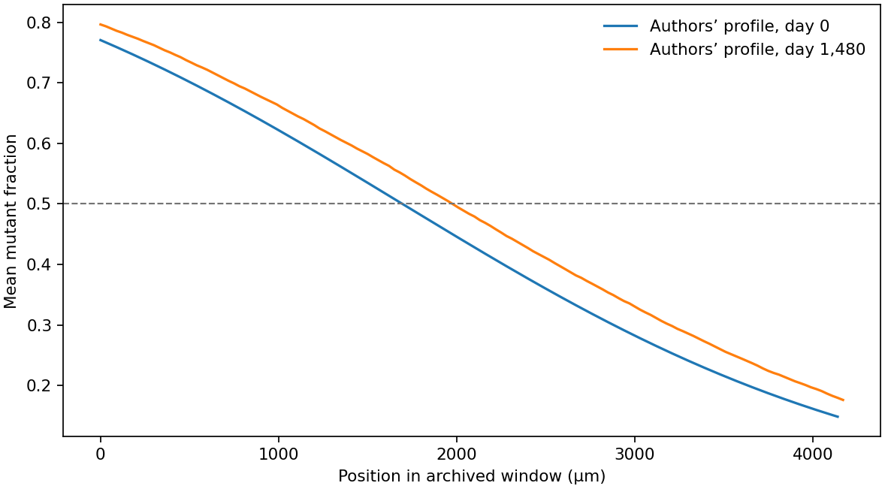
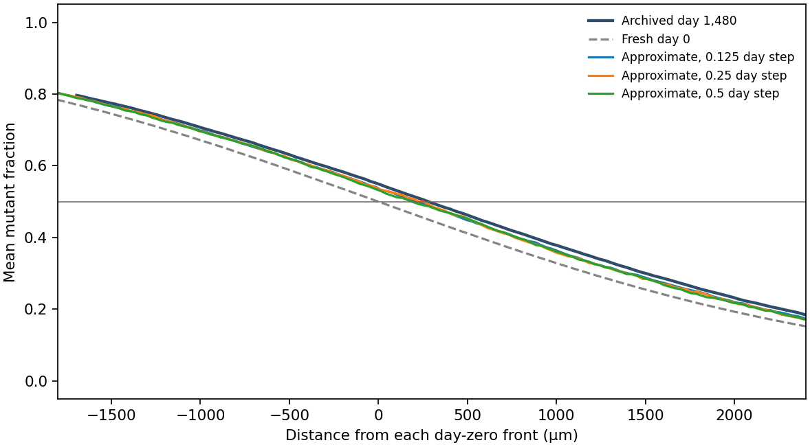

# S4. Case study of spatial spread of mtDNA deletions

## What this chapter reproduces

[Tutorial O2](../optimization/O2-mtdna-inference.md) follows the takeover of a single cell. A
skeletal muscle fiber is long and holds many local populations of
mitochondrial DNA (mtDNA), each around its own nucleus. In aged fibers,
regions full of one deletion mutant grow along the fiber. A 2022 paper asks
whether such a mutant can spread even when it replicates no faster than the
wild type:

> Insalata F., Hoitzing H., Aryaman J., Jones N.S. (2022). Stochastic
> survival of the densest and mitochondrial DNA clonal expansion in aging.
> *PNAS* 119(49), e2122073119.
> [doi:10.1073/pnas.2122073119](https://doi.org/10.1073/pnas.2122073119)
> (Figures 1C, 2B and 2E)

The authors published their simulation outputs by figure, in a repository
at revision
[45462390](https://github.com/ferdinando17/Survival-of-the-Densest/tree/45462390b4c27cf2ffe4860c4f526e67d49ad6c8).
This chapter reads those files, simulates the model again, and compares.
The paper's authors did not write or review this chapter. The published
supplement could not be opened for this review; the model details come from
the paper, the headers of the archived files and the supplement of the
first preprint ([arXiv:2009.00403](https://arxiv.org/abs/2009.00403)).

The paper's model has no de novo mutations. Its reactions are birth, death
and hopping of wild-type and mutant copies; no reaction makes a new mutant.
Every simulation starts with mutants already present and follows their
spread: the two-region runs of Figure 1C start both regions at a mutant
fraction of 0.5, the wave of Figure 2E starts from a sigmoid front, and the
founder simulations behind the paper's Figure 4 start from one mutant copy
(described in the supplement of the preprint as having "no additional
mutational events"). The paper
states that it focuses on "the mechanism by which a preexisting mutation
reaches high heteroplasmy through clonal expansion". Its estimate of a de
novo mutation rate for human fibers (4.1 · 10⁻⁸ to 1.6 · 10⁻⁶ per
replication) is derived from the founder's takeover probability, not from
simulations in which mutations keep arising, and the paper does not count
mutant types. [Pages 19b and 19c](S4b-mtdna-spread-de-novo.md) add de novo
deletions to the model and count the types; they are an extension made in
this guide, not a result of the paper. At 3 years an affected region then
holds well over a thousand mutant types, with or without the density
difference, about 820 at 10 years and about 110 at 80 years, at deletion
rates far above the paper's estimate; at 40 years the calibration failed.

The result in three lines:

- Figure 1C, two connected regions: fresh runs with 2,000 paths per
  condition reproduce all three neutral day-700 means within simultaneous
  99% intervals, and the denser mutant gains 0.040 in mean mutant fraction.
- Figure 2E, the wave: the authors' two archived profiles give
  0.18973 µm/day. Every approximate cohort, from four step sizes and two
  copy numbers, gives 0.126 to 0.163 µm/day, and every 99% interval
  excludes 0.18973. This is an **unresolved discrepancy**.
- Most fresh wave runs use an approximate time-stepping scheme. A pilot of
  eight exact fibers gives 0.160 µm/day with a 99% interval of 0.064 to
  0.199: with eight fibers this is **inconclusive**. The exact 800-fiber
  run (about 5 CPU-minutes per fiber with the local sampler) is
  outstanding. Copy number, boundaries, the birth-rate clipping and the
  step size were tested as causes and do not explain the gap
  ([limits](S4a-mtdna-spread-limits.md)).

## The model

Each region `i` holds `W_i` wild-type and `M_i` mutant copies. Every copy
dies at rate `mu` per day. Every copy of either type is copied at the same
per-copy rate
`lambda_i = max(0, mu + c * (Nss - W_i - delta * M_i))`,
so the region settles where `W_i + delta * M_i = Nss`. With `delta < 1` a
region of mutants holds `Nss / delta` copies, more than a region of wild
types: the mutant is denser, not faster. Each copy hops to each neighbor at
rate `gamma` per day (a central copy leaves at `2 * gamma` in total). A
hop is one reaction per genotype and directed edge, so it removes a copy at
the source and adds it at the destination. Here is that reaction alone.

```python
import crn_craft as crn

model = crn.Model("one_hop")
model.add_species({"M0": 1, "M1": 0})
model.add_reaction(0.2, ["M0"], ["M1"], name="hop")
run = crn.ensemble(model, end=10, report_times=[0, 10], method="static_direct")
mean = run.simulate().statistics["mean"]
print(mean[["M0", "M1"]].sum(axis=1).astype(int).tolist())
```

```text
[1, 1]
```

| Symbol | Figure 1C | Figure 2E | Source |
| --- | --- | --- | --- |
| `mu` | 0.07/day | 0.07/day | paper, archive code |
| `c` | 0.001/day | 0.0002/day | choice (value in the archived C code); Fig. 2 caption |
| `Nss` | 150 copies | 3,500 copies | choice, matched to the archived spread; Fig. 2 caption |
| `delta` | 0.5 (1 for equal density) | 0.2 | archive file headers; Fig. 2 caption |
| `gamma` | 0.035/day (0 isolated) | 0.1/day | archive file headers; Fig. 2 caption |
| extra mutant death | 0.00007/day | none | header: 0.001 of `mu` |
| regions, spacing | 1 or 2 | 500, 30 µm | preprint supplement |

The mutant fraction of a region is `h_i = M_i / (W_i + M_i)`. As in the
archive, it is computed in each path and region first, then averaged over
regions and paths with equal weight. No region became empty in the
Figure 1C runs.

## Figure 1C: two connected regions

Each stochastic condition starts both regions at `h = 0.5` on their steady
state (100 + 100 copies for `delta = 0.5`, 75 + 75 for `delta = 1`) and runs
2,000 paths for 700 days. The deterministic control has a closed form:
with equal per-copy birth rates, `M / W` decays as `exp(-0.00007 t)`.

Rules fixed in the plan before the runs: compare the three neutral
day-700 means with the archive using simultaneous 99% intervals
(Bonferroni over four comparisons); require a positive contrast between
higher and equal mutant density. The archive gives one standard error per
region but not their covariance, so the archived error of the
two-region mean is bounded above by the average of the two regional
errors.

<!-- mtdna-spread-1c -->
| Condition at day 700 | Archived mean | Fresh mean | Fresh minus archive | Simultaneous 99% interval |
| --- | ---: | ---: | ---: | ---: |
| Isolated, neutral | 0.50300 | 0.50570 | +0.00269 | -0.02653 to +0.03192 |
| Equal density, neutral | 0.49944 | 0.49654 | -0.00290 | -0.02863 to +0.02283 |
| Higher mutant density, neutral | 0.54026 | 0.53652 | -0.00374 | -0.02589 to +0.01840 |
| Deterministic, mutants degraded faster | 0.49300 | 0.48775 | -0.00525 | not tested |
| Isolated, mutants degraded faster | 0.48246 | 0.48876 | +0.00630 | not tested |
| Equal density, mutants degraded faster | 0.48493 | 0.49461 | +0.00968 | not tested |
| Higher mutant density, mutants degraded faster | 0.52123 | 0.51653 | -0.00470 | not tested |
<!-- /mtdna-spread-1c -->

All three neutral intervals contain zero. This is a failure to find a
difference, and the test is coarse: it would detect only differences
larger than about 0.022 to 0.032. The higher-density mean exceeds the
equal-density mean by 0.0400, with a simultaneous lower bound of 0.0161.
That is stochastic survival of the densest: the denser mutant gains
without a replicative advantage, even when it is degraded faster.

The archived deterministic curve with faster mutant degradation falls on a
straight line, `0.5 - 0.00001 t`. The stated model gives
`1 / (1 + exp(0.00007 t))`, 0.48775 at day 700. The cause of this
difference of 0.00525 is unknown.

The figure overlays two sources in each panel:

- **Lines** are computed here: the mean mutant fraction over the 2,000
  paths of the saved draft run at days 0, 140, ..., 700, joined by straight
  segments. In the deterministic panel the line is the closed form, not a
  simulation.
- **Points** are the authors' archived curves, the data behind the paper's
  Figure 1C. Each bar is the upper bound of the archived standard error
  described above; the fresh runs carry no bars.

Blue is the neutral case, red the case with mutants degraded faster. A
point away from its line of the same color is therefore a difference
between this reconstruction and the archive, and the table gives its size
at day 700.



## Figure 2E: the traveling front

The archive holds the ensemble-mean profile at day 0 and day 1,480 over a
window of 139 and 140 regions. Find the descending crossing of 0.5 in
each, interpolating linearly between neighboring regions, and divide the
displacement by 1,480 days. The crossing moves from 1,695.52 to 1,976.33 µm,
280.80 µm in all, giving **0.18973 µm/day**. At 0.4 and 0.6 the same
profiles give 0.20354 and 0.17469 µm/day; the profile flattens as it
moves.



The archived day-0 profile is exactly the supplement's start,
`h(x) = 1 / (1 + exp(0.000715 x - 3.915))`, shifted by 3,780 µm (126
regions). The fresh chain uses that start over 500 regions, holds the
leftmost region at `h = 1` as a fixed reservoir, and sets `h < 0.005` to
zero. A diffusing copy travels about 520 µm in 1,480 days, far less than
the 5,475 µm from the front to the reservoir, so the boundaries cannot
shape the front.

The plan fixed an equivalence margin of ±0.03 µm/day around the archived
speed and a bootstrap over whole fibers. An interval inside the margin is
numerical agreement; an interval that excludes the archived speed is an
unresolved discrepancy; anything else is inconclusive.

<!-- mtdna-spread-2e -->
| Source of the profiles | Fibers | Half-height speed (µm/day) | 99% interval | Label |
| --- | ---: | ---: | ---: | --- |
| Authors' archive, days 0 and 1,480 | 800 | 0.18973 | not available | reference |
| Same chain without noise (Nss = 3,500) | none | 0.04199 | none | deterministic part |
| Approximate, 0.5-day step, Nss = 3,500 | 48 | 0.12753 | 0.10504–0.15397 | unresolved discrepancy |
| Approximate, 0.25-day step, Nss = 3,500 | 48 | 0.16271 | 0.13014–0.18822 | unresolved discrepancy |
| Approximate, 0.125-day step, Nss = 3,500 | 96 | 0.14617 | 0.13016–0.16360 | unresolved discrepancy |
| Approximate, 0.0625-day step, Nss = 3,500 | 32 | 0.14921 | 0.12571–0.17367 | unresolved discrepancy |
| Approximate, 0.5-day step, Nss = 3,500, second cohort | 32 | 0.12579 | 0.09678–0.15338 | unresolved discrepancy |
| Approximate, 0.125-day step, Nss = 3,000 | 96 | 0.14293 | 0.12424–0.16245 | unresolved discrepancy |
| Exact (local sampler), Nss = 3,500, pilot | 8 | 0.15951 | 0.06445–0.19865 | inconclusive |
<!-- /mtdna-spread-2e -->

The approximate rows come from the scheme of `wave.py`. The last row
comes from eight exact fibers of the local sampler (`spatial_turnover`),
fibers 0 to 7 of the 800-fiber design, with the same estimator: the
three-bin smoother and 700 whole-fiber resamples. Its interval contains
the archived speed and is wider than the ±0.03 µm/day margin, so eight
fibers cannot decide between the approximate cohorts and the archive.
Averaged over the whole profile, the eight exact fibers gain
0.148 µm/day (99% interval 0.097 to 0.198, t with 7 degrees of
freedom), close to the approximate cohorts' 0.128 to 0.141. The
two 0.5-day cohorts agree (0.128 and 0.126). Averaged
over the whole profile, the step effect between 0.5 and 0.0625 days is
−0.013 µm/day (99% interval −0.027 to +0.000). The last three rows are review runs; the limits page
gives their targets, which were fixed before the runs. Even without noise
the chain moves its half-height crossing by 0.042 µm/day: mutant copies
diffuse out of the denser region. Noise adds the rest.



The paper also fits the lengths of abnormal fiber regions against age in
rhesus monkeys (Figure 2B) and reports **0.131 ± 0.025 µm/day** from that
linear fit. The paper does not say whether ± is a standard error. That
number is an observation, not a simulation, and nothing here is fitted to
it. The paper reports its simulated speed as about 0.2 µm/day.

## Running the example

| Size | Command | What it does | Time on one core |
| --- | --- | --- | --- |
| quick | `python examples/mtdna_spread/study.py --size quick` | 128 two-region paths, short chain, archived crossings | 2 s |
| draft | `python examples/mtdna_spread/study.py --size draft` | Figure 1C with 2,000 paths per condition | 1 min |
| wave | `python examples/mtdna_spread/wave.py --fibers 96 --step 0.125` | approximate fiber cohort | 7 to 12 min |
| full | `python examples/mtdna_spread/study.py --source-chain --wave-sampler local --fibers 800 --threads N` | exact fibers, checkpointed | about 55 to 65 CPU-hours (estimate) |

A run writes tables, not figures. Drawing is a second command, and it
reads the tables saved in `examples/mtdna_spread/results` unless
`--output` names the folder of a run:

```sh
# the figures of this page, from the saved tables
python examples/mtdna_spread/study.py --figures examples/mtdna_spread/runs/figures

# the same figures from a run of your own
python examples/mtdna_spread/study.py --size draft --output examples/mtdna_spread/runs/draft
python examples/mtdna_spread/study.py --figures examples/mtdna_spread/runs/figures --output examples/mtdna_spread/runs/draft
```

`python validation/check_mtdna_spread.py` checks the laws, the archive
reader and the tables of this page. The
[example README](../../../examples/mtdna_spread/README.md) lists the files.

[Choices, checks and limits](S4a-mtdna-spread-limits.md) lists every
reconstruction choice and the review experiments.
[De novo deletions and mutant types](S4b-mtdna-spread-de-novo.md) and
[its results](S4c-mtdna-spread-de-novo-results.md) are the extension of this
guide described above.
[Tutorial S5](S5-mtdna-network.md) uses the same mutant fraction to measure
how different cells become over time.
