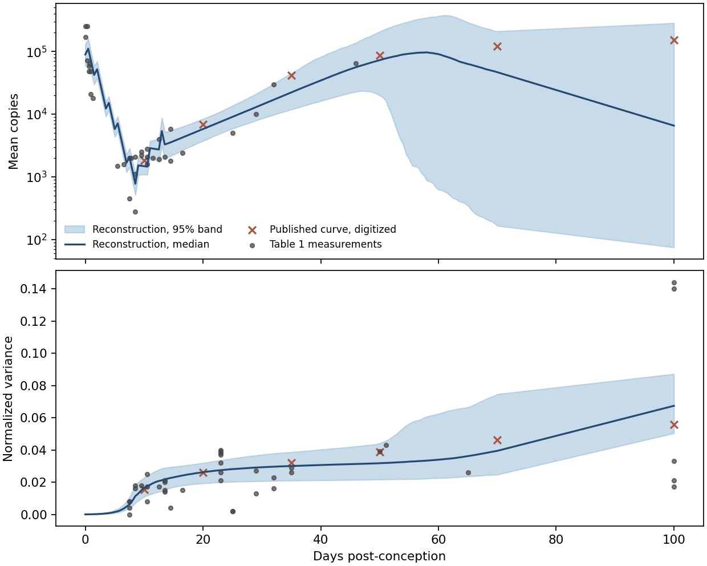

# Results

All numbers on this page come from the stored files in
`examples/mtdna_bottleneck/results/`. `validation/check_mtdna_bottleneck.py`
regenerates the tables and lists from those files and fails if the page
differs.

## In numbers

<!-- mtdna-bottleneck-headline -->
- Run: 4 ensembles x 16 walkers x 360,000 sweeps = 23,040,000 proposals; acceptance 5.68% to 9.95%; largest stored distance 39.99999.
- Effective size: sum over ensembles of the smallest of eight monitored observables, 1,191 (target 1,000).
- Figure 3: all 12 of 12 digitized central values inside the reconstructed 95% bands; median absolute difference 0.424 in natural-log copies and 0.00455 in V'(h).
- Figure 3 discrepancy: at 100 dpc the reconstructed median is 6,562 copies against 151,572 digitized (log ratio -3.14); reconstructed medians outside the digitized outer envelope: 1 of 12.
- HB groups: 12 of 15 inside their group-sized 95% bands; 3 of 5 for the two flagged litters; 7 of 15 inside the population band.
- First-order V'(h) against exact lineages: median relative error 0.60%, largest 3.4%; 27 of 28 draws stay below 40, all 28 within two Monte Carlo errors.
- Division timing: with the rounded labels 0.29, 0.58 and 0.88 dpc only 49.5% of 20,000 stored states stay below 40.
- Ensemble agreement: largest R-hat 1.29 over parameters and 1.08 over the monitored observables.
<!-- /mtdna-bottleneck-headline -->

## Figure 3: copy number and normalized variance

The dots are the Table 1 measurements. The crosses are the published
central curve, read from the figure. The shaded region is the 95% range
of the population statistic over 6,400 accepted parameter sets (1,600
drawn from each ensemble). It is not a range for individual
measurements. The figure caption of the paper says the same of its own
band.

The published curve and its two shaded envelopes were read from a
1,000-pixel render of Figure 3 (`digitize.py`). The axis calibration is
written into that script. The only uncertainty recorded is ±3 pixels on
each central value. The paper does not say which posterior ranges its
two envelopes show.

<!-- mtdna-bottleneck-figure3 -->
| Day | Observable | Digitized center | Digitized outer envelope | Reconstructed median | Reconstructed 95% band |
|---:|---|---:|---:|---:|---:|
| 10 | copies | 1,829 | 1,405 to 2,668 | 1,483 | 1,096 to 1,885 |
| 20 | copies | 6,856 | 3,475 to 11,199 | 5,779 | 3,743 to 8,395 |
| 35 | copies | 41,971 | 10,385 to 116,298 | 22,176 | 11,860 to 44,838 |
| 50 | copies | 85,986 | 18,293 to 220,934 | 72,504 | 19,942 to 207,114 |
| 70 | copies | 120,772 | 28,775 to 310,315 | 46,586 | 166 to 209,496 |
| 100 | copies | 151,572 | 29,730 to 406,992 | 6,562 | 75 to 282,709 |
| 10 | V'(h) | 0.0156 | 0.0101 to 0.0232 | 0.0164 | 0.0109 to 0.0228 |
| 20 | V'(h) | 0.0259 | 0.0181 to 0.0337 | 0.0262 | 0.0192 to 0.0319 |
| 35 | V'(h) | 0.0322 | 0.0223 to 0.0434 | 0.0300 | 0.0210 to 0.0387 |
| 50 | V'(h) | 0.0387 | 0.0265 to 0.0547 | 0.0318 | 0.0216 to 0.0441 |
| 70 | V'(h) | 0.0463 | 0.0333 to 0.0648 | 0.0394 | 0.0247 to 0.0746 |
| 100 | V'(h) | 0.0559 | 0.0394 to 0.0766 | 0.0673 | 0.0503 to 0.0871 |
<!-- /mtdna-bottleneck-figure3 -->

### How to read the agreement

The plan asked how often the published central value falls inside the
reconstructed 95% band. All 12 do, but at 70 and 100 dpc that test cannot
fail. There, the reconstructed copy-number band is about 3 times
wider in log units than the published outer envelope. From 10 to 50 dpc
it is 0.55 to 0.94 times as wide. The stricter reverse test asks whether
each reconstructed median lies inside the published outer envelope. It
fails once: copy number at 100 dpc. That case is an **unresolved
discrepancy**. Table 1 has no copy-number measurement after 46 dpc, and
the fit lets the late phases lower the copy number to raise `V'` toward
the large mature-egg values (up to 0.144). The paper's narrower band at
100 dpc may come from a constraint this reconstruction lacks; the review
could not find one in the paper. Up to 50 dpc the result is
**numerical agreement** within the published envelopes.

## How good is the first-order variance

The distance uses the first-order `V'`. The review drew 24 accepted
parameter sets at random, plus the 4 with the lowest copy number at
100 dpc. It simulated 20,000 exact lineages for each: per phase the exact
birth–death law for every founder copy, and the binomial draw at every
division (`review.py`, `results/review-vprime.csv`). The copy-number
minimum lies at 8.5 dpc for all 28 sets, with 481 to 1,200 copies on
average. No lineage died out there. The largest errors occur at 100 dpc
in the sets with about 20 copies, where 6% of lineages have lost or fixed
the mutant. The headline list gives the counts. The approximation does
not change which draws are accepted beyond the Monte Carlo error of the
check. One draw, at distance 39.994, crosses the threshold by 0.006,
far less than one Monte Carlo standard error (0.21).

## The independent mouse groups

`*` marks the two litters flagged in the manifest. The population band is
the 95% posterior range of the population `V'`. The group-sized band adds
the sampling spread of that many cells. Only the group-sized band is a
fair test for a single group.

<!-- mtdna-bottleneck-hb -->
| Group | Litter | Day | Cells | Observed V'(h) | Population band | Group-sized band | Inside |
|---:|---:|---:|---:|---:|---:|---:|---|
| 1 | 1551 | 24 | 25 | 0.0102 | 0.0201 to 0.0341 | 0.0140 to 0.0455 | no |
| 2 | 1425 | 24 | 30 | 0.0147 | 0.0201 to 0.0341 | 0.0145 to 0.0444 | yes |
| 3 | 1424* | 25 | 21 | 0.0551 | 0.0202 to 0.0347 | 0.0126 to 0.0473 | no |
| 4 | 1424* | 25 | 13 | 0.0585 | 0.0202 to 0.0347 | 0.0103 to 0.0567 | no |
| 5 | 1554 | 25 | 13 | 0.0387 | 0.0202 to 0.0347 | 0.0095 to 0.0571 | yes |
| 6 | 1554 | 25 | 11 | 0.0202 | 0.0202 to 0.0347 | 0.0086 to 0.0549 | yes |
| 7 | 1424* | 29 | 30 | 0.0167 | 0.0206 to 0.0366 | 0.0150 to 0.0505 | yes |
| 8 | 1424* | 29 | 34 | 0.0256 | 0.0206 to 0.0366 | 0.0159 to 0.0460 | yes |
| 9 | 1550 | 30 | 20 | 0.0262 | 0.0207 to 0.0370 | 0.0132 to 0.0561 | yes |
| 10 | 1550 | 30 | 17 | 0.0163 | 0.0207 to 0.0370 | 0.0127 to 0.0570 | yes |
| 11 | 1550 | 30 | 36 | 0.0210 | 0.0207 to 0.0370 | 0.0156 to 0.0471 | yes |
| 12 | 1197 | 45 | 25 | 0.0252 | 0.0214 to 0.0419 | 0.0151 to 0.0585 | yes |
| 13 | 1403 | 58 | 24 | 0.0407 | 0.0222 to 0.0607 | 0.0159 to 0.0715 | yes |
| 14 | 1406* | 58 | 20 | 0.0457 | 0.0222 to 0.0607 | 0.0148 to 0.0722 | yes |
| 15 | 1422 | 61 | 20 | 0.0364 | 0.0226 to 0.0634 | 0.0153 to 0.0674 | yes |
<!-- /mtdna-bottleneck-hb -->

Two groups of litter 1424 at 25 dpc have twice the predicted variance.
Group 1 has less than predicted. The sample band depends on a founder law
fitted to two moments, not on the exact six-phase law. That band starts
from the group's own observed mean. This conditioning matters little,
because `V'` does not depend on the mean to first order. Together with
the missing transformation and split of the paper, this makes the
comparison a **new validation**, not a reproduction of Figure 4D.

## Sampler diagnostics

`results/abc.csv` holds acceptance, distances and effective sizes per
ensemble. `results/review-ensembles.csv` adds, per ensemble, the 2.5%,
50% and 97.5% quantiles of each free parameter and of the eight monitored
observables, and a rank-normalized R-hat that treats each walker as a
chain. Medians of the monitored observables agree across ensembles. The
tails of weakly identified parameters do not. They include the growth
rates of phases 4 and 5 and the lengths of the quiescent phases. The
review declared R-hat below 1.05 as the bound before computing it; the
parameters exceed it, so the **ensembles disagree** on those tails. The
summed effective size of 1,191 refers to the eight observables only. If
the minimum is taken after summing over ensembles, it is 1,376.

## Final-phase degradation

The appendix fixes replication in phase 6 to zero, and its prior covers
degradation in every phase. The stored run also fixes the phase-6
degradation at zero. The sensitivity run frees it (`--free-final-degradation`, same seeds and size):

<!-- mtdna-bottleneck-phase6 -->
| Phase-six degradation | Acceptance | Effective size | MAD log copies | MAD V'(h) | Copies at 100 dpc, median (95%) | HB inside |
|---|---:|---:|---:|---:|---:|---:|
| fixed at 0 | 5.7% to 9.9% | 1191 | 0.424 | 0.00455 | 6,562 (75 to 282,709) | 12 of 15 |
| free on [0, 1] per hour | 9.9% to 20.0% | 1706 | 0.418 | 0.00461 | 7,096 (30 to 221,885) | 12 of 15 |
<!-- /mtdna-bottleneck-phase6 -->

The Figure 3 comparison and the group comparison barely change. In about
half of the accepted sets (more when the rate is free) phase 6 starts after 100 dpc, so the
final-phase rate is not identified by the data. The 100 dpc discrepancy
remains.
