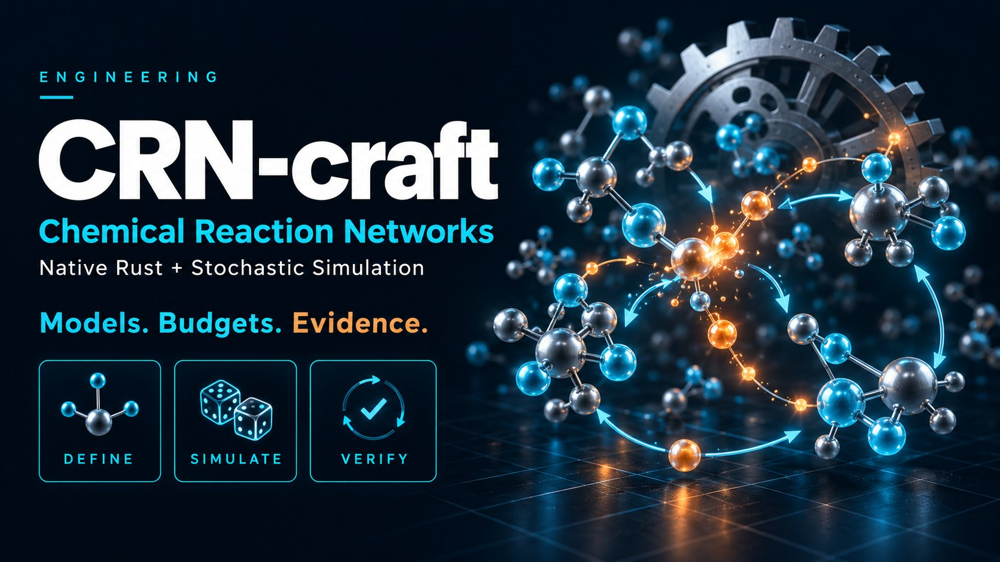

# CRN-craft



Reproducible simulation and analysis of well-mixed chemical reaction networks,
with a native Rust core. Models, requests and results are versioned JSON
documents with strict input checks, explicit budgets and replayable seeds.

```bash
pip install crn-craft
```

Wheels for CPython 3.10 and newer (stable ABI) on Linux x86_64, Windows x64
and macOS (x86_64 and arm64); other platforms build from the source
distribution with a Rust toolchain.

## Example

Immigration–death (birth rate 4, death rate 0.2, starting from zero) has a
Poisson law with mean `20 (1 - exp(-0.2 t))`: 12.64 at t = 5 and 17.29 at
t = 10. A model is built from Python calls; a number is a mass-action
constant, a string the reaction's whole propensity.

```python
import crn_craft as crn

model = crn.Model("immigration_death")
model.add_parameter("k_in", 4.0).add_species("X")
model.add_reaction("k_in", [], ["X"], name="immigration")  # string: whole propensity
model.add_reaction(0.2, ["X"], [], name="death")  # number: mass action, 0.2 X
result = crn.ensemble(
    model,
    end=10.0,
    report_times=[0.0, 5.0, 10.0],
    replicates=1000,
    seed=1,
    threads=2,
    method="static_direct",
    keep_paths="all",
).simulate()
print(result.metadata["sampler"])
print(result.statistics["mean"])
print(result.statistics["median"])
print(result.rule_events.sum().to_dict())
print(result.paths.sel(variable="X").to_pandas().head(3))  # cells x times
```

```text
chacha8-u53-ziggurat/rules-static-direct/1
           X
time        
0.0    0.000
5.0   12.623
10.0  17.305
         X
time      
0.0    0.0
5.0   12.0
10.0  17.0
{'immigration': 39800, 'death': 22495}
time       0.0   5.0   10.0
replicate                  
0           0.0  14.0  19.0
1           0.0  19.0  20.0
2           0.0  17.0  17.0
```

The means lie within one standard error of the exact 12.64 and 17.29. The same
seed gives the same result on every run and for every thread count.
`result.statistics` also holds the median and the 2.5% and 97.5% quantiles,
`result.save("run.md")` writes the model and the results to a markdown report
(`.json` writes a JSON report), and results are pandas DataFrames: per-replicate
records and rule counts, statistics by report time and trackers. Kept paths and
event logs are xarray DataArrays with the replicate first.

The same model has an exact distribution, from finite state projection, and a
structural analysis:

```python
import crn_craft as crn

model = crn.Model("immigration_death")
model.add_parameter("k_in", 4.0).add_species("X")
model.add_reaction("k_in", [], ["X"], name="immigration")
model.add_reaction(0.2, ["X"], [], name="death")
distribution = model.fsp(end=10.0, report_times=[10.0], bounds={"X": 60})
print(distribution)
print(distribution.mean)  # 17.29, the exact mean at t = 10
report = model.analyze()
print(report["schema"], report["analysis"]["conservation"]["status"])
```

```text
FspResult(61 states of X, 1 report times)
species          X
time              
10.0     17.293294
crn-craft.analysis/1.0 exact
```

## What is included

- One engine and one API. A model is a `crn-craft.model/1.0` document, a run
  request is `crn-craft.run/1.0`, and the result is `crn-craft.result/1.0`;
  the same contracts are used by the Rust crate and the `crn-craft` command.
- Exact stochastic simulation: `static_direct` with the event selectors
  `linear`, `composition_rejection`, `sorting`, `rssa_cr` and `auto`,
  `next_reaction`, and the exact `tree` method for models whose species carry
  attributes (clones, sizes, lineages).
- Explicitly approximate methods: Poisson leaping (`tau`), fixed splitting
  (`binomial`) and `hybrid` for models with continuous variables.
- Prepared runs and parameter binding for optimization loops
  (`run.bind_parameters(...)`), trackers, event logs and callbacks, and
  an opt-in compiled event loop (`crn.compile_loop`, needs a Rust toolchain).
- Exact distributions (`Model.fsp`), network analysis and conservation laws
  (`Model.analyze`), GillesPy2 export (`Model.to_gillespy2`), and strict
  SBML and BioNetGen import
  (`crn.read_sbml`, `crn.read_bngl`, `crn-craft-import`).
- Quantile statistics and the median, and `Result.save` to markdown or JSON.
- The `crn-craft` command for `check`, `run`, `verify` (sealed archives),
  `analyze`, `convert` and `export`. The native command-line tool
  (`cargo install crn-craft-cli --locked`) has the same commands.
- `pip install "crn-craft[fit]"` adds the pinned SciPy, fcmaes-rust and
  SQP-craft versions used by the fitting examples.

`crn_craft.rules` keeps the API of release 0.6.0 under its old name, with its
defaults, so code written for 0.6.0 keeps running with the same results.
Release 0.7.0 merged the earlier network engine into the one engine; the
[changelog](https://github.com/dietmarwo/CRN-craft/blob/main/CHANGELOG.md)
has the migration tables. ODE right-hand sides and Jacobians are in the Rust
crate (`crn_craft::kinetics`). The optional diffsol BDF integrator with
forward sensitivities and the job worker for
[optimization-jobs](https://github.com/dietmarwo/optimization-jobs) build from
the repository and are not part of the wheel.

## Documentation

- [Repository and README](https://github.com/dietmarwo/CRN-craft)
- [Tutorial](https://github.com/dietmarwo/CRN-craft/blob/main/docs/tutorial.md)
- [Exact methods and selectors](https://github.com/dietmarwo/CRN-craft/blob/main/docs/reference/methods.md)
- [Model reference](https://github.com/dietmarwo/CRN-craft/blob/main/docs/reference/model-language.md) and [mtDNA user manual](https://github.com/dietmarwo/CRN-craft/blob/main/docs/mtdna-user-manual.md)
- [Using CRN-craft from R](https://github.com/dietmarwo/CRN-craft/blob/main/docs/using-from-r.md) through reticulate
- [Optimization tutorials C1–C4](https://github.com/dietmarwo/CRN-craft/blob/main/tutorials/optimization/README.md)
- [Agent context](https://github.com/dietmarwo/CRN-craft/blob/main/docs/developer/ai-context.md)
- [Changelog](https://github.com/dietmarwo/CRN-craft/blob/main/CHANGELOG.md)

A successful numerical run is not biological validation. MIT licensed; see
[THIRD_PARTY_NOTICES.md](https://github.com/dietmarwo/CRN-craft/blob/main/THIRD_PARTY_NOTICES.md)
for the Ziggurat tables adapted from Julia.
