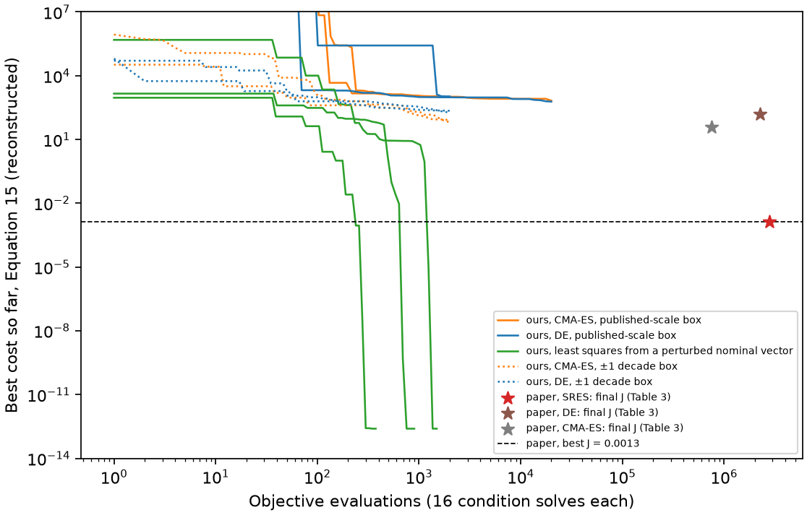
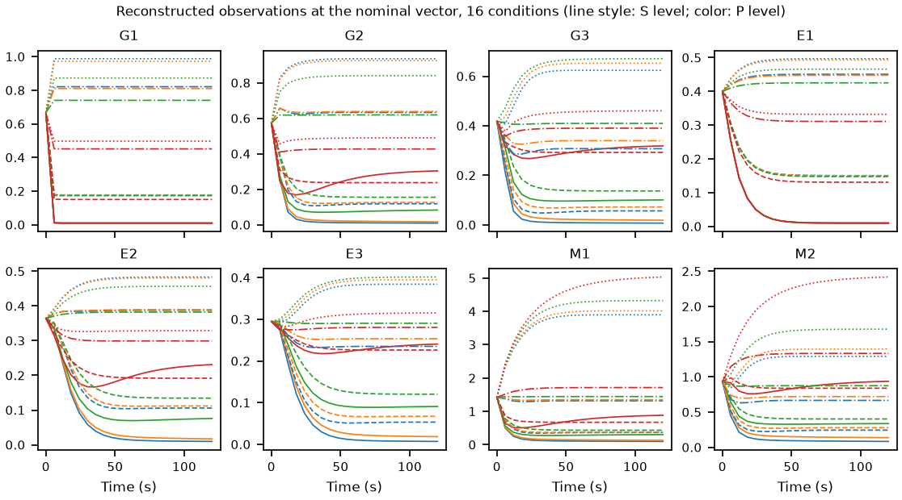

# C10 · Fit 36 kinetic parameters of a three-step pathway

Moles, Mendes and Banga fitted all 36 parameters of a model metabolic
pathway (three genes, three enzymes, two intermediate metabolites) to 16
noise-free synthetic experiments and compared seven global optimizers.
Only the evolution strategies came close to the true parameters; the best,
SRES, reached J = 0.0013 after 2.8 million evaluations
([Moles et al. 2003, Table 3](https://doi.org/10.1101/gr.1262503)). This
lesson rebuilds the problem with the native concentration solver and asks:
is the reconstructed objective right, and how far do fcmaes DE and CMA-ES get
with budgets of 2,000 and 20,000 evaluations? Code: [pathway.py](publications/pathway.py).

## What is reproduced

Nothing of the paper's numbers is reproduced. The 2003 data are not
available, so the observations are regenerated from the nominal parameters,
and the published J = 0.0013 is context for a reconstructed objective, not
a target on the same data.

| Item | Paper | Here |
| --- | --- | --- |
| Model | eight ODEs, 36 parameters | same structure; the enzyme E3 is made from transcript G3 (`--printed-equation-12` uses the printed G2 numerator) |
| Experiments | 16 combinations of S and P | S ∈ {0.1, 0.46416, 2.1544, 10} × P ∈ {0.05, 0.13572, 0.3684, 1} |
| Initial state and sampling | from the authors' data | initial state of the later reconstruction; 20 samples per state at 6, 12, …, 120 s |
| Objective | Equation 15, weighted squared residuals | each state normalized by its largest observation in its condition |
| Budget | 16,515 to 2.8 million evaluations per method | 2,000 and 20,000 (8-thread study), and local fits |

The reconstruction choices (initial state, grid, E3 numerator) follow the
later study cited in the implementation, not the 2003 paper, whose full
text could not be read in this review; the order of S and P levels and
the parameter bounds of the paper are therefore not verified here.

## Model and objective

With regulators R₁ = S, R₂ = M1, R₃ = M2 and i = 1, 2, 3:

```
dGi/dt = Vi / (1 + (P/Kii)^nii + (Kai/Ri)^nai) − ki·Gi
dEi/dt = V(i+3)·Gi / (K(i+3) + Gi) − k(i+3)·Ei
dM1/dt = v1 − v2,   dM2/dt = v2 − v3
vi     = kcati·Ei·(a − b)/Km(2i−1) / (1 + a/Km(2i−1) + b/Km(2i)),
         (a, b) = (S, M1), (M1, M2), (M2, P)
```

Nominal values: V, Ki, Ka, k of the genes 1 and Hill coefficients 2; V and
k of the enzymes 0.1, K 1; kcat and Km 1. S and P are constant inputs; all
states are concentrations. The native model writes the activation term as
`V·u/(1 + (1 + (P/Ki)^ni)·u)` with `u = (R/Ka)^na`, which is equal and
stays finite at R = 0.

The cost is `J = Σ_c Σ_s Σ_t ((y − ŷ)/max_t ŷ)²` over 16 conditions, 8
states and 20 times (2,560 residuals). A cost of 600 is a mean squared
normalized residual of 0.23, about half of each curve's scale: the fit is
qualitatively wrong. The searches work in log10 coordinates: 24 decades
(10⁻¹² to 10¹²) for 32 parameters and 0.1 to 10 for the six Hill
coefficients ("published-scale box"), or ±1 decade around the nominal
values ("±1 decade box"). A candidate whose integration fails in any
condition scores 1e50; it is recorded as failed and never preferred, but
it costs an evaluation.

## Run it

```bash
python tutorials/optimization/run.py C10 --output /tmp/c10-smoke
python tutorials/optimization/run.py C10 --preset study --evaluations 2000 --output /tmp/c10-2k
python tutorials/optimization/run.py C10 --preset study --evaluations 20000 --broad-only --retries 1 --resume-from /tmp/c10-2k --output /tmp/c10-20k
```

The smoke run (24 evaluations per search, no local fits) takes 4 to 12 s
on one thread. One evaluation solves the 16 conditions, about 0.05 s. The
study adds three least-squares fits (`--local-starts`, about 3 minutes).
The saved study used 8 threads; the 20,000 traces extend the 2,000 traces
of retry 0.

## Checks

| Check | Result |
| --- | --- |
| native trajectories against an independent LSODA solve (rtol 2e-11) at the nominal vector, all 16 conditions | 6.6e-9 maximum state error; cost 4.7e-16 |
| the same at a vector perturbed by up to 10 % | 5.6e-9 |
| reference equations against a term-by-term hand transcription (`test_c10.py`) | agree to 1e-8 |
| replay of the first 240 evaluations of the saved DE and CMA-ES runs here | identical coordinates and costs |
| least squares from the nominal vector perturbed by up to 0.3 and 1 decade | integration floor in every start (below) |

## Results



*Best cost so far per run (log axes). Blue and orange: our DE and CMA-ES
runs (solid: published-scale box; dotted: ±1 decade box). Green: our
least-squares fits from perturbed nominal vectors. Stars: final J and
evaluation count of SRES, DE and CMA-ES in the paper's Table 3 (on the
paper's data). Dashed line: J = 0.0013.*

| Search (`results/C10/runs.csv`) | Evaluations | Best proposed | Verified at tight tolerance | Failed evaluations |
| --- | ---: | ---: | ---: | ---: |
| DE, published-scale box | 2,000 | 959.68 / 1,055.83 | 959.68 / none | 498 / 650 |
| CMA-ES, published-scale box | 2,000 | 1,021.40 / 997.92 | 1,021.40 / 997.92 | 476 / 543 |
| DE, ±1 decade box | 2,000 | 222.76 / 183.42 | 222.76 / 183.42 | 0 / 0 |
| CMA-ES, ±1 decade box | 2,000 | 75.72 / 62.15 | 75.72 / 62.15 | 1 / 0 |
| DE, published-scale box | 20,000 | 601.92 | 959.68 (from evaluation 1,986) | 2,612 |
| CMA-ES, published-scale box | 20,000 | 667.47 | 667.47 | 539 |
| least squares, start ±0.3 decade (cost 915) | 375 | 2.5e-13 | | |
| least squares, start ±1 decade (cost 1,432) | 898 | 2.5e-13 | | |
| least squares, start ±1 decade (cost 482,000) | 1,494 | 2.5e-13 | | |
| paper, SRES | 2,800,000 | 0.0013 | | |
| paper, CMA-ES | 756,135 | 37.881 | | |
| paper, DE | 2,250,000 | 151.779 | | |

Two values per cell are the two retries. "Verified" rescores the best
distinct candidates at tighter tolerance; for DE at 20,000 all 24 best
candidates failed that integration ("step size is too small"), so its
verified value falls back to the incumbent at evaluation 1,986, and one DE
retry at 2,000 has no verifiable candidate. The 2.5e-13 floor of the
least-squares fits is the integration error at the search tolerance
(rtol 2e-8); their largest log10 parameter error is 1.4e-7.

**What the numbers say.** Our best global result, 62.15 (CMA-ES, ±1
decade box, 2,000 evaluations), is 4.8 × 10⁴ times the published 0.0013;
in the published-scale box the best verified value, 667.47, is 5 × 10⁵
times larger. The objective is not the cause: a bounded least-squares fit
reaches the integration floor from every start tried, including one 1
decade from the truth in every coordinate with a starting cost of 482,000,
within 1,494 evaluations. The global searches are short of budget. The
paper's own DE and CMA-ES stopped at 151.8 and 37.9 after 2.25 million and
0.76 million evaluations, and SRES needed 2.8 million; 20,000 evaluations
are 0.7 % of the SRES budget. In the published-scale box 13 % (DE) and
3 % (CMA-ES) of the 20,000 evaluations fail to integrate, and in the first
2,000 a quarter to a third fail; the failures waste budget but do not
attract the search.



*The reconstructed observations: all eight states at the nominal vector in
the 16 conditions (line style: S level; color: P level).*

## Limits

- The data, grid and weights are a reconstruction; J values are not
  comparable to the paper's J. Only the order of magnitude of the gap and
  the published budgets carry over.
- The 200,000-evaluation checkpoint is implemented and not run; four
  retries per algorithm were planned, two (2,000) and one (20,000) ran.
- The least-squares fits use the knowledge that the data are noise-free
  and start near the truth; they show that the objective has its minimum
  at the truth and is locally well conditioned, not that a global search
  should find it.
- The paper's parameter bounds were not checked here; the published-scale
  box is the implementation's reading of them.

Saved tables and their origin: [results/C10](results/C10/README.md).
