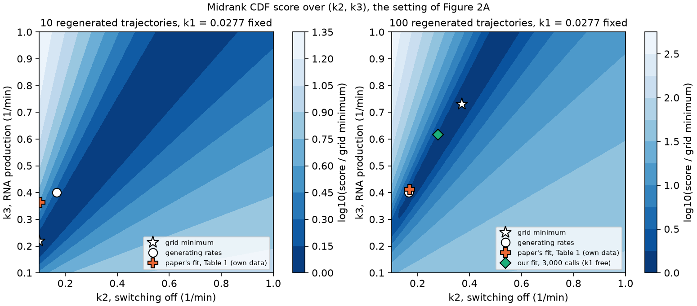
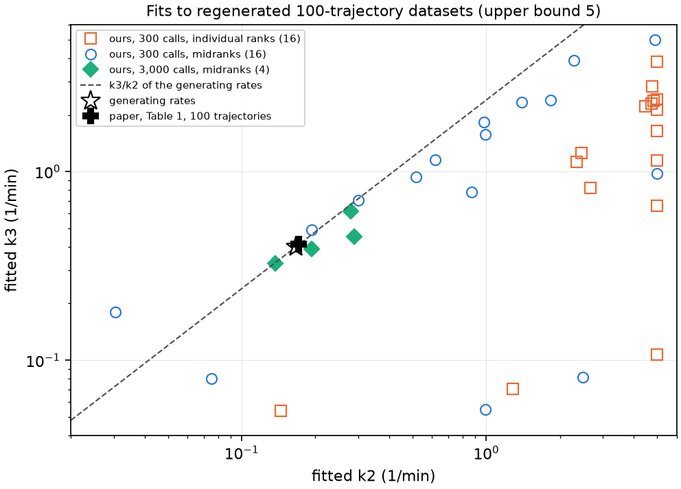

# C5 · Calibrate stochastic RNA counts with a CDF distance

Can three kinetic rates of a switching promoter be recovered from a few
noisy single-cell RNA trajectories? Poovathingal and Gunawan (2010)
answer with a density-function distance (DFD) between the cumulative
distribution of the data and that of the model, fitted by differential
evolution (DE). This lesson rebuilds their first case study with
CRN-craft and fcmaes and shows how far the published recovery carries
over to regenerated data. The implementation is
[publications/rna_counts.py](publications/rna_counts.py).
[Poovathingal and Gunawan (2010), BMC Bioinformatics 11:414](https://doi.org/10.1186/1471-2105-11-414)

## What is reproduced and what is reconstructed

The target is the DFD-CDF column of the paper's Table 1 (fits from 10, 20,
100 and 10,000 trajectories) and the setting of its Figure 2A (the
objective over the switching-off rate `k2` and the production rate `k3` at
the true activation rate `k1`, ten trajectories). The paper's random
samples are not published, so every dataset here is regenerated with the
paper's generating rates; a fit is compared with the paper's row as one
draw against another, not as a replay. The supplementary model table was
not available to this review; the reaction scheme below follows the
paper's text (a silent and an active promoter form, three reactions, three
rates) and the start state, a silent promoter without RNA, is our choice.

## Model, data and objective

| Reaction | Rate | Generating value (1/min) |
| --- | --- | --- |
| silent → active | `k1` | 0.0277 |
| active → silent | `k2` | 0.1667 |
| active → active + RNA | `k3` | 0.4 |

RNA is not degraded within the 75-minute window. The Static Direct SSA
records each trajectory every half minute from 0.5 to 75 minutes (150
times). Each count receives an independent rounded normal error. The paper
writes the error as N(0, 0.25); the lesson reads 0.25 as the variance
(standard deviation 0.5), which moves about 32% of counts by one; read as a
standard deviation it would move about 5%. Observations below zero are kept
as they are.

The score (Equations 7 to 9) sums, over times and over sorted observation
thresholds, the squared difference between the model's CDF and the data's
plotting position, weighted by `m / (F(1 - F))` with `F` the data's
position and `m` the number of trajectories. The trajectories are scored
by their marginal law at each time; the correlation along a trajectory is
not used, as in the paper. Three readings of the data position exist in
the code:

- `midrank` (default for 10 to 100 trajectories): one term per distinct
  count at the midrank `(below + ties/2) / m`, compared with the model's
  `P(X < x) + P(X = x)/2`.
- `published` (`--published-rank`): one term per cell at `(l − 0.5)/m`,
  compared with `P(X ≤ x)`, the last cell left out. With integer counts many
  cells tie, and one model value cannot match the spread of ranks of a tie.
  This reading is inconsistent: on 10,000 regenerated trajectories it scores
  the generating rates at 3.3e9 and the delivered fit (0.1176, 5, 2.4195) at
  1.6e9, while the midrank and population readings score the generating
  rates lowest (2,387 and 3,031 against 567,671 and 620,284). How the paper
  treats ties is not stated.
- `population` (10,000 trajectories): the empirical CDF at each distinct
  count, last count left out.

The model side is exact: the finite-state projection (FSP) of the chemical
master equation gives the RNA law at the 150 times, convolved analytically
with the rounded error. The paper uses 10,000 SSA paths per candidate;
`--source-budget` runs that configuration.

**Check before fitting.** At 10, 30 and 75 minutes the noise-adjusted FSP
CDF differs from 10,000 independent noisy SSA trajectories by at most
0.010467, inside the declared 99% Dvoretzky–Kiefer–Wolfowitz limit of
0.017884 (rerun in review: same values).

## Run

Follow [setup](README.md), then from CRN-craft:

```bash
python tutorials/optimization/run.py C5 --output /tmp/c5-smoke
python tutorials/optimization/run.py C5 --preset study --threads 8 --output /tmp/c5-study
python tutorials/optimization/run.py C5 --preset study --datasets 4 --starts 1 --output /tmp/c5-reduced
python tutorials/optimization/run.py C5 --source-budget --source-evaluations 90 --output /tmp/c5-ssa
```

The smoke run (15 times, one 100-trajectory dataset, 40 calls) takes about
2 seconds on one thread. The study fits 10, 20 and 10,000 trajectories once
and eight regenerated 100-trajectory datasets twice, each start with 3,000
DE calls (population 30, rates `5 u³` for `u` in the unit cube, bounds
[0, 5]); one call costs 25 to 45 ms on a shared two-core machine. `--source-budget` adds the
publication configuration, 30 members for 4,000 generations (120,030 calls
of 10,000 SSA paths); the last command is a short pilot of it.
`summary.json` lists for each fit the rates, the score, the score of the
generating rates on the same data (`truth_score`), `reached_truth_score`
and a rescore with fresh SSA paths.

## Results



`img/C5-contour.png` (from [results/C5](results/C5/README.md)): the midrank
score on the Figure 2A window for ten (left) and one hundred (right)
regenerated trajectories. White circle: generating rates; star: grid
minimum; cross: the paper's fit for that sample size (from its own data);
diamond: our 3,000-call fit, whose `k1` is free (the ten-trajectory fit lies
outside the window). The score has a long valley in which `k3/k2`, the mean
number of RNA per active period, stays near 2: on the 100-trajectory data
the valley floor from `k2` = 0.25 to 0.55 is within 11% of the minimum.
Figure 2A of the paper shows the same window; its shape is not compared
numerically.

| Trajectories | Paper, Table 1 (DFD-CDF) | Delivered, 300 calls | Review, 3,000 calls |
| --- | --- | --- | --- |
| 10 | 0.0200, 0.1029, 0.3643 | 0.0212, 0.0257, 0.1321 | 0.0250, 0.0245, 0.1160 |
| 20 | 0.0371, 0.2124, 0.5263 | 0.0349, 0.5345, 1.2807 | 0.0372, 2.3773, 5 (bound) |
| 100, median of best fits | 0.0273, 0.1702, 0.4121 | 0.0308, 0.5668, 0.8570 (8 datasets; 11 of 16 starts short) | 0.0304, 0.2362, 0.4217 (4 datasets) |
| 100, individual ranks | | 0.1305, 5 (bound), 2.2138 (biased score) | not run |
| 10,000 | 0.0276, 0.1659, 0.4102 | 0.0311, 1.3423, 2.0729 (short) | 0.0273, 0.1623, 0.3924 |

The delivered columns are recounted from the implementer's 8-thread study
runs; the review column is rerun on one thread with the same seeds. "Short"
means the search ended above the score of the generating rates on the same
data: 300 calls are ten DE generations, and 11 of 16 delivered midrank starts
and the 10,000-trajectory start stopped there (126,810 against 2,506). With
3,000 calls every review start reaches below that score. The four review
fits at 100 trajectories are (0.0252, 0.2790, 0.6175), (0.0307, 0.1934,
0.3904), (0.0302, 0.1373, 0.3265) and (0.0362, 0.2889, 0.4530).



`img/C5-recovery.png`: fitted `k2` and `k3` of every 100-trajectory start,
ours with 300 calls (open, both rank readings) and 3,000 calls (filled),
the generating rates (star), the paper's 100-trajectory fit (cross) and the
line of constant `k3/k2` through the generating rates.

## What reproduces and what does not

- `k1` is recovered in every converged fit (0.025 to 0.037 against 0.0277),
  as the paper reports.
- With 10,000 trajectories the converged fit matches the generating rates
  within 3% and the paper's row within 6%.
- With 100 trajectories the converged median is within 1.5 times the
  generating rates; two of four datasets are within 1.5 times on every rate,
  two miss on `k2` (1.67 and 1.73 times). The fits lie along the valley of
  constant `k3/k2`. The paper's single 100-trajectory fit lies within 3%;
  one regenerated draw cannot say whether its sample was typical.
- With 10 and 20 trajectories the converged fits slide along the valley to
  `k2` = 0.024 and to the upper bound. The paper's fits at these sizes are
  closer to the generating rates; ours are not. The data do not constrain `k2`
  and `k3` separately, and the result depends on the draw.

The delivered study's medians therefore measured an unconverged search
(and, for individual ranks, a biased score), not the estimator.

## Limits

The supplementary model table, the paper's error convention, its tie
handling and its DE settings beyond population and generations are not
verified. The review reran four of the eight 100-trajectory datasets with
one start each; the full 3,000-call study (about 57,000 calls) and the
publication-scale SSA arm were not run. The SSA pilot in the delivered
evidence (90 calls, individual ranks) is not a recovery test.
