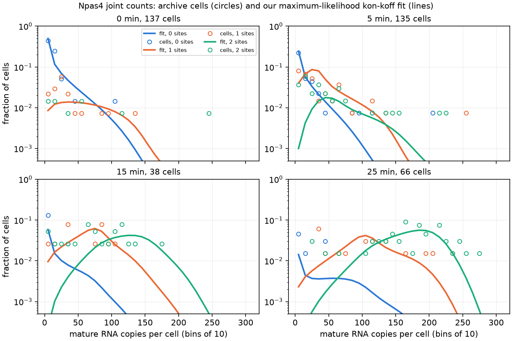
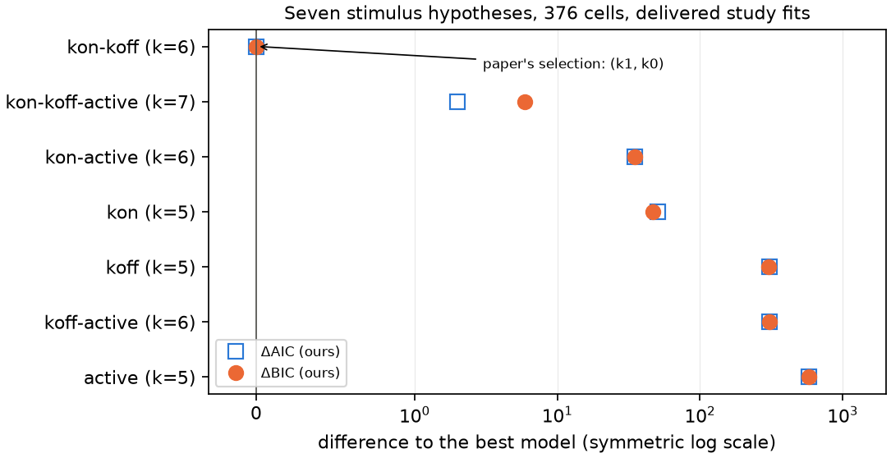

# C6 · Select a stimulus response from joint RNA and site counts

Which rates of a two-state promoter does a stimulus change? Gómez-Schiavon
et al. (2017) count, in single neurons, the mature *Npas4* RNA and the
number of active transcription sites (0, 1 or 2) before and 5, 15 and 25
minutes after KCl stimulation. They compare seven hypotheses, each letting a
different subset of the switching-on rate, the switching-off rate and the
active transcription rate change at the stimulus, and select the one that
changes both switching rates. This lesson repeats the selection by maximum
likelihood with the finite-state projection (FSP) of CRN-craft and the DE
and CMA-ES optimizers of fcmaes. The implementation is
[publications/stimulus_fit.py](publications/stimulus_fit.py).
[Gómez-Schiavon et al. (2017), Genome Biology 18:164](https://doi.org/10.1186/s13059-017-1297-9)
· [BayFish data and code at the pinned revision](https://github.com/mgschiavon/BayFish/tree/70d1b685da4b4da8aa8a64934e200a5e3593791d)

## What is reproduced

The target is the model selection of the paper's Figure 5 and the rates of
its Table 1. The paper estimates posteriors by Markov chain Monte Carlo and
evaluates AIC and BIC at the highest likelihood along its chains; this
lesson maximizes the likelihood directly. Figure 5 is available only as an
image, so its values are not compared; the paper's text states the
selection, and that is compared. DIC and posterior intervals need a
sampling study and are not computed.

## Data

The four archive files hold one cell per row: two site intensities and the
mature RNA count. A site is active when its intensity is positive, the
two-state rule of the BayFish readers. The reader accepts UTF-8 or UTF-16
with a byte-order mark (three of the four files are UTF-16), at most 1 MiB
per file, exactly three fields per row, finite nonnegative intensities and
integer counts; it names file and line on any other row.

| Time (min) | Cells | 0 sites | 1 site | 2 sites | Largest RNA count |
| --- | ---: | ---: | ---: | ---: | ---: |
| 0 | 137 | 105 | 23 | 9 | 246 |
| 5 | 135 | 53 | 44 | 38 | 254 |
| 15 | 38 | 6 | 11 | 21 | 176 |
| 25 | 66 | 6 | 17 | 43 | 278 |

## Model and likelihood

Two promoter copies switch independently on at `kon` and off at `koff`.
RNA is made at `basal` per inactive copy and `active` per active copy and
degrades at 0.0559 per minute (fixed, as in the paper). Before the stimulus
the four rates take basal values; a hypothesis gives each changed rate a
second, stimulated value. The free-parameter count is `k = 4 + number of
changed rates`, 5 to 7, and agrees with the authors' count
`|unchanged| + 2 |changed|`. Rates are searched in log10 coordinates within
`kon`, `koff` in [1e-5, 3], `basal` in [1e-6, 3] and `active` in
[0.01, 25] per minute.

At time zero the joint law of active sites and RNA is the stationary law of
the basal rates, solved on a truncation at 300 RNA copies whose
transcription stops at the boundary. It is passed state by state into the
transient FSP at the stimulated rates, which records the probability that
leaves through the boundary. The score is the total negative
log-likelihood `NLL = −Σ count · log p` over the four joint histograms,
with probabilities floored at 1e-100 as in the authors' code; no occupied
bin of any fitted model is near the floor (the smallest occupied probability
is 1.9e-10). Each finalist is scored again at 450 copies.

**Check before fitting.** At the paper's Table 1 vector (posterior means of
the selected model) the NLL is 2098.742655 nats (641.710, 798.047, 239.126
and 419.859 at the four times). A matrix-exponential solve written
independently of the CRN-craft engine in the same module gives the same
value within 4.6e-08 nats; it shares the model reading but not the solver.
Raising the cutoff to 450 changes the score by 0.0075 nats, and 3.7e-05 of
the probability escapes the 300-copy truncation by 25 minutes. All three
numbers are rerun here and match the implementer's record.

## Run

Fetch the pinned files (checked by SHA-256), then:

```bash
python tutorials/optimization/publications/sources.py C6 --data-dir /tmp/pub-data
python tutorials/optimization/run.py C6 --data-dir /tmp/pub-data --output /tmp/c6-smoke
python tutorials/optimization/run.py C6 --preset study --threads 8 --data-dir /tmp/pub-data --output /tmp/c6-study
```

The smoke run (one DE retry of 30 calls per hypothesis) takes 5 to 15
seconds on one thread; it shows the route, not a fit, and its nested pairs
are recorded but not gated. The study default is eight DE retries of 2,000
calls (population 16) per hypothesis, then 300 CMA-ES calls started from
the best of the retries and of the fitted nested sub-hypotheses. One call
costs about 40 ms. The study gates on `NLL(superset) ≤ NLL(subset) + 0.01`
for all twelve nested pairs; `summary.json` holds per model the retries,
their spread, AIC, BIC and AICc.

## Results

| Changed rates | k | NLL | ΔAIC | ΔBIC | Best NLL of the four DE retries |
| --- | ---: | ---: | ---: | ---: | --- |
| kon, koff | 6 | 2098.695 | 0.000 | 0.000 | 2135.32, 2098.75, 2098.72, 2100.08 |
| kon, koff, active | 7 | 2098.695 | 2.000 | 5.930 | 3024.95, 2118.71, 3226.65, 2333.52 |
| same, review CMA-ES | 7 | 2098.600 | 1.810 | 5.739 | |
| kon, active | 6 | 2116.057 | 34.723 | 34.723 | 3070.09, 2116.08, 2121.52, 2116.16 |
| kon | 5 | 2124.953 | 50.516 | 46.586 | 2125.00, 2124.99, 2381.33, 2124.98 |
| koff | 5 | 2252.180 | 304.970 | 301.040 | 2252.18, 2252.19, 6174.04, 2252.34 |
| koff, active | 6 | 2251.712 | 306.033 | 306.033 | 2274.94, 2251.71, 2274.84, 2257.63 |
| active | 5 | 2389.897 | 580.403 | 576.474 | 2389.90, 2389.90, 2536.39, 2389.96 |

AIC is `2k + 2 NLL` and BIC `k ln 376 + 2 NLL` with the total NLL, the
forms of the authors' figure code; the paper's Methods write the
small-sample AICc, which shifts the gaps by less than 0.08 (column `aicc`
in [results/C6/models.csv](results/C6/README.md)). The delivered rows are
recounted from the implementer's study run (four DE retries of 550 calls and
300 CMA-ES calls per hypothesis, fewer than the default) and rescored here
to 1e-9 nats. Both criteria select `kon, koff`, the paper's selection, and
the four hypotheses that change `kon` all fit better than the three that do
not, as the paper states. `koff, active` has the lower NLL but the higher
ΔAIC than `koff`: one extra parameter costs 2 and buys 2 × 0.469.

The search is not converged in every retry: single retries miss by up to
3,900 nats. For `kon, koff, active` no retry came within 20 nats of
`kon, koff`; its delivered value is that of the nested `kon, koff` vector.
A review CMA-ES run (1,500 calls, step 0.3 in log10, seed 7001) from that
vector reaches 2098.600, 0.095 nats lower: ΔAIC 1.81, ΔBIC 5.74. A fresh
2,000-call DE retry ends at 2099.97. The decision needs a 1-nat gain for AIC
and 2.97 nats for BIC to change; neither occurs. All twelve nested pairs
hold for the delivered values.

| Rate (1/min) | Paper, posterior mean ± SD | Ours, maximum likelihood |
| --- | --- | --- |
| `kon` before / after | 0.0093 ± 0.0010 / 0.0839 ± 0.0063 | 0.00932 / 0.0814 |
| `koff` before / after | 0.1108 ± 0.0172 / 0.0189 ± 0.0056 | 0.1070 / 0.0169 |
| `basal` | 0.0078 ± 0.0042 | 0.00770 |
| `active` | 8.14 ± 0.23 | 8.124 |

Every fitted rate lies within one posterior SD of the paper's mean.



`img/C6-distributions.png`: fraction of archive cells (circles) and our
maximum-likelihood `kon, koff` law (lines) per 10-copy RNA bin and number of
active sites at the four times. The paper's Figure 6 shows posterior-averaged
predictions instead.



`img/C6-criteria.png`: ΔAIC (squares) and ΔBIC (dots) of the delivered fits
on a symmetric log scale; the arrow marks the paper's selection.

## Limits

The delivered study used 550-call retries; the default eight 2,000-call
retries were not rerun (about 75 minutes on one thread). The CMA-ES review
covers only the seven-rate model. Whether the authors' chain likelihood in
Figure 5 is the total or the per-cell value (their MATLAB scorer divides by
the cell count, their C++ scorer does not) cannot be read from the paper.
The authors truncate at 500 copies; this lesson uses 300 and checks 450.
