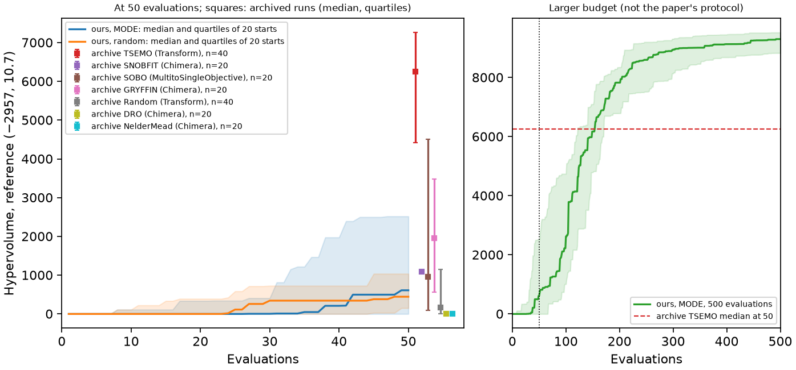
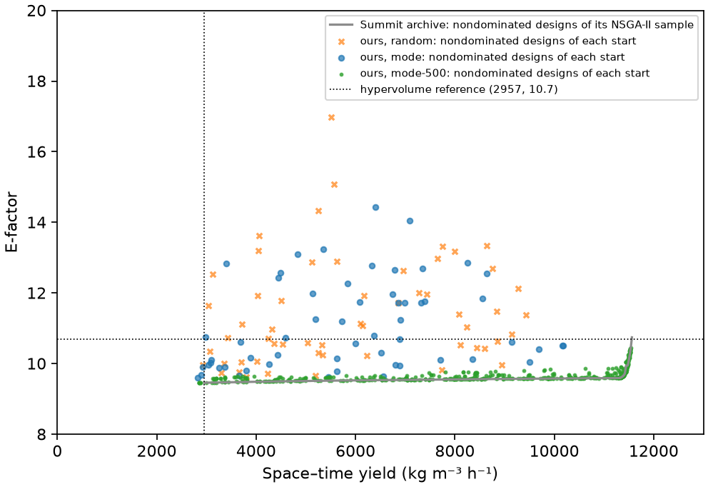

# C7 · Compare MODE with the archived strategies on a virtual reactor

Felton, Rittig and Lapkin compared optimization strategies on Summit's
virtual SnAr reactor: four reactor settings, two objectives, 50 virtual
experiments per run and 20 repeated runs, scored by the hypervolume of the
designs found ([Felton et al. 2021, Figure 3](https://doi.org/10.1002/cmtd.202000051)).
This lesson asks one question: at the same budget and on the same
hypervolume, where does fcmaes MODE land among the archived strategies, and
does it beat uniform random designs? Code: [reactor.py](publications/reactor.py).

## What is reproduced

| Item | Source | Here |
| --- | --- | --- |
| Emulator outputs | Summit's NSGA-II sample `pareto_front_snar.csv` (10,000 designs) | reproduced to 7e-8 relative on 200 designs |
| Terminal hypervolume of the archived runs at 50 experiments | `snar_results.csv` (582 runs, all with zero noise) | read, grouped by strategy and transform |
| Hypervolume definition | Summit's analysis code, reference point (−2957, 10.7) on (−STY, E-factor) | same code path, recounted independently |
| MODE and random designs, 20 × 50 evaluations | not in the paper | new runs |

The archived runs are the comparison; the paper's figure itself is not
redrawn. The archive keeps only the terminal hypervolume of each run, so
the archived strategies appear as points at 50 evaluations, not as
trajectories.

## Model and objectives

The reactor is a plug-flow SnAr reaction of 2,4-dinitrofluorobenzene (A)
with pyrrolidine (B) to the ortho product P, the para product Q and the
bis-adduct R, with second-order rates in mol/L and minutes:

```
A + B → P (ka)    A + B → Q (kb)    P + B → R (kc)    Q + B → R (kd)
```

Each constant is `0.6 · k_ref · exp(−Ea/R · (1/T − 1/T_ref))` with
`T = θ + 273.71` K and `T_ref = 90 + 273.71` K (Summit's conversion,
kept as published). The settings are residence time τ ∈ [0.5, 2] min,
pyrrolidine equivalents ∈ [1, 5], inlet concentration of A ∈ [0.1, 0.5] M
and temperature θ ∈ [30, 120] °C. The state of the native model
(`crn-diffsol concentrations`) is concentration in mol/L, integrated from
0 to τ. The objectives, from the outlet concentrations `c`, are

- space–time yield `STY = 60 · M_P · c_P / τ` in kg m⁻³ h⁻¹ (at least 1e-6),
- E-factor `(789 + Σ_{i≠P} M_i c_i) / (M_P c_P)`, capped at 1000 and set to
  1000 when `c_P` is zero (ethanol density 0.789 g/mL; molar masses in g/mol).

MODE minimizes `(−STY, E-factor)`. The hypervolume counts only designs with
STY above 2957 and E-factor below 10.7.

**Which emulator.** Summit releases 0.5.0 to 0.8.3, which produced the
archive, form Q with the ortho constant ka (`dQ/dt = ka·A·B − kd·Q·B`).
The [pinned source revision](https://github.com/sustainable-processes/summit/blob/1de682d05e97adcfb96cd8376e876cef2d6160d3/summit/benchmarks/snar.py)
uses kb, the chemically consistent constant. With ka, Summit's integration
settings (RK45, default tolerances) reproduce the archived sample to
7e-8 relative. With kb the archived E-factors are about 10 % higher than
the emulator's, and our 20 random starts reach a median hypervolume of 2,689
against 160 for the 40 archived random runs (Mann–Whitney p = 7e-6);
with ka the same starts give 445 (p = 0.30). The lesson therefore uses ka by default
(`--kinetics archive`); `--kinetics pinned` runs the corrected kinetics.
Hypervolumes from the two emulators must not be compared with each other.

## Run it

```bash
python tutorials/optimization/publications/sources.py C7 --data-dir DATA
python tutorials/optimization/run.py C7 --data-dir DATA --output /tmp/c7-smoke
python tutorials/optimization/run.py C7 --data-dir DATA --preset study --output /tmp/c7-study
```

The smoke run (2 starts) takes about 2 s on one thread, the study about
15 s. Each start of MODE and of the random baseline has exactly 50
evaluations, initialization included; MODE uses a population of ten with
the NSGA-II update (`fcmaes.mode.MODE(..., nsga_update=True)`), so it
makes five batches: the first comes from unevaluated random parents, and
only four selection steps follow. The study adds a MODE arm of 500
evaluations with the same seeds (its first 50 evaluations are those of the
50-evaluation arm). It is not part of the paper's protocol.

## Checks

| Check | Rule | Result |
| --- | --- | --- |
| archived noise level | all 582 rows zero | 0 |
| emulator against 200 archived designs | relative difference < 1e-6 | 3.9e-15 (STY), 6.6e-8 (E-factor) |
| native outlets against SciPy at rtol 2e-11, 16 corners and 8 interior designs | state < 1e-6 M, objective < 0.02 | 1.4e-8 M, 1.8e-4 |
| Summit's own RK45 settings against the tight solve, same designs | reported | up to 2.9 objective units |
| hypervolume, hand front with a dominated point and a point outside the reference | 11 | 11 |
| evaluations per start | exactly 50 (500), no failures | yes |

## Results

Terminal hypervolume at 50 evaluations, reference (−2957, 10.7), ka
kinetics (`results/C7/terminal.csv`, `archive-groups.csv`). Archived rows
show the best transform setting per strategy.

| Search | Runs | Median | Interquartile range |
| --- | ---: | ---: | ---: |
| archive TSEMO | 40 | 6,254.9 | 4,420.4 to 7,261.7 |
| archive GRYFFIN (Chimera 1.0/1.0) | 20 | 1,954.2 | 559.4 to 3,488.1 |
| archive SNOBFIT (Chimera) | 20 | 1,095.4 | 1,095.4 to 1,095.4 |
| archive SOBO (weighted sum) | 20 | 953.2 | 91.0 to 4,505.7 |
| **ours, MODE** | 20 | **610.5** | 0 to 2,519.0 |
| **ours, random** | 20 | **444.7** | 150.9 to 1,036.7 |
| archive Random | 40 | 160.0 | 0 to 1,145.1 |
| archive DRO, Nelder–Mead | 20 each | 0 | 0 to 0 |
| ours, MODE, 500 evaluations (larger budget) | 20 | 9,301.1 | 8,829.6 to 9,523.6 |



*Left: median and quartiles of our 20 starts per arm (lines and bands);
squares with bars: median and quartiles of the archived runs at 50
experiments. Right: the MODE arm of 500 evaluations, with the archived
TSEMO median at 50 as a dashed line.*

MODE and random are not distinguishable at 20 runs: Mann–Whitney U = 202,
two-sided p = 0.97, and the bootstrap 95 % interval of the difference of
medians, −573 to 1,867, contains zero. Both lie in the range of the
archived single-objective strategies and far below TSEMO. A run of 50
evaluations with a population of ten tests early behavior only: MODE is
built for many generations, and with 500 evaluations its median passes
the TSEMO median at 154 evaluations and reaches 9,301. That arm says how
much budget MODE needs, not how it ranks in the published protocol.



*Nondominated designs of each of our starts in physical units (crosses:
random; circles: MODE at 50; dots: MODE at 500) and the nondominated
subset of Summit's 10,000-design NSGA-II sample (gray line). Dotted lines:
the hypervolume reference.*

With the pinned kb kinetics (`results/C7/terminal-pinned.csv`) the same
runs give MODE 2,273.1 (54.7 to 5,221.0) and random 2,688.8 (1,335.8 to
6,328.4), p = 0.32. These are the values of the delivered run; they are
on a different emulator from the archive.

## Limits

- The archived strategies ran in Summit with their own initial designs;
  only their terminal values are archived, so no trajectory comparison is
  possible.
- The study is noise-free, as the archived runs are. Summit's example
  scripts also pass a 2.5 % noise argument under a name the pinned
  emulator ignores; no noisy comparison is made here.
- The ka form does not conserve mass (A is consumed at ka + kb, products
  form at 2·ka); it is kept only because the archive was produced with it.
- Twenty runs per arm resolve large differences (TSEMO against the rest)
  but not the MODE–random difference at this budget.

Saved tables and their origin: [results/C7](results/C7/README.md).
