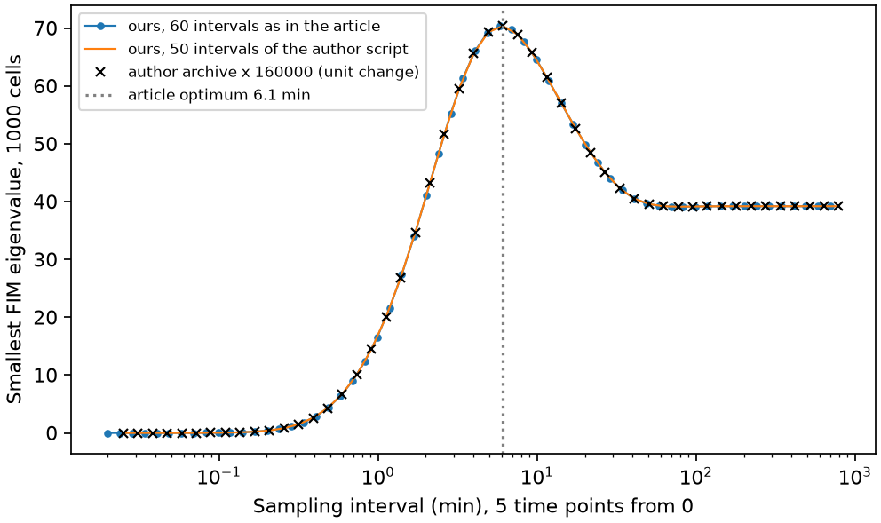
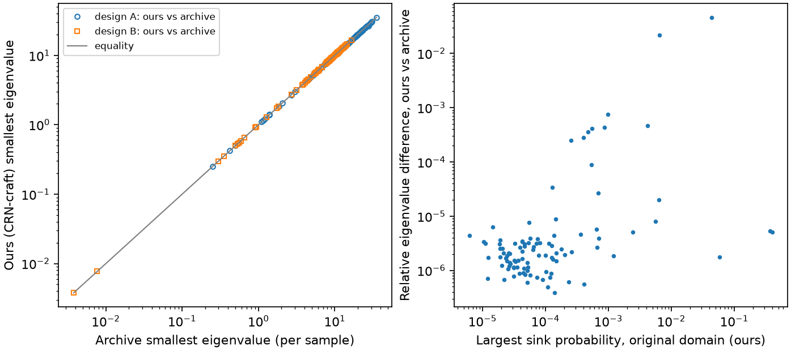
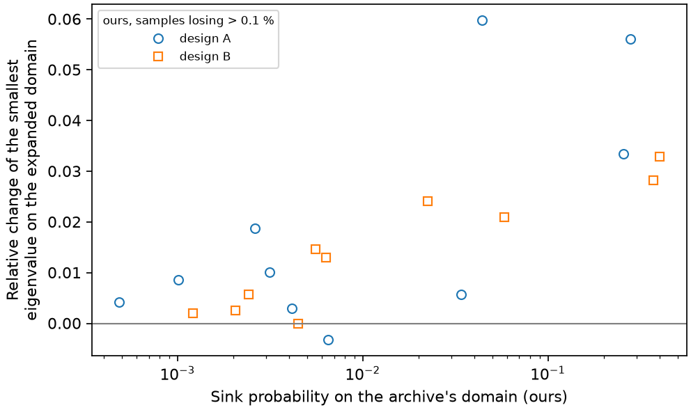

# C8 · Design single-cell experiments with Fisher information

A snapshot experiment measures the counts of many cells at a few times.
Which times, and which stimulus, tell most about the rate parameters?
Fox and Munsky answer with the Fisher information of the finite state
projection (FSP): the derivatives of the probability law with respect to
the parameters, weighted by the law itself. This lesson rebuilds two of
their designs with the native FSP sensitivities of CRN-craft and checks
them against the matrices the authors archived.

Z. R. Fox and B. Munsky, "The finite state projection based Fisher
information matrix approach to estimate information and optimize
single-cell experiments", PLoS Comput. Biol. 15 (2019) e1006365,
[doi:10.1371/journal.pcbi.1006365](https://doi.org/10.1371/journal.pcbi.1006365).
Author archive (models, parameter samples, precomputed matrices):
[FSPFIM_2018 at commit 2e2f76f](https://github.com/Munsky/FSPFIM_2018/tree/2e2f76fdeeb0d9290b48aa981210422d254b07c2).
Code: [experiment_design.py](publications/experiment_design.py),
[sensitivities](../../python/crn_craft/sensitivities.py).

## What is reproduced

| Paper | What we compute | Kind |
|---|---|---|
| Figure 5: E-optimal sampling interval of the bursting gene, RNA only | the smallest eigenvalue of the Fisher matrix on the 60 intervals of the article, the 50 of the author script and a fine grid | reproduction |
| Figure 7: toggle switch, 672 designs (pulse duration, sampling interval, UV), 100 parameter samples | the archived matrices, the archive ranking, and native matrices of the two marked designs for all 100 samples | reproduction |
| Figure 7 search beyond the grid | bounded DE on the three design variables | extension (pilot) |

## Models, data and objective

For a measured bin `b` at time `t` with probability `p` and derivative
vector `g`, and `n_t` cells, the information of independent snapshots is
`I = Σ_t n_t Σ_b g gᵀ / p`. Hidden states are summed into the measured
bins first (`ProjectionSensitivities.observed`); bins with `p = 0` carry
nothing. The design score is E-optimality: the smallest eigenvalue.

**Bursting gene (Figure 5).** A gene switches on at `kon = 0.05/min` and
off at `koff = 0.15/min`, transcribes at 5/min while on, and RNA decays at
0.05/min; at time zero the gene is off with no RNA. The fitted parameters
are `koff` and the transcription rate; 1000 cells; RNA counts only. An
experiment has five evenly spaced time points from zero, so four
informative snapshots at `Δt … 4Δt`: the law at time zero is fixed and
holds no information. The author script works in units of the RNA
lifetime (20 min) on 50 intervals and plots them times 25 min (the 1.25 of
`linspace(0, 5f, 5)`), keeps 0 to 199 RNA and drops bins below `1e-6`; the
article describes 60 intervals from 0.02 to 700 min. We compute all three
grids with those conventions.

**Toggle switch (Figure 7).** Two repressors: in the archive's order `x`
(λcI, the article's `y`) is made at `bx + kx / (1 + ayx y^nyx)` and decays
at `dx`, and `y` at `by + ky / (1 + axy x^nxy)` with decay `dy`. UV raises
`dx` to `3.84e-4 + 0.02 UV² / (2500 + UV³)` per second for `β` hours from
`t = 1 h`. The seven fitted directions are the natural logs of `bx, by,
kx, ky, ayx, axy, dy`; the Hill exponents stay at 2.1 and 3.0. The
initial law is the archived fixed law near the stationary law of the true
parameters, with zero derivative. Three snapshots at `Δt, 2Δt, 3Δt` of
100 cells each; bins below `1e-8` dropped. The state domain is
`x ≤ 70, y ≤ 100, (x − 4)(y − 4) < 2500` (a `retained` set of
`prepare_fsp`); mass that leaves it goes to the sink. The objective of a
design `d` is the mean over the 100 archived parameter samples of the
smallest eigenvalue of each sample's matrix,
`Φ(d) = (1/100) Σ_j λ_min(I(d, θ_j))`, not the eigenvalue of the mean
matrix. Design A = (β 2 h, Δt 3 h, UV 9) is the grid optimum; B =
(3 h, 4 h, 6) is the article's "nearby, less informative" design.

These conventions are not all printed in the article. We established
them by reproducing the archived 7 × 7 matrices entrywise; the variants we
tried and rejected are listed under "What did not reproduce".

## Commands

```bash
python tutorials/optimization/publications/sources.py C8      # 65 MB archive
python tutorials/optimization/run.py C8 --preset smoke --output /tmp/c8-smoke
python tutorials/optimization/run.py C8 --preset smoke --native-pair-samples 100 \
    --expanded-bounds 100 135 6200 --output /tmp/c8-pairs
python tutorials/optimization/run.py C8 --preset study --threads 8 \
    --cache /tmp/fim-cache --output /tmp/c8-study
```

`sources.py` checks the archive by content: a digest over the SHA-256 of
the 676 files the lesson reads (`examples/publication_tutorials/sources.json`),
so a GitHub tarball and a `git archive` of the commit both pass and a
changed file fails. The archive is read as a stream; nothing in it is
extracted or executed. The smoke run takes about 40 s (38 s measured) on one
thread: the sensitivity checks, the bursting sweep, the archive ranking
and one native toggle design. The pair run adds 200 native toggle solves
(about 15 CPU minutes) and recomputes the samples that lose more than 0.1 %
to the sink on the expanded domain. The study runs four DE searches with
100 evaluations each on all 100 samples (several CPU days; not rerun for
this page).

## Results

| Quantity | Paper or archive | Ours |
|---|---|---|
| Figure 5 optimum, 50-interval script grid | 6.105 min (archive curve) | 6.105 min, curve = archive × 160000 (unit change) within 1e-5 |
| Figure 5 optimum, 60-interval article grid | "6.1 min" | 5.829 min, the grid point next to 6.1 (neighbors 4.88, 6.96) |
| Figure 5 optimum, fine grid 3–12 min | — | 5.941 min |
| Figure 7 grid optimum (672 designs) | A = (2 h, 3 h, UV 9), Φ = 14.944 | same (read from the archive) |
| A beats B, per sample | 97 of 100 | 97 of 100; the winner agrees on all 100 samples |
| Φ(A), Φ(B) | 14.944, 8.037 | 14.927, 8.033 |
| Per-sample λ_min, ours vs archive | — | median relative gap 1.5e-6; above 1e-3 for samples 0 (4.6 %) and 47 (2.2 %) |
| Largest sink on the original domain | not reported | 0.40 (sample 43); above 1e-3 for 10 samples |
| On the expanded domain (100, 135, 6200), leaky samples | — | sink at most 1.2e-5; A beats B on all 10; λ_min changes by at most 6 % |



The bursting curves: lines and circles are ours on the article's 60 and the
script's 50 intervals; crosses are the archived curve rescaled by the unit
factor; the dotted line marks the article's 6.1 min.



Left: per parameter sample, the smallest eigenvalue of our matrix against
the archived one for designs A (circles) and B (squares). Right: the
relative difference against the sink probability of our solve on the
original domain.

## What did not reproduce, and why

- **Equation 28.** The article prints the UV law as
  `3.8e-4 + 0.002 UV² / (1250 + UV³)`. With it the native matrix of design
  A, sample 0, differs from the archive by 38 % (Frobenius); with the
  constants of the archive code it agrees to 0.2 %, and to 1e-5 on
  samples 1 and 2. The archived matrices, and so Figure 7, follow the code.
  `--pulse-law paper` keeps Eq. 28 for comparison.
- **Snapshots and cells.** On design A, sample 0, with the best common
  scale factor fitted, two, four or five snapshots of the code law leave
  Frobenius gaps of 7.1 %, 4.4 % and more, three snapshots starting one
  hour later 3.0 %, and Eq. 28 at least 37 %; three snapshots at `Δt, 2Δt,
  3Δt` leave 0.2 % with a fitted scale of 0.999 × 100 cells.
- **Truncation.** The archive's own domain loses up to 40 % of the
  probability for two parameter samples (sample 43: 0.40, sample 40: 0.37
  at design A or B), and more than 0.1 % for ten. Our solves on the same
  domain lose the same mass and agree with the archive, so the 97 of 100
  is a property of the truncated model. On a domain about twice as large
  the sink falls below 2e-5 and λ_min moves by at most 6 %; the ranking of
  A and B holds on all ten samples.

  

  Ours on the expanded domain against ours on the archive's domain, for
  the ten samples that lose more than 0.1 % there.
- **Two samples.** Samples 0 and 47 differ from the archive by 4.6 % and
  2.2 % in λ_min (matrix gaps 0.2 %) at the same domain, stable from
  tolerance 3e-6 to 1e-9 and not explained by the `1e-8` bin floor. The
  cause is not identified.
- **Continuous search.** The archive-interpolation DE (160 evaluations)
  ends at Φ = 14.49, below the grid optimum A (14.94): too small a budget
  for that surface. A native DE pilot with two starts of ten designs,
  each scored on three parameter samples, proposes (β 1 h, Δt 1.22 h,
  UV 4); on samples 0 to 19 it scores 0.86 against 19.0 for A (0 of 20
  wins), close to the archived grid value 0.85 at (1 h, 1.5 h, UV 4).
  Three samples per design are too few to rank designs, and twenty
  designs too few to search three variables: such a run is a pilot, not
  a result. Beating A needs the full 100 samples per design and a far
  larger budget (the study preset); the grid optimum A stands.

## Limits

The Fisher matrix is local: it describes small parameter changes around
each sample, not identifiability far from it. The 100 samples are the
authors'; the conclusions hold for their prior. The archive gives only
derived matrices: the cluster script that produced them is not in the
archive, so the conventions above are inferred from the matrices and the
published code. The derivative of the generator is a centered difference
in the parameter (exact for the linear rates, second order for the Hill
terms; checked against differences of whole solves at two steps).

## Prompt and follow-up

> Reproduce Figures 5 and 7 of Fox and Munsky with native FSP
> sensitivities. Match the archived Fisher matrices before searching, and
> report the truncation of the authors' domain.

Score the design on the expanded domain, add a second experiment as in the
article's dual designs, or replace E-optimality by D-optimality, and
compare against `toggle/out/all_fims_sampled_fim` before trusting a new
optimum. Results tables: [results/C8](results/C8/README.md).
