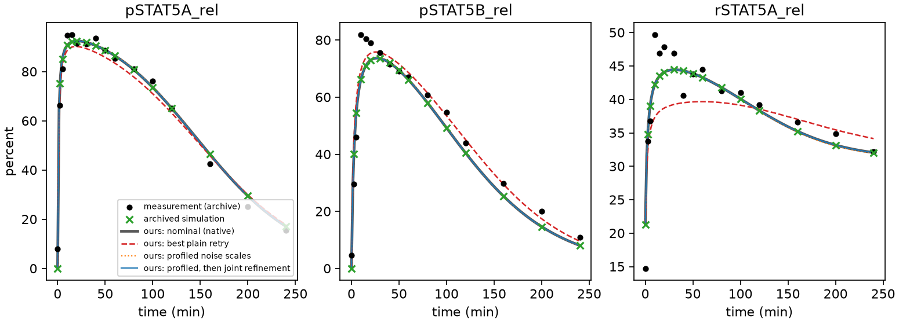
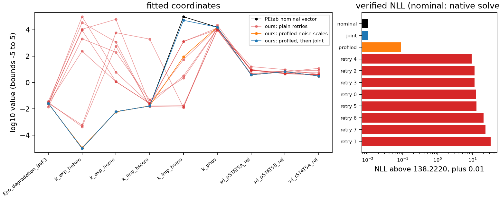

# C9 — Fit a deterministic STAT5 model from PEtab tables

Boehm et al. (2014) measured, by quantitative mass spectrometry, how the two
isoforms STAT5A and STAT5B are phosphorylated and form homo- and heterodimers
after erythropoietin (EPO) stimulation of BaF3 cells, and fitted an ordinary
differential equation model to three relative signals
([paper](https://doi.org/10.1021/pr5006923)). The Benchmark-Models-PEtab
collection archives this fit as a PEtab v1 problem with an SBML model, the
measurements, the estimated parameter vector and the simulated signals at that
vector ([pinned problem](https://github.com/Benchmarking-Initiative/Benchmark-Models-PEtab/tree/49900951a5594a757ad5e651684c7f0a59272881/problems/Boehm_JProteomeRes2014/v1)).
The implementation is [publications/stat5.py](publications/stat5.py) with the
reader [publications/petab.py](publications/petab.py).

The lesson asks three questions in order. Does our score reproduce the
archived negative log-likelihood (NLL) from the archived simulations alone?
Does our own solve of the model give the same signals and NLL at the archived
vector? Can fcmaes find a vector of the same quality from random starts?

## What is reproduced

The reference is the archive, not a figure of the paper: the 48 archived
simulated values and the total NLL 138.2219997062 they give. The paper's
figures are not digitized. The three time courses below show the measurements,
the archived simulation and our solves.

## Model, data and objective

The SBML Level 2 model has eight species in two compartments, cytoplasm (size
1.4) and nucleus (size 0.45): free STAT5A and STAT5B, three phosphorylated
dimers in the cytoplasm (pApA, pApB, pBpB) and the same three in the nucleus.
Nine reactions dimerize, import and export them. The initial concentrations are
assignments, STAT5A = 207.6 · ratio and STAT5B = 207.6 · (1 − ratio), with
`ratio` fixed at 0.693. The input is an assignment rule,
BaF3_Epo = 1.25·10⁻⁷ · exp(−Epo_degradation_BaF3 · t), with t in minutes (the
model's time unit is 60 s); it multiplies `k_phos` in the three dimerization
rates and carries no unit of its own in the file. Reaction rates in SBML are
amounts per minute (concentration × compartment size), so each species
equation divides by its own compartment size; import and export therefore
carry the factor 1.4/0.45 or its inverse. [stat5.py](publications/stat5.py)
writes these eight equations by hand as a `crn-craft.concentration-model/0.1`
document for the native diffsol solver.

The observables are ratios of states in percent; `specC17` (fixed at 0.107)
enters all three:

- `pSTAT5A_rel` = (100 pApB + 200 pApA s) / (pApB + STAT5A s + 2 pApA s), s = specC17;
- `pSTAT5B_rel` and `rSTAT5A_rel` are the analogous formulas of the
  observable table, passed unchanged to the native expression parser.

There are 16 measurements per signal at 0 to 240 minutes, one condition, and
nine estimated coordinates: six rates and one Gaussian noise scale per signal,
all on log10 scale with bounds 10⁻⁵ to 10⁵. Each measurement contributes
0.5 ((y − ŷ)/σ)² + log σ + 0.5 log 2π. The normalization terms stay in the
score because σ is estimated. Archived rows join measurements by observable,
dataset, condition and numeric time; repeated measurements would take the
archived rows of their key in file order (this problem has none).

**The reader.** `petab.py` reads one PEtab v1 problem: one condition without
parameter overrides, one SBML file, parameters on `lin` or `log10` scale
without priors, linear observations with normal noise, and one named noise
parameter per row. Files are untrusted input: each is at most 4 MiB of UTF-8
inside the problem folder (no absolute paths, `..`, URLs or links), YAML goes
through a safe loader that refuses duplicate keys, anchors and aliases, the
TSV tables must have exactly the supported columns and finite numbers, and
formulas are never evaluated in Python. Everything else is refused with a
message naming the feature. The model file is read only by the reference
route below, through the package's XML guard (`crn_craft._xml`, which refuses
DTDs, entities, non-UTF-8 and deep nesting) before libSBML sees it.

## Run it

Fetch the pinned files once (SHA-256 checked), then run from CRN-craft:

```bash
python tutorials/optimization/publications/sources.py C9 --data-dir DATA
python tutorials/optimization/run.py C9 --data-dir DATA --output /tmp/c9-smoke
python tutorials/optimization/run.py C9 --preset study --data-dir DATA \
  --profile-evaluations 4000 --joint-refine-evaluations 2400 --output /tmp/c9-study
```

Add `--ode-binary /absolute/path/crn-diffsol` for a nondefault build. The
smoke run takes about 8 s on one thread, most of it the three reference solves
in Python; the study takes about 100 s on one thread. Every candidate is
scored in a fixed order, so the thread count does not change the result.

## Checks before the search

1. The archived rows alone give 138.2219997062 nats (44.2806969018,
   52.8702405033 and 41.0710623010 per signal). Gate: within 10⁻⁶ of the
   archived total.
2. A second route reads the SBML file with libSBML, builds the stoichiometry
   and the kinetic laws from its formula trees, integrates amounts with SciPy
   (Radau, rtol 2·10⁻¹⁰) and divides by the compartment sizes. It shares no
   equation with the hand-written model. Both routes run at the nominal vector
   and at two off-nominal vectors (rates shifted by up to five decades; the
   second also moves `ratio` and `specC17`). Gate: largest signal difference
   below 0.01 percent and NLL difference below 0.05 nats at each vector, and the
   search tolerance (rtol 2·10⁻⁸) within 0.05 nats of the tight one.

| Vector | Largest signal difference | NLL native | NLL libSBML route | NLL at search tolerance |
|---|---:|---:|---:|---:|
| nominal | 7.3·10⁻⁸ | 138.2219977864 | 138.2219977431 | 138.2220004556 |
| off-nominal a | 1.1·10⁻⁷ | 1452.5616352 | 1452.5616336 | 1452.5616808 |
| off-nominal b | 4.0·10⁻⁸ | 1024.2078279 | 1024.2078281 | 1024.2078194 |

The native nominal NLL is 1.9·10⁻⁶ nats below the archived one; the archive
rounds its simulations and noise scales to ten digits. The total dimer-weighted
amounts of STAT5A and STAT5B stay constant to 7·10⁻¹² ([verification.csv](results/C9/verification.csv)).

## Results



*Black points: measurements. Green crosses: archived simulation. Lines: our
native solves at the PEtab nominal vector, at the best plain retry, at the
profiled fit and after the joint refinement; the last three lines coincide
with the nominal one at this scale.*

| Source | pSTAT5A_rel | pSTAT5B_rel | rSTAT5A_rel | Total NLL | Calls |
|---|---:|---:|---:|---:|---:|
| Archive (published reference) | 44.2807 | 52.8702 | 41.0711 | 138.2219997 | – |
| Ours, nominal vector, native | 44.2807 | 52.8702 | 41.0711 | 138.2219978 | – |
| Ours, best of eight plain retries | 45.9870 | 51.7878 | 49.7697 | 147.5444711 | 5,000 |
| Ours, profiled noise scales | 44.3927 | 52.8222 | 41.0846 | 138.2995085 | 4,000 |
| Ours, profiled, then joint refinement | 44.2768 | 52.8727 | 41.0725 | 138.2220115 | 6,400 |

([nll.csv](results/C9/nll.csv), [fits.csv](results/C9/fits.csv))

**Plain retries miss the reference.** Eight retries, each DE (population 12,
2,500 calls) followed by CMA-ES (population 12, 2,500 calls, started at the DE
best with step 0.3 of the normalized box), on all nine coordinates from random
starts, end at 147.54, 149.59, 149.60, 150.40, 151.01, 158.81, 161.64 and
171.13 nats: 9.3 to 32.9 nats above the archive. Mostly this is not a budget
limit: in five of eight retries the best value changes by less than 0.004 nats
over the last 500 calls (in the other three by 0.12, 0.28 and 20.6). Each retry settles in a different local optimum
whose import and export rates lie decades away from the archived ones and
whose noise scales are larger (σ of pSTAT5A from 4.3 to 16 against 3.85). A
larger σ explains a misfit cheaply and flattens the landscape, so the free
noise scales help the search stop there. The DE phase is weak at this
population: alone it reaches only 167 to 233 nats.

**Profiling the noise scales.** For fixed rates, the maximum-likelihood σ of
each signal is the root mean square of its residuals (clipped to the bounds).
`--profile-evaluations` searches only the six rates (DE population 24, then
CMA-ES population 16 from the DE best with step 0.06) with σ set this way.
`--joint-refine-evaluations` then runs CMA-ES (population 14, step 0.015) on
all nine coordinates, started at the profiled optimum. No step reads the
nominal vector or the archived simulations; only the fixed `ratio` and
`specC17` come from the parameter table. This route was added after the plain
retries failed, so it is a second method, not the planned protocol.



*Left: the nine coordinates of the PEtab nominal vector (black), the plain
retries (red), the profiled fit (orange) and the joint refinement (blue).
Right: verified NLL above the best value, plus 0.01 so that zero is visible.*

**The profiled route depends on the seed** ([profiled-seeds.csv](results/C9/profiled-seeds.csv)):

| Seed offset | Profiled NLL | After joint refinement |
|---:|---:|---:|
| 0 (study run) | 138.2995 | 138.22201 |
| 1 | 138.2706 | 138.22284 |
| 2 | 138.2220 | 138.22199 |
| 3 | 171.1341 | 171.13408 |
| 4 | 149.5878 | 149.58784 |
| 0, half budget | 150.5819 | 138.22441 |

Three of five seeds at the study budget reach the archive within 0.001 nats;
two stop in the optima the plain retries also found. One profiled run is not
enough evidence of a reliable route.

**Non-identifiable directions.** The fits that reach 138.222 agree with the
nominal vector within 0.002 decades in four rates and the three σ, but not in
two coordinates. `k_exp_hetero` sits on its lower bound 10⁻⁵ (10^-4.97 in the
half-budget run; nominal 1.0007·10⁻⁵): the bound is active. `k_imp_homo` ranges from 10^3.43
to 10^4.78 (nominal 10^4.99, next to the upper bound): with the other values
nominal, the NLL changes by less than 0.002 nats for any `k_imp_homo` above
10³, because homodimer import is then much faster than everything it feeds.

## What did not reproduce, and limits

- The planned protocol (eight DE-to-CMA-ES retries of 5,000 calls on all nine
  coordinates) misses the archived NLL by 9.3 nats at its best. The gap is
  local optima, not integration error or a different convention.
- The profiled route reaches the archive within 1.2·10⁻⁵ nats in the study
  run, but in three of five seeds only.
- The hand-written model holds for this SBML file only; the reader does not
  translate SBML in general. Native solves refuse a few extreme vectors as
  negative concentrations beyond tolerance; those candidates score as failures
  (1 to 275 of 5,000 per retry), all far from the optimum.
- The figure-level comparison with the paper is not made; the archive is the
  reference.

## Prompt and follow-up

> Reproduce the archived STAT5 likelihood from the PEtab tables, verify the
> model mapping against an independent reading of the SBML file at the
> archived and at off-nominal vectors, then fit from random starts and report
> every retry.

Run more seeds of the profiled route and count how often it reaches 138.23.
Does a larger DE population in the plain retries close the gap without
profiling? Fix `k_exp_hetero` at its bound and compare the retries again.
